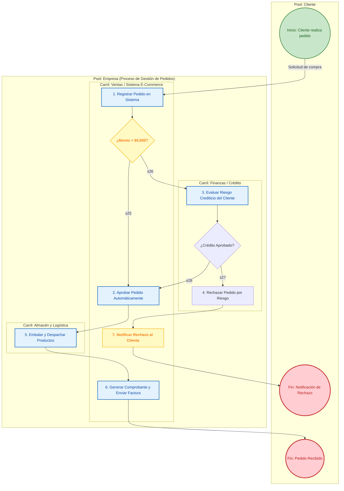

## Procesos de negocio

Un **Diagrama de Procesos de Negocio** (BPD, por sus siglas en inglés) bajo el estándar **BPMN** (*Business Process Modeling and Notation*) es una representación gráfica estandarizada que ilustra la secuencia temporal de actividades, flujos de trabajo, reglas de decisión e interacciones de datos que componen un proceso dentro de una organización. 

Estandarizado internacionalmente por el **Object Management Group (OMG)**, el propósito fundamental de BPMN es proporcionar una notación visual única e inequívoca que sirva como **puente de comunicación común entre los analistas de negocio y los desarrolladores de TI**.


### Elementos Core y Categorías de la Notación BPMN

BPMN organiza sus símbolos en cinco categorías principales para estructurar visualmente cualquier proceso:

#### A. Objetos de Flujo (*Flow Objects*)
Son los elementos gráficos principales que definen el comportamiento y la lógica del proceso:
* **Eventos (*Events* - Círculos):** Representan algo que sucede de forma instantánea durante el proceso. Se dividen en tres tipos según el momento:
  * *Inicio (*Start Event*):* Borde fino; indica dónde se dispara la instancia del proceso.
  * *Intermedio (*Intermediate Event*):* Borde doble; ocurre entre el inicio y el fin para capturar o lanzar eventos (temporizadores, mensajes, errores).
  * *Fin (*End Event*):* Borde grueso; marca la conclusión o resultado del proceso.
* **Actividades (*Activities* - Rectángulos redondeados):** Representan el trabajo o tareas concretas que requieren tiempo y recursos para ejecutarse. Pueden ser **Tareas** (actividades atómicas) o **Subprocesos** (agrupaciones complejas de pasos).
* **Compuertas / Pasarelas (*Gateways* - Rombos):** Mecanismos para controlar las divergencias (*splits*) y convergencias (*joins*) de los caminos del proceso según condiciones o decisiones:
  * *Exclusiva (XOR):* Evalúa condiciones para tomar **solo una** ruta alternativa.
  * *Paralela (AND):* Divide el flujo para ejecutar múltiples ramas simultáneamente o espera a que todas terminen para continuar.
  * *Inclusiva (OR):* Activa una o varias rutas concurrentes dependiendo de qué condiciones se cumplan.

#### B. Organizadores (*Swimlanes*)
Permiten estructurar y asignar responsabilidades dentro del diagrama:
* **Piscina (*Pool*):** Representa a un participante principal, un proceso completo o una entidad organizacional autónoma.

* **Carril (*Lane*):** Subdivisión horizontal o vertical dentro de un *Pool* utilizada para categorizar actividades por roles, departamentos o sistemas específicos.

#### C. Objetos de Conexión (*Connecting Objects*)
Conectan los objetos de flujo para establecer las relaciones operativas:
* **Flujo de Secuencia (*Sequence Flow* - Flecha sólida):** Indica el orden estricto de ejecución de las actividades dentro de un mismo *Pool*.

* **Flujo de Mensajes (*Message Flow* - Flecha punteada con círculo):** Representa el intercambio de comunicación o mensajes entre dos *Pools* o participantes independientes.

* **Asociación (*Association* - Línea punteada simple):** Vincula información, artefactos o datos a los elementos del flujo.

#### D. Datos y Artefactos
Proveen contexto adicional sin alterar directamente la secuencia del flujo:
* **Objetos de Datos (*Data Objects*) y Almacenes (*Data Store*):** Muestran la información requerida, creada o guardada de forma persistente durante la ejecución de las actividades.
* **Anotaciones de Texto y Grupos:** Permiten añadir notas explicativas o agrupar visualmente actividades para mejorar la lectura.


### De la Modelación a la Ejecución (*WYMIWYR*)

Una de las mayores fortalezas de BPMN (especialmente a partir de su versión 2.0) es que no solo sirve para diagramar procesos en papel, sino que posee una semántica ejecutable basada en XML. Bajo el principio de **"Lo que modelas es lo que ejecutas" (*WYMIWYR - What You Model Is What You Run*)**, los diagramas detallados creados por los analistas pueden desplegarse directamente en motores de procesos o **BPMS (*Business Process Management Suites*)** para automatizar el flujo de trabajo en tiempo real.

Aquí tienes el **Diagrama de Procesos de Negocio (BPMN)** en formato Mermaid para el caso práctico de **Aprobación y Procesamiento de Pedidos de Clientes**. 

Este modelo ilustra cómo se estructuran las actividades, decisiones y roles a través de carriles de responsabilidad (*Lanes*).


### Diagrama de Proceso BPMN 
**(Aprobación y Despacho de Pedidos)**




### Elementos BPMN

1. **Eventos (*Events*):**
   * **Inicio (Círculo de borde fino):** El proceso se activa cuando el cliente ingresa una solicitud de compra.
   * **Fin (Círculo de borde grueso):** Concluye el proceso con dos posibles estados finales: *Pedido Recibido de forma exitosa* o *Notificación de Rechazo expedida*.

2. **Carriles (*Lanes*):**
   * **Ventas / Sistema:** Se encarga de la captura inicial, comprobantes finales y notificaciones al usuario.
   * **Finanzas:** Asume únicamente la tarea de evaluar compras de alto valor.
   * **Logística:** Ejecuta la preparación física y embalaje del paquete.

3. **Compuertas Exclusivas (*Gateways XOR* - Rombos):**
   * **Regla de negocio 1 (Monto):** Si el pedido es menor o igual a \$5,000, se aprueba en automático sin intervención humana. Si supera dicho monto, se bifurca hacia Finanzas.
   * **Regla de negocio 2 (Crédito):** Determina si el cliente cuenta con capacidad crediticia. Si es aprobado, se reincorpora al flujo normal de empaque; si es rechazado, pasa a la tarea de cancelación.

### Diagrama BPMN Avanzado 
**Control de SLAs y Manejo de Excepciones**

A continuación se presenta el **Diagrama de Procesos BPMN Avanzado** para la gestión de pedidos, incorporando **Eventos Intermedios de Tiempo (Temporizadores / SLAs)** y **Manejo de Excepciones de Negocio (Falta de Stock y Cancelaciones)**:


```mermaid
flowchart TD
    %% Estilos de Nodos BPMN
    classDef eventStart fill:#c8e6c9,stroke:#2e7d32,stroke-width:2px,color:#1b5e20
    classDef eventEnd fill:#ffcdd2,stroke:#c62828,stroke-width:3px,color:#b71c1c
    classDef task fill:#e3f2fd,stroke:#1565c0,stroke-width:2px,color:#0d47a1
    classDef gateway fill:#fff9c4,stroke:#fbc02d,stroke-width:2px,color:#f57f17,font-weight:bold
    classDef eventInter fill:#ffe0b2,stroke:#e65100,stroke-width:2px,color:#e65100

    subgraph PROCESO["Proceso Avanzado: Gestión de Pedidos con SLAs y Excepciones"]
        A((Inicio: Pedido Recibido)) ::: eventStart --> B[1. Validar Datos del Pedido] ::: task
        B --> C{¿Monto > $5,000?} ::: gateway

        %% Rama de Aprobación Financiera con Temporizador (SLA)
        C -- "Sí (Monto > $5,000)" --> D[2. Revisión Crediticia en Finanzas] ::: task
        
        %% Evento de Tiempo
        D -. "Límite Excedido" .-> T1(("⏱️ Timer: 24 Horas")) ::: eventInter
        T1 --> E[Avisar al Cliente y Cancelar por Timeout] ::: task
        E --> Z1((Fin: Cancelado por Tiempo)) ::: eventEnd

        D --> F{¿Aprobado?} ::: gateway
        F -- "No" --> G[Notificar Rechazo Crediticio] ::: task
        G --> Z2((Fin: Rechazado)) ::: eventEnd

        %% Rama de Preparación en Almacén
        C -- "No (Monto <= $5,000)" --> H
        F -- "Sí" --> H[3. Preparar Pedido en Almacén] ::: task

        %% Evento de Borde / Excepción de Stock
        H -. "Excepción" .-> ERR(("⚠️ Error: Stock Insuficiente")) ::: eventInter
        ERR --> I[Generar Solicitud de Reabastecimiento] ::: task
        I --> J[Notificar Nueva Fecha Estimada al Cliente] ::: task
        J --> Z3((Fin: En Espera de Stock)) ::: eventEnd

        %% Flujo Normal Exitoso
        H --> K[4. Generar Factura y Guía de Despacho] ::: task
        K --> L[5. Entregar Paquete a Transportista] ::: task
        L --> Z4((Fin: Pedido Despachado)) ::: eventEnd
    end
```


### Patrones Avanzados

1. **Eventos Intermedios de Temporizador (*Timer Events*):**
   * **Propósito:** Controlar los Acuerdos de Nivel de Servicio (**SLA**).
   * **Mecanismo:** Si el área de Finanzas no toma una decisión dentro de la ventana de **24 horas**, el temporizador interrumpe la actividad `Revisión Crediticia` y redirige el proceso hacia una ruta de cancelación automática por inactividad, evitando que los pedidos queden "congelados" indefinidamente.

2. **Eventos de Borde de Excepción (*Boundary Error Events*):**
   * **Propósito:** Manejar desviaciones operativas no planificadas (*Rainy-Day Scenarios*).
   * **Mecanismo:** Durante la ejecución de `Preparar Pedido en Almacén`, si el sistema o el operario detectan un descuadre de inventario (*Stock Insuficiente*), se dispara un evento de error que aborta la preparación normal e inicie un flujo alternativo de reabastecimiento y notificación de retraso al cliente.

3. **Gobernanza y Continuidad del Negocio:**
   * La inclusión de estos eventos garantiza que el proceso sea **resiliente**: cada posible punto de falla (tiempo agotado o falta de insumos) tiene un estado final definido (`Fin: Cancelado por Tiempo` o `Fin: En Espera de Stock`), cumpliendo con los estándares de modelado ejecutable en BPMS.

