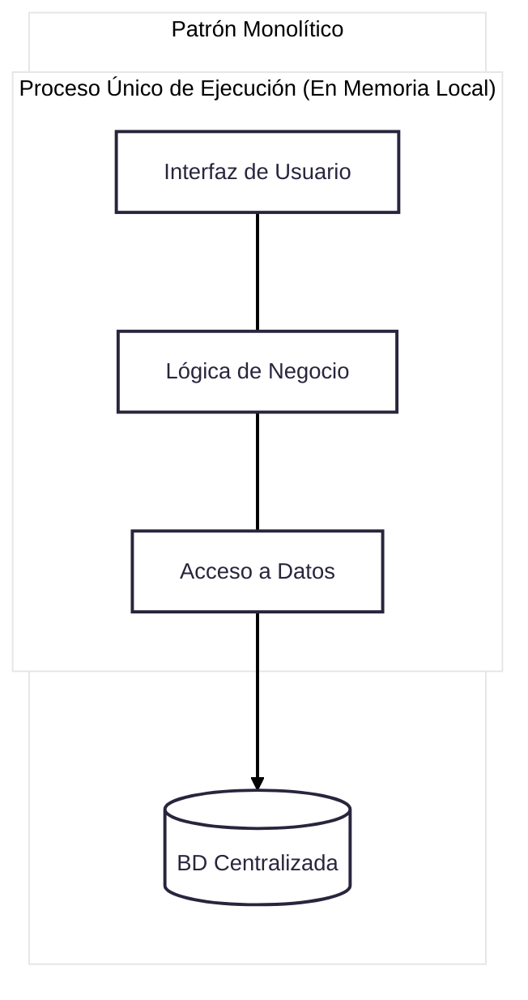
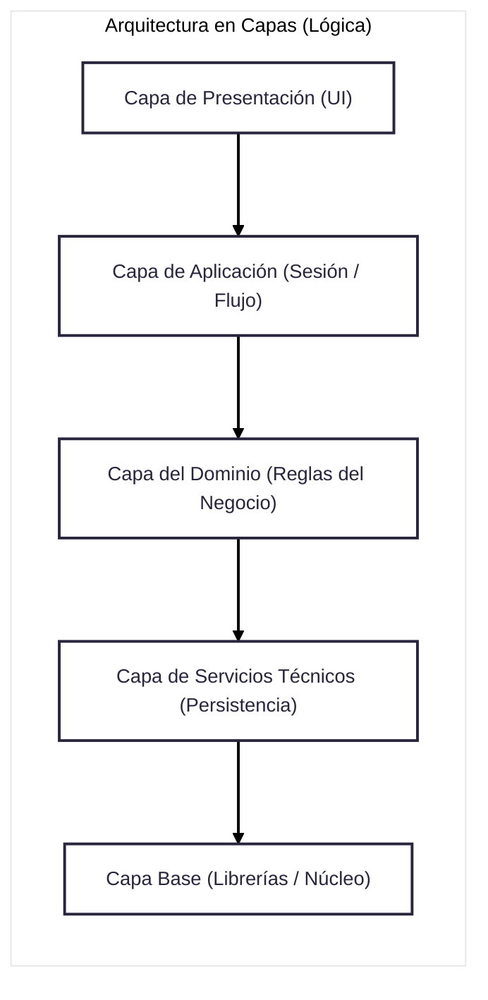
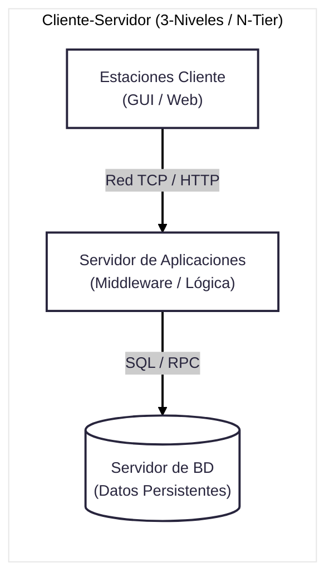
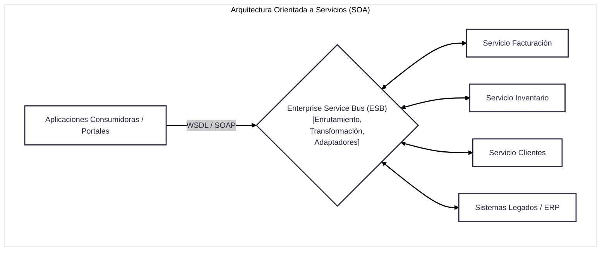
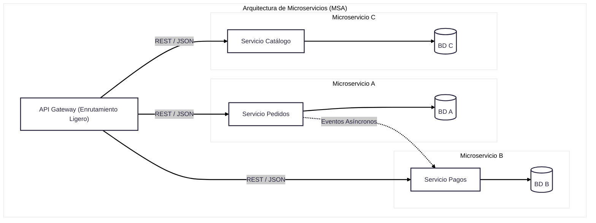
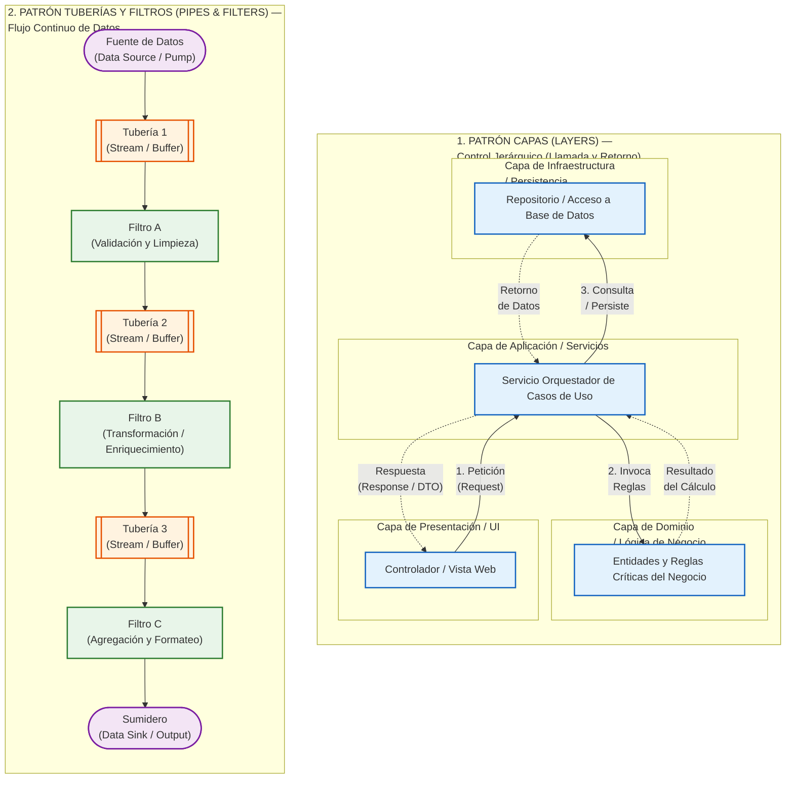

## **Arquitectura**

La **arquitectura de sistemas** es la disciplina y el plano estructural que define la **organización fundamental de un sistema**, sus **componentes**, las **relaciones e interfaces** que existen entre ellos y con su entorno, así como los **principios y directrices** que gobiernan su diseño, construcción y evolución.

En resumen, define cómo se construye un sistema de software, bajo qué conceptos o paradigma y establece la forma de implementarlo.

### Definición formal
De acuerdo con las definiciones estándar (como IEEE 1471 / ISO 42010 citadas en las fuentes), la arquitectura no es solo el código o el hardware aislado, sino el marco formal que organiza las partes constitutivas de una solución tecnológica:
* **Como sustantivo (el artefacto o plano):** Es la representación abstracta y estructurada de los elementos del sistema, sus responsabilidades, mecanismos de interacción y las motivaciones de diseño detrás de esas decisiones.

* **Como verbo (el proceso de diseñar):** Es la actividad técnica e interdisciplinaria que traduce los requisitos operativos y de negocio en especificaciones estructuradas, asegurando que las decisiones a gran escala satisfagan tanto los requisitos funcionales como los atributos de calidad (rendimiento, seguridad, escalabilidad, disponibilidad).

### Dimensiones y componentes
Todo sistema computarizado e informático integra tres partes fundamentales: **hardware** (procesadores, redes, almacenamiento), **software** (aplicaciones, servicios, bibliotecas) y **datos** (estructuras persistentes y en memoria). La arquitectura de sistemas organiza estos elementos a través de:

1. **Partición y Modularidad:** Divide un problema complejo en elementos o subsistemas más pequeños con límites, responsabilidades y alcances claramente delimitados.

2. **Interfaces y Conectores:** Establece los contratos y protocolos formales (como APIs, middleware o protocolos de comunicación) que permiten la interoperabilidad y el intercambio de información entre los componentes.

3. **Estructuras Estáticas y Dinámicas:** 
   * *Estáticas:* El diseño de las partes en reposo (capas lógicas, paquetes, clases, esquemas de bases de datos).
   * *Dinámicas:* El comportamiento y las colaboraciones en tiempo de ejecución ante eventos o estímulos del entorno (flujo de mensajes, transacciones, concurrencia).
   
4. **Separación de Intereses (*Separation of Concerns*):** Principio arquitectónico que aísla distintos aspectos del sistema (por ejemplo, la interfaz de usuario, la lógica de negocio y la persistencia de datos) en capas o módulos independientes para garantizar bajo acoplamiento y alta cohesión.

### Vistas y perspectivas
Dado que ningún diagrama único puede capturar la totalidad de un sistema, la arquitectura se documenta mediante **múltiples vistas complementarias** dirigidas a diferentes partes interesadas (*stakeholders*:
* **Vista Lógica / de Aplicación:** Describe la organización conceptual del software en capas, paquetes, interfaces y subsistemas (por ejemplo, modelos N-capas o Modelo-Vista-Controlador).

* **Vista de Datos e Información:** Modela los esquemas lógicos y físicos de las bases de datos, flujos de datos y repositorios de almacenamiento.

* **Vista Física / de Despliegue:** Muestra la topología de la red, los nodos de hardware, servidores, máquinas virtuales y cómo se asignan los componentes ejecutables a la infraestructura.

* **Vista de Procesos / Ejecución:** Modela los hilos de control, sincronización, concurrencia y orquestación de servicios en tiempo de ejecución.

### Niveles de escala
**Sistema vs. Arquitectura Empresarial (AE)**

La arquitectura de sistemas opera en dos escalas interconectadas:
* **A nivel de solución o software (*System / Software Architecture*):** Se enfoca en una solución tecnológica específica, resolviendo cómo interactúan sus módulos de código, bases de datos e infraestructura para cumplir con sus requisitos técnicos y operacionales.

* **A nivel organizacional (*Enterprise Architecture - AE*):** Adopta una visión holística basada en el pensamiento sistémico para evitar los "silos" tecnológicos. Integra la arquitectura del sistema dentro de **cuatro dominios corporativos**: *Arquitectura de Negocio* (procesos y estrategia), *Arquitectura de Datos/Información*, *Arquitectura de Aplicaciones* y *Arquitectura Tecnológica* (redes e infraestructura).

### Patrones de arquitectura

#### Monolítico

#### Capas

#### Cliente - Servidor

El patrón de arquitectura Cliente-Servidor (Client-Server Architecture) es un modelo de diseño de software y sistemas distribuidos en el que las tareas, el procesamiento y los datos se reparten entre los proveedores de un recurso o servicio, llamados servidores, y los demandantes de dicho servicio, llamados clientes.

#### Orientada a Servicios (SOA)

La Arquitectura Orientada a Servicios (Service-Oriented Architecture - SOA) es un estilo arquitectónico y de integración para sistemas de información distribuidos que organiza y descompone las aplicaciones y procesos de negocio de una organización en un conjunto de servicios reutilizables, autónomos y débilmente acoplados (loosely coupled), los cuales se comunican mediante interfaces y contratos estandarizados e independientes de la plataforma.

#### Microservicios (MSA)

El Patrón de Arquitectura de Microservicios (Micro-Service Architecture - MSA) es un estilo arquitectónico que estructura una aplicación como una constelación de servicios pequeños, autónomos y débilmente acoplados, donde cada servicio se ejecuta en su propio proceso de computación y modela una capacidad de negocio bien delimitada.

---
## **Patrón de arquitectura**

Un **patrón de arquitectura de software** (frecuentemente llamado también *estilo arquitectónico*) es una **solución probada, estructurada y reutilizable a problemas recurrentes de organización y diseño a gran escala** en el desarrollo de sistemas.

A diferencia de los patrones de diseño orientados a objetos (como los patrones GoF o GRASP, que resuelven problemas locales de asignación de responsabilidades entre clases específicas), un patrón de arquitectura aborda la **estructura global del sistema**, gobernando la partición gruesa en subsistemas, la asignación de responsabilidades de alto nivel y las reglas bajo las cuales los componentes se comunican.

### Elementos Constitutivos

Todo patrón o estilo arquitectónico se compone fundamentalmente de cuatro elementos:
1. **Elementos / Componentes:** Unidades de software o subsistemas modulares que ejecutan funciones específicas requeridas por el sistema.
2. **Conectores:** Mecanismos y protocolos que habilitan la comunicación, coordinación y transferencia de flujo de control o datos entre los elementos (llamadas a métodos, mensajería asíncrona, eventos, sockets de red).
3. **Restricciones y Reglas:** Conjunto de lineamientos que definen cómo pueden integrarse y comunicarse los elementos para formar el sistema (por ejemplo, prohibir que capas inferiores dependan de capas superiores).
4. **Atributos de Calidad Asociados:** Beneficios y compromisos (*trade-offs*) respecto a los requisitos no funcionales del sistema (rendimiento, escalabilidad, mantenibilidad, fiabilidad o tolerancia a fallos).

### Jerarquía
**Patrones de Arquitectura vs. Patrones de Diseño vs. Idiomas (POSA)**

Los patrones se organizan en tres niveles de granularidad (clasificación *Pattern-Oriented Software Architecture - POSA*):

* **1. Patrones de Arquitectura (Nivel Macro):** Estructuran el sistema completo en sus componentes principales durante las fases tempranas. Definen la vista lógica general.
  * *Ejemplos:* Capas (*Layers*), Tuberías y Filtros (*Pipes & Filters*), Cliente-Servidor, Arquitectura Orientada a Servicios (SOA), Microservicios, Repositorio (*Data-Centered*).
* **2. Patrones de Diseño / Microarquitectura (Nivel Medio):** Gobiernan la estructura de subsistemas, frameworks y la colaboración local entre clases y objetos.
  * *Ejemplos:* Fachada (*Facade*), Observador (*Observer*), Adaptador, Estrategia (*Strategy*), Método Plantilla (*Template Method*).
* **3. Idiomas / Estilos de Implementación (Nivel Micro):** Soluciones de bajo nivel específicas para un lenguaje de programación concreto o plataforma.
  * *Ejemplos:* El patrón *Singleton* para asegurar una única instancia global en memoria, convenciones de punteros o sincronización de hilos.

### Principales ejemplos

| Familia de Estilo Arquitectónico | Patrón Clave | Características y Reglas Estructurales | Atributos de Calidad Promovidos |
| :--- | :--- | :--- | :--- |
| **Llamada y Retorno (*Call and Return*)** | **Capas (*Layers*)** | Descompone el sistema en niveles lógicos horizontales (Presentación, Aplicación/Dominio, Servicios Técnicos, Base). El acoplamiento es estrictamente unidireccional (de arriba hacia abajo). | Mantenibilidad, separación de intereses, reutilización de servicios técnicos. |
| **Distribución y Red** | **Cliente-Servidor (2-Tier / 3-Tier)** | Separa las terminales consumidoras (*clientes*) de los proveedores de servicios (*servidores*) a través de protocolos de red. | Centralización de datos, control de acceso y balanceo de carga. |
| **Centrado en Servicios e Integración** | **SOA (Arquitectura Orientada a Servicios)** | Descompone los procesos en servicios independientes y reutilizables comunicados por contratos estandarizados mediante un bus de integración (ESB). | Interoperabilidad heterogénea y bajo acoplamiento a escala corporativa. |
| **Descentralización y Consistencia Eventual** | **Saga / Microservicios** | Descompone una transacción global en transacciones locales coordinadas por coreografía u orquestación con compensaciones semánticas. | Alta disponibilidad, escalabilidad horizontal independiente y tolerancia a fallos. |
| **Flujo de Datos (*Dataflow*)** | **Tuberías y Filtros (*Pipes and Filters*)** | El flujo de entrada atraviesa una serie secuencial de componentes transformadores independientes conectados por canales continuos. | Flexibilidad para reorganizar transformaciones, paralelismo y procesamiento por etapas. |
| **Centrado en Datos (*Data-Centered*)** | **Repositorio / Pizarra (*Blackboard*)** | Existe un almacén de datos central pasivo rodeado por múltiples componentes independientes que operan y transforman su estado. | Integridad de estado global e independencia entre clientes consumidores. |

### ¿Por qué se Utilizan?

1. **Gestión de la Complejidad (*Divide y Vencerás*):** Permiten descomponer sistemas de gran escala en partes conceptuales comprensibles con límites bien definidos.
2. **Cumplimiento de Requisitos No Funcionales (Atributos de Calidad):** Cada patrón promueve ciertas cualidades sistémicas (como resiliencia o rendimiento) sacrificando otras (como latencia o costo).
3. **Vocabulario Técnico Compartido:** Proporcionan un lenguaje unificado para que arquitectos y desarrolladores comuniquen decisiones de gran envergadura de forma concisa y sin ambigüedades.
4. **Prevención de la Degradación del Sistema (*Software Rot*):** Guían la evolución del software mediante principios de alta cohesión, bajo acoplamiento y variaciones protegidas, evitando que los cambios se propaguen en cascada.

## **Patrón de capas y tuberías**

Diagrama comparativo que contrasta la topología y el comportamiento del flujo entre el patrón de Capas (Layers) y el patrón de Tuberías y Filtros (Pipes & Filters), seguido de un análisis de sus diferencias estructurales.

### Contraste técnico

| Criterio Estructural | Patrón Capas (*Layers*) | Patrón Tuberías y Filtros (*Pipes & Filters*) |
| :--- | :--- | :--- |
| **Estilo y Paradigma** | **Llamada y Retorno (*Call and Return*):** Orientado a la invocación de interfaces y ejecución síncrona o asíncrona de operaciones. | **Flujo de Datos (*Dataflow / Streaming*):** Orientado al paso unidireccional de secuencias de bytes, registros o mensajes. |
| **Dirección del Flujo** | **Bidireccional (Petición y Respuesta):** La llamada desciende por los niveles jerárquicos y la respuesta retorna por el mismo canal conceptual. | **Unidireccional (Flujo hacia adelante):** Los datos entran por la fuente (*pump*), avanzan a través de los filtros y terminan en el destino (*sink*) sin retroceder. |
| **Acoplamiento entre Elementos** | **Dependencia de Interfaz/Contrato:** Cada capa conoce la interfaz del nivel inferior inmediato (o depende de abstracciones mediante DIP). | **Aislamiento Total entre Filtros:** Un filtro desconoce por completo quién procesó el dato antes o quién lo recibirá después; solo lee de su tubería de entrada y escribe en la de salida. |
| **Manejo del Estado** | Habitualmente **con estado contextual** a lo largo de la transacción o sesión de la petición. | Mayoritariamente **sin estado (*stateless*)** dentro de cada filtro, operando sobre cada elemento del flujo de manera aislada. |
| **Concurrencia y Paralelismo** | Concurrencia por petición (múltiples hilos gestionan transacciones independientes cruzando todas las capas). | **Paralelismo por etapas (*Pipelining*):** Todos los filtros pueden ejecutarse de manera concurrente en núcleos o nodos distintos procesando fragmentos sucesivos del flujo. |
| **Reconfiguración / Flexibilidad** | Reorganizar o alterar el orden de las capas exige refactorizar interfaces y la arquitectura lógica. | **Alta reconfigurabilidad:** Los filtros se pueden reorganizar, añadir, retirar o intercambiar como bloques modulares sin tocar el código interno de los demás. |
| **Casos de Uso Típicos** | Aplicaciones empresariales, sistemas CRUD, software de gestión transaccional (ERP, banca, portales web). | Compiladores (análisis léxico $\rightarrow$ sintáctico $\rightarrow$ semántico $\rightarrow$ código máquina), procesamiento de imágenes/video, pipelines ETL de datos masivos. |

---
## **Arquitectura vs. Diseño**

Aunque ambos conceptos proporcionan soluciones reutilizables a problemas recurrentes en la ingeniería de software, la diferencia fundamental radica en su **nivel de escala, granularidad y alcance estructural** dentro del sistema.

En la literatura de ingeniería de software y la clasificación canónica de POSA (*Pattern-Oriented Software Architecture*), los patrones se organizan en tres niveles jerárquicos: **patrones de arquitectura** (a gran escala), **patrones de diseño o microarquitectura** (a escala media/pequeña) y **estilos o idiomas de implementación** (a bajo nivel de código).

### Cuadro Comparativo de Diferencias Clave

| Criterio | Patrón de Arquitectura (*Estilo Arquitectónico*) | Patrón de Diseño (*Microarquitectura / GoF / GRASP*) |
| :--- | :--- | :--- |
| **Nivel de Escala y Granularidad** | **Macro / Grano grueso (*Coarse-grained*):** Define la partición global del sistema en subsistemas, capas, procesos y componentes principales. | **Micro o Medio / Grano fino:** Modela la colaboración interna, interfaces, jerarquías de herencia y distribución de responsabilidades entre clases y objetos. |
| **Foco y Preocupación Principal** | **Atributos de calidad sistémicos:** Resuelve requisitos no funcionales críticos como escalabilidad, disponibilidad, rendimiento global, seguridad y tolerancia a fallos. | **Flexibilidad y asignación de responsabilidades:** Resuelve problemas de acoplamiento, cohesión, creación de objetos y algoritmos intercambiables. |
| **Límites de Visibilidad** | Se enfoca en las **propiedades externas** de los elementos, sus límites lógicos y los mecanismos de conexión/flujo de control entre subsistemas. | Se enfoca en la **estructura interna** de los componentes, sus algoritmos, métodos y estructuras de datos. |
| **Momento de Adopción** | Se selecciona en las **primeras iteraciones** (fase de elaboración) para establecer y estabilizar la arquitectura ejecutable base. | Se introduce de forma continua e incremental durante el **diseño detallado y la programación** de cada caso de uso. |
| **Costo de Reversibilidad (Impacto del Cambio)** | **Extremadamente alto:** Cambiarlo suele requerir reestructurar todo el sistema, rehacer la base técnica o descartar la solución (*trade-off* estructural masivo). | **Localizado y moderado:** Afecta a un módulo o subsistema específico; puede refactorizarse sin alterar la topología global del software. |
| **Ejemplos Típicos** | Capas (*Layers*), Tuberías y Filtros (*Pipes & Filters*), Cliente-Servidor, Microservicios, Saga, Arquitectura Orientada a Servicios (SOA). | Fachada (*Facade*), Estrategia (*Strategy*), Adaptador, Observador, Método Plantilla, Factoría, Singleton. |

### Diferencias principales

#### A. Alcance y Partición del Sistema
* **Patrón de Arquitectura:** Aborda la pregunta: *¿Cuáles son los bloques de construcción principales del sistema completo y cómo se comunican?*. Por ejemplo, el patrón **Capas (*Layers*)** divide conceptualmente todo el software en Presentación, Lógica del Dominio y Servicios Técnicos, imponiendo la regla de que las dependencias fluyen estrictamente desde los niveles superiores hacia los inferiores.

* **Patrón de Diseño:** Aborda la pregunta: *¿Cómo colaboran clases concretas para realizar una tarea particular dentro de un subsistema?*. Por ejemplo, dentro de la capa del dominio, se aplica el patrón **Estrategia (*Strategy*)** para intercambiar diferentes algoritmos de cálculo de descuentos sin acoplar la clase `Venta` a una regla rígida.

#### B. Atributos de Calidad vs. Mantenibilidad de Código
* Los patrones de arquitectura se eligen para dar respuesta a los **factores arquitectónicos y escenarios de calidad** (como soportar 2.000 transacciones concurrentes o mantener la operación ante la caída de un servidor central).

* Los patrones de diseño buscan garantizar la **alta cohesión**, el **bajo acoplamiento** y la **separación de intereses** a nivel de código, evitando duplicación de lógica y facilitando la extensibilidad.

#### C. Relación de Sinergia (Cómo se articulan)
Ambos conceptos no compiten, sino que se integran jerárquicamente: **los patrones de diseño sirven como herramientas tácticas para conectar e implementar las grandes estructuras definidas por los patrones de arquitectura**.

> **Ejemplo de integración:**  
> Si se adopta el patrón de arquitectura en **Capas**, se recurre a patrones de diseño GoF y GRASP para resolver sus fronteras:
> * Se utiliza una **Fachada (*Facade*)** para exponer una interfaz unificada y simplificada del subsistema de persistencia o de reglas hacia las capas superiores.
> * Se utiliza un **Controlador (*Controller*)** para gestionar los eventos del sistema procedentes de la capa de interfaz sin mezclar la lógica de negocio con las ventanas.
> * Se utiliza un **Observador (*Observer*)** para permitir que el dominio notifique cambios a la interfaz de usuario de forma indirecta, preservando el principio de separación Modelo-Vista.

