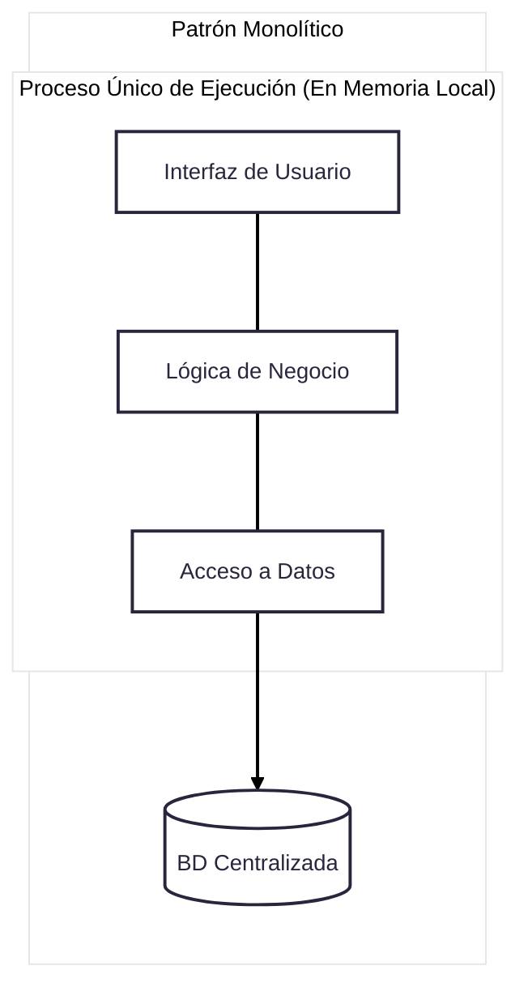
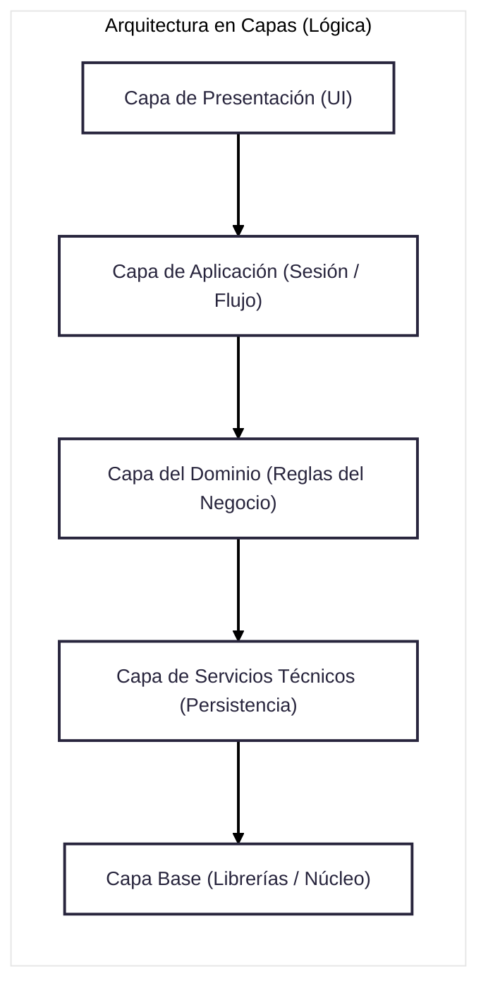
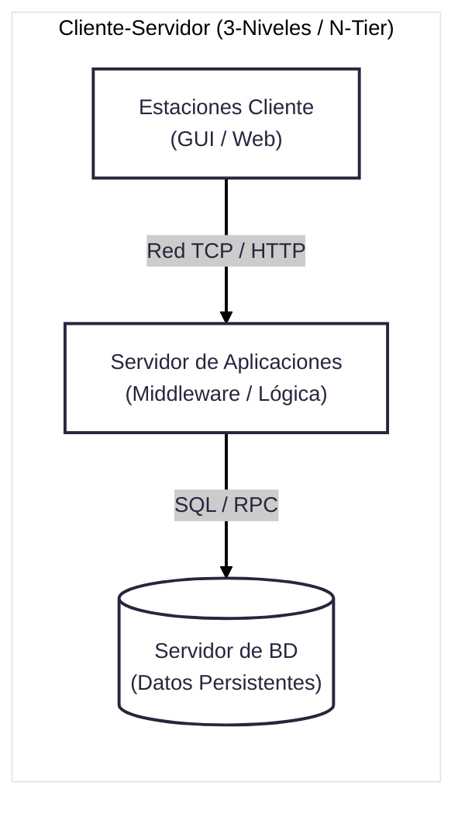
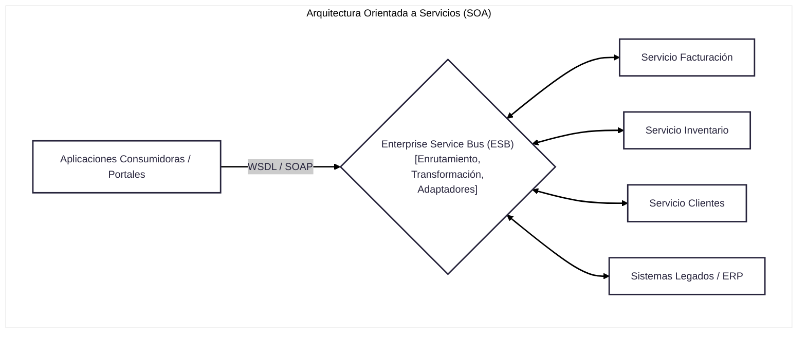
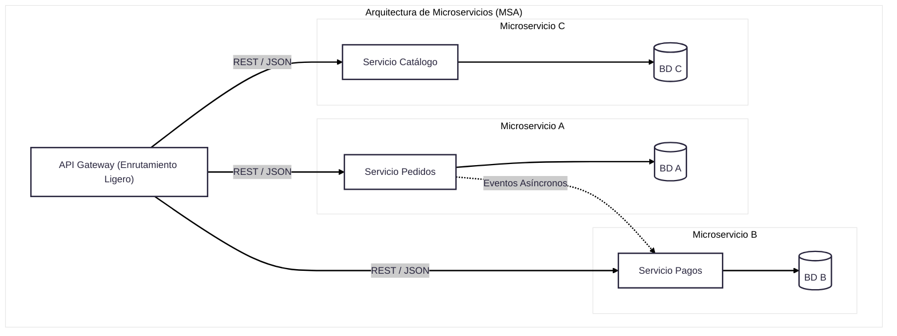

## **Arquitectura**

La **arquitectura de sistemas** es la disciplina y el plano estructural que define la **organización fundamental de un sistema**, sus **componentes**, las **relaciones e interfaces** que existen entre ellos y con su entorno, así como los **principios y directrices** que gobiernan su diseño, construcción y evolución.

### Definición Formal
De acuerdo con las definiciones estándar (como IEEE 1471 / ISO 42010 citadas en las fuentes), la arquitectura no es solo el código o el hardware aislado, sino el marco formal que organiza las partes constitutivas de una solución tecnológica:
* **Como sustantivo (el artefacto o plano):** Es la representación abstracta y estructurada de los elementos del sistema, sus responsabilidades, mecanismos de interacción y las motivaciones de diseño detrás de esas decisiones.

* **Como verbo (el proceso de diseñar):** Es la actividad técnica e interdisciplinaria que traduce los requisitos operativos y de negocio en especificaciones estructuradas, asegurando que las decisiones a gran escala satisfagan tanto los requisitos funcionales como los atributos de calidad (rendimiento, seguridad, escalabilidad, disponibilidad).

### Dimensiones y Componentes Clave
Todo sistema computarizado e informático integra tres partes fundamentales: **hardware** (procesadores, redes, almacenamiento), **software** (aplicaciones, servicios, bibliotecas) y **datos** (estructuras persistentes y en memoria). La arquitectura de sistemas organiza estos elementos a través de:

1. **Partición y Modularidad:** Divide un problema complejo en elementos o subsistemas más pequeños con límites, responsabilidades y alcances claramente delimitados.

2. **Interfaces y Conectores:** Establece los contratos y protocolos formales (como APIs, middleware o protocolos de comunicación) que permiten la interoperabilidad y el intercambio de información entre los componentes.

3. **Estructuras Estáticas y Dinámicas:** 
   * *Estáticas:* El diseño de las partes en reposo (capas lógicas, paquetes, clases, esquemas de bases de datos).
   * *Dinámicas:* El comportamiento y las colaboraciones en tiempo de ejecución ante eventos o estímulos del entorno (flujo de mensajes, transacciones, concurrencia).
   
4. **Separación de Intereses (*Separation of Concerns*):** Principio arquitectónico que aísla distintos aspectos del sistema (por ejemplo, la interfaz de usuario, la lógica de negocio y la persistencia de datos) en capas o módulos independientes para garantizar bajo acoplamiento y alta cohesión.

### Vistas y Perspectivas
Dado que ningún diagrama único puede capturar la totalidad de un sistema, la arquitectura se documenta mediante **múltiples vistas complementarias** dirigidas a diferentes partes interesadas (*stakeholders*:
* **Vista Lógica / de Aplicación:** Describe la organización conceptual del software en capas, paquetes, interfaces y subsistemas (por ejemplo, modelos N-capas o Modelo-Vista-Controlador).

* **Vista de Datos e Información:** Modela los esquemas lógicos y físicos de las bases de datos, flujos de datos y repositorios de almacenamiento.

* **Vista Física / de Despliegue:** Muestra la topología de la red, los nodos de hardware, servidores, máquinas virtuales y cómo se asignan los componentes ejecutables a la infraestructura.

* **Vista de Procesos / Ejecución:** Modela los hilos de control, sincronización, concurrencia y orquestación de servicios en tiempo de ejecución.

### Niveles de Escala
**Sistema vs. Arquitectura Empresarial (AE)**

La arquitectura de sistemas opera en dos escalas interconectadas:
* **A nivel de solución o software (*System / Software Architecture*):** Se enfoca en una solución tecnológica específica, resolviendo cómo interactúan sus módulos de código, bases de datos e infraestructura para cumplir con sus requisitos técnicos y operacionales.

* **A nivel organizacional (*Enterprise Architecture - AE*):** Adopta una visión holística basada en el pensamiento sistémico para evitar los "silos" tecnológicos. Integra la arquitectura del sistema dentro de **cuatro dominios corporativos**: *Arquitectura de Negocio* (procesos y estrategia), *Arquitectura de Datos/Información*, *Arquitectura de Aplicaciones* y *Arquitectura Tecnológica* (redes e infraestructura).

### Patrones de Arquitectura

#### Monolítico

#### Capas

#### Cliente - Servidor

#### SOA

#### Microservicios (MSA)

---

