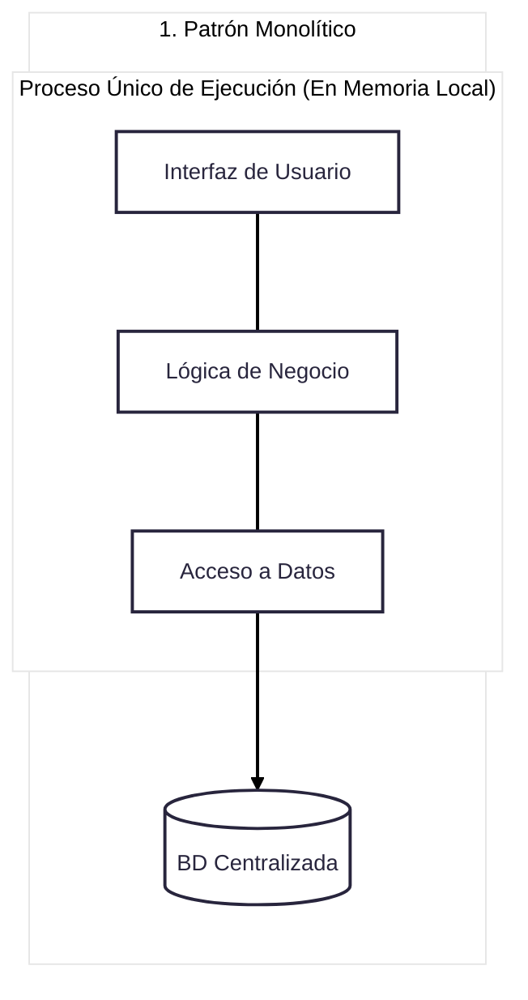

Una **arquitectura monolítica** es un estilo arquitectónico tradicional en el que todas las funcionalidades, componentes y capas de una aplicación de software se diseñan, desarrollan, compilan y despliegan como una **única unidad indivisible y fuertemente acoplada**. 

En la evolución de las arquitecturas empresariales, el modelo monolítico corresponde a la era clásica de la computación centralizada (como el cómputo en *mainframes* o aplicaciones de proceso único en un solo host). En este enfoque, la **interfaz de usuario, la lógica de negocio y el acceso a datos operan conjuntamente dentro de un mismo espacio de ejecución y base de código**.

---

### 1. Características Principales

* **Despliegue unificado (*Single Deployable Unit*):** Todo el sistema se empaqueta y distribuye en un único archivo o ejecutable (por ejemplo, un archivo `.war`, `.ear` o binario único). Cualquier modificación, por pequeña que sea, exige volver a compilar, probar y desplegar la aplicación completa.
* **Acoplamiento estrecho (*Tight Coupling*):** Los distintos módulos internos invocan directamente funciones, métodos o llamadas en memoria sin pasar por protocolos de red ligeros ni contratos independientes.
* **Base de datos compartida y centralizada:** Todos los módulos del sistema acceden habitualmente al mismo esquema y motor de base de datos relacional para coordinar transacciones.
* **Escalabilidad en bloque:** El escalado no puede realizarse de forma granular sobre una función demandada; para escalar el sistema se debe clonar la instancia completa del monolito en múltiples servidores o procesos detrás de un balanceador de carga.

---

### 2. Ventajas de la Arquitectura Monolítica

A pesar de sus limitaciones en sistemas a gran escala, el diseño monolítico ofrece beneficios concretos:

1. **Rendimiento en llamadas internas y baja latencia:** Al estar todos los componentes dentro del mismo proceso, la comunicación ocurre mediante llamadas a métodos locales en memoria. Esto evita la latencia de red, la serialización de datos (XML/JSON) y la sobrecarga que introducen las arquitecturas modulares o distribuidas.
2. **Simplicidad inicial de desarrollo y pruebas:** En las fases iniciales o en proyectos pequeños, es más fácil de construir, ejecutar y depurar localmente en un solo entorno de desarrollo, sin lidiar con problemas de consistencia eventual, descubrimiento de servicios ni fallos de red distribuida.
3. **Transacciones ACID locales:** Garantizar la consistencia transaccional es directo, ya que se apoya en los mecanismos de bloqueo y confirmación (`commit`/`rollback`) locales de una única base de datos relacional.
4. **Despliegue y monitoreo sencillos al inicio:** Solo se gestiona una canalización de compilación (*build pipeline*), un artefacto ejecutable y un punto de monitoreo operativo.

---

### 3. Desventajas y Desafíos a Gran Escala

A medida que el sistema y la organización crecen, surgen problemas arquitectónicos significativos:

* **Efectos colaterales e impacto en cascada (*Software Rot*):** Debido al fuerte acoplamiento, una modificación o corrección en un sector del código puede provocar efectos imprevistos e inestabilidad en módulos distantes.
* **Inflexibilidad tecnológica:** Toda la solución está atada al mismo lenguaje de programación, framework y plataforma de ejecución; modernizar o cambiar una tecnología obliga a reescribir la aplicación por completo.
* **Ciclos de entrega lentos:** Las pruebas de regresión se vuelven extensas y lentas, ya que cualquier cambio funcional obliga a validar y certificar la totalidad del sistema antes de cada entrega.
* **Punto único de fallo (*Single Point of Failure*):** Si un componente experimenta una fuga de memoria (*memory leak*), un bloqueo de hilos o una excepción no controlada, puede derribar el proceso completo y dejar inoperable toda la aplicación.
* **Dificultad de escalamiento eficiente:** Si solo una funcionalidad específica experimenta alta demanda (por ejemplo, la generación de reportes o el catálogo), se debe replicar el monolito entero, consumiendo recursos de cómputo y memoria de forma ineficiente.

---

### 4. Cuadro Comparativo: Monolito vs. Microservicios

| Criterio | Arquitectura Monolítica | Arquitectura de Microservicios (MSA) |
| :--- | :--- | :--- |
| **Estructura** | Un único proceso ejecutable que contiene todas las funciones. | Múltiples servicios pequeños y autónomos, cada uno en su propio proceso. |
| **Comunicación** | Llamadas a métodos en memoria (rápidas, bajo el mismo proceso). | Protocolos de red ligeros (HTTP/REST, gRPC, mensajería asíncrona). |
| **Manejo de Datos** | Base de datos centralizada compartida por todos los módulos. | Descentralizado; base de datos privada e independiente por servicio (*Database-per-Service*). |
| **Despliegue** | Unificado; se compila y despliega el sistema completo. | Independiente; cada microservicio se despliega sin alterar a los demás. |
| **Escalabilidad** | Horizontal en bloque (replicar todo el sistema). | Selectiva y elástica según la demanda de cada servicio individual. |
| **Transacciones** | ACID estrictas y locales en una sola base de datos. | Consistencia eventual coordinada mediante patrones como **SAGA** (coreografía u orquestación). |

