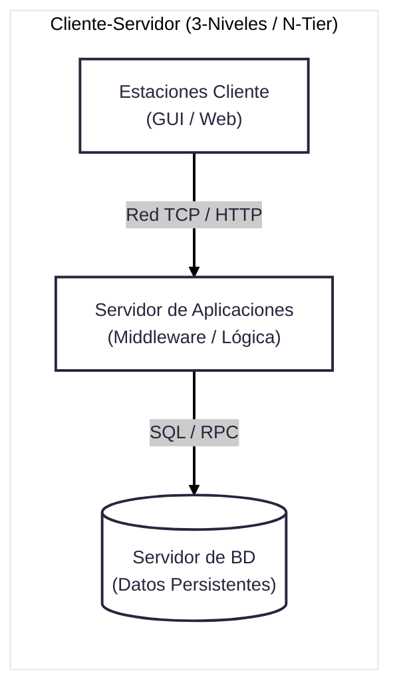
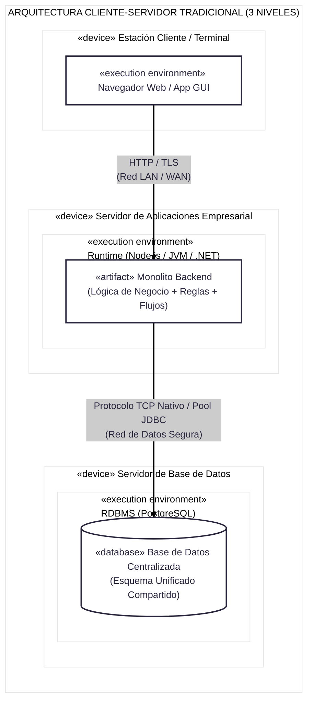
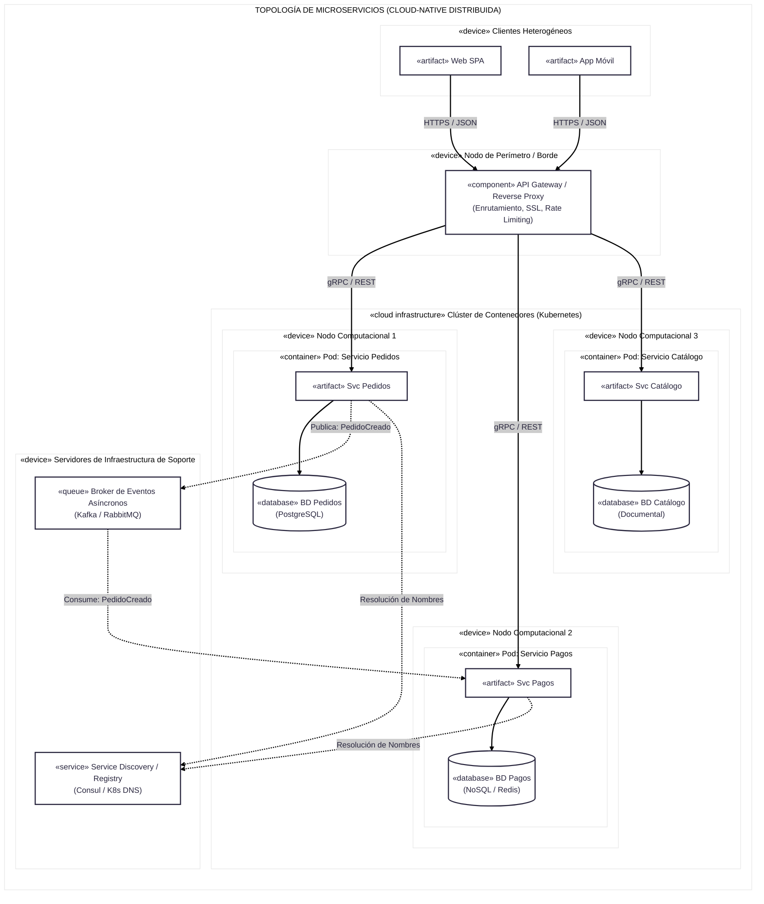

## **Cliente-Servidor**


El **patrón de arquitectura Cliente-Servidor (*Client-Server Architecture*)** es un modelo de diseño de software y sistemas distribuidos en el que las tareas, el procesamiento y los datos se reparten entre los proveedores de un recurso o servicio, llamados **servidores**, y los demandantes de dicho servicio, llamados **clientes**.

A diferencia de las arquitecturas monolíticas —donde la interfaz, la lógica de negocio y el almacenamiento se ejecutan en un único proceso o máquina local—, el modelo cliente-servidor distribuye estas responsabilidades a través de una red de comunicaciones mediante protocolos estandarizados (como TCP/IP, HTTP/S, RPC o SQL).



### Principio fundamental

El funcionamiento básico sigue el paradigma de **Petición-Respuesta (*Request-Response*)**:

1. **Cliente (Iniciador activo):** Dispositivo o proceso que interactúa directamente con el usuario final o con un sistema consumidor. Formula y envía una solicitud a través de la red hacia una dirección o puerto conocido del servidor.
2. **Red de Comunicación / Middleware:** Transporta el mensaje de manera confiable (usualmente sockets TCP/IP, middleware de paso de mensajes o protocolos de capa de aplicación).
3. **Servidor (Receptor pasivo / reactivo):** Proceso o computador central que escucha permanentemente en un puerto de red. Al recibir la solicitud, valida la identidad y permisos, ejecuta la lógica o consulta correspondiente, y retorna un mensaje de respuesta con los datos solicitados o el estado de la operación.

```
┌───────────────────┐                     ┌───────────────────┐
│     CLIENTE       │  ── Petición (Req) ─►│     SERVIDOR      │
│  (Inicia el flujo │◄── Respuesta (Res) ─ │ (Procesa y provee │
│  y presenta datos)│                     │  recursos/datos)  │
└───────────────────┘                     └───────────────────┘
```

---

### Tipos de Clientes
**Delgado vs. Grueso**

Según la cantidad de lógica y procesamiento que resida en el dispositivo cliente, se clasifica en:

* **Cliente Delgado (*Thin Client*):**
  * *Características:* El cliente solo se encarga de pintar la interfaz gráfica y capturar eventos de entrada del usuario (teclado/ratón/toque). Toda la lógica de negocio, las validaciones complejas y la persistencia se ejecutan en el servidor.
  * *Ejemplo típico:* Aplicaciones web renderizadas en el servidor (SSR) ejecutándose en un navegador web ligero o terminales virtuales.
  * *Ventajas:* Mantenimiento y despliegue centralizados; bajos requerimientos de hardware en las terminales del usuario.

* **Cliente Grueso / Pesado (*Thick / Fat Client*):**
  * *Características:* El cliente aloja no solo la interfaz de usuario, sino también una parte sustancial de la lógica de negocio, cálculos locales y validaciones de datos antes de enviar la información al servidor (que usualmente actúa como motor de base de datos o almacenamiento).
  * *Ejemplo típico:* Aplicaciones de escritorio tradicionales (escritas en C++, Java Swing o .NET) o aplicaciones móviles avanzadas con bases de datos embebidas locales (SQLite) que sincronizan periódicamente.
  * *Ventajas:* Menor carga de procesamiento en el servidor central; posibilidad de trabajar con funciones *offline* o menor consumo de ancho de banda constante.


### Evolución topológica
**De 2 Niveles a N-Niveles (*Tiers*)**

En la arquitectura de sistemas es crucial distinguir entre **capas (*layers*)**, que son separaciones lógicas en el código, y **niveles (*tiers*)**, que son distribuciones físicas en máquinas o procesos separados por red:

#### A. Arquitectura de 2 Niveles (*2-Tier / Cliente-Servidor Clásico*)
* **Topología:** Cliente físico conectado directamente por red local (LAN) al servidor de base de datos.
* **Distribución:**
  * *Nivel 1 (Cliente):* Interfaz de usuario + Lógica de negocio (Cliente Grueso).
  * *Nivel 2 (Servidor):* Gestor de Base de Datos Relacional (RDBMS), que almacena los datos y ejecuta restricciones de integridad o procedimientos almacenados (*stored procedures*).
* **Limitaciones:** Alto acoplamiento con la estructura de la base de datos; problemas graves de seguridad al exponer credenciales directas de BD al cliente; saturación de conexiones concurrentes en el motor de base de datos.

#### B. Arquitectura de 3 Niveles (*3-Tier / Estándar Empresarial*)
Para mitigar las deficiencias de los 2 niveles, se introduce un intermediario físico dedicado a la lógica de negocio:
1. **Nivel de Presentación (*Presentation Tier*):** Estación cliente (navegador web o app móvil) que muestra la interfaz y captura peticiones.
2. **Nivel de Aplicación / Lógica de Negocio (*Application / Logic Tier*):** Servidor de aplicaciones (ej. servidores web, frameworks backend como Spring, Django o Node.js) que valida reglas de negocio, procesa cálculos y orquesta el flujo de trabajo.
3. **Nivel de Datos (*Data Tier*):** Servidor de base de datos dedicado (PostgreSQL, Oracle, MongoDB) que solo atiende peticiones seguras provenientes del servidor de aplicaciones.

```
[ Cliente (GUI / Web) ] 
         │ (HTTP / JSON)
         ▼
[ Servidor de Aplicaciones ] <── Lógica de negocio, seguridad, sesión
         │ (Conexión TCP / Pool SQL)
         ▼
[ Servidor de Base de Datos ] <── Tablas, persistencia, transacciones
```

#### C. Arquitectura Multi-Nivel (*N-Tier*)
La lógica se subdivide aún más en niveles especializados: servidores web de borde (*Edge / Reverse Proxy*), balanceadores de carga, servidores de caché en memoria (Redis), servidores de autenticación centralizada (OAuth / LDAP) y clústeres de almacenamiento distribuido.

---

### 4. Ventajas del Patrón Cliente-Servidor

1. **Centralización de Datos y Recursos:** Las políticas de respaldo (*backup*), seguridad, integridad referencial y auditoría se gestionan en servidores protegidos y controlados, evitando la dispersión de datos sensibles.
2. **Modularidad e Independencia Tecnológica:** El cliente y el servidor pueden construirse con lenguajes y plataformas distintas (por ejemplo, una aplicación cliente en Flutter/Dart en Android interactuando con un servidor en Java/Spring en Linux).
3. **Mantenibilidad Mejorada (Especialmente en 3-Tier):** Los cambios en las reglas de negocio o fórmulas financieras se modifican en el servidor de aplicaciones sin necesidad de reinstalar ni actualizar el software en cada uno de los clientes.
4. **Escalabilidad Horizontal y Concurrencia:** Permite incorporar balanceadores de carga para repartir miles de clientes simultáneos entre granjas de servidores de aplicaciones.

---

### 5. Desafíos y Desventajas

* **Punto Único de Fallo (*Single Point of Failure*):** Si el servidor central colapsa o pierde conectividad de red, todos los clientes quedan inoperativos a menos que se implemente redundancia y alta disponibilidad (*clustering* / failover).
* **Latencia y Dependencia de la Red:** A diferencia de las llamadas a funciones en memoria de un monolito, cada interacción viaja por la red física, introduciendo retrasos, serialización de datos y posibles caídas temporales de paquetes.
* **Congestión y Cuellos de Botella:** Un incremento masivo e imprevisto de peticiones puede saturar la CPU, la memoria o el número máximo de conexiones TCP del servidor.
* **Costo Operativo de Infraestructura:** Requiere hardware servidor dedicado, configuración de cortafuegos (*firewalls*), políticas de certificados SSL/TLS y personal especializado para la administración de sistemas y redes.

---

### 6. Relación con SOA y Microservicios

El patrón Cliente-Servidor es el **ancestro fundacional** de las arquitecturas distribuidas modernas:
* Mientras que el modelo cliente-servidor clásico solía estructurarse en torno a un cliente centralizado consumiendo un backend unificado, **SOA (Arquitectura Orientada a Servicios)** y los **Microservicios (MSA)** generalizan este principio: dentro del propio backend, cada microservicio actúa simultáneamente como *servidor* para las peticiones que recibe y como *cliente* cuando consume servicios de inventario, pagos o autenticación de otros componentes del ecosistema.


## **Cliente-servidor vs Microservicios**

El **diagrama de despliegue UML** que contrasta formalmente la distribución física de hardware y componentes entre una **arquitectura cliente-servidor clásica de tres niveles (*3-Tier*)** y una **topología distribuida de microservicios (*MSA*)**.

---

### Diagrama comparativo

#### Cliente - Servidor

#### Microservicios


---

### Matriz de comparación

| Criterio de Despliegue | Cliente-Servidor (3-Tier) | Topología de Microservicios (MSA) |
| :--- | :--- | :--- |
| **Límites de Despliegue (*Deployment Units*)** | Una única aplicación monolítica empaquetada (ej. `.war`, `.ear` o binario único) desplegada en el servidor de aplicaciones. | Múltiples contenedores independientes e imágenes aisladas desplegadas en un orquestador (como Kubernetes). |
| **Topología de Datos** | **Centralizada:** Un servidor RDBMS dedicado con un esquema único donde confluyen todas las tablas del negocio. | **Descentralizada (*Database-per-Service*):** Cada contenedor administra su propio almacén de datos (relacional o NoSQL); se prohíbe el acceso directo cruzado. |
| **Escalabilidad Física** | **Vertical (*Scale-Up*):** Agregar CPU y RAM al servidor central, o replicar el monolito completo tras un balanceador de carga, duplicando módulos no saturados. | **Horizontal Granular (*Scale-Out*):** Escalar únicamente los contenedores bajo alta demanda (por ejemplo, escalar a 20 réplicas el Pod de Pagos sin alterar el Catálogo). |
| **Comunicaciones Internas** | Llamadas locales a métodos en memoria (`in-process memory bus`) entre módulos de presentación, negocio y acceso a datos. | Peticiones remotas sobre la red física (`out-of-process`), empleando protocolos livianos (REST, gRPC) o eventos asíncronos mediante brokers. |
| **Impacto de Fallas Físicas** | **Punto único de falla:** Una fuga de memoria o un bloqueo de tablas en el servidor central impacta a todos los clientes. | **Aislamiento de fallas:** Si el contenedor de Catálogo se satura o cae, el servicio de Pedidos sigue operando o se activa un patrón de degradación suave. |

---

### Infraestructura para la Transición

1. **Gestión del Tráfico Externo (API Gateway):**
   * En el modelo 3-Tier tradicional, el cliente se acopla directamente a los endpoints del servidor de aplicaciones.
   * En microservicios, el **API Gateway** desacopla a los clientes externos de la topología interna, ocultando las direcciones dinámicas de los contenedores y centralizando la autenticación y el cifrado TLS.

2. **Coordinación y Persistencia Políglota:**
   * La arquitectura Cliente-Servidor garantiza consistencia **ACID** inmediata gracias al motor de base de datos único.
   * En microservicios, al tener bases de datos físicas independientes, las operaciones que cruzan límites de servicio recurren a la **consistencia eventual** y a patrones como **Saga**, apoyándose en un broker de mensajería para desacoplar temporalmente los nodos.