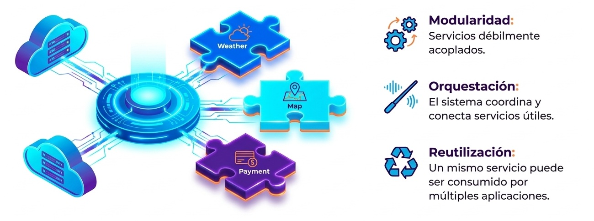
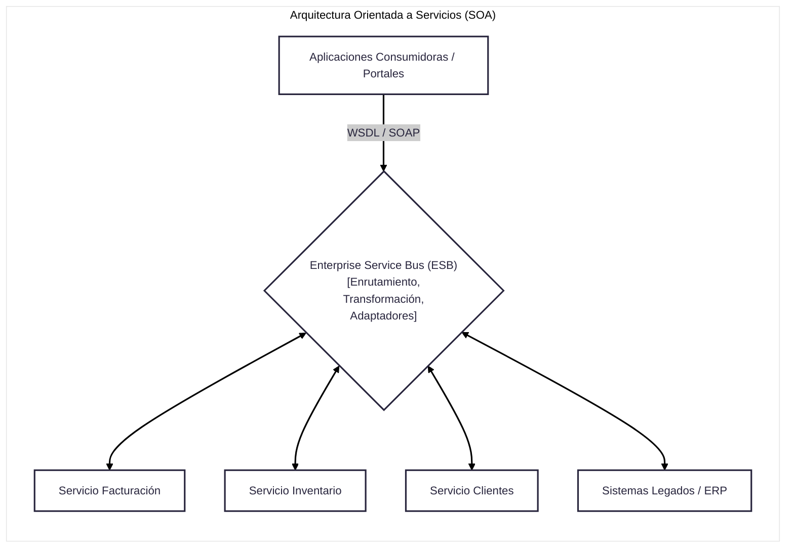
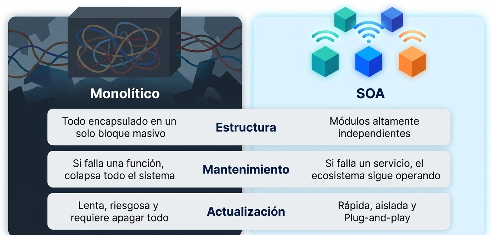
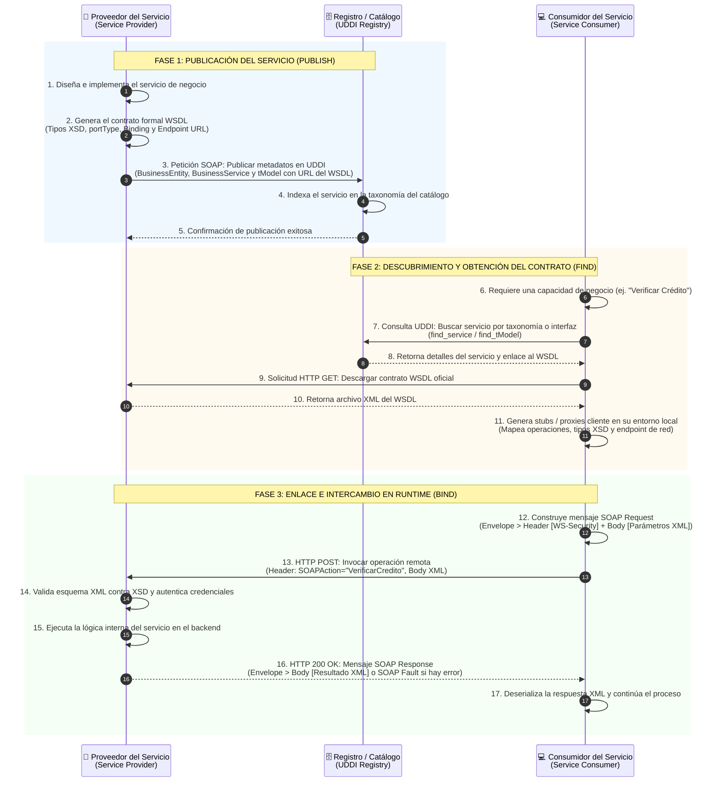

## **Orientación a servicios**



La **Arquitectura Orientada a Servicios (*Service-Oriented Architecture - SOA*)** es un estilo arquitectónico y de integración para sistemas de información distribuidos que organiza y descompone las aplicaciones y procesos de negocio de una organización en un conjunto de **servicios reutilizables, autónomos y débilmente acoplados (*loosely coupled*)**, los cuales se comunican mediante interfaces y contratos estandarizados e independientes de la plataforma.

A diferencia de las arquitecturas tradicionales jerárquicas o monolíticas, SOA no estructura las soluciones como un bloque único ni mediante llamadas dependientes de un lenguaje concreto; su propósito central es superar la fragmentación de los "silos" de aplicaciones existentes (ERP, CRM, sistemas legados) y habilitar la interoperabilidad universal y la reutilización ágil a escala empresarial.




### Concepto de "Servicio" 
**Principios Fundamentales de SOA**

En el marco de SOA, un **servicio** es una unidad de software que encapsula una actividad o capacidad de negocio identificable y discreta (por ejemplo, *calcular impuestos*, *verificar inventario* o *autorizar un pago*). Se rige por los siguientes principios técnicos fundamentales:

1. **Contratos de Servicio Bien Definidos (*Well-Defined Service Contracts*):**  
   El contrato es la pieza central de SOA y es más importante que la propia implementación. Separa estrictamente la interfaz accesible externamente de los detalles técnicos internos del ejecutable. Este contrato describe qué mensajes acepta y devuelve el servicio, las reglas de datos, los requisitos de seguridad y los acuerdos de nivel de servicio (*SLAs*).

2. **Bajo Acoplamiento (*Loose Coupling*):**  
   El consumidor del servicio únicamente conoce el contrato y el formato del mensaje que intercambia, desconociendo por completo el sistema operativo, el lenguaje de programación (Java, C#, COBOL) o el motor de base de datos que procesa la petición en el backend.

3. **Abstracción y Encapsulamiento:**  
   La lógica interna y la tecnología de ejecución quedan completamente ocultas tras la interfaz. Un servicio puede envolver un procedimiento almacenado en SQL, una cola de mensajería o una aplicación legada mainframe sin que el cliente note la diferencia.

4. **Reutilización (*Reusability*):**  
   Los servicios se diseñan para ser compartidos por múltiples aplicaciones dentro y fuera de la empresa, evitando la duplicación de código y acelerando el desarrollo de nuevas soluciones compuestas.

5. **Autonomía y Sin Estado (*Statelessness*):**  
   Cada invocación de un servicio es independiente y no depende de que el servidor conserve el estado de la conversación o de sesiones específicas en memoria entre peticiones sucesivas. Toda la información requerida para ejecutar la tarea viaja dentro del propio mensaje.

6. **Descubrimiento Dinámico Basado en Metadatos (*Discoverable*):**  
   Los servicios se publican en catálogos o registros centralizados que permiten a los consumidores localizarlos, inspeccionar sus capacidades e integrarse a ellos de forma dinámica.


### El Triángulo de operación de SOA

La interacción fundamental en SOA involucra tres roles que interactúan en un ciclo de publicación, búsqueda y enlace (*Publish-Find-Bind*):

```
                      ┌─────────────────────────┐
                      │  Registro de Servicios  │
                      │    (Service Broker)     │
                      └─────────────────────────┘
                         ▲                   │
          1. Publica     │                   │ 2. Busca / Descubre
         (Publish WSDL)  │                   │    (Find UDDI)
                         │                   ▼
             ┌───────────────────┐       ┌───────────────────┐
             │    Proveedor de   │       │   Consumidor de   │
             │     Servicios     │◄──────┤     Servicios     │
             │ (Service Provider)│       │ (Service Consumer)│
             └───────────────────┘       └───────────────────┘
                           3. Invoca y Enlaza
                            (Bind SOAP / REST)
```

1. **Proveedor del Servicio (*Service Provider*):** Diseña, implementa y aloja el servicio; publica su contrato y especificaciones de acceso en el registro.

2. **Registro o Agente (*Service Broker / Registry*):** Directorio centralizado donde se catalogan las interfaces de los servicios disponibles en la empresa o en la web, organizados taxonómicamente.

3. **Consumidor o Solicitante (*Service Requester / Consumer*):** Aplicación, proceso de negocio u otro servicio que localiza el contrato en el registro y se enlaza directamente con el proveedor para invocar sus operaciones.



### Pila Tecnológica 
**Web Services en SOA**

Aunque el paradigma SOA como filosofía arquitectónica es conceptualmente independiente de una tecnología concreta, en la práctica empresarial se consolidó a través del estándar de **Servicios Web (*Web Services*)** sobre protocolos universales de Internet:

* **WSDL (*Web Services Description Language*):** Vocabulario XML que describe formalmente el contrato del servicio. Define la parte abstracta (operaciones, tipos de datos y parámetros agrupados en `<portType>`) y la parte concreta (protocolo de transporte, formatos de serialización y dirección de red del *endpoint*).

* **SOAP (*Simple Object Access Protocol*):** Protocolo de mensajería basado en XML para el intercambio estructurado de información entre emisor y receptor. Estructura los mensajes en un sobre (*Envelope*), encabezado (*Header*, para seguridad y transacciones) y cuerpo (*Body*).

* **UDDI (*Universal Description, Discovery, and Integration*):** Registro y directorio estándar que permite a las empresas y aplicaciones publicar y buscar servicios en catálogos organizados.

* **XML / XSD (*Extensible Markup Language / XML Schema*):** Formato universal que define la estructura y tipos de datos neutrales transportados en los mensajes.

* **REST (*Representational State Transfer*):** Enfoque alternativo y complementario a SOAP que utiliza las operaciones nativas del protocolo HTTP (GET, POST, PUT, DELETE) sobre recursos identificados por URIs.

* **Estándares WS-\*:** Especificaciones complementarias para entornos corporativos de misión crítica: **WS-Security** (cifrado y firma de mensajes XML), **WS-ReliableMessaging** (entrega garantizada) y **WS-Coordination / WS-Transaction** (transacciones distribuidas).


### El Bus de Servicios Empresariales (*ESB*)

El elemento integrador por excelencia en las implementaciones corporativas de SOA es el **Enterprise Service Bus (ESB)**. 

El ESB es una plataforma de middleware que actúa como columna vertebral de comunicación. Resuelve el problema de la "telaraña" (*spaghetti architecture*) de conexiones punto a punto entre aplicaciones heterogéneas, haciendo que todos los sistemas se conecten únicamente al bus mediante adaptadores estándar:

```
[ Aplicación Web / CRM ]   [ Portal Móvil ]   [ Sistema ERP / SAP ]   [ Mainframe Legado ]
          │                       │                     │                      │
          ▼                       ▼                     ▼                      ▼
    ┌───────────┐           ┌───────────┐         ┌───────────┐          ┌───────────┐
    │ Adaptador │           │ Adaptador │         │ Adaptador │          │ Adaptador │
    └─────┬─────┘           └─────┬─────┘         └─────┬─────┘          └─────┬─────┘
          │                       │                     │                      │
══════════╪═══════════════════════╪═════════════════════╪══════════════════════╪══════════
                          ENTERPRISE SERVICE BUS (ESB)
  • Enrutamiento por Contenido        • Transformación de Datos (XSLT / XML)
  • Conversión de Protocolos           • Manejo de Eventos y Colas Asíncronas
  • Seguridad y Autorización (WSS)     • Monitoreo, Políticas de SLA y Registro
═══════════════════════════════════════════════════════════════════════════════════════════
```

#### Capacidades Clave del ESB:
* **Enrutamiento Inteligente (*Content-Based Routing*):** Inspecciona el contenido o contexto del mensaje XML y aplica reglas de negocio para derivarlo dinámicamente al destinatario correcto sin que el emisor conozca la dirección física final.

* **Transformación y Mediación de Protocolos:** Traduce estructuras de datos dispares (por ejemplo, convirtiendo un mensaje XML de la industria al formato plano o propietario que exige un sistema mainframe legado) y transforma protocolos de transporte (ej. de HTTP/SOAP a colas de mensajería JMS o MQ).

* **Integración de Sistemas Legados (*Service Enablement*):** Mediante conectores y adaptadores específicos, expone funcionalidades de aplicaciones antiguas o paquetes COTS (como SAP u Oracle) como servicios web estándar accesibles para toda la red corporativa.

* **Seguridad y Políticas Centralizadas:** Aplica autenticación federada, descifrado y validación de privilegios de acceso en el borde de la comunicación.


### Coordinación de Procesos
**Orquestación vs. Coreografía**

Una de las grandes ventajas de SOA es permitir la **composición de servicios**: combinar múltiples servicios individuales de grano fino o medio para crear un nuevo proceso de negocio de mayor nivel. Esto se coordina bajo dos modalidades:

* **Orquestación (Enfoque Centralizado):**  
  Un proceso centralizado (frecuentemente especificado en **BPEL** — *Business Process Execution Language* o ejecutado mediante un motor BPMN) controla la lógica de negocio, la secuencia de ejecución, las condiciones y el intercambio de mensajes entre los servicios participantes desde la perspectiva de un único director de flujo.

* **Coreografía (Enfoque Descentralizado y Basado en Eventos):**  
  No hay un controlador central. Los servicios interactúan de forma colaborativa y reactiva respondiendo a eventos de negocio publicados en el bus (arquitectura dirigida por eventos / *Event-Driven SOA*), donde cada participante conoce su rol y reacciona de manera autónoma.


### SOA, BPM y Arquitectura Empresarial (AE)

SOA no es una iniciativa aislada de programación; conforma un triángulo estratégico y táctico con la **Gestión de Procesos de Negocio (BPM)** y la **Arquitectura Empresarial (AE)**:

1. **Alineación Negocio-TI:**  
   La Arquitectura de Negocio (EBA) modela las capacidades y cadenas de valor de la empresa. BPM optimiza y rediseña los flujos de procesos operativos. SOA proporciona los bloques de construcción tecnológicos reutilizables para que esos procesos de BPM se ejecuten e interactúen de forma automatizada sobre la infraestructura de TI.

2. **Capas en el Modelo Empresarial:**  
   En marcos como $EA^3$ Cube o TOGAF, los servicios ocupan una capa articuladora (servicios de negocio y servicios de aplicación) que enlaza la estrategia corporativa con la infraestructura técnica (servidores, redes y bases de datos).

3. **Evolución hacia Microservicios:**  
   Mientras que la SOA clásica tradicionalmente abordó la integración a escala de toda la corporación mediante servicios de grano grueso o mediano comunicados a través de un bus inteligente (ESB), la arquitectura de **microservicios (MSA)** evolucionó a partir de estos principios hacia una granularidad mucho más fina, eliminando el ESB centralizado en favor de tuberías simples (*dumb pipes*), contenedores aislados y bases de datos completamente independientes por servicio.


### Ventajas y Desafíos de SOA

| Ventajas Principales | Desafíos y Complejidades |
| :--- | :--- |
| **Reutilización de Activos Existentes:** Evita tener que descartar o reescribir sistemas legados costosos, exponiéndolos como servicios a través de adaptadores. | **Sobrecarga de Rendimiento y Latencia:** La serialización, deserialización y validación de esquemas XML/SOAP a través de múltiples saltos de red introduce consumo de CPU y demoras. |
| **Agilidad Organizacional:** Nuevas aplicaciones pueden ensamblarse rápidamente orquestando servicios que ya existen y han sido probados. | **Complejidad y Dependencia del ESB:** Un ESB centralizado mal administrado puede convertirse en un cuello de botella operacional y en un punto único de falla para toda la corporación. |
| **Independencia Tecnológica:** Elimina el bloqueo con un solo proveedor (*vendor lock-in*) al basarse en estándares abiertos (WSDL, SOAP, XML, HTTP). | **Gobernanza Rigurosa Requerida:** Requiere políticas estrictas de versionado de contratos, catálogo de servicios, control de cambios y monitoreo de niveles de servicio (*SLAs*) para evitar servicios redundantes. |

***

## **Ciclo de vida**

El ciclo de vida de interacción se ilustra en **diagrama de secuencia detallado**: **Publicación (*Publish*), Búsqueda (*Find*) y Enlace (*Bind*)**, integrando la pila de estándares **WSDL**, **UDDI** y **SOAP**, junto con la descomposición de cada etapa técnica.


### Diagrama de Secuencia
**Triángulo de Operación SOA (Publish - Find - Bind)**




### Anatomía de los Protocolos

#### A. WSDL (*Web Services Description Language*): El Contrato
El archivo WSDL actúa como el contrato vinculante e independiente de la plataforma tecnológica. Se divide en dos capas técnicas:
* **Definición Abstracta:**
  * `<types>`: Esquemas de datos XML (XSD) que definen la estructura y tipos de las variables transportadas.
  * `<message>`: Definición de los mensajes de entrada y salida para cada operación.
  * `<portType>` / `<interface>`: Conjunto de operaciones ofrecidas (equivalente a una interfaz en programación orientada a objetos).

* **Definición Concreta:**
  * `<binding>`: Protocolo de transporte y codificación física (ej. SOAP sobre HTTP/POST o RPC/encoded vs. Document/literal).
  * `<service>` y `<port>`: Dirección de red exacta (*URI / URL Endpoint*) donde el servicio escucha peticiones en producción.

#### B. UDDI (*Universal Description, Discovery, and Integration*): El Directorio
El registro de servicios almacena los metadatos de las capacidades empresariales organizados en tres categorías (las "páginas"):
* **Páginas Blancas (*White Pages*):** Información general de la organización proveedora (nombre de la empresa, contacto, identificadores comerciales).

* **Páginas Amarillas (*Yellow Pages*):** Clasificación taxonómica estándar del servicio (por sector industrial, códigos NAICS o ubicación geográfica).

* **Páginas Verdes (*Green Pages*):** Información técnica de integración, que contiene punteros a las especificaciones técnicas (**tModels**) que referencian el WSDL formal del servicio.

#### C. SOAP (*Simple Object Access Protocol*): El Vehículo de Ejecución
En tiempo de ejecución (*runtime*), el cliente no vuelve a consultar el registro; se comunica directamente con el proveedor enviando sobres XML estructurados:
* **`<soap:Envelope>`:** Raíz obligatoria que identifica el documento como un mensaje SOAP.

* **`<soap:Header>`:** Sección opcional para metadatos de calidad de servicio corporativo (*QoS*), tales como cabeceras de **WS-Security** (tokens de autenticación, firmas digitales XML), identificadores de transacción distribuida (**WS-AtomicTransaction**) o rutas de enrutamiento.

* **`<soap:Body>`:** Carga útil (*payload*) que contiene la llamada al método y los parámetros tipados según el esquema XSD. En caso de fallo en el backend, el proveedor retorna un bloque estandarizado `<soap:Fault>`.

***
## **Implementación SOA**

### Caso de estudio

**Sistema de Procesamiento de Órdenes de Venta (E-Commerce)**

Una empresa comercializadora necesita procesar órdenes de compra integrando distintas capacidades de negocio preexistentes y heterogéneas. Para evitar conexiones punto a punto ("arquitectura espagueti"), se adopta el patrón **SOA (Arquitectura Orientada a Servicios)** mediante tres pilares:

1. **Servicios Proveedores Autónomos (*Service Providers*):**
   * **Servicio de Inventario (`InventoryService`):** Gestiona la disponibilidad y reserva de productos en bodega.
   * **Servicio de Facturación (`BillingService`):** Procesa el cargo financiero y emite el comprobante de pago.
   * **Servicio de Notificaciones (`NotificationService`):** Envía confirmaciones por correo o mensajería al comprador.
2. **Bus de Servicios Empresariales (*Simple ESB*):**
   * Actúa como el intermediario central que desacopla a los emisores de los receptores.
   * Administra el **directorio de servicios** (registro dinámico).
   * Realiza **enrutamiento basado en contenido (*Content-Based Routing*)** y **transformación de contratos/mensajes**.
3. **Consumidor (*Service Requester*):**
   * El portal web o aplicación cliente, el cual interactúa únicamente con el ESB enviando un mensaje estándar (formato canónico JSON/diccionario), sin conocer los detalles de implementación ni la ubicación de los servicios subyacentes.

---

### Código de implementación

El siguiente script en Python utiliza la biblioteca estándar (`dataclasses`, `typing`, `json`) para simular una implementación desacoplada y ejecutable de SOA:

```python
"""
Ejemplo de Implementación de Arquitectura Orientada a Servicios (SOA) en Python.
Demuestra: Contratos canónicos, Servicios desacoplados y Bus de Servicios (ESB).
"""

from dataclasses import dataclass, asdict
from typing import Dict, Any, Optional
import json

# ============================================================================
# 1. CONTRATO CANÓNICO DE MENSAJERÍA (CANONICAL MESSAGE FORMAT)
# ============================================================================

@dataclass
class ServiceMessage:
    """Contrato estándar de mensaje que viaja a través del bus."""
    action: str
    payload: Dict[str, Any]
    correlation_id: str
    status: str = "PENDING"
    error_message: Optional[str] = None

# ============================================================================
# 2. INTERFAZ BASE Y SERVICIOS DE NEGOCIO PROVEEDORES
# ============================================================================

class IService:
    """Interfaz contractual que todo servicio proveedor debe cumplir."""
    service_name: str

    def process(self, message: ServiceMessage) -> ServiceMessage:
        raise NotImplementedError

class InventoryService(IService):
    """Servicio proveedor de gestión de stock."""
    service_name = "InventoryService"

    def __init__(self):
        # Base de datos local interna y privada del servicio
        self._stock = {
            "PROD-001": {"nombre": "Teclado Mecánico", "cantidad": 5},
            "PROD-002": {"nombre": "Monitor 4K", "cantidad": 0}  # Agotado
        }

    def process(self, message: ServiceMessage) -> ServiceMessage:
        data = message.payload
        sku = data.get("sku")
        qty = data.get("qty", 1)

        print(f"  [Inventario] Validando disponibilidad para {sku} (Cant: {qty})...")
        
        if sku not in self._stock:
            message.status = "FAILED"
            message.error_message = f"Artículo {sku} no existe en catálogo."
            return message

        item = self._stock[sku]
        if item["cantidad"] >= qty:
            item["cantidad"] -= qty
            message.status = "SUCCESS"
            message.payload["producto_nombre"] = item["nombre"]
            message.payload["stock_restante"] = item["cantidad"]
            print(f"  [Inventario] Reserva exitosa. Quedan {item['cantidad']} unidades.")
        else:
            message.status = "FAILED"
            message.error_message = f"Stock insuficiente para {item['nombre']}. Disponibles: {item['cantidad']}."
            print(f"  [Inventario] Rechazado: {message.error_message}")

        return message

class BillingService(IService):
    """Servicio proveedor financiero y facturación."""
    service_name = "BillingService"

    def process(self, message: ServiceMessage) -> ServiceMessage:
        data = message.payload
        monto = data.get("monto", 0.0)
        cliente = data.get("cliente_id")

        print(f"  [Facturación] Procesando cargo por ${monto:.2f} al cliente '{cliente}'...")
        
        if monto <= 0:
            message.status = "FAILED"
            message.error_message = "Monto a facturar debe ser mayor a 0."
            return message

        # Simulación de transacción contable
        message.status = "SUCCESS"
        message.payload["factura_id"] = f"FAC-2026-{hash(message.correlation_id) % 10000:04d}"
        print(f"  [Facturación] Comprobante emitido con ID: {message.payload['factura_id']}")
        return message

class NotificationService(IService):
    """Servicio proveedor de mensajería al cliente."""
    service_name = "NotificationService"

    def process(self, message: ServiceMessage) -> ServiceMessage:
        data = message.payload
        destino = data.get("email")
        asunto = data.get("asunto", "Notificación del Sistema")

        print(f"  [Notificaciones] Enviando correo a <{destino}> | Asunto: {asunto}")
        message.status = "SUCCESS"
        message.payload["notificado"] = True
        return message

```

### ESB

**El Bus como Mediador y Orquestador (ESB):** El consumidor (`PortalVentas`) no necesita invocar tres APIs con formatos propietarios distintos; envía una sola petición al ESB, y este se encarga del enrutamiento basado en contenido, la orquestación y la mediación.

```python showLineNumbers
# ============================================================================
# 3. ENTERPRISE SERVICE BUS (ESB / MEDIADOR CENTRAL)
# ============================================================================

class EnterpriseServiceBus:
    """
    Middleware que resuelve:
    - Registro de servicios (Service Registry)
    - Enrutamiento basado en contenido (Content-Based Routing)
    - Orquestación de procesos de negocio
    """
    def __init__(self):
        self._registry: Dict[str, IService] = {}

    def register_service(self, action: str, service: IService):
        """Publicación y registro de servicios en el catálogo del ESB."""
        self._registry[action] = service
        print(f"[ESB] Servicio registrado: Acción '{action}' -> {service.service_name}")

    def send(self, message: ServiceMessage) -> ServiceMessage:
        """Enruta y envía el mensaje al servicio correspondiente según la acción."""
        if message.action not in self._registry:
            message.status = "ERROR"
            message.error_message = f"Ruta desconocida en el ESB: No hay servicio para '{message.action}'"
            return message

        service = self._registry[message.action]
        return service.process(message)

    def execute_order_saga(self, order_request: Dict[str, Any]) -> Dict[str, Any]:
        """
        Orquestación de un proceso de negocio complejo en el ESB:
        Paso 1: Reservar Inventario -> Paso 2: Facturar -> Paso 3: Notificar
        """
        correlation_id = order_request.get("order_id", "ORD-DEFAULT")
        print(f"\n[ESB] >>> Iniciando Orquestación de Orden: {correlation_id} <<<")

        # 1. Enrutar a Servicio de Inventario
        msg_inv = ServiceMessage(
            action="RESERVAR_STOCK",
            payload={"sku": order_request["sku"], "qty": order_request["cantidad"]},
            correlation_id=correlation_id
        )
        res_inv = self.send(msg_inv)
        if res_inv.status != "SUCCESS":
            return {"resultado": "ORDEN_RECHAZADA", "motivo": res_inv.error_message}

        # 2. Transformación y enrutamiento a Servicio de Facturación
        msg_bill = ServiceMessage(
            action="PROCESAR_PAGO",
            payload={
                "cliente_id": order_request["cliente_id"],
                "monto": order_request["precio_unitario"] * order_request["cantidad"]
            },
            correlation_id=correlation_id
        )
        res_bill = self.send(msg_bill)
        if res_bill.status != "SUCCESS":
            return {"resultado": "ORDEN_RECHAZADA", "motivo": res_bill.error_message}

        # 3. Enrutar a Servicio de Notificaciones
        msg_notif = ServiceMessage(
            action="ENVIAR_ALERTA",
            payload={
                "email": order_request["email_cliente"],
                "asunto": f"Confirmación de Compra {correlation_id}",
                "factura": res_bill.payload["factura_id"]
            },
            correlation_id=correlation_id
        )
        self.send(msg_notif)

        return {
            "resultado": "ORDEN_EXITOSA",
            "orden_id": correlation_id,
            "factura": res_bill.payload["factura_id"],
            "producto": res_inv.payload["producto_nombre"]
        }
```

### Programa consumidor

**Reutilización de Servicios:** El `NotificationService` o el `InventoryService` pueden ser consumidos en el futuro por otros procesos (por ejemplo, devoluciones de mercancía o auditorías de almacén) sin reescribir una sola línea de su lógica interna.

```python showlineNumbers
# ============================================================================
# 4. PROGRAMA CONSUMIDOR / CLIENTE (DEMOSTRACIÓN DE CASOS DE USO)
# ============================================================================

if __name__ == "__main__":
    # A. Inicializar infraestructura SOA
    esb = EnterpriseServiceBus()

    # B. Instanciar y registrar los servicios proveedores en el bus
    inventario = InventoryService()
    facturacion = BillingService()
    notificaciones = NotificationService()

    esb.register_service("RESERVAR_STOCK", inventario)
    esb.register_service("PROCESAR_PAGO", facturacion)
    esb.register_service("ENVIAR_ALERTA", notificaciones)

    # C. Caso 1: Compra exitosa (Producto con stock disponible)
    orden_valida = {
        "order_id": "ORD-1001",
        "cliente_id": "CLIENTE_JUAN",
        "email_cliente": "juan.perez@empresa.cl",
        "sku": "PROD-001",
        "cantidad": 2,
        "precio_unitario": 85.50
    }
    resultado_1 = esb.execute_order_saga(orden_valida)
    print("\n[Portal Ventas] Respuesta del ESB:")
    print(json.dumps(resultado_1, indent=2, ensure_ascii=False))

    # D. Caso 2: Compra fallida (Producto agotado en el servicio de inventario)
    orden_invalida = {
        "order_id": "ORD-1002",
        "cliente_id": "CLIENTE_ANA",
        "email_cliente": "ana.silva@empresa.cl",
        "sku": "PROD-002",
        "cantidad": 1,
        "precio_unitario": 350.00
    }
    resultado_2 = esb.execute_order_saga(orden_invalida)
    print("\n[Portal Ventas] Respuesta del ESB:")
    print(json.dumps(resultado_2, indent=2, ensure_ascii=False))
```


---

### Análisis de los Principios SOA Aplicados en el Código

1. **Bajo Acoplamiento (*Loose Coupling*):** El `InventoryService` y el `BillingService` no se conocen entre sí ni tienen dependencias directas en memoria; ambos se integran a través del contrato neutral `ServiceMessage`.
2. **Contrato Formal Bien Definido:** Los datos viajan estructurados bajo un formato estándar que contiene acción, carga útil (*payload*), identificador de correlación y estado, equivalente a un sobre de mensaje tipo SOAP/XML o REST/JSON.
3. **El Bus como Mediador y Orquestador (ESB):** El consumidor (`PortalVentas`) no necesita invocar tres APIs con formatos propietarios distintos; envía una sola petición al ESB, y este se encarga del enrutamiento basado en contenido, la orquestación y la mediación.
4. **Reutilización de Servicios:** El `NotificationService` o el `InventoryService` pueden ser consumidos en el futuro por otros procesos (por ejemplo, devoluciones de mercancía o auditorías de almacén) sin reescribir una sola línea de su lógica interna.