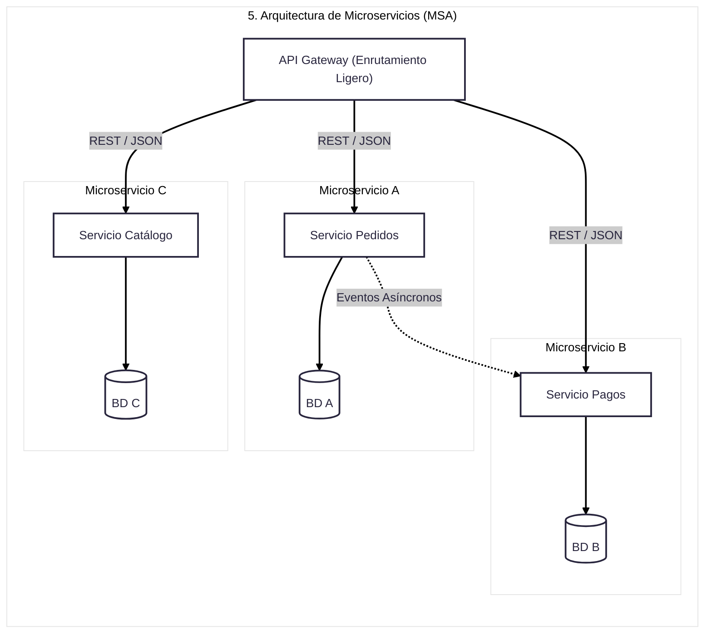
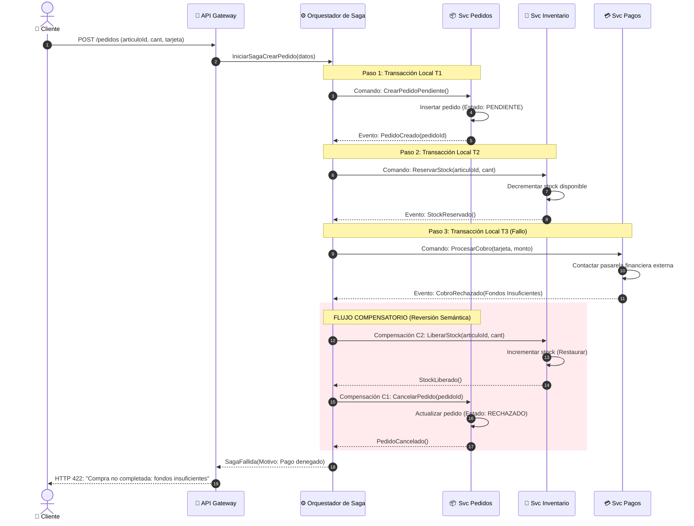
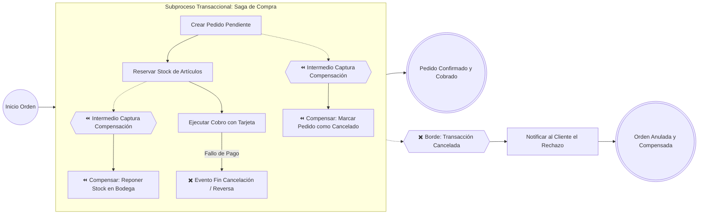

## **Microservicios**
El **Patrón de Arquitectura de Microservicios (*Micro-Service Architecture - MSA*)** es un estilo arquitectónico que estructura una aplicación como una **constelación de servicios pequeños, autónomos y débilmente acoplados**, donde cada servicio se ejecuta en su propio proceso de computación y modela una capacidad de negocio bien delimitada. 

A diferencia de los sistemas monolíticos tradicionales, donde todos los componentes de software (presentación, lógica y datos) residen y compiten en un único proceso ejecutable, los microservicios distribuyen la responsabilidad para permitir despliegues independientes, alta tolerancia a fallos y escalabilidad granular.

<center>



</center>


### Principios Fundamentales

1. **Servicios Pequeños y Altamente Cohesivos (*Single Responsibility*):**
   Cada microservicio se enfoca en resolver una tarea o subdominio específico del negocio. Esto se fundamenta en el principio de *Alta Cohesión* y *Responsabilidad Única (SRP)*: una unidad de software debe tener una sola razón para cambiar, manteniéndose ligera y comprensible.

2. **Procesos Aislados e Independientes:**
   Cada servicio corre en su propio entorno de ejecución independiente (por ejemplo, contenedores Docker orquestados con Kubernetes sobre plataformas cloud/Linux). Si un servicio experimenta un fallo crítico o saturación de memoria, no colapsa el resto del ecosistema.

3. **Mecanismos de Comunicación Ligeros (*Smart Endpoints, Dumb Pipes*):**
   La interacción entre servicios no depende de middlewares pesados con lógica centralizada de transformación (como los ESB de SOA tradicional). En su lugar, se utilizan protocolos abiertos, universales y sin estado:
   * **Sincrónicos:** APIs RESTful sobre HTTP/HTTPS transmitiendo representaciones JSON o XML.
   * **Asincrónicos:** Mensajería orientada a eventos (*Event-Driven Architecture*) a través de brokers (RabbitMQ, Kafka) utilizando patrones de publicación/suscripción (*Publish/Subscribe*) para desacoplar temporalmente los componentes.

4. **Gestión Descentralizada de Datos (*Database-per-Service*):**
   Cada microservicio es dueño exclusivo de su propio almacén de persistencia (sea SQL relacional o NoSQL no estructurado). Ningún servicio externo tiene permitido consultar o escribir directamente en la base de datos de otro; toda interacción debe realizarse a través de la API pública del servicio propietario.

5. **Despliegue y Ciclo de Vida Independientes (*Independent Deployability*):**
   Dado que las interfaces están claramente separadas de la implementación técnica, un equipo puede compilar, probar e implementar una nueva versión de un microservicio en producción sin recompilar ni reiniciar las demás partes del sistema.


### Anatomía y Topología

En un diseño integral de microservicios, la interacción se organiza en las siguientes piezas estructurales:

```
[ Clientes / Dispositivos Móviles / Web ]
                   │
                   ▼ (HTTPS / REST)
       ┌────────────────────────┐
       │      API Gateway       │  <── Enrutamiento, Autenticación, 
       └────────────────────────┘      Rate Limiting
         │          │          │
         ▼          ▼          ▼
   ┌──────────┐┌──────────┐┌──────────┐
   │ Servicio ││ Servicio ││ Servicio │
   │ Pedidos  ││  Pagos   ││ Catálogo │
   └────┬─────┘└────┬─────┘└────┬─────┘
        │           │           │
        ▼           ▼           ▼
     [(BD)]      [(BD)]      [(BD)]   <── Persistencia Descentralizada
        │           ▲
        └─(Eventos)─┘                 <── Broker Asíncrono / Mensajería
```

* **API Gateway (Puerta de Enlace):**
  Actúa como el punto de entrada unificado y fachada (*Facade*) para todos los clientes externos. Centraliza tareas transversales como la terminación TLS/SSL, la validación de tokens de identidad, el balanceo de carga y el enrutamiento hacia los microservicios internos.

* **Servicios de Dominio:**
  Implementan la lógica de negocio nuclear organizada por capacidades (ej. Pedidos, Facturación, Inventario).

* **Gestor de Descubrimiento de Servicios (*Service Discovery*):**
  Dado que los contenedores en la nube cambian dinámicamente de dirección IP y puerto al autoescalar, el registro de servicios permite localizar dinámicamente las instancias activas mediante nombres lógicos.

* **Persistencia Políglota (*Polyglot Persistence*):**
  Dado que cada servicio tiene su propia base de datos, el equipo puede elegir la tecnología de almacenamiento idónea para el caso de uso específico: un motor relacional como PostgreSQL para transacciones financieras o bases de datos documentales/gráficas NoSQL para catálogos o analítica.


### Microservicios vs. SOA vs. Monolito

<table>
   <thead>
      <tr>
         <th>Dimensión</th>
         <th>Arquitectura Monolítica</th>
         <th>SOA (Orientada a Servicios Tradicional)</th>
         <th>Microservicios (MSA)</th>
      </tr>
   </thead>
   <tbody>
      <tr>
         <th scope="row">Límite de Ejecución</th>
         <td>Un único proceso de SO; componentes acoplados en memoria.</td>
         <td>Varios sistemas y servicios heterogéneos.</td>
         <td>Múltiples servicios pequeños en procesos/contenedores aislados.</td>
      </tr>
      <tr>
         <th scope="row">Gobernanza de Datos</th>
         <td>Base de datos centralizada compartida por todos los módulos.</td>
         <td>Tiende a compartir bases de datos corporativas o esquemas comunes.</td>
         <td><strong>Base de datos por servicio</strong> (descentralizada y políglota).</td>
      </tr>
      <tr>
         <th scope="row">Middleware de Comunicación</th>
         <td>Llamadas a funciones o métodos locales (<code>in-process</code>).</td>
         <td><strong>ESB inteligente</strong>: orquestación centralizada, adaptadores y transformación de datos.</td>
         <td><strong>Tuberías tontas (<em>Dumb Pipes</em>)</strong>: APIs REST livianas o brokers de eventos simples.</td>
      </tr>
      <tr>
         <th scope="row">Granularidad del Servicio</th>
         <td>Gruesa / Monobloque (sin servicios externos).</td>
         <td>Gruesa o Mediana; orientada a la integración corporativa.</td>
         <td><strong>Fina y enfocada</strong>: delimitada estrictamente por contexto de negocio.</td>
      </tr>
      <tr>
         <th scope="row">Acoplamiento Operacional</th>
         <td>Máximo; un fallo en un módulo puede tumbar el proceso entero.</td>
         <td>Medio; mitigado por el bus pero con dependencia del ESB central.</td>
         <td>Mínimo; alta resiliencia y autonomía de despliegue.</td>
      </tr>
   </tbody>
</table>


### Ventajas Técnicas y Estratégicas

1. **Escalabilidad Elástica y Selectiva:**
   En un monolito, si el módulo de pagos se satura, es necesario replicar la aplicación completa (incluyendo catálogos y reportes), consumiendo hardware de manera ineficiente. En microservicios, se escalan horizontalmente solo las réplicas del contenedor saturado.

2. **Diversidad Tecnológica (*Polyglot Programming*):**
   Cada equipo puede seleccionar el lenguaje de programación, framework y motor de base de datos más eficiente para su problema (ej. Node.js para I/O intensivo, Python para modelos analíticos, Java para transaccionalidad bancaria).

3. **Agilidad Organizacional y Equipos Descentralizados:**
   Alinea la estructura técnica con la estructura humana: equipos pequeños, autónomos y multifuncionales que son dueños del ciclo de vida completo de un servicio (*DevOps*), facilitando entregas continuas y liberaciones semanales o diarias.


### Desafíos y Complejidades

El patrón de microservicios traslada la complejidad desde el interior del código hacia la red y las operaciones:

* **Consistencia Eventual frente a Transacciones ACID:**
  Al no existir una base de datos única, no es posible aplicar transacciones ACID globales tradicionales o mecanismos de bloqueo directo sin introducir bloqueos y cuellos de botella severos. Se debe recurrir a la *consistencia eventual* y patrones de compensación mediante transacciones distribuidas o flujos asíncronos.

* **Latencia de Red y Fallos Parciales:**
  Las llamadas a métodos en memoria son instantáneas y seguras, mientras que las llamadas remotas por red introducen latencia, pérdidas de paquetes o caídas temporales. Requiere patrones de tolerancia a fallos como *Circuit Breakers*, *Proxies de Redirección* y reintentos exponenciales.

* **Observabilidad y Trazabilidad Compleja:**
  Un solo clic del usuario puede desencadenar peticiones a través de 10 microservicios distintos. Diagnosticar un error exige infraestructura de observabilidad avanzada: correlación de registros (*Log Aggregation*), métricas de rendimiento y trazabilidad distribuida (*Distributed Tracing*).


***
## **Transacciones distribuidas**

En un sistema monolítico o centralizado, garantizar la consistencia transaccional es directo: el gestor de la base de datos relacional proporciona garantías **ACID** (Atomicidad, Consistencia, Aislamiento y Durabilidad) mediante bloqueos de registros y confirmaciones atómicas locales (`BEGIN TRANSACTION ... COMMIT / ROLLBACK`).

Sin embargo, en una arquitectura de microservicios, el patrón fundamental es la **gestión descentralizada de datos (*Database-per-Service*)**:
* Cada microservicio posee y administra de manera exclusiva su propia base de datos (relacional o NoSQL).

* Ningún servicio externo tiene permitido consultar o escribir directamente en las tablas de otro microservicio; toda interacción se realiza estrictamente a través de APIs o intercambio de mensajes.

#### ¿Por qué no se utiliza el compromiso en dos fases (2PC)?

El protocolo tradicional de transacciones distribuidas en bases de datos es el **Compromiso en Dos Fases (*Two-Phase Commit - 2PC*)**. Como explican las fuentes especializadas en sistemas distribuidos, el 2PC impone graves limitaciones operacionales:
1. **Bloqueo síncrono prolongado:** Requiere que todos los nodos aseguren bloqueos locales en la fase de preparación y esperen la instrucción del coordinador central, manteniendo recursos retenidos por períodos prolongados.

2. **Punto único de fallo y acoplamiento temporal:** Si el coordinador o la red fallan durante el proceso, los servicios quedan bloqueados (*in-doubt*), comprometiendo la disponibilidad y autonomía del sistema.

3. **Incompatibilidad con persistencia moderna:** Muchos motores NoSQL y brokers de mensajería no implementan interfaces de transacciones distribuidas compatibles con XA/2PC.

Para resolver este dilema, la arquitectura de microservicios adopta la **consistencia eventual** y las **transacciones de larga duración (*Long-Running Transactions*)**, donde el trabajo se confirma de manera local e incremental y se recurre a **actividades de compensación** en caso de aborto o error.


***
## **Patrón Saga**

El patrón Saga es un patrón de diseño arquitectónico para gestionar **transacciones distribuidas de larga duración (Long-Running Transactions)** en sistemas compuestos por servicios o microservicios que manejan bases de datos independientes. Donde cada servicio administra su propia base de datos (*Database-per-Service*).

A diferencia de las bases de datos relacionales tradicionales, donde todas las operaciones se agrupan en una única transacción atómica local bajo el estándar **ACID** (mediante sentencias BEGIN TRANSACTION ... COMMIT / ROLLBACK), en un entorno de microservicios con persistencia descentralizada (Database-per-Service) no es viable retener bloqueos globales sin degradar severamente la disponibilidad y el rendimiento del sistema. El patrón SAGA sustituye las transacciones atómicas globales por **consistencia eventual** apoyada en acciones compensatorias.

El **Patrón Saga** modela una transacción de negocio que abarca múltiples microservicios como una **secuencia ordenada de transacciones locales independientes**.

```math
\text{Saga} = \{T_1, T_2, T_3, \dots, T_n\}
```

* **Compromiso Local Inmediato:** Cada microservicio ejecuta su transacción local $T_i$, confirma (*commit*) los cambios en su base de datos privada y publica un evento o mensaje para desencadenar el siguiente paso $T_{i+1}$.

* **Reversión Semántica mediante Compensación:** Si alguna de las transacciones locales falla (por ejemplo, fondos insuficientes en el servicio de pagos o falta de stock en inventario), la Saga no puede ejecutar un rollback físico tradicional porque los pasos previos ya hicieron commit en sus bases de datos locales. En su lugar, el patrón ejecuta una serie de **transacciones compensatorias** en orden inverso para revertir semánticamente los efectos ya confirmados:

```math
\text{Flujo de Compensación} = \{C_{i-1}, C_{i-2}, \dots, C_1\}
```

Una **transacción compensatoria ($C_k$)** no es un *rollback* físico de bajo nivel de base de datos (ya que $T_k$ ya hizo `COMMIT`), sino una acción de negocio explícita que restaura el sistema a un estado consistente equivalente  (por ejemplo: si $T_1$ reservó stock, $C_1$ devuelve los artículos al inventario disponible; si $T_2$ emitió un cobro, $C_2$ genera un reembolso o abono).

---

### Mecanismos de Coordinación
**Orquestación vs. Coreografía**

Existen dos estrategias principales para orquestar la secuencia de eventos y compensaciones:

#### A. Coreografía (Descentralizada / Reactiva)
* **Mecanismo:** Los microservicios colaboran intercambiando eventos a través de un canal o broker de mensajería (como Apache Kafka o RabbitMQ) sin un controlador central. Cada servicio escucha los eventos que le conciernen, ejecuta su transacción local y publica un nuevo evento notificando su éxito o fallo.

* **Manejo de fallo:** Si el servicio de pagos emite el evento PagoFallido, los servicios que ya realizaron cambios (como inventario o pedidos) capturan ese evento de manera reactiva y ejecutan sus correspondientes tareas de compensación local

* **Ventajas:** Máximo desacoplamiento y no requiere un orquestador adicional.

* **Desventajas:** Dificultad para rastrear el flujo completo del proceso (*deadlocks* o bucles cíclicos si las suscripciones no están rigurosamente diseñadas). Su trazabilidad es más compleja de monitorear a medida que aumenta el número de servicios.


#### B. Orquestación (Centralizada / Mediada)
* **Mecanismo:** Un componente o servicio especializado (el **Orquestador de Saga**, a menudo implementado mediante un motor de procesos ejecutables como Camunda o un microservicio dedicado) le indica a cada participante qué transacción local ejecutar enviando comandos de solicitud/respuesta.

* **Manejo de fallo:** Si un microservicio responde con un error de negocio, el orquestador toma el control y envía de forma estructurada los comandos de compensación ($C_k$) a los servicios que completaron con éxito sus etapas previas.

* **Ventajas:** Lógica de negocio y control de estados concentrados en un solo flujo observable; simplifica enormemente la gestión de compensaciones y auditoría en tiempo real.

* **Desventajas:** Riesgo de sobrecargar al orquestador con lógica de dominio si no se respeta la separación de responsabilidades.


### Transacción Clásica (ACID / 2PC) y Patrón Saga

| Característica | Transacción Clásica ACID / 2PC (Two-Phase Commit) | Patrón Saga |
| :--- | :--- | :--- |
| **Garantía de Consistencia** | Consistencia Inmediata y Fuerte (Atomicidad global). | **Consistencia Eventual** (los datos se equilibran al finalizar la cadena o compensación). |
| **Aislamiento (*Isolation*)** | Alto: los registros permanecen bloqueados para otros usuarios hasta el *commit*. | Bajo: los cambios locales se confirman de inmediato, por lo que otros procesos pueden leer estados intermedios pendientes. |
| **Mecanismo de Deshacer** | *Rollback* técnico directo en el motor de base de datos. | **Compensación semántica** (nueva transacción de negocio que contrarresta el efecto previo). |
| **Tolerancia y Escalabilidad** | Baja en redes distribuidas; susceptible a bloqueos prolongados y caídas de nodos. | **Alta escalabilidad y resiliencia**; adecuada para arquitecturas de microservicios en la nube. |


### Principales Casos de Uso

El patrón SAGA se aplica cuando una operación de negocio debe mantener la consistencia a través de múltiples límites de datos independientes:

* **Comercio Electrónico y Procesamiento de Órdenes:** Coordinación secuencial de *Crear Pedido* $\rightarrow$ *Reservar Inventario* $\rightarrow$ *Cobrar con Tarjeta* $\rightarrow$ *Generar Envío*. Si el cobro falla, se devuelve el inventario retenido.

* **Reservas de Viajes y Turismo:** Reserva conjunta de vuelo, hotel y arriendo de vehículo. Si el hotel no tiene disponibilidad, se cancela la reserva del vuelo sin penalización.

* **Servicios Financieros y Transferencias Interbancarias:** Débito en la cuenta de origen, validación de fraude y acreditación en la cuenta de destino.

* **Procesos de Negocio en BPMS / BPMN:** Flujos donde subprocesos transaccionales integran servicios web heterogéneos y requieren eventos y manejadores de compensación (`compensationHandler`) ante excepciones.


### Diagrama de secuencia
**Saga Orquestada de Compra y Pago**

El siguiente diagrama de secuencia ilustra el flujo de una compra en comercio electrónico bajo el patrón Saga orquestado, demostrando tanto el **camino de éxito** como el **manejo de fallos con compensación semántica**:



---

### Modelo de Proceso BPMN 2.0
**Transacción con Compensadores**

BPMN 2.0 cuenta con semántica nativa estándar para modelar transacciones de negocio que requieren reversión mediante **Subprocesos Transaccionales** y **Manejadores de Compensación (*Compensation Handlers*)**:



#### Reglas de ejecución en la notación BPMN:
1. **Asociación de Compensación:** Las actividades marcadas con el símbolo de rebobinado (`⏪`) no tienen flujos de secuencia salientes directos; únicamente son disparadas por el motor de procesos cuando una excepción o evento de cancelación posterior exige restaurar el estado de negocio.

2. **Orden Inverso:** El motor ejecuta las compensaciones en estricto orden cronológico inverso: primero libera el inventario que se reservó en el paso 2 y luego cancela la orden creada en el paso 1.

3. **Idempotencia:** En arquitecturas de microservicios, tanto los comandos de acción como los de compensación deben diseñarse como **operaciones idempotentes** (procesar el mismo mensaje repetido no debe duplicar inventario ni cobrar dos veces) para tolerar reintentos en redes no confiables.


### Consideraciones de Diseño

| Desafío en Microservicios | Riesgo Técnico | Solución con Patrón Saga |
| :--- | :--- | :--- |
| **Pérdida de Aislamiento (Lecturas Sucias)** | Otro microservicio o usuario puede ver datos en estado intermedio (ej. inventario reservado) antes de que la transacción global falle. | **Estados intermedios explícitos:** Usar estados como `PENDIENTE_PAGO` en lugar de confirmar el pedido inmediatamente, o aplicar lecturas con versionado semántico. |
| **Mensajes Duplicados o Fuera de Orden** | La red o el broker pueden entregar el mismo evento más de una vez (*at-least-once delivery*). | **Receptores Idempotentes:** Registrar claves de deduplicación de transacciones antes de procesar cualquier comando o compensación. |
| **Fallos en la Compensación** | Si un servicio de inventario falla cuando intenta devolver el stock al almacén. | **Reintentos automáticos e intervención asistida:** Los comandos compensatorios deben garantizarse mediante colas persistentes con reintentos exponenciales y alertas a colas de mensajes fallidos (*Dead-Letter Queues*). |


### Ejemplo de Implementación

El siguiente ejemplo ilustra la arquitectura de una **Saga Orquestada** con registro de pasos y ejecución automática de compensaciones ante excepciones:

```python showLineNumberss
from dataclasses import dataclass, field
from typing import List, Callable, Any

@dataclass
class PasoSaga:
    nombre: str
    accion: Callable[[], bool]          # Transacción local (Ti)
    compensacion: Callable[[], None]    # Compensación semántica (Ci)

class OrquestadorSaga:
    def __init__(self):
        self.pasos: List[PasoSaga] = []
        self.pasos_completados: List[PasoSaga] = []

    def registrar_paso(self, nombre: str, accion: Callable[[], bool], compensacion: Callable[[], None]):
        self.pasos.append(PasoSaga(nombre, accion, compensacion))

    def ejecutar(self) -> bool:
        print("=== Iniciando Ejecución de la Saga ===")
        for paso in self.pasos:
            print(f"Ejecutando: {paso.nombre}...")
            try:
                exito = paso.accion()
                if not exito:
                    print(f"[!] Fallo de negocio en: {paso.nombre}")
                    self._compensar()
                    return False
                self.pasos_completados.append(paso)
            except Exception as e:
                print(f"[!] Excepción técnica en {paso.nombre}: {e}")
                self._compensar()
                return False

        print("=== Saga Completada con Éxito ===")
        return True

    def _compensar(self):
        print("\n>>> INICIANDO FLUXO DE COMPENSACIÓN (Orden Inverso) <<<")
        for paso in reversed(self.pasos_completados):
            print(f"Compensando: {paso.nombre}...")
            try:
                paso.compensacion()
            except Exception as e:
                print(f"Error crítico en compensación de {paso.nombre}: {e}")
        print(">>> Compensación Finalizada: Estado Consistente <<<\n")

# --- SIMULACIÓN DE MICROSERVICIOS INDEPENDIENTES ---

class ServicioPedidos:
    def crear_orden(self): 
        print("  [Pedidos] Orden creada en estado PENDIENTE.")
        return True
    def cancelar_orden(self): 
        print("  [Pedidos] Compensación: Orden marcada como CANCELADA.")

class ServicioInventario:
    def __init__(self, stock: int):
        self.stock = stock
    def reservar(self):
        if self.stock >= 1:
            self.stock -= 1
            print(f"  [Inventario] Stock reservado. Restante: {self.stock}")
            return True
        print("  [Inventario] Error: Sin existencias.")
        return False
    def liberar(self):
        self.stock += 1
        print(f"  [Inventario] Compensación: Stock restaurado. Total: {self.stock}")

class ServicioPagos:
    def cobrar(self, fondos_suficientes: bool):
        if fondos_suficientes:
            print("  [Pagos] Cobro procesado exitosamente.")
            return True
        print("  [Pagos] Error: Tarjeta declinada por fondos insuficientes.")
        return False
    def reembolsar(self):
        print("  [Pagos] Compensación: Reembolso emitido al cliente.")

# --- PRUEBA DEL CASO DE FALLO ---
if __name__ == "__main__":
    pedidos = ServicioPedidos()
    inventario = ServicioInventario(stock=5)
    pagos = ServicioPagos()

    saga = OrquestadorSaga()
    
    # Se encadenan las transacciones y sus compensadores
    saga.registrar_paso("Crear Pedido", pedidos.crear_orden, pedidos.cancelar_orden)
    saga.registrar_paso("Reservar Stock", inventario.reservar, inventario.liberar)
    # Simulamos fallo de pago en el paso 3
    saga.registrar_paso("Procesar Pago", lambda: pagos.cobrar(fondos_suficientes=False), pagos.reembolsar)

    resultado = saga.ejecutar()
    print(f"Resultado final de la transacción global: {'Éxito' if resultado else 'Transacción Abortada'}")
```


### Consideraciones de Diseño

Al implementar Sagas, se deben resolver tres retos inherentes a la consistencia eventual:

1. **Falta de Aislamiento (*Lack of Isolation*):** Dado que cada transacción local hace *commit* inmediatamente, otros servicios o usuarios pueden ver datos en estado intermedio (lecturas sucias). Se mitiga usando **estados semánticos pendientes** (ej. `PENDIENTE_PAGO` en lugar de `APROBADO`) o versionamiento de registros.

2. **Idempotencia Obligatoria:** En entornos de red distribuidos, los mensajes pueden duplicarse o reintentarse. Tanto las transacciones de acción ($T$) como las de compensación ($C$) deben ser **idempotentes** (procesar el mismo mensaje múltiples veces debe producir el mismo resultado que procesarlo una sola vez).

3. **Manejo de Fallos en la Compensación:** Si una compensación falla (por ejemplo, el servicio de inventario se cae justo cuando debe reponer el producto), la saga debe contar con **reintentos exponenciales automáticos**, colas de mensajes fallidos (*Dead-Letter Queues*) y alertas para intervención técnica.