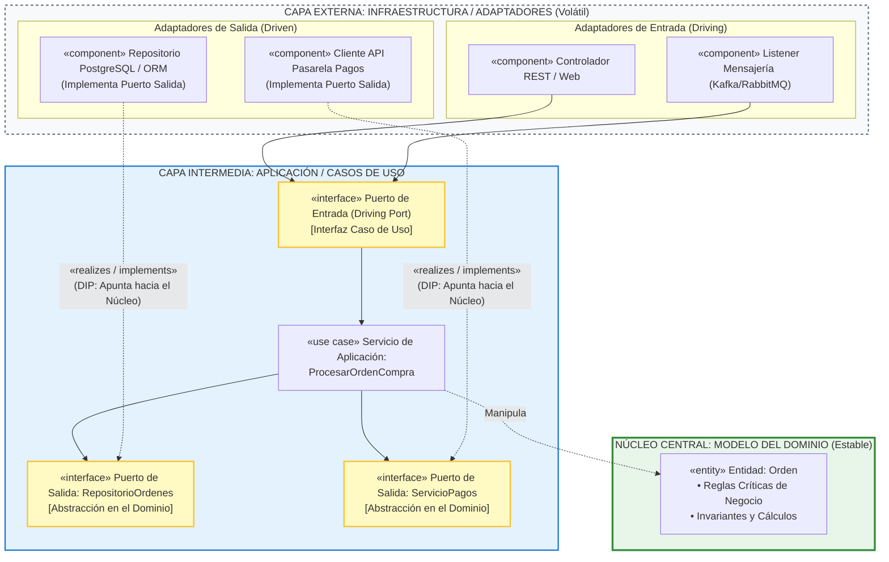

## **¿Qué es Arquitectura de Software?**

La **arquitectura de software** es el conjunto de **decisiones significativas sobre la organización y estructura de un sistema de software**. Define los elementos estructurales y sus interfaces, los comportamientos específicos de sus colaboraciones y la composición de dichos elementos en subsistemas progresivamente más amplios, bajo un estilo arquitectónico que guía su diseño y evolución.

En la ingeniería de software y sistemas, el término se concibe bajo dos facetas complementarias:
* **Como sustantivo (el artefacto / plano maestro):** Es el mapa estructural abstracto que describe los subsistemas, las responsabilidades de gran escala, los patrones de conexión y los fundamentos o motivaciones de por qué el sistema está diseñado de esa manera.
* **Como verbo (el proceso de diseño o análisis arquitectural):** Es la actividad técnica iterativa encargada de traducir los requisitos operativos y de negocio en soluciones estructuradas. Su foco primordial está en la **identificación y resolución de los requisitos no funcionales y atributos de calidad** (como fiabilidad, tolerancia a fallos, rendimiento, escalabilidad, seguridad y mantenibilidad) en el contexto de los requisitos funcionales del sistema.

#### Vistas y Perspectivas de la Arquitectura
Dado que ningún diagrama único puede capturar la complejidad total del software, la arquitectura se documenta mediante **múltiples vistas complementarias** dirigidas a distintas partes interesadas (*stakeholders*):
* **Vista Lógica:** Modela la organización conceptual del software en capas lógicas, paquetes, subsistemas, clases e interfaces (por ejemplo, aplicando patrones como Capas, MVC o Fachada).
* **Vista de Procesos:** Modela los elementos de concurrencia en tiempo de ejecución, como procesos, hilos de ejecución (*threads*), sincronización y flujos de control.
* **Vista de Despliegue:** Modela la topología física y de red, mapeando los ejecutables y componentes a nodos de cómputo y servidores físicos o virtuales.
* **Vista de Implementación:** Describe la organización física del código fuente, librerías, dependencias y entregables empaquetados.


### El Rol del Arquitecto de Software

El **arquitecto de software** es el especialista técnico y líder responsable de definir, mantener y guiar la arquitectura técnica de las aplicaciones y sistemas complejos. A diferencia de los ingenieros o programadores que suelen enfocarse detalladamente en componentes o clases específicas, el arquitecto tiene la responsabilidad de abordar la **visión global del sistema, las dependencias entre componentes y los límites estructurales**.

Sus principales responsabilidades y funciones incluyen:

1. **Toma de Decisiones Estructurales Críticas:**
   * Define la arquitectura lógica inicial (descomposición en capas, módulos y servicios) en las primeras fases del ciclo de vida y construye el núcleo central de la arquitectura (*arquitectura ejecutable* o base técnica) para mitigar los riesgos más elevados antes de la construcción masiva.
   * Resuelve factores de diseño fundamentales, evaluando compromisos (*trade-offs*) entre costo, tiempo y calidad técnica.
   * Elabora y mantiene el **Documento de la Arquitectura del Software (SAD)** y los memorándums técnicos que registran las alternativas evaluadas, las decisiones tomadas y la motivación que las respalda.

2. **Evaluación y Selección Tecnológica (*Build vs. Buy*):**
   * Evalúa si es conveniente desarrollar internamente componentes a medida (*build*), reutilizar servicios existentes (*reuse*) o integrar paquetes comerciales empaquetados (*buy / COTS*) y librerías de terceros (como motores de reglas o persistencia) para optimizar costos y reducir riesgos.

3. **Gobernanza y Aplicación de Principios de Calidad:**
   * Vela por la aplicación de principios y patrones de diseño ejemplares (tales como alta cohesión, bajo acoplamiento, separación de intereses, variaciones protegidas y principios SOLID) para evitar la degradación arquitectónica (*software rot*).
   * Define los estándares de interfaces (APIs, contratos y protocolos de intercambio) para permitir la sustitución modular y la interoperabilidad.

4. **Liderazgo Técnico y Facilitación:**
   * Actúa como **líder técnico**, facilitando la coordinación entre los equipos de desarrollo y asegurando que las decisiones de diseño se comprendan e implementen adecuadamente.
   * En entornos iterativos y ágiles, colabora directamente con los desarrolladores, visitando equipos de diseño, resolviendo dependencias y sirviendo de enlace para armonizar las soluciones técnicas.

5. **Puente entre Negocio y Tecnología (Habilidades de Comunicación):**
   * Es un interlocutor clave con capacidad para traducir problemas de negocio en especificaciones técnicas de software y, a su vez, explicar decisiones técnicas complejas a clientes, analistas y directivos de forma comprensible.

***
## **Principios SOLID**

Aunque los principios **SOLID** suelen enseñarse a nivel de clases y programación orientada a objetos, su propósito original y más profundo es fundamentalmente **arquitectónico**. Formulados inicialmente por Robert C. Martin a partir de su trabajo sobre la degradación del software (*software rot*) y formalizados bajo el acrónimo acuñado por Michael Feathers, estos principios operan como heurísticas esenciales para definir los **límites estructurales, las dependencias y la modularidad** de un sistema.

A nivel de arquitectura de software, su relación se articula en torno a la **separación de intereses (*Separation of Concerns*)**, la **alta cohesión** y el **bajo acoplamiento**:


### Vicios Arquitectónicos
**(*Software Rot*)**

La arquitectura de un sistema debe permitir que este evolucione con el tiempo sin colapsar bajo su propia complejidad. Cuando la arquitectura no se apoya en principios como SOLID, surgen cuatro síntomas clásicos de degradación arquitectónica:
* **Rigidez:** La resistencia al cambio, donde una pequeña modificación en un requisito obliga a una cascada de alteraciones imprevistas en múltiples módulos o subsistemas.

* **Fragilidad:** La tendencia del software a romperse en áreas no relacionadas conceptualmente cada vez que se introduce una modificación.

* **Inmovilidad:** La incapacidad de reutilizar módulos o servicios en otras partes del sistema o en nuevas aplicaciones debido a que están estrechamente acoplados con componentes específicos.

* **Viscosidad:** La dificultad técnica o arquitectónica para incorporar cambios de forma limpia, tentando a los desarrolladores a recurrir a parches rápidos o atajos que violan el diseño.


### Dimensión Arquitectónica

La dimesión arquitectónica de cada principio SOLID se refleja en la tabla siguiente:

| Principio | Manifestación a Nivel de Clases | Manifestación a Nivel de Arquitectura |
| :--- | :--- | :--- |
| **S – Responsabilidad Única (*SRP*)** | Una clase debe tener una sola responsabilidad y una única razón para cambiar. | **Delimitación de Módulos y Microservicios:** Cada paquete, subsistema o servicio debe concentrarse en un único aspecto cohesivo o responder ante un único actor o interesado del negocio. Evita que la lógica de la interfaz de usuario, las reglas de negocio y los servicios técnicos de persistencia se mezclen en un mismo componente. |
| **O – Abierto / Cerrado (*OCP*)** | Una clase debe estar abierta a la extensión pero cerrada a la modificación. | **Arquitecturas Extensibles y Basadas en Plugins:** Los subsistemas centrales (las reglas de negocio esenciales) deben permanecer inmutables ante la llegada de nuevos requisitos; las nuevas funcionalidades se incorporan agregando nuevos componentes o adaptadores sin modificar el núcleo existente. Equivale al patrón arquitectónico de **Variaciones Protegidas (VP)**. |
| **L – Sustitución de Liskov (*LSP*)** | Una subclase debe poder sustituir a su clase base sin alterar el comportamiento esperado del programa. | **Intercambiabilidad de Componentes y Cumplimiento de Contratos:** Los sistemas y subsistemas que consumen una interfaz o contrato arquitectónico no deben fallar ni requerir código condicional especial si se reemplaza una implementación de base de datos, un proveedor de pagos o un servicio externo por otro compatible. |
| **I – Segregación de Interfaces (*ISP*)** | Las interfaces grandes deben dividirse en interfaces más pequeñas y específicas para el cliente. | **Contratos de Servicios de Grano Fino:** En arquitecturas distribuidas, SOA y microservicios, evita crear interfaces o APIs "monolíticas" o sobrecargadas que obliguen a los clientes a depender de métodos o estructuras de datos que no necesitan, reduciendo el acoplamiento innecesario entre aplicaciones. |
| **D – Inversión de Dependencias (*DIP*)** | Los módulos de alto nivel no deben depender de los de bajo nivel; ambos dependen de abstracciones. | **Límites Arquitectónicos (*Clean / Hexagonal Architecture*):** Las capas de más alto nivel (la lógica y las entidades del dominio) no deben depender directamente de la infraestructura técnica (bases de datos relacionales, frameworks web, controladores de red o librerías de terceros). En su lugar, el dominio define interfaces abstractas (puertos) y los detalles técnicos implementan esas interfaces (adaptadores), invirtiendo el flujo tradicional de dependencias. |


### Patrones de Arquitectura

1. **Arquitectura en Capas (*Layered Architecture*):**  
   El patrón Capas organiza el sistema separando la capa de presentación, la lógica de negocio y los servicios técnicos/persistencia. SOLID —particularmente **SRP** y **DIP**— fundamenta esta organización al exigir que las capas no se mezclen y que la capa del dominio se mantenga protegida de la inestabilidad de las tecnologías externas.

2. **Estabilidad de Paquetes y Subsistemas:**  
   Robert C. Martin formuló a nivel arquitectónico que **los paquetes más responsables (de los que más componentes dependen) deben ser los más estables**, consistiendo predominantemente en interfaces y abstracciones (**DIP** y **OCP**), mientras que el código concreto y volátil se despliega en paquetes periféricos fácilmente reemplazables.

3. **Principio de Separación Modelo-Vista (*Model-View Separation*):**  
   Derivado directo de SRP, este principio arquitectónico establece que los objetos del modelo del dominio no deben conocer ni acoplarse a las ventanas o componentes de la interfaz de usuario, garantizando que el núcleo del negocio pueda ejecutarse de forma autónoma, reutilizarse con múltiples interfaces o trasladarse a otros entornos.

***

## **El Arquitecto**

El rol, las competencias y las responsabilidades del arquitecto no son homogéneos. Por el contrario, existen **tensiones fundamentales y complementariedades críticas** en torno a cómo se concibe esta figura en el contexto de las vistas del sistema.

A continuación las cuatro dimensiones principales que emergen de este cruce de perspectivas:


### Participación
**¿El Arquitecto como "Rol Centralizado" vs. "Arquitectura Emergente del Equipo"?**

El contraste más marcado entre las fuentes radica en **quién es el dueño de las decisiones arquitectónicas**:

* **El Enfoque Estructurado y de Ingeniería de Software (Larman / Proceso Unificado):**  
  Larman sitúa al arquitecto como un **líder técnico con alta responsabilidad individual o de núcleo**. Su función primordial es el **análisis arquitectural**: identificar y resolver los atributos de calidad (requisitos no funcionales como fiabilidad, rendimiento o tolerancia a fallos) en las primeras fases mediante la construcción de un núcleo central o *arquitectura ejecutable*. Si bien Larman recalca que en un proceso iterativo "los programadores son también diseñadores", el arquitecto actúa como un **enlace activo** que visita a los distintos equipos en sus pizarras, detecta dependencias, resuelve conflictos y armoniza las decisiones para evitar divergencias estructurales.

* **La Tesis Ágil Pura (*Agile Practice Guide* / Scrum):**  
  El principio 11 del Manifiesto Ágil sostiene de forma categórica que *"las mejores arquitecturas, requerimientos y diseños surgen de equipos auto-organizados"*. En los marcos ágiles estándar (como Scrum), no existe formalmente el cargo de "Arquitecto de Software"; los roles se limitan al equipo multidisciplinario, el dueño del producto (*Product Owner*) y el facilitador (*Scrum Master*). En este entorno, el dueño del producto puede consultar a expertos de dominio (como arquitectos) de forma externa, pero la responsabilidad arquitectónica se diluye y se asume colectivamente mediante refactorización continua, pruebas automatizadas y diseño evolutivo.

* **La Síntesis (Scrum Management / FDD):**  
  Fuentes como *Flexibilidad con Scrum* e *International Conference on Complex Systems* advierten que confiar ciegamente en que la arquitectura emergerá sola sin experiencia técnica de alto nivel conduce a la "programación heroica" o a una severa degradación arquitectónica (*software rot*) en sistemas grandes o críticos. Por ello, marcos escalados como el *Desarrollo Impulsado por Características (FDD)* reincorporan formalmente la figura del **Arquitecto Jefe (*Chief Architect*)** para gobernar el modelo general, demostrando que la complejidad no puede eliminarse únicamente con autoorganización sin una visión técnica integradora.


### El Rol

**Arquitecto de Software vs. Arquitecto de Soluciones vs. Arquitecto Empresarial**

Las fuentes demuestran que el término "arquitecto" sufre de una frecuente confusión conceptual en las organizaciones:

* **Amplitud (*Breadth*) vs. Profundidad (*Depth*):**  
  Como categoriza *Getting Started with Enterprise Architecture*, existen cuatro niveles genéricos bien diferenciados:
  1. **Enterprise Architect (EA):** Posee el alcance más amplio (*enterprise-wide ecosystem*) pero menor detalle de bajo nivel; traduce la estrategia de negocio y conecta los cuatro dominios organizacionales (Negocio, Datos, Aplicaciones, Tecnología).

  2. **Domain Architect:** Se especializa en un dominio corporativo específico (ej. Arquitecto de Negocio, Arquitecto de Datos o Arquitecto de Seguridad).

  3. **Solution Architect:** Se enfoca en la gobernanza integral del ciclo de vida de un sistema complejo de gran envergadura (como un CRM o ERP), orquestando sus dependencias.

  4. **Software Architect / Senior Software Engineer:** Opera en el extremo de mayor profundidad técnica y detalle de implementación. Mientras que el ingeniero se enfoca en componentes específicos, la responsabilidad del arquitecto de software es **la solución completa y las dependencias e interfaces entre componentes**.

* **La Frontera entre Análisis y Arquitectura:**  
  Tanto en sistemas como en el plano empresarial, las fuentes (como Iyamu y Hendrickx) debaten la delgada línea entre el **analista de negocio/sistemas** y el **arquitecto**:

  * El **analista** opera a nivel táctico/operativo, traduciendo los requerimientos cotidianos de los usuarios y modelando procesos inmediatos.

  * El **arquitecto** opera a nivel estructural y de gobierno; es *dueño y responsable (accountable)* de descomponer la solución global en componentes funcionales estables y definir las reglas que gobernarán su evolución en el tiempo.


### Competencias
**El Debate entre Habilidades Duras (*Hard*) y Blandas (*Soft*)**

Un hallazgo recurrente en textos como *Enterprise Architecture for Strategic Management* es que muchos profesionales técnicos promovidos a arquitectos *"no saben lo que no saben"*: tienden a encerrarse en la pura sofisticación técnica (lenguajes, frameworks, algoritmos) y descuidan los aspectos no técnicos.

Las fuentes identifican que las competencias indispensables se dividen en dos facetas:

```
┌────────────────────────────────────────────────────────────────────────┐
│                   PERFIL DE COMPETENCIAS DEL ARQUITECTO                │
├───────────────────────────────────┬────────────────────────────────────┤
│   HABILIDADES TÉCNICAS (Hard)     │    HABILIDADES DE GESTIÓN (Soft)   │
├───────────────────────────────────┼────────────────────────────────────┤
│ • Evaluación de Trade-offs        │ • Comunicación Multidisciplinaria  │
│   (Rendimiento vs. Mantenibilidad)│   (Traducir entre Negocio y TI)    │
│ • Modelado y Separación Lógica    │ • Liderazgo Técnico y Coaching     │
│   (UML, Vistas, Capas, Patrones)  │   (Influir sin autoridad formal)   │
│ • Decisión "Build vs. Buy/Reuse"  │ • Gestión de Políticas y Conflictos│
│   (COTS vs. Software a Medida)    │   (Alineación de Stakeholders)     │
│ • Mitigación de Riesgos Tempranos │ • Pensamiento Sistémico y Holístico│
│   (Arquitectura ejecutable / PoC) │   (Superación de silos de equipo)  │
└───────────────────────────────────┴────────────────────────────────────┘
```

* **Traducción y Mediación:** Autores como van der Torre y Van Zee señalan que el arquitecto debe descomponer su rol en dos figuras: el **ingeniero** (que crea modelos formales) y el **facilitador** (que media entre el lenguaje de los desarrolladores y las prioridades de los directivos).

* **Decisiones Económicas y Estratégicas (*Build vs. Buy*):** Como ilustra Larman en el caso del punto de venta (PDV) NuevaEra, una competencia arquitectónica crítica no es inventar código nuevo, sino saber cuándo **comprar o reutilizar librerías y componentes comerciales existentes** (por ejemplo, adoptar estándares JavaPOS o frameworks de persistencia probados) para ahorrar costos de desarrollo y evitar sobrecargar al equipo con mantenimiento prescindible.


### Responsabilidades
**"Vistas Arquitectónicas"**

Un principio fundamental en el que convergen tanto el Proceso Unificado (Larman) como TOGAF e ISO/IEC/IEEE 42010 es que **un sistema complejo no puede describirse mediante un único plano unificado**. La responsabilidad cardinal del arquitecto es **diseñar y mantener las distintas vistas (*views*) basadas en puntos de vista (*viewpoints*) específicos** para satisfacer las preocupaciones (*concerns*) de los distintos interesados:

| Vista Arquitectónica | Foco Estructural y Técnico | Audiencia / Interesado Clave | Responsabilidad del Arquitecto según las Fuentes |
| :--- | :--- | :--- | :--- |
| **Vista Lógica** | Organización conceptual en capas, paquetes, interfaces, clases y patrones (MVC, Fachada, etc.). | Desarrolladores, diseñadores de software. | Garantizar la **separación de intereses**, el bajo acoplamiento y la alta cohesión, evitando que la lógica de negocio se mezcle con la interfaz o la base de datos. |
| **Vista de Procesos (Concurrencia)** | Hilos de control (*threads*), sincronización, comunicación entre procesos y manejo de eventos. | Ingenieros de sistemas, especialistas en concurrencia y rendimiento. | Dimensionar la latencia, evitar condiciones de carrera y coordinar la mensajería asíncrona o transacciones distribuidas. |
| **Vista de Despliegue (Física)** | Mapeo de procesos a nodos de cómputo físicos/virtuales, topología de red y servidores. | Administradores de infraestructura, redes y operaciones (DevOps). | Asegurar la alta disponibilidad, escalabilidad elástica y tolerancia a fallos ante caídas de hardware o enlaces de red. |
| **Vista de Implementación (Desarrollo)** | Organización física del código fuente, librerías, dependencias, frameworks y entregables compilados. | Equipos de programación, líderes de configuración. | Estabilizar la estructura de paquetes, gestionar la deuda técnica y mitigar el impacto de cambios en módulos inestables. |
| **Vista de Casos de Uso (Escenarios / 4+1)** | Realizaciones de los casos de uso más críticos y significativos para la arquitectura. | Usuarios, directores de proyecto, patrocinadores y arquitectos. | Validar tempranamente que el diseño arquitectónico realmente cumpla con los objetivos y requisitos prioritarios del negocio. |

#### Las Perspectivas Transversales (*Architectural Perspectives*)
Algunos autores añaden que el arquitecto no solo diseña vistas estáticas aisladas, sino que debe aplicar **perspectivas transversales**: actividades y tácticas de diseño que atraviesan todas las vistas para garantizar los atributos de calidad (como la perspectiva de *Seguridad*, *Escalabilidad* o *Resiliencia*).


### Resumen

El arquitecto de software no es un "diseñador aislado en una torre de marfil" que entrega planos detallados e inmutables para que otros los codifiquen (lo cual las fuentes rechazan como una falacia del modelo en cascada tradicional). 

En la ingeniería de sistemas moderna, el arquitecto es un **negociador continuo de compromisos técnicos y organizacionales**:
1. Construye tempranamente una **base arquitectónica ejecutable** para disipar la incertidumbre.

2. Modela a través de **múltiples vistas simplificadas** para que cada grupo de interesados entienda y valide el sistema.

3. Aplica **principios de diseño disciplinados** (separación de intereses, modularidad, SOLID) para dotar al software de resiliencia ante el cambio.

4. En contextos ágiles, ejerce un **liderazgo de servicio y facilitación**, empoderando al equipo para que tome decisiones locales sin perder de vista la integridad y coherencia del sistema global.


## **Inversión de Dependencias**

A continuación se presenta el **diagrama** que ilustra formalmente cómo el **Principio de Inversión de Dependencias (DIP)** establece la frontera y la dirección de las dependencias en una **Arquitectura Limpia (*Clean Architecture*)** o **Hexagonal (*Ports & Adapters*)**, junto con el desglose de su funcionamiento técnico.


### Diagrama Arquitectónico
**Inversión de Dependencias y Límites del Dominio**




### Anatomía del Límite Arquitectónico

#### A. El Enfoque Tradicional vs. El Enfoque Invertido (DIP)
* **Arquitectura Clásica en Capas (Dependencia Directa de Arriba hacia Abajo):**  
  En un diseño tradicional sin DIP, la lógica de negocio depende directamente de la capa de acceso a datos (`Lógica de Negocio ──► Repositorio SQL`). Si la base de datos cambia de esquema, de tecnología o de librería, el cambio se propaga hacia el núcleo del negocio.

* **Arquitectura Limpia / Hexagonal (Inversión de Dependencias):**  
  El núcleo de la aplicación **no importa librerías externas ni tecnologías de persistencia**. En su lugar, el caso de uso declara lo que necesita mediante una interfaz abstracta: el **Puerto de Salida** (`RepositorioOrdenes`). La clase concreta (`RepositorioPostgres`) reside en la capa externa de infraestructura y es la que **depende e implementa la interfaz del núcleo**.

#### B. La "Regla de Dependencia" de Robert C. Martin
Como se aprecia en el diagrama, todas las flechas que cruzan los límites arquitectónicos **apuntan invariablemente hacia el interior (hacia el núcleo más estable)**:
1. **El Dominio es Agnóstico:** Las entidades y las reglas del negocio no saben si existen bases de datos relacionales, páginas web, APIs REST o terminales de consola.
2. **Los Detalles Dependen de las Abstracciones:** Las bases de datos, los frameworks web y las colas de mensajería son tratados como **detalles de entrada/salida periféricos** (*plugins* o adaptadores) que se enchufan a los puertos definidos por la aplicación.
3. **Facilidad de Pruebas Unitarias (*Testability*):** Dado que el caso de uso interactúa únicamente con interfaces (`PuertoRepo`, `PuertoPago`), se pueden inyectar implementaciones en memoria (*Mocks* o *Fakes*) durante las pruebas sin levantar contenedores de base de datos ni conectar pasarelas de pago reales.

***
## **Ejemplo codigo**

A continuación tienes un ejemplo conciso, autocontenido y ejecutable en **Python** que implementa la estructura de **Arquitectura Limpia / Hexagonal (*Ports & Adapters*)**, demostrando cómo el **Principio de Inversión de Dependencias (DIP)** protege las reglas de negocio del dominio.


### Estructura de las Capas

1. **Núcleo del Dominio (*Domain*):** Entidades puras y reglas de negocio invariantes. Sin dependencias externas.

2. **Puertos de la Aplicación (*Application Ports*):** Interfaces abstractas (`ABC`) que definen qué necesita el sistema para persistir datos o procesar pagos.

3. **Caso de Uso (*Use Case*):** Orquesta el flujo de negocio dependiendo **únicamente** de los puertos abstractos.

4. **Adaptadores de Infraestructura (*Adapters*):** Implementaciones concretas (ej. base de datos SQL o pasarela de pagos) que implementan las interfaces del núcleo, invirtiendo la dirección tradicional de las dependencias.


### Código en Python

```python showLineNumbers
"""
Ejemplo de Arquitectura Hexagonal / Clean Architecture demostrando DIP.
El caso de uso y el dominio NUNCA importan detalles de infraestructura (SQL, APIs).
"""

from abc import ABC, abstractmethod
from dataclasses import dataclass, field
from typing import Dict, Optional
import uuid

# ============================================================================
# 1. CAPA DE DOMINIO (Entidades y Reglas de Negocio Puras)
# ============================================================================

@dataclass
class Orden:
    """Entidad del dominio: no conoce bases de datos ni frameworks web."""
    id: str
    cliente_id: str
    monto_total: float
    estado: str = "PENDIENTE"

    def confirmar_pago(self) -> None:
        if self.monto_total <= 0:
            raise ValueError("No se puede pagar una orden con monto menor o igual a cero.")
        if self.estado != "PENDIENTE":
            raise ValueError(f"La orden no puede pagarse en estado: {self.estado}")
        self.estado = "PAGADA"

# ============================================================================
# 2. PUERTOS DE APLICACIÓN (Abstracciones / Interfaces)
# ============================================================================

class PuertoRepositorioOrdenes(ABC):
    """Puerto de Salida (Driven Port): define el contrato de persistencia."""
    @abstractmethod
    def guardar(self, orden: Orden) -> None:
        pass

    @abstractmethod
    def obtener_por_id(self, orden_id: str) -> Optional[Orden]:
        pass

class PuertoPasarelaPago(ABC):
    """Puerto de Salida (Driven Port): define el contrato de cobro financiero."""
    @abstractmethod
    def cobrar(self, monto: float, token_tarjeta: str) -> bool:
        pass

# ============================================================================
# 3. CAPA DE APLICACIÓN (Caso de Uso)
# ============================================================================

class CasoUsoProcesarPagoOrden:
    """
    Módulo de alto nivel: orquesta el caso de uso.
    CUMPLE DIP: Depende de abstracciones (Puertos), NO de bases de datos o APIs concretas.
    """
    def __init__(
        self,
        repositorio: PuertoRepositorioOrdenes,
        pasarela_pago: PuertoPasarelaPago
    ):
        # Inyección de dependencias a través de las abstracciones
        self.repo = repositorio
        self.pasarela = pasarela_pago

    def ejecutar(self, orden_id: str, token_tarjeta: str) -> bool:
        orden = self.repo.obtener_por_id(orden_id)
        if not orden:
            print(f"[Caso de Uso] Error: Orden {orden_id} no encontrada.")
            return False

        # Invoca la pasarela a través de la interfaz abstracta
        pago_exitoso = self.pasarela.cobrar(orden.monto_total, token_tarjeta)
        if not pago_exitoso:
            print(f"[Caso de Uso] Cobro rechazado para la orden {orden_id}.")
            return False

        # Aplica regla del dominio y persiste
        orden.confirmar_pago()
        self.repo.guardar(orden)
        print(f"[Caso de Uso] ¡Éxito! Orden {orden_id} pagada y actualizada.")
        return True

# ============================================================================
# 4. CAPA DE INFRAESTRUCTURA (Adaptadores Concretos)
# ============================================================================

class AdaptadorRepositorioMemoria(PuertoRepositorioOrdenes):
    """Adaptador de infraestructura: almacén en memoria para pruebas rápidas."""
    def __init__(self):
        self._tabla: Dict[str, Orden] = {}

    def guardar(self, orden: Orden) -> None:
        self._tabla[orden.id] = orden
        print(f"  [DB Memoria] Orden {orden.id} guardada (Estado: {orden.estado}).")

    def obtener_por_id(self, orden_id: str) -> Optional[Orden]:
        return self._tabla.get(orden_id)

class AdaptadorPasarelaStripeFake(PuertoPasarelaPago):
    """Adaptador de infraestructura: simula llamadas HTTP a la API de Stripe."""
    def cobrar(self, monto: float, token_tarjeta: str) -> bool:
        print(f"  [Stripe API] Conectando por HTTPS... cobrando ${monto:.2f} con token '{token_tarjeta}'.")
        # Simula aprobación si el token no es inválido
        return token_tarjeta != "tarjeta_rechazada"

# ============================================================================
# 5. PUNTO DE ENTRADA / ENSAMBLAJE (Composición e Inyección)
# ============================================================================

if __name__ == "__main__":
    print("=== 1. CONFIGURACIÓN Y ENSAMBLAJE DE ADAPTADORES ===")
    # Instanciamos los adaptadores de infraestructura
    repo_memoria = AdaptadorRepositorioMemoria()
    pasarela_stripe = AdaptadorPasarelaStripeFake()

    # Preparamos una orden de prueba en el repositorio
    orden_inicial = Orden(id="ORD-999", cliente_id="CLI-01", monto_total=149.99)
    repo_memoria.guardar(orden_inicial)

    # Inyectamos los adaptadores concretos en el caso de uso
    caso_uso = CasoUsoProcesarPagoOrden(
        repositorio=repo_memoria,
        pasarela_pago=pasarela_stripe
    )

    print("\n=== 2. EJECUCIÓN DEL CASO DE USO (TRANSACCIÓN EXITOSA) ===")
    exito = caso_uso.ejecutar(orden_id="ORD-999", token_tarjeta="tok_visa_valida")

    print(f"\nResultado final: {'Aprobado' if exito else 'Rechazado'}")
    orden_actualizada = repo_memoria.obtener_por_id("ORD-999")
    print(f"Estado de la orden en la BD: {orden_actualizada.estado}")
```


### ¿Cómo se evidencia aquí el Principio de Inversión de Dependencias (DIP)?

1. **Aislamiento del Dominio y del Caso de Uso:**
   El archivo del caso de uso (`CasoUsoProcesarPagoOrden`) no importa librerías como `sqlite3`, `psycopg2`, `requests` ni SDKs de pasarelas. Únicamente conoce las clases base `PuertoRepositorioOrdenes` y `PuertoPasarelaPago`.
2. **Inversión del Control de Código:**
   En una arquitectura clásica sin DIP, la lógica de negocio depende directamente de la base de datos (`Negocio -> SQL`). Aquí, es la clase de infraestructura `AdaptadorRepositorioMemoria` la que **apunta hacia adentro** e implementa la interfaz que la capa de aplicación diseñó para su conveniencia.
3. **Sustituibilidad Inmediata para Pruebas Unitarias:**
   Si mañana decides sustituir la memoria por PostgreSQL o cambiar Stripe por PayPal, **no modificas ni una sola línea del caso de uso ni de la entidad `Orden`**. Solo creas un nuevo adaptador que herede del puerto correspondiente y lo inyectas al arrancar el sistema.

***


### Pruebas unitarias

A continuación tienes una suite de pruebas unitarias completa con el módulo estándar `unittest` de Python. 

Esta suite demuestra el verdadero poder del **Principio de Inversión de Dependencias (DIP)**: verificar la lógica del caso de uso y de la entidad del dominio aislando completamente el sistema mediante **adaptadores simulados (*Test Mocks / Fakes*)**, sin necesidad de conectar bases de datos reales ni pasarelas de pago externas.


#### Código de Pruebas Unitarias (`test_arquitectura_hexagonal.py`)

```python showLineNumbers
"""
Suite de Pruebas Unitarias para el Caso de Uso de Pago de Órdenes.
Verifica la lógica del dominio y la orquestación del caso de uso aislando
las dependencias de infraestructura mediante Mocks basados en los Puertos.
"""

import unittest
from typing import Dict, Optional

# Importamos las clases definidas en la arquitectura hexagonal
from caso_uso_hexagonal import (
    Orden,
    PuertoRepositorioOrdenes,
    PuertoPasarelaPago,
    CasoUsoProcesarPagoOrden,
)

# ============================================================================
# 1. MOCKS DE INFRAESTRUCTURA PARA PRUEBAS (TEST DOUBLES)
# ============================================================================

class MockRepositorioOrdenes(PuertoRepositorioOrdenes):
    """Simula el almacenamiento en base de datos en memoria para pruebas."""
    def __init__(self):
        self.ordenes: Dict[str, Orden] = {}
        self.llamadas_guardar: int = 0

    def guardar(self, orden: Orden) -> None:
        self.ordenes[orden.id] = orden
        self.llamadas_guardar += 1

    def obtener_por_id(self, orden_id: str) -> Optional[Orden]:
        return self.ordenes.get(orden_id)

class MockPasarelaPago(PuertoPasarelaPago):
    """Simula una pasarela financiera con comportamiento programable."""
    def __init__(self, debe_aprobar: bool = True):
        self.debe_aprobar = debe_aprobar
        self.monto_cobrado: Optional[float] = None
        self.token_recibido: Optional[str] = None
        self.llamadas_cobrar: int = 0

    def cobrar(self, monto: float, token_tarjeta: str) -> bool:
        self.llamadas_cobrar += 1
        self.monto_cobrado = monto
        self.token_recibido = token_tarjeta
        return self.debe_aprobar

# ============================================================================
# 2. PRUEBAS DEL DOMINIO Y CASO DE USO
# ============================================================================

class TestCasoUsoProcesarPagoOrden(unittest.TestCase):

    def setUp(self):
        """Configuración inicial antes de cada prueba."""
        self.repo_mock = MockRepositorioOrdenes()
        self.pasarela_mock = MockPasarelaPago(debe_aprobar=True)
        
        # Inyectamos los mocks en el caso de uso
        self.caso_uso = CasoUsoProcesarPagoOrden(
            repositorio=self.repo_mock,
            pasarela_pago=self.pasarela_mock
        )

    def test_pago_exitoso_actualiza_orden_a_pagada_y_persiste(self):
        """Valida el camino feliz: cobro aprobado y orden actualizada en el repositorio."""
        # Arrange (Preparar)
        orden = Orden(id="ORD-100", cliente_id="CLI-1", monto_total=250.0, estado="PENDIENTE")
        self.repo_mock.guardar(orden)
        self.repo_mock.llamadas_guardar = 0  # Reiniciar contador

        # Act (Ejecutar)
        resultado = self.caso_uso.ejecutar(orden_id="ORD-100", token_tarjeta="tok_valido")

        # Assert (Verificar)
        self.assertTrue(resultado)
        self.assertEqual(self.pasarela_mock.llamadas_cobrar, 1)
        self.assertEqual(self.pasarela_mock.monto_cobrado, 250.0)
        self.assertEqual(self.pasarela_mock.token_recibido, "tok_valido")
        
        # Verificar que se persistió la orden modificada
        self.assertEqual(self.repo_mock.llamadas_guardar, 1)
        orden_guardada = self.repo_mock.obtener_por_id("ORD-100")
        self.assertIsNotNone(orden_guardada)
        self.assertEqual(orden_guardada.estado, "PAGADA")

    def test_pago_rechazado_mantiene_orden_en_pendiente_y_no_guarda(self):
        """Valida que si la pasarela declina el cobro, el estado de la orden no cambia."""
        # Arrange: Configuramos la pasarela para simular rechazo
        self.pasarela_mock.debe_aprobar = False
        orden = Orden(id="ORD-200", cliente_id="CLI-2", monto_total=80.0, estado="PENDIENTE")
        self.repo_mock.guardar(orden)
        self.repo_mock.llamadas_guardar = 0

        # Act
        resultado = self.caso_uso.ejecutar(orden_id="ORD-200", token_tarjeta="tok_fondos_insuficientes")

        # Assert
        self.assertFalse(resultado)
        self.assertEqual(self.pasarela_mock.llamadas_cobrar, 1)
        # La orden no debe haberse vuelto a guardar como pagada
        self.assertEqual(self.repo_mock.llamadas_guardar, 0)
        orden_en_repo = self.repo_mock.obtener_por_id("ORD-200")
        self.assertEqual(orden_en_repo.estado, "PENDIENTE")

    def test_orden_inexistente_retorna_falso_y_no_invoca_pasarela(self):
        """Valida que si la orden no existe en el repositorio, no se intente cobrar nada."""
        # Act
        resultado = self.caso_uso.ejecutar(orden_id="ORD-INEXISTENTE", token_tarjeta="tok_test")

        # Assert
        self.assertFalse(resultado)
        self.assertEqual(self.pasarela_mock.llamadas_cobrar, 0)

    def test_regla_dominio_orden_con_monto_cero_o_negativo_lanza_excepcion(self):
        """Valida directamente la regla de negocio invariante de la entidad del dominio."""
        orden_invalida = Orden(id="ORD-300", cliente_id="CLI-3", monto_total=0.0)
        
        with self.assertRaises(ValueError) as context:
            orden_invalida.confirmar_pago()
            
        self.assertIn("menor o igual a cero", str(context.exception))

# ============================================================================
# 3. EJECUCIÓN DIRECTA
# ============================================================================

if __name__ == "__main__":
    unittest.main(verbosity=2)
```


#### Salida esperada

```text
test_orden_inexistente_retorna_falso_y_no_invoca_pasarela (__main__.TestCasoUsoProcesarPagoOrden) ... ok
test_pago_exitoso_actualiza_orden_a_pagada_y_persiste (__main__.TestCasoUsoProcesarPagoOrden) ... ok
test_pago_rechazado_mantiene_orden_en_pendiente_y_no_guarda (__main__.TestCasoUsoProcesarPagoOrden) ... ok
test_regla_dominio_orden_con_monto_cero_o_negativo_lanza_excepcion (__main__.TestCasoUsoProcesarPagoOrden) ... ok

----------------------------------------------------------------------
Ran 4 tests in 0.002s

OK
```

#### Beneficios Arquitectónicos Comprobados:
1. **Velocidad de ejecución:** Los 4 tests se ejecutan en milésimas de segundo porque no hay conexiones I/O ni esperas de red.
2. **Determinismo:** Ninguna prueba fallará por problemas de conectividad con Stripe ni caídas del servidor de base de datos.
3. **Aislamiento real:** Se comprueba tanto la regla pura del dominio (invariante de monto > 0) como la orquestación del caso de uso de manera independiente.