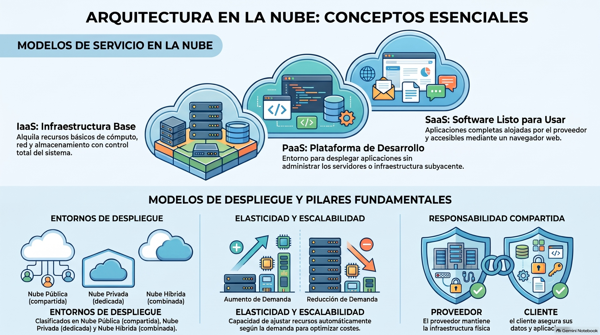

## **Computación en la nube**

**Cloud computing** (computación en la nube) es la **entrega bajo demanda de recursos de tecnologías de la información (TI) y aplicaciones a través de Internet** bajo un esquema de precios de pago por uso (*pay-as-you-go*). 

En lugar de que una empresa tenga que realizar fuertes inversiones de capital inicial (*CapEx*) comprando, configurando y manteniendo hardware o centros de datos físicos propios, alquila capacidad de procesamiento, almacenamiento, redes y bases de datos a proveedores de servicios en la nube (como AWS, Microsoft Azure o Google Cloud) tratándolo como un gasto operativo (*OpEx*).

### Características esenciales
Según el estándar del **NIST** (*National Institute of Standards and Technology*), la computación en la nube se define formalmente mediante cinco características fundamentales:

1. **Autoservicio bajo demanda (*On-demand self-service*):** Los usuarios pueden aprovisionar recursos informáticos (como servidores o almacenamiento) de manera automática y casi instantánea a través de consolas web o APIs, sin requerir intervención humana directa del proveedor.

2. **Acceso amplio a la red (*Broad network access*):** Las capacidades y servicios están disponibles a través de Internet o redes privadas, siendo accesibles desde cualquier lugar del mundo y mediante una amplia variedad de dispositivos (laptops, teléfonos móviles, terminales de trabajo).

3. **Agrupación y compartición de recursos (*Resource pooling / Multi-tenancy*):** La infraestructura física del proveedor se comparte de forma segura y transparente entre múltiples clientes (*tenants*), asignando dinámicamente recursos virtuales según las necesidades.

4. **Rápida elasticidad (*Rapid elasticity*):** Los recursos pueden aumentarse (*scale up/out*) o reducirse (*scale down/in*) dinámicamente y con rapidez para adaptarse a las fluctuaciones de la carga de trabajo, evitando la sobrecapacidad ociosa o la falta de recursos en picos de demanda.

5. **Servicio medido (*Measured service*):** El uso de los recursos se monitoriza, controla y tarifica con precisión; el usuario paga únicamente por el consumo real que realiza (tiempo de CPU, almacenamiento utilizado, ancho de banda, etc.).

### Modelos de servicio
Los servicios de computación en la nube se clasifican según el nivel de control y responsabilidad que asume el usuario frente al proveedor:

* **[IaaS (*Infrastructure as a Service*)](/docs/ingenieria-sistemas/cloud/cloud-iaas):** Entrega la infraestructura base (máquinas virtuales, almacenamiento en disco y componentes de red). El proveedor se encarga de la infraestructura física y la virtualización, mientras que el cliente administra el sistema operativo, los parches, las bases de datos y las aplicaciones. Ejemplos: Amazon EC2, Azure VMs, Google Compute Engine.

* **[PaaS (*Platform as a Service*)](/docs/ingenieria-sistemas/cloud/cloud-paas):** Ofrece un entorno y plataforma completos para desarrollar, probar, desplegar y gestionar aplicaciones. El proveedor se encarga del hardware, el sistema operativo, los tiempos de ejecución (*runtimes*) y la infraestructura subyacente, permitiendo a los desarrolladores centrarse exclusivamente en el código de su aplicación y la lógica de negocio. Ejemplos: AWS Elastic Beanstalk, Azure App Service, Google App Engine.

* **[SaaS (*Software as a Service*)](/docs/ingenieria-sistemas/cloud/cloud-Saas):** Proporciona aplicaciones de software completas y listas para usar a través de un navegador web o API. El proveedor gestiona absolutamente toda la pila tecnológica (servidores, seguridad, mantenimiento, actualizaciones y código). Ejemplos: Microsoft 365, Google Docs/Workspace, Salesforce.

* **[Serverless / FaaS (*Function as a Service*)](/docs/ingenieria-sistemas/cloud/cloud-Serverless):** Una evolución de alto nivel donde la infraestructura y los servidores se abstraen por completo; el desarrollador únicamente carga fragmentos de código (funciones) que se ejecutan en respuesta a eventos específicos, facturándose solo por las fracciones de tiempo exactas que dura la ejecución. Ejemplos: AWS Lambda, Azure Functions, Cloud Functions.

### Modelos de despliegue
Existen diferentes formas de implementar y consumir entornos de nube:

* **Nube pública (*Public Cloud*):** Los recursos e infraestructura física pertenecen a un proveedor externo y se ofrecen de forma compartida (multinquilino) a cualquier organización o usuario a través de Internet.

* **Nube privada (*Private Cloud*):** Infraestructura dedicada de uso exclusivo para una sola organización (*single-tenant*), ubicada en un centro de datos propio o gestionada por un tercero, ofreciendo mayor control, personalización y aislamiento de seguridad.

* **Nube híbrida (*Hybrid Cloud*):** Combina entornos de nube pública y privada (o centros de datos locales tradicionales), permitiendo que las aplicaciones y los datos se trasladen y compartan entre ambos mundos.

### Principales ventajas
* **Sustitución de gastos de capital (*CapEx*) por gastos operativos (*OpEx*):** Elimina el coste de adquisición de hardware físico, licencias perpetuas y costes asociados de espacio y refrigeración.

* **Economías de escala:** Debido a que los grandes proveedores agregan el consumo de cientos de miles de clientes, consiguen costes unitarios significativamente más bajos que se traducen en tarifas reducidas para los usuarios.

* **Alta disponibilidad y tolerancia a fallos:** Los proveedores operan mediante centros de datos redundantes distribuidos en regiones y zonas de disponibilidad a nivel mundial, garantizando continuidad de negocio ante incidentes de hardware.

* **Velocidad y agilidad global:** Permite desplegar infraestructuras y sistemas completos a nivel global en cuestión de minutos con unos pocos clics.

