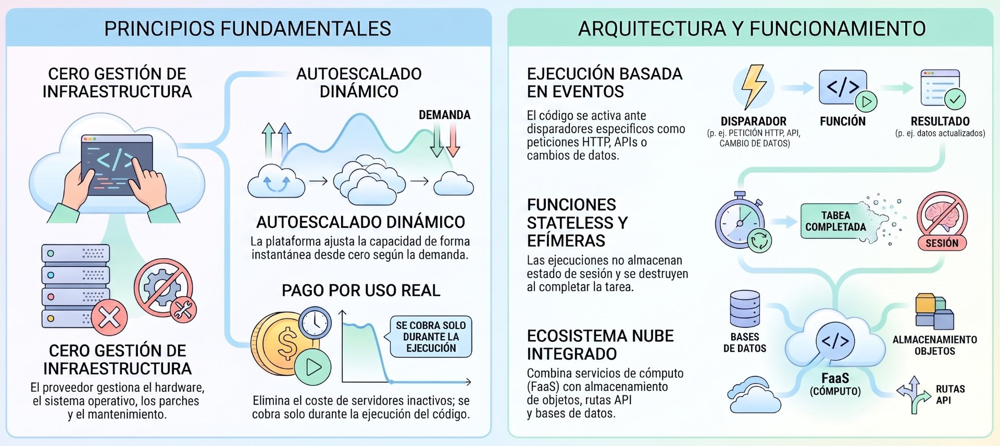
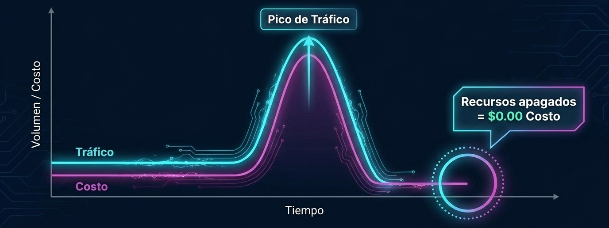
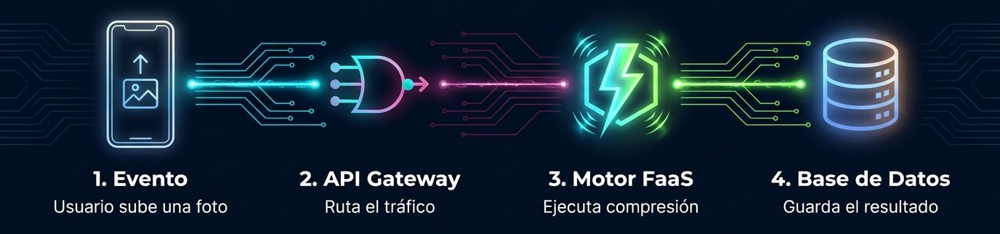
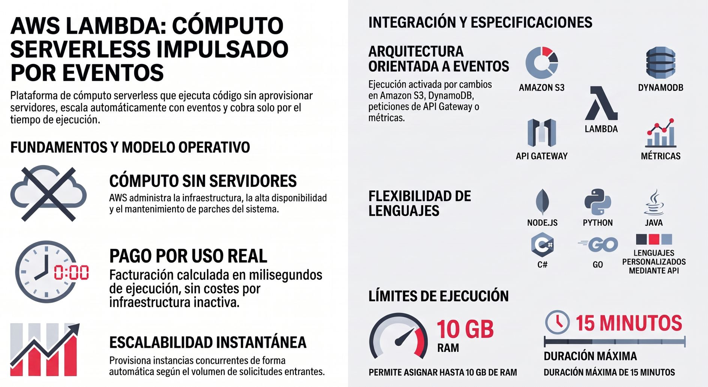
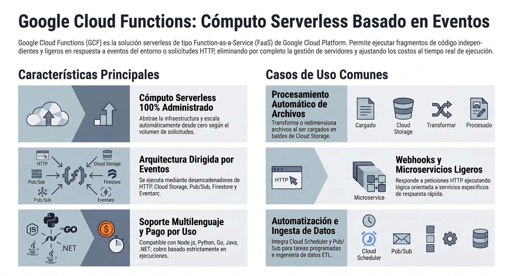
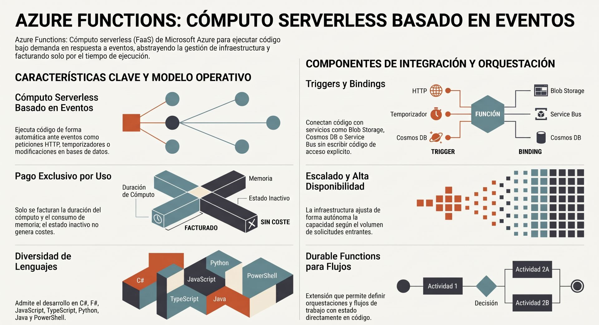

## **Serverless como servicio**

**Serverless** (computación sin servidor) es un modelo de ejecución en la nube donde el proveedor de servicios en la nube gestiona, aprovisiona y escala dinámicamente toda la infraestructura necesaria para ejecutar el código o los flujos de trabajo de una aplicación. 

El término es, en realidad, un nombre engañoso (*misnomer*): **no significa que no existan servidores**, sino que los servidores físicos, las máquinas virtuales, los sistemas operativos, las actualizaciones y el mantenimiento quedan **completamente abstraídos** de la responsabilidad y el control del desarrollador. En comparación con **IaaS** (que abstrae el hardware) y **PaaS** (que abstrae el cómputo), Serverless abstrae incluso la administración del entorno de ejecución y la infraestructura, permitiendo a los equipos de desarrollo centrarse al 100% en la lógica de negocio y en la entrega rápida de valor.

### Características principales

1. **Cero administración de servidores (*No Server Management*):**
   * El desarrollador únicamente escribe su código o diseña sus flujos y los sube a la plataforma.
   * El proveedor de la nube asume las tareas operativas de aprovisionamiento de capacidad, aplicación de parches de seguridad, balanceo de carga, monitoreo de salud y reemplazo de hardware defectuoso.

2. **Escalabilidad automática y *Scale to Zero*:**
   * La infraestructura escala de forma horizontal de manera autónoma en cuestión de segundos para responder con precisión al volumen entrante de peticiones o tareas.
   * Cuando no hay tráfico o la ejecución de una tarea termina, el proveedor desasigna los recursos computacionales y **escala a cero** (*scale to zero*), de modo que no queda ninguna instancia ociosa gastando recursos.

3. **Modelo estricto de pago por consumo (*Pay-per-Use*):**

<figure>

<figcaption>Si nadie usa tu aplicación, el costo se detiene y la memoria se libera automáticamente. Sin embargo, lo contrario también ocurre, aumenta el costo a mayor demanda.</figcaption>
</figure>

   * A diferencia de los servidores tradicionales o instancias virtuales que cobran por hora de disponibilidad sin importar si están ocupados, en serverless **se paga exclusivamente por los recursos consumidos durante la ejecución** (medidos en milisegundos o segundos de tiempo de ejecución y memoria asignada) y por el número de invocaciones o eventos.
   * **No existe costo por capacidad ociosa** (*idle capacity*).

4. **Arquitectura basada en eventos (*Event-Driven Architecture*):**

<figure>

<figcaption>Reacción en cadena en respuesta a eventos.</figcaption>
</figure>

   * El cómputo y los procesos serverless son reactivos: se ejecutan en respuesta a disparadores (*triggers*) o eventos externos.
   * Ejemplos típicos de eventos incluyen: una petición HTTP entrante a través de un API Gateway, la subida o modificación de un archivo en almacenamiento de objetos (como Amazon S3 o Blob Storage), la inserción de un registro en una base de datos, un mensaje depositado en una cola o un cronómetro programado.

5. **Naturaleza efímera y sin estado (*Stateless*):**
   * Las unidades de ejecución serverless son típicamente efímeras y no retienen el estado de la sesión entre una invocación y otra.
   * Cualquier persistencia de datos o estado debe delegarse a servicios externos gestionados, como bases de datos o almacenamiento de objetos.

6. **Alta disponibilidad y tolerancia a fallos incorporada:**
   * Los servicios serverless distribuyen automáticamente la ejecución y replican los datos a través de múltiples **Zonas de Disponibilidad (AZs)** dentro de una región de nube, eliminando puntos únicos de falla sin que el usuario deba diseñar clústeres redundantes manualmente.

### Componentes

Aunque a menudo se equipara serverless únicamente con funciones, la tecnología abarca una suite completa de servicios gestionados (cada uno de estos componentes incurre en costos adicionales):

* **FaaS (*Function as a Service*):** Servicios de cómputo donde se ejecutan bloques de código aislados (como **AWS Lambda**, **Azure Functions** o **Google Cloud Functions**) que atienden eventos puntuales con soporte para múltiples lenguajes de programación (Python, Node.js, C#, Java, Go, etc.).

* **Bases de datos serverless:** Motores de base de datos que ajustan su capacidad y pausado automáticamente según la carga, como **Amazon DynamoDB**, **Amazon Aurora Serverless**, **Azure Cosmos DB** o **Cloud Firestore**.

* **Contenedores serverless:** Soluciones que ejecutan aplicaciones empaquetadas en contenedores Docker sin necesidad de administrar clústeres ni servidores anfitriones, tales como **AWS Fargate**, **Google Cloud Run** y **Azure Container Apps**.

* **Enrutadores de APIs y mensajería:** Componentes como **Amazon API Gateway**, **EventBridge**, **Amazon SQS** o **Azure Event Grid**, que actúan desacoplando sistemas mediante enrutamiento HTTP, colas y buses de eventos.

* **Orquestación de flujos de trabajo:** Herramientas visuales y declarativas para coordinar secuencias de tareas, reintentos y estados entre servicios, tales como **AWS Step Functions** o **Azure Logic Apps**.

### Límites y Aspectos a Considerar

* **Arranque en frío (*Cold Start*):** Cuando una función se invoca por primera vez tras un período de inactividad, el proveedor debe instanciar el entorno de ejecución, lo que puede introducir una latencia inicial de inicialización.

* **Límites de tiempo de ejecución (*Timeouts*):** Las funciones serverless no están diseñadas para tareas infinitas; por ejemplo, las funciones de AWS Lambda tienen un límite máximo de ejecución de 15 minutos.

* **No apto para todas las cargas de trabajo:** Procesos de cálculo numérico intensivo continuo (HPC) o trabajos batch monolíticos de muy larga duración suelen ser más eficientes en arquitecturas de instancias dedicadas o clústeres optimizados.

***
## **Gestión de seguridad**

En las arquitecturas **Serverless**, la gestión de la seguridad cambia el enfoque respecto a la infraestructura tradicional: al no existir servidores ni sistemas operativos que parchear o administrar directamente, la protección se traslada al código, la identidad, las configuraciones de los servicios gestionados y el flujo de eventos. 

A continuación, se detallan los pilares fundamentales para gestionar la seguridad en este modelo:

#### Modelo de Responsabilidad Compartida
La seguridad en entornos serverless opera bajo una división estricta de tareas:
* **Responsabilidad del proveedor cloud (Seguridad *de* la nube):** El proveedor (como AWS) se encarga de proteger la infraestructura física, aislar el entorno de ejecución, mantener el hardware, las zonas de disponibilidad y aplicar parches de seguridad al software del runtime y sistema operativo subyacente.

* **Responsabilidad del desarrollador (Seguridad *en* la nube):** El usuario es responsable de la lógica del código, las bibliotecas y dependencias de terceros, la configuración de los recursos cloud, la gestión de identidades y accesos (IAM) y la protección de los datos.

#### Modelo Zero Trust
En lugar de depender de un perímetro defensivo perimetral tradicional ("castillo y foso"), serverless se adapta de forma natural a una arquitectura **Zero Trust**:
* **Roles de ejecución por función (*Execution Roles*):** Cada función serverless (por ejemplo, AWS Lambda) debe contar con su propio rol de ejecución independiente con los permisos mínimos necesarios (*Principle of Least Privilege*) para ejecutar su tarea específica. Por ejemplo, una función que únicamente consulta el estado de una orden debe tener acceso exclusivo de lectura (`dynamodb:Query`) y no permisos totales sobre la base de datos.

* **Credenciales temporales en lugar de claves estáticas:** No se deben incrustar claves de acceso ni contraseñas en el código o en variables de configuración; el servicio de cómputo utiliza tokens de seguridad efímeros (a través de STS) que rotan automáticamente y expiran en poco tiempo.

* **Evitar comodines (`*`) y políticas genéricas:** Se deben especificar los nombres exactos de recursos (ARN) y las acciones permitidas, evitando el uso de comodines y reemplazando las políticas administradas genéricas por políticas personalizadas ajustadas al caso de uso.

#### Protección y Control de Acceso en el Perímetro de las APIs
La puerta de entrada a la mayoría de las arquitecturas serverless suele ser un API Gateway:
* **Autenticación y Autorización:**
  * **Integración con Identity Providers (IdP):** Uso de servicios como Amazon Cognito para gestionar grupos de usuarios (*user pools*) y autenticación federada con tokens JWT (JSON Web Tokens).
  * **Authorizers (Lambda / JWT):** Implementación de funciones de autorización dedicadas en el API Gateway para validar firmas de tokens de acceso antes de enrutar las peticiones al backend.

* **Validación de peticiones entrantes:** El API Gateway puede contrastar las solicitudes contra esquemas JSON antes de invocar las funciones; si la estructura o los datos son inválidos, la petición se descarta de inmediato con un error `400 Bad Request`, protegiendo el cómputo y la base de datos.

* **Firewall de Aplicaciones Web (WAF):** Desplegar reglas de WAF delante de las APIs permite mitigar ataques comunes (como inyecciones SQL o Cross-Site Scripting) y aplicar límites de tráfico (*throttling*) por dirección IP.

#### Cifrado y Gestión Segura de Secretos
* **Cifrado en tránsito:** Toda la comunicación entre clientes, APIs y servicios gestionados debe realizarse de forma obligatoria a través de HTTPS/TLS, complementada por la firma de peticiones de API (como Signature Version 4).

* **Cifrado en reposo:** Se debe habilitar el cifrado en cada capa de persistencia (tablas de DynamoDB, colas SQS, buckets de almacenamiento S3) gestionando las claves criptográficas mediante servicios centralizados como AWS Key Management Service (KMS).

* **Bóvedas de secretos:** Las credenciales de bases de datos externas, claves de API de terceros y certificados no deben colocarse en texto plano en variables de entorno; deben almacenarse en servicios como **AWS Secrets Manager** o **Systems Manager Parameter Store**, los cuales permiten rotación automática y entrega cifrada en tiempo de ejecución.

#### Cadena de Suministro y Firmado de Código
* **Escaneo de dependencias:** Dado que las dependencias externas (paquetes npm, módulos pip, etc.) se empaquetan y ejecutan con los mismos permisos que la lógica de la función, deben auditarse continuamente para prevenir vulnerabilidades de código de terceros.

* **Firmado de código (*Code Signing*):** Permite verificar que el artefacto desplegado proviene de una fuente autorizada y no ha sido alterado de forma maliciosa durante el pipeline de integración o despliegue.

#### Mitigación de Riesgos Específicos
**DoS y *Denial of Wallet***
* **Throttling y cuotas de uso:** Configurar límites de velocidad (*rate limiting*) y cuotas por cliente en el API Gateway para evitar sobrecargas del sistema.

* **Control de concurrencia y tiempos de espera (*Timeouts*):** Asignar tiempos de ejecución ajustados y límites de ejecuciones concurrentes en las funciones serverless para impedir que bucles infinitos o peticiones masivas generen costes desmedidos (*Denial of Wallet*) o agoten la capacidad de la cuenta.

#### Observabilidad y Detección de Amenazas
* **Auditoría con CloudTrail:** Registrar y centralizar todas las llamadas y eventos de API realizadas por usuarios, roles y servicios para mantener la trazabilidad de cualquier cambio en la infraestructura o acceso a datos.

* **Detección continua de anomalías:** Herramientas como Amazon GuardDuty proporcionan análisis y protección contra comportamientos sospechosos (como ejecución de código malicioso o comunicación de funciones con direcciones IP peligrosas).

***
## **Aspectos de rendimiento**

La optimización del rendimiento en funciones serverless (como **AWS Lambda** o **Azure Functions**) se enfoca en reducir la latencia de respuesta, mitigar los arranques en frío (*cold starts*) y balancear la asignación de recursos computacionales. 

A continuación se detallan las principales estrategias técnicas para optimizarlas:

#### Memoria y CPU
* **Relación directa entre RAM y CPU:** En plataformas serverless como AWS Lambda, la asignación de capacidad de procesamiento (CPU) y recursos de red es directamente proporcional a la memoria RAM configurada (que puede ajustarse desde 128 MB hasta varios gigabytes).

* **El efecto de mayor memoria en el tiempo de ejecución:** Incrementar la memoria asignada no solo evita errores por saturación de RAM, sino que otorga más potencia de CPU. En tareas con uso intensivo de cómputo, una función con 1024 MB puede completar su tarea en una fracción del tiempo que tardaría con 128 MB, logrando una latencia significativamente menor con un costo global prácticamente idéntico.

* **Ajuste continuo (*Power Tuning*):** Se recomienda analizar el consumo real en herramientas de observabilidad como **CloudWatch Lambda Insights** o ejecutar herramientas automatizadas como *AWS Lambda Power Tuning* para encontrar el punto óptimo entre costo y velocidad de ejecución.

#### Mitigación de los Arranques en Frío (*Cold Starts*)
Cuando una función serverless se invoca por primera vez o necesita escalar para atender peticiones concurrentes, el proveedor debe aprovisionar un microentorno o contenedor y cargar el código, lo que añade una latencia inicial conocida como *cold start*. Para minimizar este impacto:
* **Reducir el tamaño del paquete de despliegue:** Mantener el paquete de código lo más pequeño posible. Es crucial excluir dependencias de desarrollo y subir únicamente los submódulos específicos necesarios de los SDKs en lugar de librerías enteras. Menor tamaño de paquete agiliza la descarga y descompresión en el entorno de ejecución.

* **Elección del lenguaje y runtime:** Lenguajes interpretados como **Node.js** o **Python** presentan habitualmente tiempos de inicialización en frío sustancialmente menores que runtimes compilados basados en Java o .NET.

* **Concurrencia aprovisionada (*Provisioned Concurrency*):** Para flujos con requerimientos estrictos de latencia donde no se tolera la variabilidad inicial, se puede configurar concurrencia aprovisionada para mantener instancias preinicializadas y en estado "tibio" (*warm*) de manera permanente.

#### Reutilización del Contexto de Ejecución (*Execution Context Reuse*)
El ciclo de vida de una función serverless consta de una fase de inicialización (*init*) y una fase de invocación (*invoke*):
* **Inicialización fuera del manejador (*handler*):** Todas las tareas que produzcan objetos reutilizables deben ejecutarse en el ámbito global/estático fuera de la función manejadora.

* **Persistencia de conexiones a bases de datos y clientes:** Abrir conexiones a bases de datos (como MongoDB o PostgreSQL) y crear clientes de SDKs en el ámbito global permite reutilizar esas conexiones TCP/HTTP vivas en invocaciones posteriores que reutilicen el contenedor, evitando la penalización de reconexión y evitando agotar los límites de conexiones concurrentes del motor de base de datos.

#### Arquitectura de Código y Patrones de Ejecución
* **Principio de Responsabilidad Única (SRP):** Diseñar funciones pequeñas y enfocadas en una sola tarea en lugar de crear funciones monolíticas pesadas (*Lambdaliths*). Las funciones específicas reducen la complejidad del código, el número de dependencias y el tiempo de arranque.

* **Evitar invocaciones síncronas entre funciones (*Functions calling functions*):** Hacer que una función llame directamente a otra y espere su respuesta es un antipatrón; la primera función permanece ociosa esperando, acumulando tiempo facturable y consumiendo cuotas de concurrencia de la cuenta. Para coordinar tareas complejas, se debe utilizar orquestación de flujos de trabajo (como **AWS Step Functions**) o mensajería asíncrona mediante colas (SQS) o buses de eventos (EventBridge).

* **Procesamiento paralelo (*Fan-Out*):** Para tareas masivas o procesamiento por lotes (como conversión de múltiples archivos o ingesta de datos), el patrón *fan-out* permite que una función inicial fragmente la carga y dispare múltiples funciones en paralelo, completando el proceso mucho más rápido.

* **Evitar recursividad descontrolada:** No usar código recursivo directo que invoque la misma función o escriba al mismo canal que la disparó para prevenir bucles infinitos y estrangulamiento (*throttling*).

#### Almacenamiento, Red y Caché
* **Ajuste de Timeouts:** Configurar límites de tiempo (*timeouts*) estrictos y ajustados al tiempo esperado de respuesta de la lógica de negocio; esto garantiza que fallos en dependencias externas se corten de inmediato en lugar de esperar minutos gastando recursos.

* **Uso de cachés intermedias:** Integrar capas de caché en memoria como **Redis / Memcached** (vía Amazon ElastiCache) o **DynamoDB Accelerator (DAX)** para datos de acceso recurrente, evitando consultas costosas a disco o bases de datos lentas.

* **Validación temprana en API Gateway:** Activar la validación de solicitudes contra esquemas en el API Gateway para rechazar peticiones mal formadas en el perímetro antes de invocar la función de cómputo.

* **Procesadores modernos:** Adoptar arquitecturas de procesador basadas en ARM (como procesadores Graviton), que habitualmente entregan mejor rendimiento por ciclo de cómputo y reducen los costos y consumo de energía.

#### Observabilidad y Trazabilidad
* **Rastreo distribuido:** Implementar herramientas como **AWS X-Ray** para desglosar el tiempo de ejecución en subsegmentos y detectar exactamente qué llamada descendente (red, base de datos externa o API) está introduciendo latencia.
* **Librerías estandarizadas:** Emplear librerías como **AWS Lambda Powertools** para estructurar logs, métricas y trazado eficiente sin sobrecargar el código de la función.

***
## **AWS Lamba sobre EC2**

La principal diferencia entre **AWS Lambda** y las instancias **Amazon EC2** radica en el modelo de computación: mientras que EC2 pertenece al modelo **IaaS** (*Infrastructure as a Service*) donde se aprovisionan y administran servidores virtuales, Lambda es una plataforma **serverless** o **FaaS** (*Function as a Service*) diseñada para ejecutar código en respuesta a eventos con cero administración de infraestructura.

A continuación se detallan las ventajas más significativas de AWS Lambda frente a EC2:

#### Cero administración
* **AWS Lambda:** Elimina por completo las tareas operativas de aprovisionamiento, configuración del sistema operativo, aplicación de parches de seguridad y mantenimiento de hardware. El desarrollador únicamente carga su código y define las fuentes de eventos.
* **Amazon EC2:** Requiere que el usuario asuma la gestión completa del sistema operativo invitado (*guest OS*), parches de software, librerías, dependencias, espacio en disco y configuración de red.

#### Modelo de cobro por uso real (*Pay-per-Use*) 
**sin capacidad ociosa**

* **AWS Lambda:** La facturación es granular y se cobra estrictamente por el número de solicitudes y la duración exacta de ejecución (medida en milisegundos o fracciones de 100 ms) junto con la memoria RAM consumida. Si no se reciben peticiones o la función está inactiva, **el costo es cero**, eliminando el gasto por capacidad ociosa.
* **Amazon EC2:** Se factura de forma continua (por hora o por segundo) mientras la instancia permanezca encendida, independientemente de si está procesando tráfico o si la CPU está al 0% de uso.

#### Escalabilidad automática inmediata y *Scale to Zero*
* **AWS Lambda:** Escala de manera horizontal automática e instantánea ejecutando tantas copias en paralelo de la función como peticiones o eventos concurrentes lleguen. Cuando el tráfico finaliza, el entorno se desasigna automáticamente y escala a cero (*scale to zero*).
* **Amazon EC2:** Para escalar requiere configurar grupos de Auto Scaling, definir políticas basadas en métricas de CloudWatch (como porcentaje de CPU) y asociar balanceadores de carga (ELB). Además, arrancar una nueva instancia EC2 toma minutos.

#### Alta disponibilidad y tolerancia a fallos incorporada
* **AWS Lambda:** Se ejecuta por defecto de manera distribuida y redundante a través de múltiples **Zonas de Disponibilidad (AZs)** dentro de una región. Esto garantiza tolerancia a fallos nativa sin necesidad de diseñar clústeres redundantes.
* **Amazon EC2:** Una instancia individual reside en una sola Zona de Disponibilidad. Lograr alta disponibilidad exige que el arquitecto despliegue múltiples instancias en distintas AZs y distribuya el tráfico mediante Elastic Load Balancing.

#### Integración nativa orientada a eventos (*Event-Driven*)
* **AWS Lambda:** Se integra de forma directa como consumidor reactivo de eventos con decenas de servicios de AWS (como cargas de archivos en S3, modificaciones en DynamoDB, mensajes en SQS o peticiones en API Gateway).
* **Amazon EC2:** Para procesar estos eventos habitualmente requiere implementar demonios en segundo plano o procesos que realicen sondeos continuos (*polling*), consumiendo recursos de cómputo constantes.

### Resumen Comparativo

| Característica | AWS Lambda (Serverless / FaaS) | Amazon EC2 (IaaS) |
| :--- | :--- | :--- |
| **Administración** | **Cero gestión:** AWS administra SO, parches y hardware. | **Total:** El usuario gestiona SO, actualizaciones y configuración. |
| **Modelo de costos** | Por solicitud y tiempo de cómputo en ejecución (0\$ en reposo). | Por tiempo de encendido de la instancia (activa o inactiva). |
| **Escalamiento** | Automático, por evento y capaz de escalar a cero. | Mediante Auto Scaling y balanceadores; requiere minutos para aprovisionar. |
| **Alta disponibilidad** | Multi-AZ nativa e integrada. | Requiere arquitectura explícita multi-AZ con ELB. |
| **Límites de tiempo** | Tiempo máximo de ejecución de 15 minutos por invocación. | Sin límite de tiempo (procesos continuos 24/7). |
| **Control del entorno** | Abstraído (lenguajes y runtimes soportados). | Acceso raíz completo y configuración personalizada de red y hardware. |

### ¿Cuándo sigue siendo preferible EC2?
A pesar de las ventajas de Lambda, EC2 es la opción adecuada cuando se requiere:
* Tareas de procesamiento de muy larga duración que superen los 15 minutos de ejecución (como ciertos trabajos *batch* masivos).
* Cargas continuas de cálculo intensivo (*HPC*) o acceso directo a aceleradores hardware (GPUs) y configuraciones a bajo nivel del kernel del sistema operativo.
* Aplicaciones heredadas monolíticas (*legacy*) difíciles de descomponer en funciones independientes.

***
## **Comparativa en cloud**

El ecosistema **serverless** abarca múltiples capas arquitectónicas diseñadas para eliminar la gestión de servidores, escalar automáticamente hasta cero y cobrar estrictamente por el consumo realizado. Los tres principales proveedores de nube pública (**AWS**, **Google Cloud Platform - GCP** y **Microsoft Azure**) ofrecen alternativas equivalentes y maduras para cada capa.

A continuación se presenta una comparativa técnica detallada estructurada por capas y categorías de servicio.

*   **AWS (AWS Lambda):** Pionero del modelo FaaS. Destaca por su profunda integración nativa con más de 30 servicios de AWS, soporte para múltiples lenguajes (Node.js, Python, Java, C#, Go, PowerShell) y empaquetado de contenedores de hasta 10 GB. Su tiempo límite máximo de ejecución por invocación es de 15 minutos.

*   **GCP (Cloud Functions):** Diseñado para eventos ligeros y microservicios reactivos en la nube de Google. Se integra directamente con Cloud Storage, Cloud Pub/Sub y Eventarc. Soporta Node.js, Python, Go, Java, .NET y Ruby. Ofrece tiempos de respuesta muy rápidos y simplicidad de despliegue.

*   **Azure (Azure Functions):** Motor de funciones basado en desencadenadores (*triggers*) y enlaces (*bindings*) declarativos que reducen drásticamente el código de conexión a bases de datos o colas. Soporta C#, F#, JavaScript, Python, PowerShell y Java. Con la extensión **Durable Functions**, permite orquestar flujos y tareas con estado (*stateful*) de manera nativa mediante código.

#### Contenedores
Ejecutan contenedores completos sin tener que gestionar máquinas virtuales, nodos ni clústeres subyacentes.

*   **AWS (AWS Fargate):** Motor de cómputo serverless que ejecuta tareas en **Amazon ECS** y **Amazon EKS**. Es ideal para cargas de trabajo en contenedores aisladas, tareas batch y microservicios continuos sin preocuparse por la selección de instancias EC2 o parches.

*   **GCP (Cloud Run):** Plataforma serverless basada en el estándar abierto Knative que ejecuta contenedores HTTP sin estado. Destaca por su velocidad de despliegue, soporte para cualquier lenguaje empaquetado en Docker, escalado automático rápido a cero y capacidad de concurrencia múltiple por contenedor.

*   **Azure (Azure Container Instances - ACI / Azure Container Apps - ACA):** 
    *   *ACI:* La forma más rápida y sencilla de ejecutar un contenedor aislado en segundos sin orquestación pesada.
    *   *ACA:* Plataforma serverless diseñada específicamente para microservicios y APIs basada en Kubernetes, integrada de fábrica con **KEDA** (escalado basado en eventos) y **Dapr** (runtime de aplicaciones distribuidas).

#### Bases de Datos y Almacenamiento
Bases de datos que escalan automáticamente su capacidad de procesamiento y almacenamiento bajo demanda.

*   **NoSQL Operacional / Documental:**
    *   **AWS DynamoDB:** Base de datos NoSQL clave-valor y documental totalmente gestionada, con latencia de milisegundos de un solo dígito a cualquier escala y modo de capacidad bajo demanda.
    *   **GCP Cloud Firestore:** Base de datos NoSQL de documentos sin servidor, con sincronización de datos en tiempo real, soporte offline para clientes web/móviles y transacciones ACID.
    *   **Azure Cosmos DB:** Base de datos multimodelo distribuida globalmente con latencia garantizada de milisegundos, SLAs del 99.999% y modelo de facturación serverless por unidades de solicitud (RU).
*   **Analítica y Data Warehouse Serverless:**
    *   **AWS Athena:** Motor de consultas interactivas serverless basado en SQL estándar para consultar datos directamente sobre buckets de Amazon S3 sin servidores.
    *   **GCP BigQuery:** Almacén de datos analítico (*data warehouse*) totalmente serverless, con separación de cómputo y almacenamiento, capaz de procesar petabytes en minutos mediante SQL estándar y capacidades de Machine Learning integradas (BigQuery ML).
    *   **Azure Synapse Serverless SQL Pools:** Servicio de consulta bajo demanda que permite consultar y transformar archivos Parquet/CSV directamente en el Data Lake usando sintaxis T-SQL sin aprovisionar clústeres.

#### Orquestación
**Enrutamiento de Eventos y Mensajería**

Componentes reactivos que desacoplan las piezas arquitectónicas.

*   **Orquestación de Flujos de Trabajo:**
    *   **AWS:** *AWS Step Functions* (coordinación de microservicios y tareas distribuidas mediante máquinas de estado visuales y declarativas).
    *   **GCP:** *Cloud Workflows* (orquestador serverless de baja latencia para coordinar APIs HTTP y servicios de Google Cloud).
    *   **Azure:** *Azure Logic Apps* (plataforma de integración y flujos de trabajo sin código con cientos de conectores empresariales predefinidos).
*   **Buses de Eventos y Colas:**
    *   **AWS:** *Amazon EventBridge* (bus de eventos serverless con filtrado avanzado y reglas), *Amazon SNS* (publicación/suscripción) y *Amazon SQS* (colas desacopladas).
    *   **GCP:** *Cloud Pub/Sub* (ingesta y distribución masiva de eventos en tiempo real) y *Eventarc* (enrutamiento de eventos hacia Cloud Run o Cloud Functions).
    *   **Azure:** *Azure Event Grid* (enrutamiento reactivo de eventos a gran escala con entrega de alta disponibilidad) y *Azure Service Bus* (mensajería empresarial con colas y tópicos).

### Tabla comparativa

| Capa Arquitectónica | AWS | Google Cloud Platform (GCP) | Microsoft Azure |
| :--- | :--- | :--- | :--- |
| **FaaS (Funciones)** | AWS Lambda | Cloud Functions | Azure Functions |
| **CaaS (Contenedores)** | AWS Fargate | Cloud Run | Azure Container Apps / ACI |
| **Bases de Datos NoSQL** | DynamoDB | Firestore / Datastore | Cosmos DB |
| **Analítica / Data Warehouse** | Amazon Athena / Redshift Serverless | BigQuery | Synapse Serverless SQL Pools |
| **Orquestación de Flujos** | AWS Step Functions | Cloud Workflows | Azure Logic Apps / Durable Functions |
| **Buses de Eventos** | Amazon EventBridge | Eventarc / Cloud Pub/Sub | Azure Event Grid |
| **Colas de Mensajes** | Amazon SQS | Cloud Pub/Sub | Azure Service Bus (Queues) |
| **API Gateways** | Amazon API Gateway | API Gateway / Cloud Endpoints | Azure API Management (Consumption Tier) |
| **Almacenamiento de Objetos** | Amazon S3 | Cloud Storage | Azure Blob Storage |

### Fortalezas clave

1.  **AWS:** Posee el ecosistema serverless más veterano, extenso y adoptado. Destaca por su soporte para arquitecturas *functionless* (integración directa entre API Gateway, EventBridge, SQS y DynamoDB sin necesidad de escribir funciones intermedias).

2.  **GCP:** Sobresale en la simplicidad para desarrolladores y el procesamiento masivo de datos. Su producto estrella, **Cloud Run**, simplificó el modelo serverless al estandarizarlo sobre contenedores Docker con portabilidad total (Knative), mientras que **BigQuery** es el estándar de referencia en analítica serverless.

3.  **Azure:** Ofrece la mejor integración para entornos empresariales y corporativos Microsoft (.NET, Active Directory/Entra ID). Su modelo de enlaces (*bindings*) en **Azure Functions** y el soporte de flujos de trabajo con estado mediante **Durable Functions** y **Logic Apps** facilitan la orquestación compleja de procesos de negocio.

***
## **Costos comparados**

La comparación de costos entre **AWS Lambda** y las funciones serverless de **Google Cloud (Cloud Functions)** se fundamenta en un modelo común de pago por uso (*pay-as-you-go*), pero presenta diferencias técnicas en sus métricas de cálculo, límites del nivel gratuito (*Free Tier*) y tarifas por invocación y cómputo.

### Modelo de Facturación
**Métricas Principales**

*   **AWS Lambda:**
    *   **Invocaciones:** Se cobra por cada solicitud o disparo de la función.
    *   **Tiempo de cómputo y memoria:** El costo se calcula en **GB-segundos** (memoria RAM asignada multiplicada por la duración de la ejecución, medida en incrementos de 100 ms).
    *   **CPU vinculada a la memoria:** El usuario no configura ni paga la CPU de forma separada; la capacidad de procesamiento (CPU) se asigna de manera automáticamente proporcional a la cantidad de memoria RAM configurada. Además, permite optar por procesadores **ARM (Graviton2)**, lo que reduce el costo por GB-segundo frente a arquitecturas x86 estándar.

*   **Google Cloud Functions (GCF):**
    *   **Invocaciones:** Se factura por el número de veces que se ejecuta la función a partir de eventos o peticiones HTTP.
    *   **Cómputo desagregado (CPU y Memoria):** A diferencia de Lambda, GCP calcula y factura el consumo de cómputo desglosando la memoria consumida (GB-segundo) y la capacidad de procesamiento de procesador utilizada (**GHz-segundo** de utilización de cómputo).
    *   **Tráfico de salida (*Network Egress*):** El tráfico de red saliente hacia Internet o entre regiones se factura por GB transferido.

### Comparativa del Nivel Gratuito

Ambas plataformas incluyen asignaciones gratuitas mensuales que no caducan al terminar el primer año:

*   **AWS Lambda:**
    *   **1.000.000 de solicitudes** gratuitas por mes por cuenta.
    *   **400.000 GB-segundos** de cómputo gratuitos al mes.

*   **Google Cloud Functions:**
    *   **2.000.000 de invocaciones** gratuitas por mes.
    *   **5 GB de transferencia de red saliente (*egress*)** gratuita mensual.
    *   Cuotas mensuales de GHz-segundos y GB-segundos de cómputo dentro del programa *Always Free* de GCP.

### Costos de Invocación

*   **AWS Lambda:** Cobro fijo de **\$0.20 por cada 1 millón de solicitudes** adicionales.

*   **Google Cloud Functions:** Cobro de **\$0.40 por cada 1 millón de invocaciones** una vez superados los 2 millones de cortesía.

### Costos Asociados

Al evaluar el costo total de la arquitectura, deben considerarse los servicios integrados:

*   **Puertas de enlace de API:** Exponer funciones mediante HTTP suele requerir servicios de API. En AWS, **Amazon API Gateway** agrega un costo (aproximadamente \$3.50 por millón de llamadas tras el período inicial de free tier), mientras que en GCP se puede invocar directamente mediante endpoints HTTP nativos de la función o mediante Cloud Endpoints.
*   **Monitoreo y almacenamiento de registros:** 
    *   En AWS, los registros y métricas enviados a **Amazon CloudWatch** (ingesta, almacenamiento y alarmas) suelen representar una de las partidas más significativas del gasto total en aplicaciones serverless.
    *   En GCP, el almacenamiento y exportación de métricas y registros mediante **Cloud Logging** y **Cloud Monitoring** genera cargos basados en el volumen de datos retenido una vez superadas las cuotas gratuitas del proyecto.

*   **Transferencia de datos (*Egress*):** La subida de datos (*ingress*) es gratuita en ambos proveedores, pero la transferencia de datos hacia clientes externos en Internet o entre distintas regiones geográficas incurre en costos adicionales por gigabyte.

### Tabla Resumen

| Factor de Costo | AWS Lambda | Google Cloud Functions |
| :--- | :--- | :--- |
| **Invocaciones gratuitas (al mes)** | 1.000.000 | **2.000.000** |
| **Tarifa por millón de invocaciones** | **\$0.20** | \$0.40 |
| **Métrica de cobro de cómputo** | GB-segundo (memoria configurada; CPU proporcional) | GHz-segundo (CPU) + GB-segundo (Memoria) |
| **Optimización de procesador** | Soporta instancias ARM (Graviton2) de menor costo | Opciones de asignación de CPU y concurrencia (Gen 2 / Cloud Run) |
| **Tráfico saliente (*Egress*) gratuito** | Varía según el nivel gratuito general de AWS | **5 GB mensuales incluidos** |

***
## **AWS Lambda**

**AWS Lambda** es un servicio de cómputo serverless (*Function as a Service* o FaaS) de administración cero que ejecuta código en respuesta a eventos o peticiones directas sin requerir el aprovisionamiento ni la gestión de servidores. 

Su funcionamiento interno se organiza en las siguientes etapas y componentes clave:

#### El ciclo de ejecución y los entornos de cómputo
Aunque el usuario no gestiona infraestructura, el código se ejecuta sobre una flota administrada por AWS en múltiples Zonas de Disponibilidad:

* **Inicialización (*Cold Start* vs. *Warm Start*):** Cuando se dispara una función, Lambda verifica si existe un entorno de ejecución activo y desocupado.
  * **Arranque en frío (*Cold start*):** Si no hay un contenedor disponible o la función estaba inactiva, Lambda descarga el paquete de código, inicia el entorno de ejecución (microVM) y ejecuta el código estático fuera del manejador (*init phase*).
  * **Contenedor caliente (*Warm execution*):** Si un contenedor ya está activo tras una invocación reciente, reutiliza el entorno directamente, evitando la latencia de inicialización.
* **El Manejador (*Handler*):** La ejecución comienza en una función o método específico denominado *handler*, el cual recibe dos argumentos esenciales:
  * **Objeto `event`:** Contiene la carga útil (*payload*) y los metadatos específicos del servicio que disparó la función (por ejemplo, el bucket y nombre de archivo si viene de Amazon S3, o cabeceras y parámetros HTTP si proviene de API Gateway).
  * **Objeto `context`:** Provee información del entorno en tiempo de ejecución, como el tiempo restante antes del *timeout* y el flujo de logs en Amazon CloudWatch.
* **Naturaleza efímera y escalado a cero (*Scale to Zero*):** Las funciones son sin estado (*stateless*). Una vez que el código responde o agota su tiempo asignado, el entorno queda en reposo y, tras un período de inactividad, los recursos se liberan, reduciendo el consumo a cero.

#### Modelos de invocación
Lambda interactúa con los orígenes de eventos mediante tres mecanismos principales:

* **Modelo Push (Fuentes de eventos sin flujo):** Servicios como **Amazon S3**, **Amazon SNS**, **Amazon EventBridge** o **Amazon API Gateway** invocan directamente a la función cuando ocurre una acción (como la subida de un archivo o la llegada de una solicitud web).

* **Modelo Pull (Fuentes de eventos basadas en flujo/colas):** Para servicios de streaming como **Amazon Kinesis Data Streams** o **Amazon DynamoDB Streams**, Lambda sondea (*polls*) de manera continua las particiones (*shards*), obtiene los registros en lotes y ejecuta la función.

* **Síncrono vs. Asíncrono:** 
  * En una invocación **síncrona** (`RequestResponse`), el cliente espera el resultado de la función en tiempo real (habitual en APIs con API Gateway).
  * En una invocación **asíncrona** (`Event`), Lambda encola el evento, responde de inmediato al emisor y gestiona reintentos automáticos en caso de fallo, pudiendo enviar los eventos fallidos a una cola de mensajes no entregados (*Dead Letter Queue* - DLQ).

#### Modelo de seguridad y permisos
La seguridad de una función se estructura mediante dos tipos de políticas de IAM:
* **Rol de ejecución (*Execution Role*):** Es un rol de IAM asignado a la función que define a qué otros recursos de AWS tiene permiso de acceder mientras procesa el evento (por ejemplo, escribir logs en CloudWatch, leer de DynamoDB o acceder a S3).

* **Política de recursos (*Function Policy* / *Invocation Permissions*):** Otorga permisos explícitos a servicios externos o cuentas de AWS para que puedan invocar la función de Lambda.

#### Escalamiento, recursos y costos
* **Escala por concurrencia:** La unidad de escalado es la **concurrencia**. Si se reciben múltiples peticiones simultáneas, Lambda instancia copias independientes de la función para procesar cada evento en paralelo hasta el límite de concurrencia de la cuenta.

* **Asignación de hardware:** El desarrollador únicamente define la **memoria RAM** (desde 128 MB hasta capacidades superiores); la capacidad de CPU y el ancho de banda de red se asignan de forma estrictamente proporcional a la memoria elegida.

* **Límites de tiempo:** Cada invocación tiene un límite de ejecución configurable de hasta **15 minutos** (*timeout*).

* **Cobro por uso:** Se factura únicamente por el tiempo exacto en que el código está en ejecución (medido en incrementos de 100 ms) y el número total de solicitudes, sin costo alguno mientras no haya tráfico.

***
## **Cloud Functions**

**Google Cloud Functions (GCF)** es la plataforma de cómputo serverless bajo el modelo *Function as a Service* (FaaS) de Google Cloud Platform (GCP). Permite ejecutar pequeños fragmentos de código o lógica de negocio de ámbito específico sin necesidad de aprovisionar, administrar ni configurar servidores o entornos de ejecución.

Su funcionamiento técnico se organiza en los siguientes pilares:

#### Modelo Orientado a Eventos y Tipos de Triggers
El principio central de Cloud Functions es reaccionar ante eventos. Se distinguen principalmente dos tipos de funciones según su origen de disparo:

* **Funciones HTTP (*HTTP Functions*):** Se invocan directamente mediante una solicitud web estándar (GET, POST, PUT, DELETE) a través de una URL o endpoint público o autenticado. Son ideales para construir APIs ligeras, webhooks o backend para aplicaciones móviles y web.
* **Funciones en Segundo Plano (*Background / Event-driven Functions*):** Se ejecutan de manera asíncrona en respuesta a eventos emitidos por otros servicios del ecosistema de Google Cloud o de terceros. Entre los desencadenadores habituales se encuentran:
  * **Cloud Storage:** Se dispara automáticamente cuando se crea, modifica, elimina o archiva un objeto o archivo dentro de un bucket (por ejemplo, para redimensionar imágenes o procesar archivos de carga).
  * **Cloud Pub/Sub:** Se activa al publicarse un mensaje en un tópico o canal de mensajería asíncrona.
  * **Eventarc (GCF 2ª Generación):** Permite canalizar más de 90 eventos directos procedentes de servicios de Google Cloud y eventos basados en el estándar CloudEvents.
  * **Cloud Firestore / Firebase:** Reacciona ante inserciones, actualizaciones o eliminaciones de documentos en bases de datos NoSQL.
  * **Cloud Scheduler:** Ejecución programada mediante expresiones temporales tipo *cron* (por ejemplo, para copias de seguridad periódicas o tareas de mantenimiento).

#### Ciclo de Vida y Entorno de Ejecución
Aunque el desarrollador no ve servidores, Google gestiona la infraestructura subyacente:

1. **Despliegue:** El código fuente se escribe en uno de los lenguajes soportados (como **Python, Node.js, Java, Go, Ruby, PHP o .NET Core**). El desarrollador define un punto de entrada (*entry point*), que es el nombre de la función o método que atenderá la llamada. Durante el despliegue, herramientas como **Cloud Build** compilan y empaquetan la función.

2. **Invocación y Arranque en Frío (*Cold Start*):** Cuando se recibe el primer evento o la función pasa de estar inactiva a recibir tráfico, la plataforma aprovisiona un entorno de ejecución ligero, carga el runtime y ejecuta el código de inicialización. Si ya existe una instancia activa reciente, se atiende de forma inmediata (*warm execution*).

3. **Ejecución y Aislamiento:** Cada invocación de una función tradicional procesa una petición a la vez dentro de un entorno seguro y aislado. En GCF de 2ª generación (construido sobre la infraestructura de Cloud Run), se añade soporte para concurrencia de peticiones en una misma instancia.

4. **Desmantelamiento (*Scale to Zero*):** Las funciones son inherentemente **sin estado (*stateless*)**. Una vez que el código finaliza su tarea o entrega el resultado, los recursos computacionales se liberan; si no hay tráfico entrante, el número de instancias activas desciende a cero sin generar costo alguno.

#### Escalamiento Automático y Límites Operativos
* **Escalabilidad Elástica:** GCF escala horizontalmente de manera automática según la carga entrante. Si de pronto llegan miles de peticiones o archivos simultáneos, Google levanta instantáneamente tantas copias de la función como sean necesarias.

* **Control de Instancias Máximas (`--max-instances`):** Para proteger bases de datos relacionales u otros sistemas cliente frente a picos repentinos de concurrencia y controlar el costo, los desarrolladores pueden fijar un tope máximo de instancias concurrentes.

* **Tiempos de Espera (*Timeouts*):** Cada función tiene un límite máximo de ejecución para evitar procesos bloqueados; el valor predeterminado típico es de 1 minuto, pudiendo configurarse habitualmente hasta un máximo de 9 minutos.

* **Asignación de Memoria y CPU:** Al configurar la función, se asigna una cuota de memoria RAM (habitualmente desde 128 MB hasta varios gigabytes); la capacidad de procesamiento de CPU (GHz) se escala de forma directamente proporcional al tamaño de memoria seleccionado.

#### Seguridad, Permisos y Observabilidad
* **Autenticación con IAM:** El acceso a la función se controla mediante Cloud IAM. Puede configurarse para acceso anónimo o público (`Allow unauthenticated invocations`), o bien exigir tokens de identidad asignando el rol `roles/cloudfunctions.invoker` a usuarios, cuentas de servicio o recursos autorizados.

* **Monitoreo y Registros:** Cada ejecución envía métricas automáticamente (tiempo de ejecución, latencias, fallos y número de invocaciones) a **Cloud Monitoring**, y salidas estándar (`stdout`/`stderr`) a **Cloud Logging**, facilitando la depuración y auditoría sin configuraciones complejas.

#### Esquema de Costos
Cloud Functions opera bajo el esquema de **pago por uso (*pay-as-you-go*)**:
* Se cobra por el número de invocaciones, la memoria consumida (**GB-segundos**) y la capacidad de procesador utilizada (**GHz-segundos**) calculados exclusivamente durante el tiempo de ejecución.
* Incluye un nivel gratuito mensual dentro del programa *Always Free* de GCP (que abarca hasta 2 millones de invocaciones y 5 GB de tráfico saliente al mes).

***
## **Azure Functions**

**Azure Functions** es el servicio de cómputo **serverless** (*Function as a Service* o FaaS) de Microsoft Azure diseñado para acelerar el desarrollo permitiendo ejecutar pequeños fragmentos de código o lógica de negocio en la nube sin la necesidad de aprovisionar ni administrar infraestructura o máquinas virtuales. 

Su funcionamiento se basa en un modelo **orientado a eventos** (*event-driven*), compuesto por los siguientes pilares técnicos fundamentales:

#### El Núcleo de Ejecución
**Desencadenadores (*Triggers*) y Enlaces (*Bindings*)**

A diferencia de otros entornos de funciones, Azure Functions simplifica la conectividad mediante dos conceptos clave que evitan tener que programar código repetitivo de conexión a servicios externos:

*   **Desencadenadores (*Triggers*):** Definen **cómo** se invoca una función. Toda función de Azure debe tener exactamente un desencadenador. Cuando el evento ocurre, el proveedor carga el código en un entorno de ejecución adecuado, procesa el payload y libera los recursos. Algunos ejemplos comunes incluyen:
    *   **HTTP Trigger:** Invocación directa mediante una solicitud web / URL estándar (APIs REST).
    *   **Timer Trigger:** Ejecución programada periódicamente según un cronómetro o expresión horaria.
    *   **Blob Storage Trigger:** Se dispara cuando un archivo se carga, modifica o elimina en un contenedor de almacenamiento.
    *   **Queue y Service Bus Triggers:** Se activa cuando llega un mensaje nuevo a una cola de almacenamiento o tópico de mensajería empresarial.
    *   **Event Grid / Cosmos DB Triggers:** Respuestas reactivas a cambios en bases de datos o eventos del sistema en la nube.

*   **Enlaces (*Bindings*):** Permiten conectar de forma declarativa otros recursos de datos a la función sin escribir código de autenticación o clientes SDK.
    *   **Input Bindings:** Proporcionan datos de entrada directamente como parámetros de la función (por ejemplo, leer un documento de Cosmos DB).
    *   **Output Bindings:** Permiten enviar el resultado de la función a un destino (como insertar un registro en una base de datos o enviar un mensaje a una cola) simplemente devolviendo el valor.
    *   Ambos se configuran habitualmente en un archivo declarativo (`function.json`) indicando la dirección del flujo (`in`, `out` o `inout`).

#### Estructura de la Aplicación (*Function App*)
En Azure, las funciones no existen de forma aislada; se agrupan dentro de un contenedor lógico llamado **Function App**:
*   La *Function App* representa la unidad de implementación, gestión y escalabilidad.
*   Todas las funciones dentro de una misma *Function App* comparten la misma configuración de red, variables de entorno, autenticación integrada (con Azure AD / OAuth) y la versión de ejecución del lenguaje (*runtime*).
*   Es compatible con múltiples lenguajes: **C#, F#, JavaScript, TypeScript, Python, PowerShell y Java**.

#### Modelos de Alojamiento y Facturación
Azure Functions puede ejecutarse bajo diferentes esquemas según el nivel de control y costo requerido:
*   **Plan de Consumo (*Consumption Plan* - Serverless puro):** 
    *   Azure aprovisiona y retira recursos dinámicamente según la demanda.
    *   **Escala a cero (*Scale to zero*):** Si no hay eventos, no hay instancias corriendo y el costo es cero.
    *   **Pago por uso:** Se factura exclusivamente por el número de ejecuciones y los segundos/recursos de memoria consumidos durante la ejecución activa.
    *   Incluye un nivel gratuito mensual (por ejemplo, el primer millón de ejecuciones al mes).
*   **Plan App Service / Planes Dedicados:** Permite ejecutar las funciones en máquinas virtuales dedicadas preasignadas. Es útil cuando se requiere cómputo continuo sin límites de tiempo de ejecución o para evitar arranques en frío.

#### Flujos con Estado: Azure Durable Functions
Por defecto, las funciones serverless son **sin estado (*stateless*)** y efímeras. Sin embargo, cuando se requieren coordinar procesos complejos o flujos de trabajo de negocio, Azure Functions ofrece una extensión especializada llamada **Durable Functions**:
*   Permite escribir flujos de trabajo con estado de manera programática (mediante código en C#, JavaScript, Python, etc.) sin necesidad de gestionar manualmente la persistencia en bases de datos.
*   Gestiona puntos de control (*checkpoints*) y reintentos ante fallas automáticamente utilizando un motor de abastecimiento de eventos (*event sourcing*).
*   Admite patrones de arquitectura distribuida avanzados:
    *   **Encadenamiento de funciones (*Function Chaining*):** La salida de una función es la entrada directa de la siguiente en secuencia.
    *   **Distribución en abanico (*Fan-Out / Fan-In*):** Ejecutar múltiples funciones en paralelo y esperar a que todas terminen para consolidar el resultado.
    *   **APIs HTTP asíncronas:** Exponer operaciones de larga duración que devuelven un endpoint para consultar el estado del proceso.
    *   **Interacción humana:** Pausar el flujo hasta recibir una confirmación o aprobación externa (ej. un correo o webhook de un gerente) con control de expiración (*timeouts*).

#### Diferencia Clave: Azure Functions vs. Azure Logic Apps
Dentro del ecosistema serverless de Azure, a menudo se compara con **Logic Apps**:
*   **Azure Functions:** Enfoque *Code-first* (imperativo). Diseñado para desarrolladores que necesitan ejecutar algoritmos personalizados, parsing de datos complejo o microservicios ligeros utilizando código tradicional.
*   **Azure Logic Apps:** Enfoque *Designer-first* (declarativo, no-code/low-code). Diseñado para orquestar y automatizar flujos de trabajo empresariales y procesos de negocio conectando múltiples servicios mediante una interfaz visual y conectores preconstruidos.

⚡ Si te interesa, podemos profundizar en cómo configurar un archivo `function.json` con triggers y bindings de almacenamiento o en cómo implementar un patrón de *Fan-Out/Fan-In* con Durable Functions.