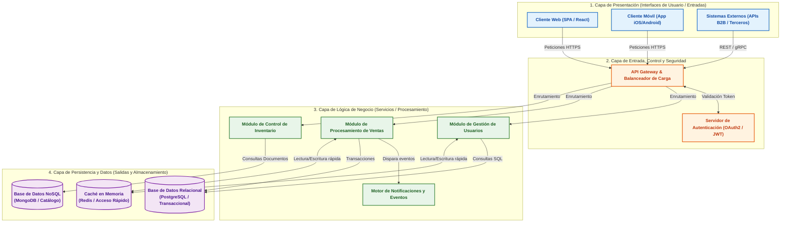
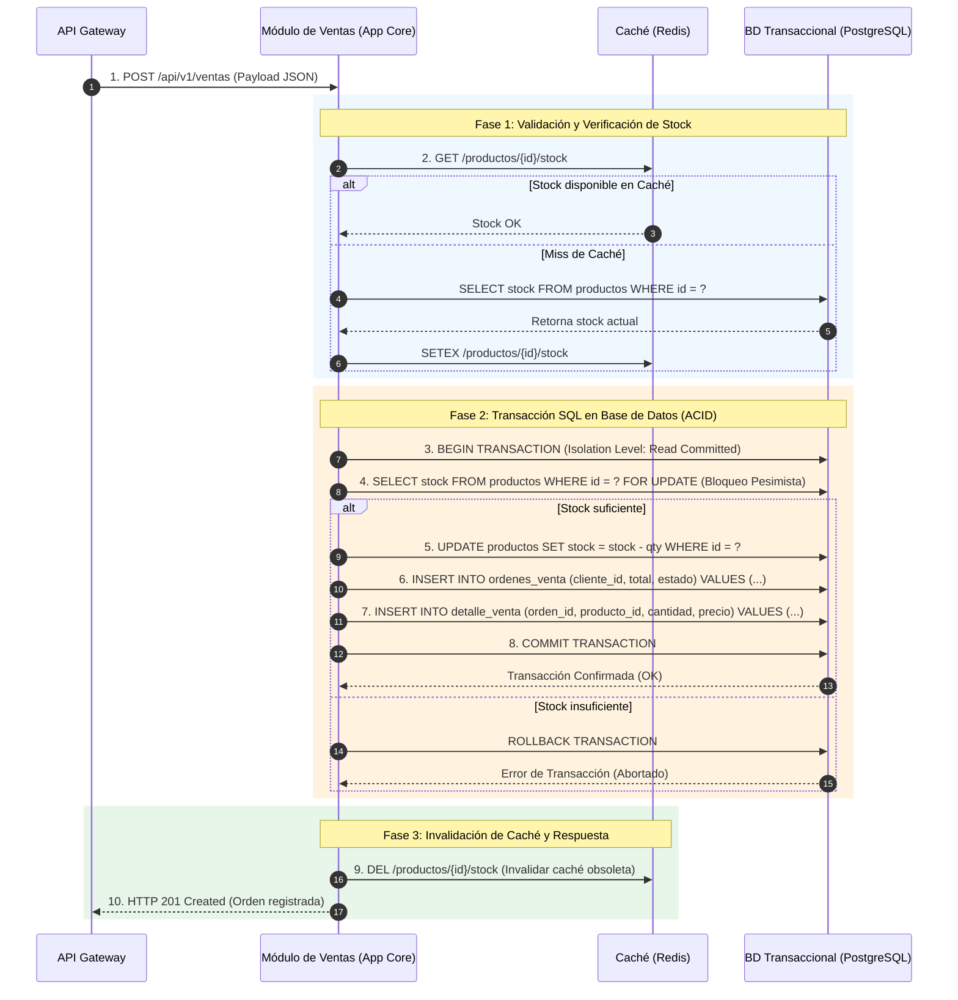

## **bloques**

Un **Diagrama de Bloques** en el modelado de sistemas es una representación gráfica, simplificada y de alto nivel que describe la estructura, composición o comportamiento funcional de un sistema. En él, las funciones principales, subsistemas, módulos o componentes se representan mediante **bloques** (generalmente rectángulos), mientras que las interconexiones, flujos de datos, señales o relaciones se representan mediante **líneas o flechas** que unen dichos bloques.

Pertenece a la categoría de los **modelos orientados a la estructura** (*structure-oriented models*), ya que su propósito primario es abstraer la complejidad del sistema para mostrar cómo se organizan y comunican sus elementos constitutivos.

### Elementos de un Diagrama

* **Bloques (Nodos / Módulos):** Representan una unidad funcional, un componente físico/lógico, un subsistema o una etapa de procesamiento. Pueden ser analizados como "cajas negras" (enfocándose únicamente en sus entradas y salidas) o desglosarse en subbloques más detallados.

* **Líneas y Flechas (Conexiones / Flujos / Interfaces):** Indican la dirección del flujo de información, energía, señales de control o relaciones de dependencia e interfaz entre los bloques.

* **Puntos de Suma / Comparación y Ramificación:** En sistemas dinámicos y teoría de control, se utilizan para modelar comparaciones de señales y **lazos de retroalimentación (*feedback loops*)**.

### Principales Aplicaciones

1. **Arquitectura de Software y Sistemas (Bloques de TI / IS Blocks):**
   * Muestra la división modular de una aplicación o infraestructura (ej. capa de presentación, motor de procesos, base de datos, servicios de integración).
   * Ayuda a definir las **interfaces** y el acoplamiento entre módulos antes de pasar al diseño detallado o implementación en código.

2. **Teoría de Control y Sistemas Dinámicos:**
   * Representa matemáticamente las funciones de transferencia de un sistema, ilustrando cómo una entrada (*input*) es transformada en una salida (*output*) mediante bloques operacionales y retroalimentación.

3. **Ingeniería de Procesos y Flujo de Actividades:**
   * Se utiliza para ilustrar la distribución de tareas, cadenas de valor o el ensamblaje de componentes en una organización.

### Ventajas del Uso de Diagramas de Bloques

* **Alto Nivel de Abstracción:** Permite entender el panorama global de un sistema complejo sin perderse en detalles de implementación de bajo nivel.

* **Facilidad de Comunicación:** Sirve como lenguaje visual común entre ingenieros, arquitectos de software, gerentes de proyecto y clientes.

* **Delimitación de Fronteras (*System Boundaries*):** Facilita la identificación de los límites del sistema, sus entradas/salidas externas y los puntos de integración con otros sistemas.

### Comparación con otras notaciones

| Criterio | Diagrama de Bloques | Diagrama de Flujo de Datos (DFD) | Diagramas de Componentes UML |
| :--- | :--- | :--- | :--- |
| **Enfoque principal** | Estructura modular, interfaces y bloques funcionales. | Transformación y flujo continuo de datos entre procesos y almacenes. | Estructura estática y relaciones de software orientado a objetos. |
| **Nivel de formalismo** | Notación libre, flexible y conceptual. | Notación estructurada fija (procesos, entidades, almacenes, flujos). | Estándar UML formal con estereotipos e interfaces especificadas. |

## **Diagrama**

El **diagrama de bloques** para la arquitectura de un **Sistema de Información Empresarial Moderno**.

### Arquitectura de un Sistema de Información

### Descripción

1. **Capa de Presentación (Clientes / Puntos de Entrada):**
   * **Bloques:** Aplicaciones web, aplicaciones móviles y servicios de terceros.
   * **Función:** Capturar las entradas del usuario (*inputs*) y presentar las salidas procesadas (*outputs*). Cada bloque actúa como una interfaz especializada para distintos tipos de usuarios.

2. **Capa de Entrada, Control y Seguridad:**
   * **Bloques:** **API Gateway** (Puerta de enlace) y **Servidor de Autenticación**.
   * **Función:** Actúa como el punto centralizado de inspección y enrutamiento. Recibe el tráfico externo, valida los permisos del usuario y distribuye las peticiones hacia los módulos correspondientes, protegiendo los componentes internos.

3. **Capa de Lógica de Negocio (Procesamiento Core):**
   * **Bloques:** Módulos independientes de **Usuarios**, **Ventas**, **Inventario** y **Notificaciones**.
   * **Función:** Contiene las reglas operativas de la organización. Recibe los datos validados, ejecuta los algoritmos de cálculo/transformación y coordina la ejecución de tareas secundarias (como el envío automático de correos o alertas).

4. **Capa de Persistencia y Datos:**
   * **Bloques:** Bases de Datos Relacionales (SQL), NoSQL y Memoria Caché (Redis).
   * **Función:** Garantiza el almacenamiento permanente, seguro y estructurado de la información del sistema, respondiendo a consultas de lectura/escritura y optimizando tiempos de respuesta.

### Principios de Modelado

* **Cajas Negras y Modularity:** Cada bloque oculta su complejidad interna (código, algoritmos) y se limita a exponer sus entradas y salidas mediante interfaces claras (APIs, protocolos de red, SQL).

* **Direccionalidad del Flujo:** Las flechas muestran la dependencia técnica y el sentido en el que viaja la información desde la captura hasta el almacenamiento.

* **Desacoplamiento:** Si el bloque de *Notificaciones* o *Caché* falla o requiere mantenimiento, el resto de las capas del sistema puede continuar operando sin interrupción directa.

## **Detalle de interfaz**

A continuación se detalla la **interfaz de comunicación interna y el protocolo de interacción** entre el **Módulo de Procesamiento de Ventas** (Capa de Negocio) y la **Base de Datos Transaccional** (Capa de Persistencia), integrando la **Memoria Caché (Redis)** para optimizar el rendimiento y garantizar las propiedades **ACID** (Atomicidad, Consistencia, Aislamiento y Durabilidad).

### Diagrama de Interacción de la Interfaz Interna

### Componentes Técnicos

#### 1. Protocolo de Red y Gestión de Conexiones
* **Mecanismo de Conexión:** La aplicación de negocio no abre una conexión socket TCP individual por cada transacción. En su lugar, utiliza un **Pool de Conexiones** (*Connection Pool* como HikariCP o PgBouncer) para reutilizar conexiones persistentes hacia la base de datos, reduciendo la latencia de *handshake*.
* **Protocolo:** Comunicación vía **Wire Protocol de PostgreSQL** sobre TCP/IP encriptado con TLS/SSL.

#### 2. Control de Concurrencia y Aislamiento (ACID)
Para evitar condiciones de carrera (*race conditions*) cuando múltiples clientes intentan comprar el último producto simultáneamente:
* **Bloqueo Pesimista (`FOR UPDATE`):** Durante la transacción, el registro del producto se bloquea temporalmente a nivel de fila (*row-level lock*) en la base de datos hasta que se ejecuta el `COMMIT` o `ROLLBACK`.
* **Nivel de Aislamiento:** *Read Committed* o *Repeatable Read*, asegurando que ningún otro proceso pueda leer o modificar el stock en estado inconsistente.

#### 3. Patrón de Caché (*Cache-Aside / Invalidation*)
* **Lectura rápida:** El módulo de ventas consulta primero la **memoria caché (Redis)** para validar la existencia y precios de productos sin sobrecargar la base de datos relacional.
* **Invalidación posterior al Commit:** Inmediatamente después de un `COMMIT` exitoso en la BD relacional, el servicio elimina o actualiza las llaves asociadas en Redis (`DEL /productos/{id}/stock`) para obligar a las subsecuentes lecturas a sincronizarse con el valor real.

#### 4. Manejo de Errores y Resiliencia
* **Rollback Automático:** Ante cualquier fallo de red, restricción de clave foránea violada o falta de stock, la aplicación envía un comando `ROLLBACK` a la BD para revertir cualquier cambio parcial, garantizando la **atomicidad**.
* **Patrón Circuit Breaker:** Si la base de datos relacional deja de responder o supera el tiempo límite (*timeout*), el módulo de ventas activa un *Circuit Breaker* para no saturar la infraestructura y responde al cliente con un mensaje de degradación controlada (`HTTP 503 Service Unavailable`).
