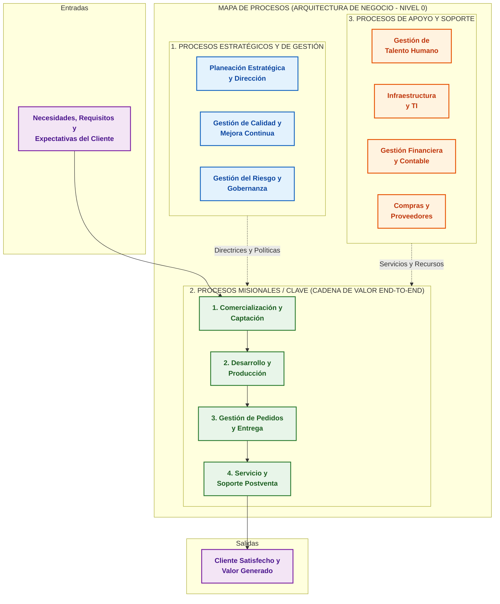

## **Procesos**

La **Arquitectura de Procesos** es el diseño, organización y representación jerárquica unificada de los procesos de negocio de una empresa y de sus componentes relacionados (como departamentos, objetivos, flujos de información, insumos, productos, reglas y participantes). 

Funciona como la representación o mapa visual (*Process Landscape* / Mapa de Procesos) de la organización, proporcionando a ejecutivos, analistas y desarrolladores una vista panorámica de cómo interactúan las actividades operativas para crear valor.

### Ubicación en la Arquitectura Empresarial (AE)

En el marco de la Arquitectura Empresarial (AE), la arquitectura de procesos constituye el núcleo de la **Arquitectura de Negocio** (*Business Architecture* - EBA). Representa el aspecto dinámico y de comportamiento de la empresa (*"cómo"* ejecuta sus capacidades funcionales para alcanzar sus metas estratégicas). Sirve de puente integrador entre la intención estratégica y la ejecución técnica en los dominios de Datos, Aplicaciones y Tecnología.

### Estructura y Niveles de Descomposición

Para gestionar la complejidad organizacional, una arquitectura de procesos organiza las actividades en una **jerarquía estructurada**:

1. **Categorización de Alto Nivel (Mapa de Procesos / Process Landscape):**
   * **Procesos Estratégicos o de Gestión:** Norman, coordinan, evalúan y dirigen la estrategia de la organización.
   * **Procesos Misionales, Clave o Core (*Value Streams*):** Transforman insumos en bienes o servicios que entregan valor directo al cliente externo (por ejemplo, el ciclo desde la recepción del pedido hasta el cobro).
   * **Procesos de Apoyo o Soporte:** Proveen los recursos, infraestructura y servicios internos necesarios para que los procesos clave funcionen (ej. gestión de talento humano, mantenimiento de TI, compras).

2. **Niveles de Detalle (Nivel Macro a Nivel Tarea):**
   * **Nivel 1 / Cadenas de Valor:** Agrupaciones globales de procesos a nivel corporativo.
   * **Niveles 2 y 3 / Procesos de Negocio:** Secuencias de actividades interrelacionadas expresadas en modelos conceptuales y lógicos.
   * **Niveles Operativos y de Flujo de Trabajo (*Workflows*):** Descomposición detallada paso a paso que incluye condiciones de error, reglas de negocio y asignación precisa de tareas y roles.

### Principales Beneficios

* **Alineación Estratégica:** Conecta la visión corporativa y los indicadores clave de desempeño (KPI) con el trabajo diario de los empleados y los sistemas informáticos.

* **Gobernanza y Propiedad de Procesos (*Process Ownership*):** Asigna responsabilidades claras a los *propietarios de procesos* para garantizar la mejora continua y el control de extremo a extremo (*End-to-End*).

* **Identificación de Ineficiencias:** Facilita la detección de cuellos de botella, actividades redundantes, vacíos de información o tareas que no agregan valor.

* **Visión Común Negocio-TI:** Otorga una taxonomía y lenguaje común entre los analistas del negocio y los equipos de TI para guiar el desarrollo de software y la automatización.

### Relación con BPM, BPMN, BPMS y SOA

* **Business Process Management (BPM):** La arquitectura de procesos es el punto de partida del ciclo de vida de BPM (en la fase de *Identificación de Procesos*).
* **Modelado en BPMN 2.0:** Los flujos y tareas descritos en la arquitectura se documentan mediante notaciones estandarizadas como **BPMN**.
* **Automatización con BPMS y SOA:** Cuando la empresa busca automatizar sus procesos, la arquitectura de procesos guía la orquestación de servicios en plataformas **BPMS** (*Business Process Management Systems*) y arquitecturas orientadas a servicios (**SOA** / **ESB**), permitiendo que los modelos de proceso se conviertan directamente en aplicaciones ejecutables.

***

## **Mapa de procesos**

A continuación se presenta el **Mapa de Procesos Global (Process Landscape)** que constituye la piedra angular de la **Arquitectura de Procesos** en una organización. 

Está estructurado bajo el modelo clásico de tres niveles funcionales (*Estratégicos, Misionales y de Apoyo*), enmarcado en el flujo continuo de transformación desde las necesidades del cliente hasta la entrega de valor.

---

### Mapa de Procesos Organizacional (Arquitectura Nivel 0)

### Explicación de la Arquitectura

1. **Entradas y Salidas (Marco de Valor):**
   * **Entradas (*Inputs*):** Los requerimientos del cliente actúan como el disparador (*trigger*) de toda la cadena operativa.
   * **Salidas (*Outputs*):** El objetivo final de la arquitectura de procesos es transformar esos insumos en productos o servicios que generen satisfacción y valor percibido.

2. **Categorización de los Niveles de Proceso:**
   * **Procesos Estratégicos (Parte Superior):** Definen el rumbo organizativo, establecen políticas, normativas y supervisan los **KPIs** globales. Aportan dirección y control a los procesos misionales.
   * **Procesos Misionales / Clave / Core (Eje Central - *Value Stream*):** Representan el flujo operativo principal de principio a fin (*End-to-End*). Son los procesos que impactan directamente al cliente y generan los ingresos de la empresa.
   * **Procesos de Apoyo / Soporte (Parte Inferior):** Proveen la capacidad operativa, infraestructura, sistemas de información y talento humano indispensables para que los procesos misionales funcionen sin interrupciones.

### Descomposición Jerárquica 
**Del Mapa a la Ejecución**

En la práctica de la Ingeniería de Sistemas y Arquitectura Empresarial, este mapa de nivel 0 se desglosa recursivamente en niveles más detallados:

* **Nivel 0 (Mapa de Procesos / Panorama):** Muestra la vista de macroprocesos corporativos (como el diagrama anterior).
* **Nivel 1 (Subprocesos de Cadena de Valor):** Desglosa cada macroproceso en flujos funcionales (por ejemplo, el módulo de *Gestión de Pedidos y Entrega* se divide en *Recepción de Orden*, *Facturación*, *Empaque* y *Despacho*).
* **Nivel 2 (Diagramas de Flujo de Trabajo / BPMN):** Representa el comportamiento detallado con carriles (*Lanes*), roles, reglas de decisión y eventos (como los diagramas BPMN detallados anteriormente).
* **Nivel 3 (Procedimientos e Instrucciones de Trabajo):** Especifica los pasos técnicos a nivel de interfaz de usuario o instrucciones de ejecución de tareas automatizadas.

***
## **Modelos de madurez**

Los modelos de madurez de procesos como **CMMI** (*Capability Maturity Model Integration* del CMMI Institute) y **BPMM** (*Business Process Maturity Model* de la OMG) proporcionan un marco cuantitativo y cualitativo para evaluar la capacidad operativa de una organización, guiando su evolución gradual desde la ejecución reactiva e informal hasta la mejora continua.

A continuación se presenta una **tabla comparativa detallada** estructurada en los 5 niveles de madurez para evaluar la gestión organizacional:

### Tabla Comparativa: Niveles de Madurez de la Arquitectura de Procesos (BPMM / CMMI)

| Nivel de Madurez | Denominación y Enfoque | Gobernanza y Organización | Medición y Control de Procesos | Riesgos y Obstáculos | Estrategia de Transición al Siguiente Nivel |
| :--- | :--- | :--- | :--- | :--- | :--- |
| **Nivel 1** | **Inicial / Inconsistente** *(Ad hoc)* | Ausencia de roles formales de proceso; el trabajo depende del esfuerzo individual y la "programación heroica". | Sin métricas estandarizadas; los resultados son impredecibles y dependen del azar o personal clave. | **Cultura de apagar incendios**, alta rotación, deuda técnica y retrabajo masivo. | Inculcar disciplina básica de gestión de proyectos, definir procedimientos locales e identificar clientes/proveedores. |
| **Nivel 2** | **Gestionado / Repetible** *(Managed)* | Se asume compromiso ejecutivo local; surgen responsables en unidades de trabajo o proyectos específicos. | Control básico de compromisos, costos y tiempos a nivel de proyecto o unidad aislada. | **Silos departamentales**, falta de integración transversal y soluciones locales inconsistentes. | Estandarizar procesos a nivel corporativo, establecer un repositorio común y definir la arquitectura de procesos (*As-Is*). |
| **Nivel 3** | **Definido / Estandarizado** *(Defined)* | Procesos integrados de extremo a extremo (*End-to-End*); se formaliza el rol de *Process Owner* y el Centro de Excelencia (CoE). | Métricas comunes y guías institucionalizadas aplicadas de forma adaptable a toda la organización. | Rigidez metodológica si no se adaptan las normas a las necesidades específicas de cada unidad. | Implementar gestión cuantitativa, control estadístico del proceso y análisis de variaciones operativas. |
| **Nivel 4** | **Gestionado Cuantitativamente** *(Predictable)* | Gobernanza basada en datos objetivos; alineación directa entre la estrategia de negocio y la capacidad del proceso. | Control estadístico del comportamiento; resultados altamente predecibles mediante métricas y KPIs agregados. | Parálisis por análisis o sobrecarga de métricas sin impacto directo en la innovación. | Fomentar la innovación de procesos, automatización adaptativa y análisis preventivo de causas raíz. |
| **Nivel 5** | **Optimizado / Innovador** *(Optimizing)* | La cultura orientada a procesos está arraigada en toda la empresa; liderazgo distribuido y agilidad organizacional. | Monitoreo en tiempo real (*BAM/Process Mining*), analítica predictiva y prevención continua de defectos. | Complacencia organizativa o pérdida de alineación ante cambios disruptivos del entorno externo. | Innovación continua, optimización tecnológica constante y adaptación ágil ante nuevos modelos de negocio. |

### Estadios de Madurez

#### Nivel 1: Inicial / Inconsistente (*Initial*)
* **Comportamiento:** La organización opera sin procesos formales repetibles. Cuando surge presión por tiempo o costos, los procedimientos informales existentes se sacrifican.
* **Impacto en el Negocio:** Los proyectos presentan variaciones extremas en costo, tiempo y calidad. El éxito de un proyecto se debe al talento puntual de ciertos empleados y no a la capacidad organizativa.

#### Nivel 2: Gestionado / Repetible (*Managed*)
* **Comportamiento:** La administración asegura que el trabajo se planifique y ejecute de acuerdo con políticas locales. Se gestionan requerimientos, cronogramas y productos entregables de forma básica.
* **Impacto en el Negocio:** Se logran repetir éxitos en proyectos similares dentro del mismo departamento, pero existe incoherencia cuando los flujos cruzan hacia otras áreas.

#### Nivel 3: Definido / Estandarizado (*Standardized / Defined*)
* **Comportamiento:** Los procesos operativos y de soporte están documentados, estandarizados e integrados horizontalmente en toda la empresa (*Process Landscape*).
* **Impacto en el Negocio:** La organización reduce significativamente el retrabajo. Los equipos no "reinventan la rueda" y se establece una cultura común apoyada por un **Centro de Excelencia de BPM (CoE)**.

#### Nivel 4: Predecible / Gestionado Cuantitativamente (*Predictable*)
* **Comportamiento:** Se establecen objetivos cuantitativos de desempeño y calidad. Las desviaciones en los procesos se identifican y corrigen mediante técnicas estadísticas.
* **Impacto en el Negocio:** Alto grado de previsibilidad operativa. Se comprenden numéricamente las causas de la variabilidad en el rendimiento.

#### Nivel 5: En Optimización (*Optimizing*)
* **Comportamiento:** El enfoque principal es la mejora continua e innovadora del desempeño de los procesos mediante cambios tecnológicos y metodológicos.
* **Impacto en el Negocio:** Prevención sistemática de defectos, optimización de tiempos de ciclo y alineación ágil instantánea ante cambios en la estrategia corporativa.

### Factores Críticos 
**de Éxito para Evaluar la Madurez (Modelo de BPM)**

Para evaluar integralmente en cuál nivel se encuentra una empresa, la evaluación debe considerar **seis dimensiones fundamentales**:
1. **Alineación Estratégica:** Vinculación directa entre los indicadores de procesos y los objetivos de negocio.
2. **Gobernanza:** Roles definidos (*Process Owners*, analistas) y mecanismos transparentes de toma de decisiones.
3. **Métodos:** Notaciones estandarizadas (BPMN) y metodologías formales de análisis/rediseño (Lean, Six Sigma).
4. **Tecnología (TI):** Sistemas de orquestación (BPMS), reglas de negocio y herramientas de análisis en tiempo real.
5. **Personas:** Conocimientos, habilidades y capacitación continua del personal en la disciplina de procesos.
6. **Cultura:** Nivel de adopción de valores centrados en el cliente, transparencia y disposición al cambio.

