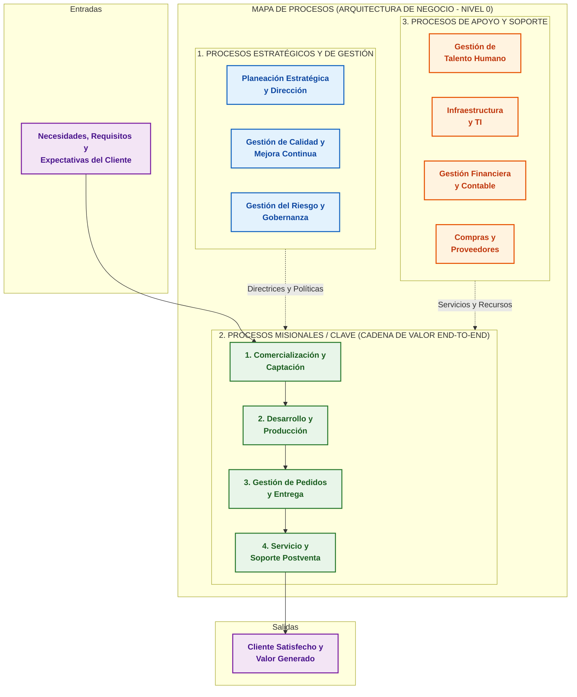

## **Procesos**

La **Arquitectura de Procesos** es el diseño, organización y representación jerárquica unificada de los procesos de negocio de una empresa y de sus componentes relacionados (como departamentos, objetivos, flujos de información, insumos, productos, reglas y participantes). 

Funciona como la representación o mapa visual (*Process Landscape* / Mapa de Procesos) de la organización, proporcionando a ejecutivos, analistas y desarrolladores una vista panorámica de cómo interactúan las actividades operativas para crear valor.


### Ubicación en AE

En el marco de la Arquitectura Empresarial (AE), la arquitectura de procesos constituye el núcleo de la **Arquitectura de Negocio** (*Business Architecture* - EBA). Representa el aspecto dinámico y de comportamiento de la empresa (*"cómo"* ejecuta sus capacidades funcionales para alcanzar sus metas estratégicas). Sirve de puente integrador entre la intención estratégica y la ejecución técnica en los dominios de Datos, Aplicaciones y Tecnología.


### Estructura y Niveles de Descomposición

Para gestionar la complejidad organizacional, una arquitectura de procesos organiza las actividades en una **jerarquía estructurada**:

1. **Categorización de Alto Nivel (Mapa de Procesos / Process Landscape):**
   * **Procesos Estratégicos o de Gestión:** Norman, coordinan, evalúan y dirigen la estrategia de la organización.
   * **Procesos Misionales, Clave o Core (*Value Streams*):** Transforman insumos en bienes o servicios que entregan valor directo al cliente externo (por ejemplo, el ciclo desde la recepción del pedido hasta el cobro).
   * **Procesos de Apoyo o Soporte:** Proveen los recursos, infraestructura y servicios internos necesarios para que los procesos clave funcionen (ej. gestión de talento humano, mantenimiento de TI, compras).

2. **Niveles de Detalle (Nivel Macro a Nivel Tarea):**
   * **Nivel 1 / Cadenas de Valor:** Agrupaciones globales de procesos a nivel corporativo.
   * **Niveles 2 y 3 / Procesos de Negocio:** Secuencias de actividades interrelacionadas expresadas en modelos conceptuales y lógicos.
   * **Niveles Operativos y de Flujo de Trabajo (*Workflows*):** Descomposición detallada paso a paso que incluye condiciones de error, reglas de negocio y asignación precisa de tareas y roles.


### Principales Beneficios

* **Alineación Estratégica:** Conecta la visión corporativa y los indicadores clave de desempeño (KPI) con el trabajo diario de los empleados y los sistemas informáticos.

* **Gobernanza y Propiedad de Procesos (*Process Ownership*):** Asigna responsabilidades claras a los *propietarios de procesos* para garantizar la mejora continua y el control de extremo a extremo (*End-to-End*).

* **Identificación de Ineficiencias:** Facilita la detección de cuellos de botella, actividades redundantes, vacíos de información o tareas que no agregan valor.

* **Visión Común Negocio-TI:** Otorga una taxonomía y lenguaje común entre los analistas del negocio y los equipos de TI para guiar el desarrollo de software y la automatización.


### Relación con BPM, BPMN, BPMS y SOA

* **Business Process Management (BPM):** La arquitectura de procesos es el punto de partida del ciclo de vida de BPM (en la fase de *Identificación de Procesos*).
* **Modelado en BPMN 2.0:** Los flujos y tareas descritos en la arquitectura se documentan mediante notaciones estandarizadas como **BPMN**.
* **Automatización con BPMS y SOA:** Cuando la empresa busca automatizar sus procesos, la arquitectura de procesos guía la orquestación de servicios en plataformas **BPMS** (*Business Process Management Systems*) y arquitecturas orientadas a servicios (**SOA** / **ESB**), permitiendo que los modelos de proceso se conviertan directamente en aplicaciones ejecutables.

***

## **Mapa de procesos**

A continuación se presenta el **Mapa de Procesos Global (Process Landscape)** que constituye la piedra angular de la **Arquitectura de Procesos** en una organización. 

Está estructurado bajo el modelo clásico de tres niveles funcionales (*Estratégicos, Misionales y de Apoyo*), enmarcado en el flujo continuo de transformación desde las necesidades del cliente hasta la entrega de valor.

---

### Mapa Organizacional
**(Arquitectura Nivel 0)**




### Explicación de la Arquitectura

1. **Entradas y Salidas (Marco de Valor):**
   * **Entradas (*Inputs*):** Los requerimientos del cliente actúan como el disparador (*trigger*) de toda la cadena operativa.
   * **Salidas (*Outputs*):** El objetivo final de la arquitectura de procesos es transformar esos insumos en productos o servicios que generen satisfacción y valor percibido.

2. **Categorización de los Niveles de Proceso:**
   * **Procesos Estratégicos (Parte Superior):** Definen el rumbo organizativo, establecen políticas, normativas y supervisan los **KPIs** globales. Aportan dirección y control a los procesos misionales.
   * **Procesos Misionales / Clave / Core (Eje Central - *Value Stream*):** Representan el flujo operativo principal de principio a fin (*End-to-End*). Son los procesos que impactan directamente al cliente y generan los ingresos de la empresa.
   * **Procesos de Apoyo / Soporte (Parte Inferior):** Proveen la capacidad operativa, infraestructura, sistemas de información y talento humano indispensables para que los procesos misionales funcionen sin interrupciones.


### Descomposición Jerárquica 
**Del Mapa a la Ejecución**

En la práctica de la Ingeniería de Sistemas y Arquitectura Empresarial, este mapa de nivel 0 se desglosa recursivamente en niveles más detallados:

* **Nivel 0 (Mapa de Procesos / Panorama):** Muestra la vista de macroprocesos corporativos (como el diagrama anterior).
* **Nivel 1 (Subprocesos de Cadena de Valor):** Desglosa cada macroproceso en flujos funcionales (por ejemplo, el módulo de *Gestión de Pedidos y Entrega* se divide en *Recepción de Orden*, *Facturación*, *Empaque* y *Despacho*).
* **Nivel 2 (Diagramas de Flujo de Trabajo / BPMN):** Representa el comportamiento detallado con carriles (*Lanes*), roles, reglas de decisión y eventos (como los diagramas BPMN detallados anteriormente).
* **Nivel 3 (Procedimientos e Instrucciones de Trabajo):** Especifica los pasos técnicos a nivel de interfaz de usuario o instrucciones de ejecución de tareas automatizadas.

***
## **Modelos de madurez**

Los modelos de madurez de procesos como **CMMI** (*Capability Maturity Model Integration* del CMMI Institute) y **BPMM** (*Business Process Maturity Model* de la OMG) proporcionan un marco cuantitativo y cualitativo para evaluar la capacidad operativa de una organización, guiando su evolución gradual desde la ejecución reactiva e informal hasta la mejora continua.

A continuación se presenta una **tabla comparativa detallada** estructurada en los 5 niveles de madurez para evaluar la gestión organizacional:


### Tabla Comparativa
**Niveles de Madurez de la Arquitectura de Procesos (BPMM / CMMI)**

| Nivel de Madurez | Denominación y Enfoque | Gobernanza y Organización | Medición y Control de Procesos | Riesgos y Obstáculos | Estrategia de Transición al Siguiente Nivel |
| :--- | :--- | :--- | :--- | :--- | :--- |
| **Nivel 1** | **Inicial / Inconsistente**<br/>*(Ad hoc)* | Ausencia de roles formales de proceso; el trabajo depende del esfuerzo individual y la "programación heroica". | Sin métricas estandarizadas; los resultados son impredecibles y dependen del azar o personal clave. | **Cultura de apagar incendios**, alta rotación, deuda técnica y retrabajo masivo. | Inculcar disciplina básica de gestión de proyectos, definir procedimientos locales e identificar clientes/proveedores. |
| **Nivel 2** | **Gestionado / Repetible**<br/>*(Managed)* | Se asume compromiso ejecutivo local; surgen responsables en unidades de trabajo o proyectos específicos. | Control básico de compromisos, costos y tiempos a nivel de proyecto o unidad aislada. | **Silos departamentales**, falta de integración transversal y soluciones locales inconsistentes. | Estandarizar procesos a nivel corporativo, establecer un repositorio común y definir la arquitectura de procesos (*As-Is*). |
| **Nivel 3** | **Definido / Estandarizado**<br/>*(Defined)* | Procesos integrados de extremo a extremo (*End-to-End*); se formaliza el rol de *Process Owner* y el Centro de Excelencia (CoE). | Métricas comunes y guías institucionalizadas aplicadas de forma adaptable a toda la organización. | Rigidez metodológica si no se adaptan las normas a las necesidades específicas de cada unidad. | Implementar gestión cuantitativa, control estadístico del proceso y análisis de variaciones operativas. |
| **Nivel 4** | **Gestionado Cuantitativamente**<br/>*(Predictable)* | Gobernanza basada en datos objetivos; alineación directa entre la estrategia de negocio y la capacidad del proceso. | Control estadístico del comportamiento; resultados altamente predecibles mediante métricas y KPIs agregados. | Parálisis por análisis o sobrecarga de métricas sin impacto directo en la innovación. | Fomentar la innovación de procesos, automatización adaptativa y análisis preventivo de causas raíz. |
| **Nivel 5** | **Optimizado / Innovador**<br/>*(Optimizing)* | La cultura orientada a procesos está arraigada en toda la empresa; liderazgo distribuido y agilidad organizacional. | Monitoreo en tiempo real (*BAM/Process Mining*), analítica predictiva y prevención continua de defectos. | Complacencia organizativa o pérdida de alineación ante cambios disruptivos del entorno externo. | Innovación continua, optimización tecnológica constante y adaptación ágil ante nuevos modelos de negocio. |


### Estadios de Madurez

#### Nivel 1: Inicial / Inconsistente (*Initial*)
* **Comportamiento:** La organización opera sin procesos formales repetibles. Cuando surge presión por tiempo o costos, los procedimientos informales existentes se sacrifican.
* **Impacto en el Negocio:** Los proyectos presentan variaciones extremas en costo, tiempo y calidad. El éxito de un proyecto se debe al talento puntual de ciertos empleados y no a la capacidad organizativa.

#### Nivel 2: Gestionado / Repetible (*Managed*)
* **Comportamiento:** La administración asegura que el trabajo se planifique y ejecute de acuerdo con políticas locales. Se gestionan requerimientos, cronogramas y productos entregables de forma básica.
* **Impacto en el Negocio:** Se logran repetir éxitos en proyectos similares dentro del mismo departamento, pero existe incoherencia cuando los flujos cruzan hacia otras áreas.

#### Nivel 3: Definido / Estandarizado (*Standardized / Defined*)
* **Comportamiento:** Los procesos operativos y de soporte están documentados, estandarizados e integrados horizontalmente en toda la empresa (*Process Landscape*).
* **Impacto en el Negocio:** La organización reduce significativamente el retrabajo. Los equipos no "reinventan la rueda" y se establece una cultura común apoyada por un **Centro de Excelencia de BPM (CoE)**.

#### Nivel 4: Predecible / Gestionado Cuantitativamente (*Predictable*)
* **Comportamiento:** Se establecen objetivos cuantitativos de desempeño y calidad. Las desviaciones en los procesos se identifican y corrigen mediante técnicas estadísticas.
* **Impacto en el Negocio:** Alto grado de previsibilidad operativa. Se comprenden numéricamente las causas de la variabilidad en el rendimiento.

#### Nivel 5: En Optimización (*Optimizing*)
* **Comportamiento:** El enfoque principal es la mejora continua e innovadora del desempeño de los procesos mediante cambios tecnológicos y metodológicos.
* **Impacto en el Negocio:** Prevención sistemática de defectos, optimización de tiempos de ciclo y alineación ágil instantánea ante cambios en la estrategia corporativa.


### Factores Críticos 
**de Éxito para Evaluar la Madurez (Modelo de BPM)**

Para evaluar integralmente en cuál nivel se encuentra una empresa, la evaluación debe considerar **seis dimensiones fundamentales**:
1. **Alineación Estratégica:** Vinculación directa entre los indicadores de procesos y los objetivos de negocio.
2. **Gobernanza:** Roles definidos (*Process Owners*, analistas) y mecanismos transparentes de toma de decisiones.
3. **Métodos:** Notaciones estandarizadas (BPMN) y metodologías formales de análisis/rediseño (Lean, Six Sigma).
4. **Tecnología (TI):** Sistemas de orquestación (BPMS), reglas de negocio y herramientas de análisis en tiempo real.
5. **Personas:** Conocimientos, habilidades y capacitación continua del personal en la disciplina de procesos.
6. **Cultura:** Nivel de adopción de valores centrados en el cliente, transparencia y disposición al cambio.

***

## **Adaptabilidad de la Arquitectura de Procesos**

### 1. Fundamentos y Clasificación 
**la Madurez de Procesos Organizacionales**

La arquitectura de procesos organizacionales moderna requiere un marco analítico capaz de categorizar la naturaleza del trabajo y alinear el modelo de ejecución operativo con los niveles de incertidumbre del entorno. La sostenibilidad del negocio y la eficiencia operativa dependen de la capacidad organizacional para seleccionar el ciclo de vida de proceso adecuado, evitando la rigidez metodológica en dominios volátiles o la falta de control en procesos estables.

#### 1.1 Categorización del Trabajo y Continuo de los Ciclos de Vida

El trabajo ejecutado por las organizaciones se distribuye a lo largo de un espectro que abarca desde el trabajo definible hasta el trabajo de alta incertidumbre:

* **Trabajo Definible:** Se caracteriza por procedimientos claros, repetibles y de baja incertidumbre que cuentan con antecedentes exitosos en proyectos previos (como la producción en serie de un vehículo, un electrodoméstico o la edificación de una vivienda tras la aprobación del diseño final). Presenta un bajo riesgo de ejecución y procesos totalmente comprendidos.  

* **Trabajo de Alta Incertidumbre:** Naturaleza exploratoria y compleja que requiere la colaboración directa de expertos en la materia para resolver problemas no abordados previamente (como la ingeniería de software, el diseño de productos innovadores, la medicina o la consultoría legal). Enfrenta elevadas tasas de cambio, complejidad técnica y riesgo de ejecución.

A lo largo de este continuo operacional, los ciclos de vida de procesos se posicionan según su frecuencia de entrega y el grado de cambio que pueden gestionar:

* **Ciclo de Vida Predictivo:** Enfoque tradicional estructurado en el que los **requisitos se fijan** en las fases iniciales, las actividades se realizan **una sola vez para todo el proyecto** y se efectúa una **entrega única** al finalizar, orientando su meta a **gestionar costos** y restringir desviaciones.  

* **Ciclo de Vida Iterativo:** Enfoque en el que los **requisitos son dinámicos**, las actividades se **repiten hasta que la solución esté correcta** mediante prototipos o pruebas de concepto, y se realiza una **entrega única** final, enfocado en lograr la **corrección de la solución**.  

* **Ciclo de Vida Incremental:** Enfoque enfocado en la velocidad donde los **requisitos son dinámicos**, las actividades se ejecutan **una vez para un incremento dado**, y se realizan **entregas frecuentes más pequeñas** de subconjuntos funcionalmente terminados para uso inmediato del cliente.  

* **Ciclo de Vida Ágil:** Enfoque que integra las dimensiones iterativa e incremental; los **requisitos son dinámicos**, las actividades se **repiten hasta estar correctas**, y se ejecutan **entregas pequeñas y frecuentes**, con el propósito de maximizar el **valor para el cliente mediante retroalimentación continua**.

#### 1.2 Modelo de Incertidumbre y Complejidad Operativa

La selección de la arquitectura de procesos adecuada se determina mediante la evaluación conjunta de la incertidumbre en los requisitos y el grado técnico de incertidumbre (viabilidad tecnológica y capacidad de producción). Tomando como marco de referencia el modelo de incertidumbre inspirado en la matriz de complejidad de Stacey, los procesos organizacionales se clasifican en cuatro dominios operativos: **Sencillo**, **Complicado**, **Complejo** y **Caos** (fundamentalmente riesgoso).

```text
Incertidumbre en Requisitos  
    ▲  
High│         Complejo              Caos / Fundamentalmente riesgoso  
    │   (Enfoques adaptativos)  
    │  
    │         Sencillo              Complicado  
Low │   (Enfoques lineales)  
    └─────────────────────────────────────────────► Grado Técnico de Incertidumbre  
        Low                                  High
```

Bajo condiciones donde los requisitos son estables y el grado técnico de incertidumbre es bajo (dominios sencillo y complicado), los enfoques lineales y predictivos son plenamente viables. Estos modelos permiten planificar en serie, controlar restricciones fijas de alcance, costo y cronograma, y gestionar el riesgo mediante documentación exhaustiva por adelantado. Sin embargo, a medida que la variabilidad de los requisitos o la incertidumbre tecnológica desplazan el proceso hacia el dominio complejo, la insistencia en enfoques lineales genera un elevado riesgo de retrabajo, costos imprevistos y desperdicio operativo. En este dominio, es obligatorio migrar hacia enfoques adaptativos (iterativos, incrementales o ágiles), los cuales mitigan el riesgo dividiendo el trabajo en incrementos reducidos e inspecciones frecuentes. La entrega continua de funcionalidad reducida permite validar suposiciones, acotar el riesgo técnico y ajustar el producto a las necesidades reales del cliente a bajo costo, eliminando la rigidez de las especificaciones estáticas. Si la incertidumbre en ambas dimensiones se eleva de forma descontrolada, el proceso cae en el dominio del Caos, donde el trabajo resulta fundamentalmente riesgoso e inviable hasta que se logre acotar al menos una de las variables de incertidumbre.

### 2. Análisis Comparativo Detallado

El nivel de madurez operacional refleja la capacidad de una organización para estructurar, medir y optimizar sus flujos de trabajo en función de la incertidumbre del entorno.

#### 2.1 Nivel 1: Inicial / Fragmentado (Trabajo Caótico o No Estructurado)

La organización en Nivel 1 carece de procesos formales estandarizados. Operativamente, el trabajo se ejecuta en silos funcionales aislados y depende de esfuerzos individuales heroicos e inconexos para cumplir las entregas. La dinámica imita el comportamiento del dominio del Caos, sin mecanismos institucionales para absorber la variabilidad.

* **Fallas de Gobernanza:** Ausencia de políticas operativas explícitas, falta de roles definidos para gestionar la demanda, decisiones descentralizadas sin alineación estratégica y dependencia absoluta de la disponibilidad individual.  
* **Ausencia de Métricas Empíricas:** Inexistencia de registros históricos de desempeño o indicadores de flujo; la medición del progreso se basa en percepciones subjetivas, estimaciones sin fundamento y reportes sintéticos no verificables.  
* **Riesgos Operativos Asociados:** Nula visibilidad del trabajo en progreso (WIP), proliferación de cuellos de botella invisibles, acumulación de trabajo bloqueado y una severa pérdida de productividad (de entre un 20% y un 40%) provocada por la multitarea y el constante cambio de contexto de los colaboradores.

#### 2.2 Nivel 2: Gestionado / Predictivo (Planificación Secuencial Rigurosa)

El Nivel 2 establece una arquitectura de procesos secuenciales estandarizados orientados al control y la predecibilidad. La ejecución sigue una trayectoria lineal dividida en fases estrictas: **Analizar, Diseñar, Construir, Probar, Entregar**, asumiendo que tanto los requisitos como la solución técnica pueden conocerse de manera completa y definitiva al inicio de la iniciativa.

La gobernanza se articula mediante comités formales de control de cambios (CCB) diseñados para contener la variabilidad, protegiendo las líneas base de alcance, presupuesto y cronograma. Las métricas primarias responden a la gestión tradicional del valor ganado (EVM) y a reportes de avance sintético basados en porcentajes teóricos de ejecución. El riesgo sistémico de este nivel se manifiesta cuando se aplican procesos secuenciales a entornos volátiles: se desencadena el "efecto sandía", donde los proyectos figuran con un estatus "verde" (conforme) en los cuadros de mando corporativos pero están en realidad "rojos" (críticos) internamente, debido a la falta de validación empírica y a la postergación de las pruebas de integración hasta las fases finales del ciclo de vida, ocasionando rebasamientos presupuestarios y entregas tardías.

#### 2.3 Nivel 3: Definido / Prototipado e Incremental (Enfoques Híbridos)

El Nivel 3 evoluciona la arquitectura de procesos al incorporar ciclos institucionales de retroalimentación mediante prototipos o pruebas de concepto (enfoque iterativo) y entregas parciales funcionales de valor (enfoque incremental). Las estructuras de gobernanza híbrida permiten mantener controles predictivos rígidos sobre subcomponentes normativos o de bajo cambio, mientras se habilita la exploración adaptativa sobre subsistemas de alta incertidumbre.

A continuación se presentan dos combinaciones híbridas estructuradas conforme al texto fuente:

1. **Desarrollo Ágil seguido de un Despliegue Predictivo:** Utilizado en iniciativas donde las fases de diseño y construcción enfrentan alta incertidumbre y requieren la flexibilidad exploratoria de equipos ágiles, pero cuya implementación final, despliegue físico o capacitación masiva exige una secuencia lineal, repetible y rigurosamente predictiva.  
2. **Enfoque Predominantemente Predictivo con Componentes Ágiles:** Aplicado en proyectos cuya infraestructura global es rutinaria y previsible, pero que incorporan un subsistema o material innovador. Por ejemplo, una obra de ingeniería tradicional que prueba un nuevo componente de aislamiento mediante experimentos ágiles a pequeña escala en el terreno para adaptar el proceso de instalación antes de ejecutarlo masivamente.

#### 2.4 Nivel 4: Medido y Gobernado (Flujo Continuo y Medición Empírica)

En el Nivel 4, la gestión del trabajo se desacopla de la estimación teórica y se orienta hacia la gobernanza empírica del flujo continuo (como en el Método Kanban) o cadencias iterativas estables. La visibilidad de los procesos se logra mediante radiadores de información (tableros Kanban) y la aplicación estricta de límites de trabajo en progreso (WIP) por cada etapa del flujo operativo.

Las métricas empíricas que sustentan la gobernanza en este nivel se definen a continuación:

* **Tiempo de Entrega (Lead Time):** El tiempo total transcurrido desde que una solicitud o característica se ingresa y acepta en el tablero de trabajo hasta que se entrega por completo al cliente final.  
* **Tiempo de Ciclo (Cycle Time):** El período requerido para procesar y completar un elemento de trabajo una vez que el equipo comienza a ejecutarlo activamente en el sistema.  
* **Tiempo de Respuesta:** La duración en que un elemento de trabajo permanece esperando en cola desde que está clasificado como "listo" hasta que se inicia efectivamente su ejecución.  
* **Diagrama de Flujo Acumulativo (CFD):** Herramienta gráfica que representa el volumen acumulado de trabajo en cada estado del proceso a lo largo del tiempo, permitiendo visualizar la estabilidad del sistema, la acumulación de colas y los cuellos de botella mediante el ensanchamiento vertical de las franjas de estado.

#### 2.5 Nivel 5: Optimizado e Innovador (Agilidad Organizacional y Mejora Continua)

El Nivel 5 representa la cima de la madurez organizacional, donde la arquitectura de procesos se auto-adapta dinámicamente frente a las exigencias del mercado. La ejecución es asumida por equipos multidisciplinarios autoorganizados conformados por especialistas generalizados o perfiles en "T", quienes combinan una especialidad técnica profunda con la versatilidad para colaborar de manera cruzada en otras disciplinas.

La mejora continua se institucionaliza mediante retrospectivas periódicas celebradas al cierre de cada iteración o hito operativo. En ellas, el equipo analiza datos cuantitativos de flujo e impresiones cualitativas para identificar causas raíz de ineficiencia e implementar experimentos de optimización. La gobernanza se transforma mediante un **liderazgo de servicio**, cuyo rol central consiste en eliminar impedimentos organizacionales, allanar el camino operativo, promover la seguridad psicológica y coordinar el enfoque continuo hacia la maximización del valor entregado al cliente.

### 3. Matriz Comparativa Multidimensional

La siguiente matriz sintetiza la evolución progresiva de los niveles de madurez, explicitando los requisitos, estructuras, métricas y los mecanismos puente indispensables para ascender de nivel:

| Nivel de Madurez | Características y Requisitos | Gobernanza y Estructura de Equipo | Métricas de Desempeño | Estrategia de Transición al Siguiente Nivel |
| :---- | :---- | :---- | :---- | :---- |
| **Nivel 1: Inicial / Fragmentado** | Requisitos desconocidos o altamente caóticos. Falta de procedimientos formales. Alta variabilidad y riesgo de ejecución no controlado. | Inexistente o reactiva. Trabajo estructurado en silos funcionales. Equipos no dedicados, multitarea severa. | Ninguna métrica formal. Reportes subjetivos de estado sin datos empíricos. | **Mecanismo Puente al Nivel 2:** Estandarizar el flujo mediante la creación del acta de constitución del proyecto, institucionalizar fases secuenciales (Analizar, Diseñar, Construir, Probar, Entregar) y centralizar el control del alcance. |
| **Nivel 2: Gestionado / Predictivo** | Requisitos fijos y detallados por adelantado. Proceso secuencial estricto. Bajo nivel de cambio tolerado. | Basada en el control de cambios (CCB) y restricciones de alcance, costo y cronograma. Líderes en rol de mando y control. | Indicadores sustitutos: % de avance sintético, hitos de cronograma, EVM tradicional (SPI/CPI teóricos). | **Mecanismo Puente al Nivel 3:** Introducir revisiones intermedias con prototipos (iterativo) e incrementos parciales funcionales para validar requisitos en subcomponentes de alta incertidumbre sin romper la línea base. |
| **Nivel 3: Definido / Prototipado e Incremental** | Requisitos dinámicos o parcialmente conocidos. Combinación de fases predictivas con iteraciones de prueba y entregas funcionales. | Gobernanza híbrida. Integración de la voz del cliente/negocio en puntos de revisión intermedios. Equipos mixtos. | Tasa de entrega de prototipos, validación de criterios de aceptación por incremento, EVM adaptado. | **Mecanismo Puente al Nivel 4:** Visibilizar todo el trabajo mediante radiadores de información (Kanban), definir e imponer límites estrictos de WIP e institucionalizar cadencias de medición del tiempo de ciclo. |
| **Nivel 4: Medido y Gobernado** | Requisitos dinámicos gestionados mediante listas de trabajo (*backlogs*). Flujo continuo o cadencias iterativas fijas (*timeboxes*). | Gobernanza empírica basada en límites de WIP y radiadores de información. Equipos dedicados con roles definidos (Dueño de Producto, Facilitador). | Métricas empíricas de flujo: Tiempo de Entrega, Tiempo de Ciclo, Tiempo de Respuesta y Diagramas de Flujo Acumulativo. | **Mecanismo Puente al Nivel 5:** Fomentar la autoorganización del equipo, desarrollar habilidades multidisciplinarias (perfiles en T) e institucionalizar retrospectivas periódicas enfocadas en la eliminación de la causa raíz de los impedimentos. |
| **Nivel 5: Optimizado e Innovador** | Requisitos emergentes. Optimización fluida del valor enfocado al cliente. Lotes de trabajo de pequeño tamaño e innovación continua. | Liderazgo de servicio habilitador. Equipos multidisciplinarios 100% dedicados, autoorganizados y sin silos organizacionales. | Métricas de resultados y valor entregado al cliente, velocidad empírica, eficiencia del flujo e índices de calidad integrada (ATDD/TDD). | **Sostenibilidad Sistémica:** Mantener la cultura de experimentación, optimizar la eficiencia global de la cadena de valor e integrar marcos adaptativos a escala en toda la arquitectura empresarial. |

### 4. Gobernanza Organizacional
**Estructura de Equipos y Evolución de la PMO**

La alineación de la arquitectura de procesos requiere transformar las estructuras humanas y los organismos de gobernanza corporativa para sostener la entrega continua de valor.

#### 4.1 Evolución de las Estructuras de Equipo y Reducción de Silos

Las organizaciones tradicionales divididas en silos funcionales (departamentos aislados de análisis, desarrollo, pruebas y operaciones) enfrentan constantes transferencias de trabajo, retrasos en colas de espera e incompatibilidad de incentivos. La madurez operacional exige migrar hacia **equipos multidisciplinarios dedicados al 100%**, conformados por un grupo de entre **3 y 9 miembros** que poseen en conjunto todas las competencias requeridas para producir un incremento de producto funcional de extremo a extremo sin dependencias externas.

La falta de dedicación exclusiva e imposición de multitarea genera un severo impacto en la capacidad útil:
```text
[1 Proyecto: 100% Capacidad]  ──► Pérdida por cambio de contexto: 0%  │ Útil: 100%  
[2 Proyectos Simultáneos]    ──► Pérdida por cambio de contexto: 20%  │ Útil: 40% por proyecto  
[3 Proyectos Simultáneo]    ──► Pérdida por cambio de contexto: 40%   │ Útil: 20% por proyecto
```
Cuando un profesional divide su atención entre múltiples proyectos, el costo de cambio de contexto (pérdida de memoria de trabajo, reajuste del entorno y tiempos de espera) consume entre un **20% y un 40%** de su productividad por cada tarea adicional asignada, incrementando exponencialmente la tasa de errores.

Para consolidar la madurez en equipos geográficamente distribuidos o dispersos, la arquitectura organizacional debe implementar entornos de trabajo compartidos:

* **Ventanas de Pecera (*Fishbowl Windows*):** Enlaces de videoconferencia duraderos que se inician al comenzar la jornada laboral y se mantienen abiertos continuamente entre las sedes distantes. Esto permite a los miembros verse y comunicarse de manera espontánea, eliminando la latencia de comunicación de la distancia física.  
* **Trabajo en Pares Remoto:** Uso de herramientas de colaboración virtual y pantallas compartidas con audio y video integrados, permitiendo a dos profesionales trabajar simultáneamente sobre el mismo entregable, replicando la eficacia de la co-ubicación física.

#### 4.2 Transformación de la PMO hacia un Centro de Excelencia de Valor

El avance en los niveles de madurez transforma el rol de la Oficina de Dirección de Proyectos (PMO). La PMO evoluciona desde una estructura tradicional de control fiscalizador (enfocada en el cumplimiento de listas de chequeo y auditorías de procesos) hacia una **PMO Ágil basada en valor**, caracterizada por ser una organización orientada a la invitación (presta servicios bajo demanda de los equipos) y de carácter multidisciplinario.

Una PMO madura actúa como un Centro de Excelencia de Valor, ejecutando las siguientes actividades clave:

* **Desarrollo e Implementación de Estándares:** Diseñar y proporcionar plantillas livianas para historias de usuario, criterios de aceptación, herramientas de radiación de información y diagramas de flujo acumulativo.  
* **Desarrollo del Personal mediante Capacitación y Tutoría:** Coordinar programas de formación, mentores y entrenadores (*coaches*) ágiles para apoyar la transición mental de los colaboradores.  
* **Facilitación del Aprendizaje Organizacional:** Capturar, indizar y consolidar los perfiles de velocidad histórica y los hallazgos de las sesiones retrospectivas para extender las mejores prácticas.  
* **Gestión de Interesados y Patrocinio:** Capacitar a los dueños de producto y ejecutivos en la evaluación de entregables incrementales, priorización por valor y dinámicas de demostración.  
* **Dirección y Coordinación de Múltiples Proyectos:** Apoyar la sincronización entre equipos mediante marcos de escalamiento y gestionar la integración a nivel de programa y portafolio.

### 5. Sistema de Métricas 
**Gestión del Valor según el Grado de Madurez**

El modelo de medición refleja directamente la madurez operativa de la organización. Las organizaciones maduras abandonan las estimaciones predictivas sintéticas para gobernarse mediante datos empíricos de valor entregado.

#### 5.1 Métricas Predictivas vs. Mediciones Empíricas Basadas en Valor

Los indicadores sustitutos tradicionales, como el porcentaje sintético de avance (ej. reportar un "90% de avance" basado en horas consumidas), inducen al "efecto sandía" debido a la falta de validación real del producto. En contraste, las métricas empíricas evalúan exclusivamente el software o producto funcional efectivamente completado y probado.

El desglose de las métricas empíricas de desempeño comprende:

* **Velocidad y Puntos de Historia:** La velocidad es la cantidad total de puntos de historia correspondientes a características totalmente terminadas durante una iteración. Mide la capacidad histórica del equipo para planificar iteraciones futuras, evaluando capacidad de entrega y no mero progreso acumulado.  
* **Gráficas de Trabajo Pendiente (*Burndown Charts*):** Representación gráfica que muestra los puntos de historia o tareas restantes frente al tiempo asignado (*timebox*), identificando tempranamente si el equipo está en riesgo de incumplir el compromiso de la iteración.  
* **Gráficas de Trabajo Realizado (*Burnup Charts*):** Muestran el trabajo completado acumulado a lo largo del tiempo en relación con la línea de alcance total. Permiten diferenciar de forma transparente el progreso real del equipo frente a los incrementos o modificaciones en el alcance.  
* **Valor Ganado Ágil (EVM Adaptado):** Adaptación de los indicadores tradicionales de desempeño de costo y cronograma sobre la base de características funcionales terminadas:

```math
{SPI} = \frac{{Funcionalidades completadas}}{{Funcionalidades planificadas}}
```
```math
{CPI} = \frac{{'Valor Ganado (EV)'}}{{'Costos Reales (AC)'}}
```
#### 5.2 Análisis de Flujo y Eficiencia de Procesos

El **Diagrama de Flujo Acumulativo (CFD)** es la herramienta central para diagnosticar la salud operacional de los flujos de trabajo. Al monitorear el número de características en cada etapa del proceso (Análisis, Desarrollo, Pruebas, Despliegue) a lo largo del tiempo, el CFD visibiliza ineficiencias: el ensanchamiento vertical de una franja indica una acumulación indeseada de trabajo en cola y un incremento del trabajo en progreso (WIP), lo que extiende el tiempo de ciclo global.

```text
Características  
   ▲  
10 ┼───────────────────────────────────────── \[Despliegue\]  
 8 ┼─────────────────────────────────/═══════ \[Pruebas\] \<── Cuello de botella (ensanchamiento)  
 6 ┼───────────────────────/────────/──────── \[Desarrollo\]  
 4 ┼─────────────/────────/────────/───────── \[Análisis\]  
 2 ┼───/────────/────────/────────/────────── \[Cola\]  
 0 └──┴────────┴────────┴────────┴───────────────────► Tiempo (Meses)
```

La estrategia fundamental para resolver estas ineficiencias consiste en la **reducción del tamaño de los lotes de trabajo**. Trabajar con lotes pequeños acorta el tiempo de ciclo, acelera la retroalimentación del cliente y permite descubrir defectos en etapas tempranas, cuando el costo del cambio es significativamente menor.

### 6. Riesgos Operativos
**Desafíos Culturales y Contratación Adaptativa**

La madurez de los procesos organizacionales está supeditada a las dinámicas culturales internas y a la flexibilidad de los instrumentos contractuales con proveedores.

#### 6.1 Evaluación Cultural y Entorno de Seguridad

La cultura organizacional constituye el ADN institucional. El factor crítico para sostener la madurez de procesos adaptativos es el establecimiento de un **entorno de trabajo seguro, transparente y libre de culpa**. La seguridad psicológica es imprescindible para que los equipos visibilicen fallos, analicen la realidad operativa e implementen mejoras profundas en las retrospectivas.

El diagnóstico cultural requiere evaluar la posición de la empresa en un continuo que equilibra fuerzas operativas contrapuestas:
```text
[Exploración]   \<─────────────────────────►   [Ejecución]  
[Velocidad]     \<─────────────────────────►   [Estabilidad]  
[Cantidad]      \<─────────────────────────►   [Calidad]  
[Flexibilidad]  \<─────────────────────────►   [Predictibilidad]
```
Los principales obstáculos institucionales que frenan la transición hacia mayores niveles de madurez incluyen:

* Estructuración del trabajo en silos funcionales que fragmentan la responsabilidad del valor final.  
* Sistemas de incentivos y evaluaciones de desempeño enfocados en el rendimiento individual en lugar de métricas de equipo.  
* Presupuestación anual rígida orientada a indicadores a corto plazo en lugar de financiamiento incremental.  
* Asignación parcial de profesionales a múltiples proyectos simultáneos (multitarea descentralizada).

#### 6.2 Estrategias de Adquisiciones y Contratos Flexibles

Las adquisiciones en entornos de alta variabilidad deben abandonar la dinámica tradicional de "ganador contra perdedor" y formalizar contratos colaborativos basados en riesgo y recompensa compartidos. Las modalidades de contratación recomendadas por el texto fuente incluyen:

* **Estructura de varios niveles:** Divide el acuerdo en varios documentos: un Acuerdo Maestro de Servicios para términos fijos contractuales (garantías, arbitraje), un Cronograma de Servicios para elementos de cambio intermedio (tarifas, descripciones globales) y un Enunciado de Trabajo (*SOW*) liviano y dinámico para el alcance, cronograma y presupuesto específicos.  
* **Enfatizar el valor entregado:** Estructura los hitos contractuales y los esquemas de pago en función de entregables incrementales de valor comercial evaluables, en lugar de revisiones de fase o documentación intermedia.  
* **Incrementos de precio fijo:** Descompone el alcance global en microentregables de precio fijo (como historias de usuario individuales), otorgando control de gasto al cliente y limitando el riesgo financiero del proveedor.  
* **Sin exceder tiempo y materiales:** Establece un techo presupuestario máximo permitiendo al cliente variar y sustituir prioridades dentro de la capacidad contratada sin incurrir en costos adicionales por solicitudes de cambio.  
* **Tiempo y materiales graduados:** Incorpora un esquema de incentivos y penalizaciones; la tarifa horaria del proveedor se incrementa si la entrega se logra antes del plazo contratado, o se reduce si sufre retrasos.  
* **Opción de cancelación anticipada:** Permite al cliente finalizar el contrato si se ha entregado el valor suficiente antes de completar todo el alcance previsto, pagando únicamente una tasa de cancelación fijada y ahorrando el presupuesto restante.  
* **Opción de alcance dinámico:** Para contratos de presupuesto fijo, otorga al cliente la facultad contractual de intercambiar características del *backlog* en puntos específicos del proyecto para ajustarse a la capacidad presupuestada.  
* **Aumento del equipo:** Financia directamente la capacidad de equipos multidisciplinarios integrados en la organización del cliente, preservando la flexibilidad estratégica sobre qué trabajo ejecutar.  
* **Favorecer a los proveedores de servicios completos:** Prioriza la contratación de proveedores capaces de entregar conjuntos de características funcionales de extremo a extremo, evitando la fragmentación de responsabilidades interorganizacionales.

### 7. Estrategia y Hoja de Ruta 
**la Transición Gradual entre Niveles de Madurez**

La evolución entre niveles de madurez debe gestionarse de forma incremental para evitar rechazos culturales o interrupciones operativas.

#### 7.1 Gestión del Cambio Organizacional e Introducción Progresiva

La transición no debe abordarse como una reestructuración masiva e intempestiva, sino mediante una estrategia híbrida y gradual. Se introducen prácticas adaptativas inicialmente en iniciativas de complejidad contenida, permitiendo a la organización desarrollar capacidades operativas con riesgo controlado.

La transformación organizacional se administra como un proceso adaptativo en sí mismo:

1. Se consolida un **Trabajo Pendiente de Cambios (*Change Backlog*)** clasificado y priorizado según el valor percibido de cada mejora metodológica.  
2. Cada modificación o nueva práctica se introduce en forma de **experimento a corto plazo**.  
3. Se utilizan **Tableros Kanban de Cambio** para monitorear en tiempo real el flujo de la transformación, divididos en columnas como *Trabajo Pendiente Clasificado*, *En Progreso (Análisis / Resolución / Mitigación de Riesgos)* y *Completado*. Esta visibilidad transparente modela la cultura objetivo y reduce la resistencia organizacional.

#### 7.2 Filtro de Idoneidad Organizacional para la Selección de Procesos

Para seleccionar el ciclo de vida adecuado en cada proyecto, la organización aplica la herramienta de diagnóstico de idoneidad basada en 9 factores distribuidos en 3 categorías clave:

* **Categoría 1: Cultura**  
  1. *Aceptación del enfoque:* Grado en que la alta dirección entiende y respalda el enfoque adaptativo.  
  2. *Confianza en el equipo:* Nivel de confianza de los interesados en la capacidad del equipo para convertir la visión en producto.  
  3. *Poderes del equipo para la toma de decisiones:* Autonomía otorgada al equipo para tomar decisiones locales.  
* **Categoría 2: Equipo** 4\. *Tamaño del equipo:* Número de integrantes del equipo principal (escala óptima de 3 a 9). 5\. *Niveles de experiencia:* Presencia de al menos un miembro experimentado por cada rol del equipo. 6\. *Acceso al cliente/negocio:* Disponibilidad diaria de representantes del negocio para resolver dudas y dar retroalimentación.  
* **Categoría 3: Proyecto** 7\. *Probabilidad de cambio:* Porcentaje de requisitos sujetos a variación o descubrimiento mensual. 8\. *Criticidad del producto o servicio:* Nivel de pérdida potencial ante defectos (desde dinero discrecional hasta riesgo de vidas). 9\. *Entrega incremental:* Viabilidad de construir, entregar y evaluar el producto en porciones parciales.

#### Secuencia de Evaluación Paso a Paso

Paso 1: Conformación del Grupo Multi-interesado  
  └─► Reunir representantes de patrocinio, negocio, gobernanza y equipo técnico.

Paso 2: Calificación Consensuada  
  └─► Calificar cada uno de los 9 factores en escala de 1 (Ágil) a 10 (Predictivo).

Paso 3: Trazado en Gráfica de Radar  
  └─► Mapear las 9 puntuaciones en el gráfico de radar de idoneidad.

Paso 4: Interpretación de Zonas  
  ├─► Agrupación central (Zona Ágil): Enfoque adaptativo puro.  
  ├─► Agrupación intermedia (Zona Híbrida): Combinación de ciclos de vida.  
  └─► Agrupación periférica (Zona Predictiva): Enfoque tradicional.

Paso 5: Consenso y Gestión de Riesgos  
  └─► Utilizar el resultado para acordar el enfoque y mitigar desajustes detectados.

1. **Conformar el grupo de evaluación multidisciplinario:** Reunir a representantes del patrocinador, equipo de ejecución, áreas de negocio afectadas, grupos de gobernanza y clientes. Ninguna persona debe evaluar de forma aislada.  
2. **Puntuar las 9 preguntas en una escala de 1 a 10:** Discutir abiertamente cada factor. Asignar puntuaciones donde **1** representa alineación total con entornos ágiles (equipo pequeño, alta incertidumbre, acceso diario al cliente), **5** representa puntos intermedios o híbridos, y **10** representa alineación con entornos predictivos tradicionales (gran tamaño de equipo, requisitos fijos, alta criticidad vital).  
3. **Trazar los resultados en la gráfica de radar:** Conectar los puntos obtenidos en las 9 dimensiones sobre el gráfico de radar de idoneidad.  
4. **Interpretar el patrón resultante:**  
   * Si los resultados se agrupan predominantemente cerca del centro (zona de puntuación baja), el proyecto es idóneo para un **enfoque ágil**.  
   * Si los resultados se ubican de manera prominente en la franja intermedia, o presentan picos aislados, se debe seleccionar un **enfoque híbrido** ajustado a los riesgos específicos.  
   * Si las puntuaciones se concentran en el perímetro exterior (zona de puntuación alta), el proyecto requiere un **enfoque predictivo**.  
5. **Utilizar el diagnóstico para la toma de decisiones y gestión de riesgos:** Someter la recomendación al consenso final de las partes interesadas. Si se decide utilizar un enfoque distinto al sugerido por la herramienta, utilizar los puntos de divergencia identificados como insumos directos para el plan de gestión de riesgos del proyecto.

