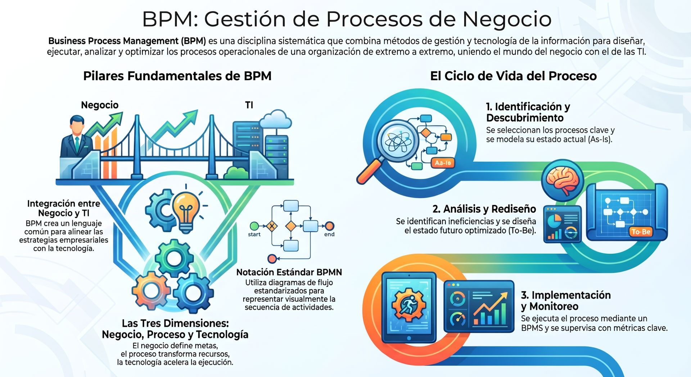
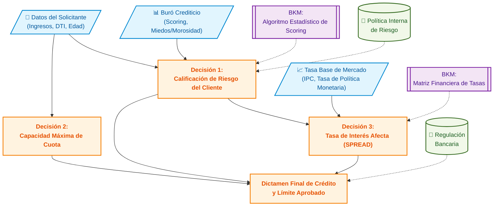

## **Gestión de procesos**



**Business Process Management (BPM)** o **Gestión de Procesos de Negocio** es una disciplina de gestión y un enfoque sistémico orientado a identificar, diseñar, estructurar, ejecutar, documentar, medir, monitorear y controlar procesos de negocio —tanto automatizados como no automatizados— con el propósito de alinearlos de forma continua con las metas estratégicas de la organización.

A diferencia de las aproximaciones de gestión tradicionales orientadas a estructuras funcionales rígidas o "silos" departamentales, BPM adopta una perspectiva transversal centrada en el flujo de valor de extremo a extremo (*end-to-end*).


### Conceptos

Un **proceso de negocio** se define como una colección coordinada y lógicamente secuenciada de eventos, actividades y puntos de decisión que involucran a diversos actores (humanos y sistemas) y recursos para transformar insumos (*inputs*) en un resultado o producto (*output*) que entrega un valor cuantitativo y cualitativo a un cliente interno o externo.

Los componentes esenciales de un proceso incluyen:
* **Eventos (*Events*):** Sucesos instantáneos que ocurren sin duración temporal y que disparan, modifican o concluyen la ejecución del flujo (ej. la llegada de una solicitud o el vencimiento de un temporizador de SLA).

* **Actividades y Tareas (*Activities & Tasks*):** Unidades de trabajo que consumen tiempo y recursos para transformar insumos.

* **Puntos de Decisión y Reglas de Negocio (*Decision Points & Gateways*):** Mecanismos lógicos que evalúan condiciones operativas para determinar la bifurcación o convergencia de las rutas de trabajo.

* **Actores, Objetos y Datos (*Actors & Data Objects*):** Participantes con roles asignados, sistemas invocados e información/documentos requeridos para ejecutar cada paso.


### Las Tres Dimensiones

La disciplina de BPM integra tres dimensiones interconectadas sustentadas por la tecnología:

1. **La Dimensión de Negocio (Valor):** Centrada en la creación de valor para clientes y partes interesadas (*stakeholders*), asegurando la alineación directa entre las operaciones diarias y los objetivos estratégicos de crecimiento, productividad y rentabilidad.

2. **La Dimensión de Proceso (Transformación):** Enfocada en la efectividad, transparencia y agilidad con que los recursos se transforman en productos o servicios, eliminando errores, duplicidades y cuellos de botella.

3. **La Dimensión de Gestión (Capacitación y Gobernanza):** Abarca las metodologías, roles y herramientas que dirigen y organizan a las personas y sistemas para ejecutar, medir y corregir las operaciones de forma estructurada y continua.

* **El Catalizador Tecnológico:** La suite de software (**BPMS**) y las arquitecturas de integración (SOA / ESB) que actúan como el motor técnico para orquestar y automatizar los procesos.


### El Ciclo de Vida

En la práctica organizacional, BPM opera mediante un ciclo cerrado e iterativo de mejora continua compuesto por seis fases fundamentales:

1. **Identificación de Procesos (*Process Identification*):** Se delimita el problema de negocio y se construye o actualiza el **mapa de procesos** (*Process Landscape* / Arquitectura de Procesos), seleccionando y priorizando los procesos clave según su impacto estratégico, salud operativa y factibilidad.

2. **Descubrimiento de Procesos (*Process Discovery / As-Is*):** Se recopila información mediante entrevistas, talleres o minería de procesos (*Process Mining*) para documentar el estado actual del proceso en modelos explícitos utilizando notaciones estándar como BPMN 2.0.

3. **Análisis de Procesos (*Process Analysis*):** Se examina cualitativa y cuantitativamente el modelo *As-Is* para identificar ineficiencias, causas raíz de fallas, tiempos de ciclo, actividades que no agregan valor y variaciones operativas.

4. **Rediseño de Procesos (*Process Redesign / To-Be*):** Se formulan alternativas optimizadas del proceso para resolver los problemas identificados, evaluando su impacto proyectado mediante simulación digital (*what-if*) antes de su construcción.

5. **Implementación de Procesos (*Process Implementation*):** Se transforma el modelo conceptual en una solución ejecutable. Abarca la gestión del cambio organizacional y la automatización mediante la orquestación de servicios e integración con sistemas legados o bases de datos corporativas.

6. **Monitoreo y Control de Procesos (*Process Monitoring & Control*):** Se mide el desempeño del proceso en tiempo real comparando los resultados contra indicadores clave de desempeño (KPIs/PPIs) y tableros de control (BAM). Los hallazgos alimentan nuevamente la fase de identificación o análisis, garantizando la resiliencia y mejora continua.


### Diferenciación

BPM consolida e integra herramientas de diversas corrientes de la ingeniería de sistemas y la administración:
* **Frente a BPR (*Business Process Reengineering*):** Mientras que BPR (Hammer & Champy) abogaba por el rediseño radical de "hoja en blanco" e intervenciones discretas o drásticas, BPM enfatiza un ciclo de vida permanente que combina cambios estructurales con la **mejora continua e incremental**.

* **Frente a TQM, Lean y Six Sigma:** TQM aporta la filosofía de calidad y satisfacción del cliente; Lean se enfoca en la eliminación de desperdicios (*muda*) y la fluidez del proceso; Six Sigma aporta el rigor analítico y estadístico para reducir la variabilidad (DMAIC). BPM adopta estas metodologías de proceso y las potencia mediante la automatización y la infraestructura de software.

* **Frente a Flujos de Trabajo (*Workflow Management Systems - WfMS*):** Los WfMS tradicionales se limitaban a la automatización y enrutamiento estático de tareas y documentos de oficina. Los sistemas **BPMS** modernos extienden este alcance añadiendo analítica de desempeño en tiempo real, integración empresarial de aplicaciones (EAI/ESB), motores de reglas de negocio independientes y supervisión ejecutiva.


### Arquitectura de un BPMS

Un **BPMS** (*Business Process Management System* o **Sistema de Gestión de Procesos**) es un conjunto integrado de software que soporta el diseño, análisis, ejecución y monitoreo de procesos a partir de modelos explícitos. Sus componentes arquitectónicos centrales son:

* **Herramienta de Modelado (*Process Modeler*):** Entorno gráfico estandarizado para diagramar procesos utilizando el lenguaje **BPMN 2.0**.

* **Motor de Ejecución (*Execution Engine*):** Núcleo que crea instancias del proceso (*cases*), gestiona los estados de ejecución, evalúa compuertas lógicas y coordina la ejecución de tareas automatizadas y humanas.

* **Gestor de Listas de Trabajo (*Worklist Handler*):** Interfaz o bandeja de entrada donde los usuarios consultan, seleccionan y completan sus tareas asignadas mediante formularios electrónicos.

* **Motor de Reglas de Negocio (*Business Rules Engine - BRE*):** Módulo que gestiona y evalúa las políticas y condiciones operativas de forma independiente al código de la aplicación.

* **Monitoreo de Actividad de Negocio (*Business Activity Monitoring - BAM*):** Herramientas gráficas e indicadores en tiempo real para supervisar tiempos de espera, cuellos de botella y rendimiento de los procesos.

BPM se apoya en el principio **"Lo que modelas es lo que ejecutas" (*WYMIWYR: What You Model Is What You Run*)**, donde el modelo visual producido por el analista de negocio se convierte en la especificación ejecutable directamente por el motor de procesos, cerrando la brecha tradicional entre negocio y TI.


### Madurez Organizacional

Para que la gestión por procesos sea una capacidad sostenible, las organizaciones deben evaluar y escalar su grado de madurez (desde el **Nivel 1: Inicial/Inconsistente** hasta el **Nivel 5: Optimizado**). Esto exige el desarrollo equilibrado de seis factores críticos de capacidad (*BPM Capability Areas*):
1. **Alineación Estratégica:** Vinculación explícita entre los procesos de negocio y la estrategia corporativa.

2. **Gobernanza:** Definición clara de decisiones, políticas, roles (*Process Owners*, CPO, Centro de Excelencia / CoE) y comités de supervisión.

3. **Métodos:** Notaciones estandarizadas y metodologías de análisis y rediseño aplicadas transversalmente.

4. **Tecnología (TI):** Herramientas de BPMS, orquestación SOA y repositorios de metadatos integrados.

5. **Personas:** Desarrollo de habilidades, competencias y capacitación continua del personal en la disciplina de procesos.

6. **Cultura:** Adopción de valores centrados en el cliente, transparencia operativa y flexibilidad ante el cambio.

***
## **Motor de reglas de negocio**

Un **motor de reglas de negocio** (conocido en inglés como *Business Rules Engine* - BRE o *Decision Engine*) es un componente de software especializado que externaliza, evalúa y ejecuta políticas, condiciones y decisiones de negocio de forma independiente al código fuente de las aplicaciones y a la estructura de los procesos.


### Propósito Fundamental

En los sistemas tradicionales, las reglas de negocio (fórmulas de cálculo, criterios de aprobación de crédito, políticas de descuento o validaciones normativas) solían estar programadas de forma rígida (*hardcoded*) dentro del código de la aplicación o entrelazadas en los flujos de trabajo. Esto provocaba que cualquier cambio normativo o comercial requiriera modificar el programa, realizar pruebas de regresión completas y atravesar largos ciclos de despliegue informático.

El motor de reglas resuelve esta rigidez mediante el **desacoplamiento de la lógica de decisión**:
* **Exteriorización de la lógica:** Las políticas operativas se extraen de la aplicación y se gestionan en un repositorio o motor independiente.

* **Autonomía para el negocio:** Permite que los analistas y gerentes de negocio creen, modifiquen y publiquen reglas de decisión mediante interfaces intuitivas (como tablas de decisión o árboles lógicos) en tiempo real, sin depender de reprogramaciones en TI.


### Mecanismo de Funcionamiento

Un motor de reglas opera como un **servicio de inferencia / evaluación** (a menudo conceptualizado como una "caja negra"):

```
[ Hechos de Entrada / Facts ] ──> [ MOTOR DE REGLAS (BRE) ] ──> [ Resultado / Decisión ]
 (Ej: Edad=22, Monto=$60.000)      Evaluación sobre Tabla      (Ej: Requiere Aprobación)
                                  de Decisiones / Reglas
```

1. **Recepción de Hechos (*Inputs / Facts*):** La aplicación o proceso envía una solicitud que contiene los datos del caso (por ejemplo, la edad del solicitante, su puntaje crediticio y el monto del préstamo).

2. **Evaluación de la Lógica:** El motor analiza los hechos recibidos contrastándolos con su repositorio de reglas cargado (por ejemplo, configurado mediante el estándar **DMN** - *Decision Model and Notation* o expresiones **FEEL**).

3. **Emisión del Resultado (*Outputs / Decisions*):** Devuelve una respuesta estructurada a la aplicación solicitante (por ejemplo, *"Aprobado"*, *"Rechazado"* o *"Escalar a Supervisor"*) para determinar cómo debe proceder el flujo.


### Integración con BPMN y Sistemas BPMS

En la gestión de procesos de negocio (**BPM**), el motor de reglas actúa en estrecha coordinación con el motor de procesos (*Workflow Engine*):

* **Tarea de Regla de Negocio (*Business Rule Task*):** En una orquestación **BPMN 2.0**, cuando el flujo de trabajo llega a un punto de decisión complejo, invoca una tarea de regla de negocio.
* **Invocación vía Servicios:** El motor de procesos transfiere el control temporalmente al BRE mediante servicios web (REST / SOAP) o llamadas de API, recibe la resolución y utiliza el resultado dentro de una compuerta lógica (*Gateway*) para dirigir el flujo por la ruta adecuada.


### Ventajas Clave

* **Agilidad Operativa:** Los cambios en las políticas de negocio se aplican casi instantáneamente sin necesidad de recompilar ni desplegar nuevamente todo el sistema.
* **Reutilización:** Una misma regla (por ejemplo, el cálculo del IVA o la validación de fraude) puede ser invocada de manera centralizada por múltiples aplicaciones, portales web o procesos de la empresa.
* **Lecturabilidad e Integración Negocio-TI:** Utiliza notaciones estándar estandarizadas por el OMG como **DMN** (*Decision Model and Notation*), las cuales son comprensibles tanto para usuarios de negocio como para desarrolladores.
* **Trazabilidad y Auditoría:** El motor registra el historial de ejecución y permite auditar exactamente qué regla y qué combinación de datos desencadenó una decisión concreta en un instante determinado.


### Tabla de decisiones

A continuación se presenta el modelado de una **Tabla de Decisiones** basada en el estándar **DMN (Decision Model and Notation)** de la OMG, aplicando el caso práctico de **Evaluación de Solicitudes de Crédito Personal**.

---

#### Tabla de Decisiones DMN: 
**Evaluacion Credito Personal**

| **Hit Policy: U** | **Entrada 1: Puntaje Crediticio** | **Entrada 2: Ingreso Mensual (USD)** | **Entrada 3: Monto Solicitado (USD)** | **Salida 1: Decisión** | **Salida 2: Límite Aprobado (USD)** |
| :---: | :---: | :---: | :---: | :---: | :---: |
| **Tipo / Rango FEEL** | `number [0..1000]` | `number` | `number` | `"Aprobado", "Revisión", "Rechazado"` | `number` |
| **Regla 1** | `< 600` | - | - | `"Rechazado"` | `0` |
| **Regla 2** | `[600..749]` | `< 2,500` | - | `"Rechazado"` | `0` |
| **Regla 3** | `[600..749]` | `>= 2,500` | `<= 10,000` | `"Aprobado"` | `Monto Solicitado` |
| **Regla 4** | `[600..749]` | `>= 2,500` | `> 10,000` | `"Revisión"` | `10,000` |
| **Regla 5** | `>= 750` | `< 1,500` | - | `"Revisión"` | `5,000` |
| **Regla 6** | `>= 750` | `>= 1,500` | `<= 25,000` | `"Aprobado"` | `Monto Solicitado` |
| **Regla 7** | `>= 750` | `>= 1,500` | `> 25,000` | `"Revisión"` | `25,000` |

---

#### Explicación de los Componentes DMN

1. **Indicador de Coincidencia (*Hit Policy*):**
   * El código **`U` (*Unique / Único*)** especifica que para cualquier combinación de hechos recibida en el sistema, **solo una fila (regla) puede ser verdadera a la vez**. Esto garantiza la integridad de la decisión al evitar resultados contradictorios o solapamientos (*overlapping rules*).
2. **Expresiones FEEL (*Friendly Enough Expression Language*):**
   * DMN utiliza la sintaxis **S-FEEL** para definir las condiciones de entrada. Ejemplos:
     * **Rango cerrado:** `[600..749]` especifica que el valor debe estar entre 600 y 749 (ambos inclusive).
     * **Comodín (`-`):** Indica que esa variable es irrelevante para esa regla en particular (condición *Don't Care*).
3. **Estructura de Entradas y Salidas:**
   * **Entradas (*Inputs*):** A la izquierda de la línea doble; representan las variables de hecho (*facts*) transmitidas al motor de reglas.
   * **Salidas (*Outputs*):** A la derecha de la línea doble; corresponden a las decisiones calculadas que se retornan al proceso de negocio.
4. **Orquestación con BPMN:**
   * Cuando un flujo BPMN 2.0 llega a una tarea de regla de negocio (*Business Rule Task*), envía los datos del cliente al motor de decisión (ej. Camunda, Drools).
   * El motor evalúa la tabla de forma instantánea y devuelve las variables `Decisión` y `Límite Aprobado`. Luego, una compuerta exclusiva (*XOR Gateway*) en el diagrama BPMN utiliza el resultado (`"Aprobado"`, `"Revisión"` o `"Rechazado"`) para bifurcar el flujo de trabajo sin necesidad de haber programado esa lógica dentro del código de la aplicación.

***

### Diagrama de requisitos (DRD)

A continuación se presenta el **Diagrama de Requisitos de Decisión (DRD - *Decision Requirement Diagram*)** en estándar **DMN (Decision Model and Notation)** de la OMG.

Este diagrama ilustra la arquitectura de decisiones de un sistema financiero de otorgamiento de crédito, mostrando cómo los **datos de entrada**, los **modelos de conocimiento de negocio (BKM)** y las **decisiones intermedias** se conectan de forma jerárquica para fundamentar la **decisión principal**.

---

#### Diagrama de Requisitos de Decisión



---

### Componentes de la Arquitectura de Decisión DMN

1. **Datos de Entrada (*Input Data*):**
   * Representan los hechos puros (*facts*) consumidos por el motor de reglas (ej. datos declarados por el cliente, estado financiero en el buró de crédito y parámetros macroeconómicos del mercado).

2. **Decisiones Intermedias (*Sub-decisions*):**
   * **Decisión 1 (Riesgo):** Evalúa el historial del cliente y sus ingresos para asignarle una categoría de riesgo (ej. *AAA, AA, B, C*).
   * **Decisión 2 (Capacidad de Pago):** Calcula la relación deuda-ingreso (*DTI - Debt-to-Income*) para determinar el monto máximo que el cliente puede pagar mensualmente sin sobreendeudarse.
   * **Decisión 3 (Tasa de Interés):** A partir del nivel de riesgo determinado en la Decisión 1 y la tasa base de mercado, calcula la tasa de interés ajustada por riesgo (*Risk-Based Pricing*).

3. **Modelos de Conocimiento de Negocio (*Business Knowledge Models - BKM*):**
   * Son funciones o algoritmos reutilizables que contienen la lógica matemática (fórmulas de scoring crediticio o algoritmos de interpolación de tasas) e invocan tablas de decisiones específicas.

4. **Fuentes de Conocimiento (*Knowledge Sources*):**
   * Documentan la autoridad o norma que justifica por qué existe la regla (políticas de crédito internas aprobadas por el directorio o normativas de la entidad reguladora del sistema financiero).

5. **Decisión Principal (*Root Decision*):**
   * Concatena los resultados de las tres decisiones intermedias y aplica la **Tabla de Decisiones DMN** (como la elaborada en la consulta anterior) para emitir la resolución final: **Aprobado**, **En Revisión** o **Rechazado**.

***
## **Caso practico**

A continuación se muestran los archivos de definición en XML estándar compatibles con **Camunda Modeler**, **Camunda Platform 7/8** y cualquier motor ejecutable BPMN 2.0 / DMN 1.3 de la OMG.

---

### 1. Proceso BPMN 2.0 
**(`solicitud_credito.bpmn`)**

Este archivo define el flujo de orquestación. La tarea **`Task_EvaluarCredito`** es de tipo `businessRuleTask` e invoca a la tabla de decisiones mediante el atributo `camunda:decisionRef="EvaluacionCreditoPersonal"`. La decisión retornada se mapea a la variable `resultadoEvaluacion` y se evalúa en la compuerta exclusiva (`Gateway_Decision`).

<details>
<summary>🖥️ Código XML</summary>

```xml
<?xml version="1.0" encoding="UTF-8"?>
<bpmn:definitions xmlns:bpmn="http://www.omg.org/spec/BPMN/20100524/MODEL"
                  xmlns:bpmndi="http://www.omg.org/spec/BPMN/20100524/DI"
                  xmlns:dc="http://www.omg.org/spec/DD/20100524/DC"
                  xmlns:di="http://www.omg.org/spec/DD/20100524/DI"
                  xmlns:camunda="http://camunda.org/schema/1.0/bpmn"
                  xmlns:xsi="http://www.w3.org/2001/XMLSchema-instance"
                  id="Definitions_1"
                  targetNamespace="http://bpmn.io/schema/bpmn"
                  exporter="Camunda Modeler"
                  exporterVersion="5.0.0">

  <bpmn:process id="Process_SolicitudCredito" name="Proceso de Solicitud de Crédito Personal" isExecutable="true">
    
    <!-- 1. Evento de Inicio -->
    <bpmn:startEvent id="StartEvent_1" name="Solicitud Recibida">
      <bpmn:outgoing>Flow_1</bpmn:outgoing>
    </bpmn:startEvent>
    
    <bpmn:sequenceFlow id="Flow_1" sourceRef="StartEvent_1" targetRef="Task_EvaluarCredito" />
    
    <!-- 2. Tarea de Regla de Negocio (Invocación al Motor DMN) -->
    <bpmn:businessRuleTask id="Task_EvaluarCredito" 
                           name="Evaluar Solicitud con DMN" 
                           camunda:decisionRef="EvaluacionCreditoPersonal" 
                           camunda:resultVariable="resultadoEvaluacion" 
                           camunda:mapDecisionResult="singleResult">
      <bpmn:incoming>Flow_1</bpmn:incoming>
      <bpmn:outgoing>Flow_2</bpmn:outgoing>
    </bpmn:businessRuleTask>
    
    <bpmn:sequenceFlow id="Flow_2" sourceRef="Task_EvaluarCredito" targetRef="Gateway_Decision" />
    
    <!-- 3. Compuerta Exclusiva (XOR Gateway) -->
    <bpmn:exclusiveGateway id="Gateway_Decision" name="¿Dictamen de Crédito?">
      <bpmn:incoming>Flow_2</bpmn:incoming>
      <bpmn:outgoing>Flow_Aprobado</bpmn:outgoing>
      <bpmn:outgoing>Flow_Revision</bpmn:outgoing>
      <bpmn:outgoing>Flow_Rechazado</bpmn:outgoing>
    </bpmn:exclusiveGateway>
    
    <!-- Flujo Aprobado -->
    <bpmn:sequenceFlow id="Flow_Aprobado" name="Aprobado" sourceRef="Gateway_Decision" targetRef="Service_NotificarAprobacion">
      <bpmn:conditionExpression xsi:type="bpmn:tFormalExpression">
        ${resultadoEvaluacion.get('decision') == 'Aprobado'}
      </bpmn:conditionExpression>
    </bpmn:sequenceFlow>
    
    <!-- Flujo Revisión Manual -->
    <bpmn:sequenceFlow id="Flow_Revision" name="Revisión Manual" sourceRef="Gateway_Decision" targetRef="User_RevisionManual">
      <bpmn:conditionExpression xsi:type="bpmn:tFormalExpression">
        ${resultadoEvaluacion.get('decision') == 'Revisión'}
      </bpmn:conditionExpression>
    </bpmn:sequenceFlow>
    
    <!-- Flujo Rechazado -->
    <bpmn:sequenceFlow id="Flow_Rechazado" name="Rechazado" sourceRef="Gateway_Decision" targetRef="Service_NotificarRechazo">
      <bpmn:conditionExpression xsi:type="bpmn:tFormalExpression">
        ${resultadoEvaluacion.get('decision') == 'Rechazado'}
      </bpmn:conditionExpression>
    </bpmn:sequenceFlow>
    
    <!-- 4. Actividades de Destino segun Dictamen -->
    <bpmn:serviceTask id="Service_NotificarAprobacion" name="Notificar Aprobación y Desembolsar" camunda:type="external" camunda:topic="desembolso">
      <bpmn:incoming>Flow_Aprobado</bpmn:incoming>
      <bpmn:outgoing>Flow_3</bpmn:outgoing>
    </bpmn:serviceTask>
    
    <bpmn:userTask id="User_RevisionManual" name="Análisis Manual de Riesgo" camunda:candidateGroups="riesgos">
      <bpmn:incoming>Flow_Revision</bpmn:incoming>
      <bpmn:outgoing>Flow_4</bpmn:outgoing>
    </bpmn:userTask>
    
    <bpmn:serviceTask id="Service_NotificarRechazo" name="Notificar Carta de Rechazo" camunda:type="external" camunda:topic="notificaciones">
      <bpmn:incoming>Flow_Rechazado</bpmn:incoming>
      <bpmn:outgoing>Flow_5</bpmn:outgoing>
    </bpmn:serviceTask>
    
    <!-- 5. Eventos de Fin -->
    <bpmn:endEvent id="EndEvent_Aprobado" name="Crédito Otorgado">
      <bpmn:incoming>Flow_3</bpmn:incoming>
    </bpmn:endEvent>
    
    <bpmn:endEvent id="EndEvent_RevisionCompleta" name="Dictamen Manual Emitido">
      <bpmn:incoming>Flow_4</bpmn:incoming>
    </bpmn:endEvent>
    
    <bpmn:endEvent id="EndEvent_Rechazado" name="Solicitud Denegada">
      <bpmn:incoming>Flow_5</bpmn:incoming>
    </bpmn:endEvent>
    
    <bpmn:sequenceFlow id="Flow_3" sourceRef="Service_NotificarAprobacion" targetRef="EndEvent_Aprobado" />
    <bpmn:sequenceFlow id="Flow_4" sourceRef="User_RevisionManual" targetRef="EndEvent_RevisionCompleta" />
    <bpmn:sequenceFlow id="Flow_5" sourceRef="Service_NotificarRechazo" targetRef="EndEvent_Rechazado" />
    
  </bpmn:process>
</bpmn:definitions>
```
</details>


### 2. Tabla de Decisiones DMN 
**(`evaluacion_credito.dmn`)**

Este documento contiene la especificación en XML de la tabla DMN con `hitPolicy="UNIQUE"`. Evalúa las variables `puntajeCrediticio`, `ingresoMensual` y `montoSolicitado`, asignando las salidas `decision` y `limiteAprobado`.

<details>
<summary>🖥️ Código XML</summary>

```xml
<?xml version="1.0" encoding="UTF-8"?>
<definitions xmlns="https://www.omg.org/spec/DMN/20191111/MODEL/"
             xmlns:dmndi="https://www.omg.org/spec/DMN/20191111/DMNDI/"
             xmlns:dc="http://www.omg.org/spec/DMN/20180521/DC/"
             xmlns:camunda="http://camunda.org/schema/1.0/dmn"
             id="Definitions_EvaluacionCredito"
             name="Evaluación de Crédito Personal"
             namespace="http://camunda.org/schema/1.0/dmn"
             exporter="Camunda Modeler"
             exporterVersion="5.0.0">

  <decision id="EvaluacionCreditoPersonal" name="Evaluación de Crédito Personal">
    <decisionTable id="DecisionTable_1" hitPolicy="UNIQUE">
      
      <!-- ENTRADAS -->
      <input id="Input_1" label="Puntaje Crediticio" camunda:inputVariable="puntajeCrediticio">
        <inputExpression id="InputExpression_1" typeRef="integer">
          <text>puntajeCrediticio</text>
        </inputExpression>
      </input>
      
      <input id="Input_2" label="Ingreso Mensual (USD)" camunda:inputVariable="ingresoMensual">
        <inputExpression id="InputExpression_2" typeRef="integer">
          <text>ingresoMensual</text>
        </inputExpression>
      </input>
      
      <input id="Input_3" label="Monto Solicitado (USD)" camunda:inputVariable="montoSolicitado">
        <inputExpression id="InputExpression_3" typeRef="integer">
          <text>montoSolicitado</text>
        </inputExpression>
      </input>
      
      <!-- SALIDAS -->
      <output id="Output_1" label="Decisión" name="decision" typeRef="string" />
      <output id="Output_2" label="Límite Aprobado (USD)" name="limiteAprobado" typeRef="integer" />
      
      <!-- REGLA 1: Puntaje Bajo (<600) -->
      <rule id="DecisionRule_1">
        <inputEntry id="UnaryTests_1_1"><text>&lt; 600</text></inputEntry>
        <inputEntry id="UnaryTests_1_2"><text>-</text></inputEntry>
        <inputEntry id="UnaryTests_1_3"><text>-</text></inputEntry>
        <outputEntry id="LiteralExpression_1_1"><text>"Rechazado"</text></outputEntry>
        <outputEntry id="LiteralExpression_1_2"><text>0</text></outputEntry>
      </rule>
      
      <!-- REGLA 2: Puntaje Medio + Ingreso Insuficiente -->
      <rule id="DecisionRule_2">
        <inputEntry id="UnaryTests_2_1"><text>[600..749]</text></inputEntry>
        <inputEntry id="UnaryTests_2_2"><text>&lt; 2500</text></inputEntry>
        <inputEntry id="UnaryTests_2_3"><text>-</text></inputEntry>
        <outputEntry id="LiteralExpression_2_1"><text>"Rechazado"</text></outputEntry>
        <outputEntry id="LiteralExpression_2_2"><text>0</text></outputEntry>
      </rule>
      
      <!-- REGLA 3: Puntaje Medio + Ingreso Suficiente + Monto <= 10,000 -->
      <rule id="DecisionRule_3">
        <inputEntry id="UnaryTests_3_1"><text>[600..749]</text></inputEntry>
        <inputEntry id="UnaryTests_3_2"><text>&gt;= 2500</text></inputEntry>
        <inputEntry id="UnaryTests_3_3"><text>&lt;= 10000</text></inputEntry>
        <outputEntry id="LiteralExpression_3_1"><text>"Aprobado"</text></outputEntry>
        <outputEntry id="LiteralExpression_3_2"><text>montoSolicitado</text></outputEntry>
      </rule>
      
      <!-- REGLA 4: Puntaje Medio + Ingreso Suficiente + Monto > 10,000 -->
      <rule id="DecisionRule_4">
        <inputEntry id="UnaryTests_4_1"><text>[600..749]</text></inputEntry>
        <inputEntry id="UnaryTests_4_2"><text>&gt;= 2500</text></inputEntry>
        <inputEntry id="UnaryTests_4_3"><text>&gt; 10000</text></inputEntry>
        <outputEntry id="LiteralExpression_4_1"><text>"Revisión"</text></outputEntry>
        <outputEntry id="LiteralExpression_4_2"><text>10000</text></outputEntry>
      </rule>
      
      <!-- REGLA 5: Puntaje Alto + Ingreso Bajo -->
      <rule id="DecisionRule_5">
        <inputEntry id="UnaryTests_5_1"><text>&gt;= 750</text></inputEntry>
        <inputEntry id="UnaryTests_5_2"><text>&lt; 1500</text></inputEntry>
        <inputEntry id="UnaryTests_5_3"><text>-</text></inputEntry>
        <outputEntry id="LiteralExpression_5_1"><text>"Revisión"</text></outputEntry>
        <outputEntry id="LiteralExpression_5_2"><text>5000</text></outputEntry>
      </rule>

      <!-- REGLA 6: Puntaje Alto + Ingreso Normal + Monto <= 25,000 -->
      <rule id="DecisionRule_6">
        <inputEntry id="UnaryTests_6_1"><text>&gt;= 750</text></inputEntry>
        <inputEntry id="UnaryTests_6_2"><text>&gt;= 1500</text></inputEntry>
        <inputEntry id="UnaryTests_6_3"><text>&lt;= 25000</text></inputEntry>
        <outputEntry id="LiteralExpression_6_1"><text>"Aprobado"</text></outputEntry>
        <outputEntry id="LiteralExpression_6_2"><text>montoSolicitado</text></outputEntry>
      </rule>

      <!-- REGLA 7: Puntaje Alto + Ingreso Normal + Monto > 25,000 -->
      <rule id="DecisionRule_7">
        <inputEntry id="UnaryTests_7_1"><text>&gt;= 750</text></inputEntry>
        <inputEntry id="UnaryTests_7_2"><text>&gt;= 1500</text></inputEntry>
        <inputEntry id="UnaryTests_7_3"><text>&gt; 25000</text></inputEntry>
        <outputEntry id="LiteralExpression_7_1"><text>"Revisión"</text></outputEntry>
        <outputEntry id="LiteralExpression_7_2"><text>25000</text></outputEntry>
      </rule>
      
    </decisionTable>
  </decision>
</definitions>
```
</details>


### 3. Comandos de Despliegue

Para probar estos artefactos en una instancia local de **Camunda Engine Platform**:

1. **Desplegar ambos artefactos vía API REST:**
   ```bash
   curl -X POST http://localhost:8080/engine-rest/deployment/create \
     -H "Content-Type: multipart/form-data" \
     -F "deployment-name=CreditoDeployment" \
     -F "solicitud_credito.bpmn=@solicitud_credito.bpmn" \
     -F "evaluacion_credito.dmn=@evaluacion_credito.dmn"
   ```

2. **Iniciar una instancia del proceso enviando los datos del cliente:**
   ```bash
   curl -X POST http://localhost:8080/engine-rest/process-definition/key/Process_SolicitudCredito/start \
     -H "Content-Type: application/json" \
     -d '{
       "variables": {
         "puntajeCrediticio": {"value": 780, "type": "Integer"},
         "ingresoMensual": {"value": 3200, "type": "Integer"},
         "montoSolicitado": {"value": 15000, "type": "Integer"}
       }
     }'s
   ```

   **Resultado en tiempo de ejecución:** El motor BPMN avanzará a la tarea `Task_EvaluarCredito`, evaluará la **Regla 6** del DMN, determinará `"decision": "Aprobado"`, `"limiteAprobado": 15000`, y conducirá el flujo automáticamente hacia la actividad de notificación y desembolso (`Service_NotificarAprobacion`).

