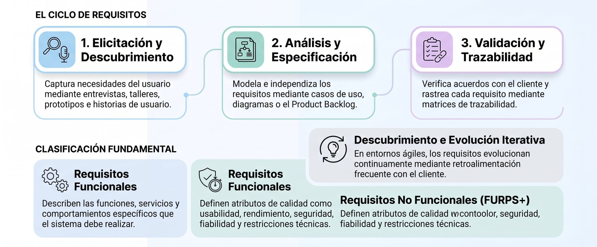
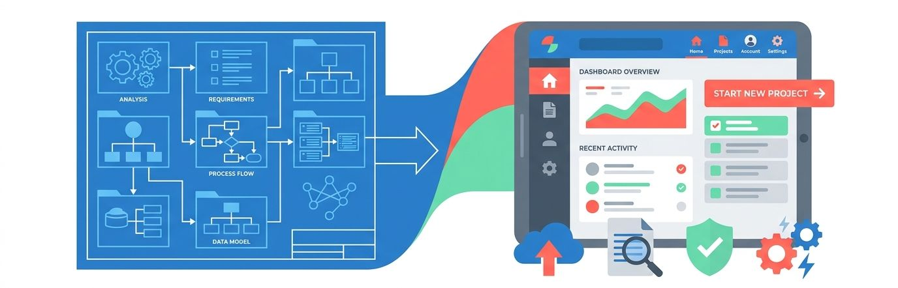
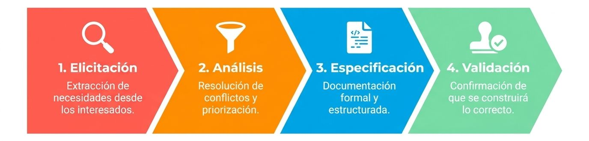
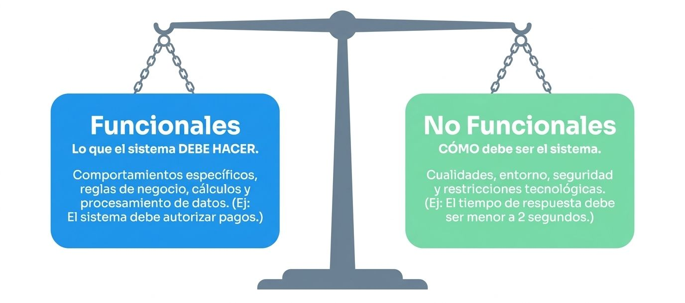
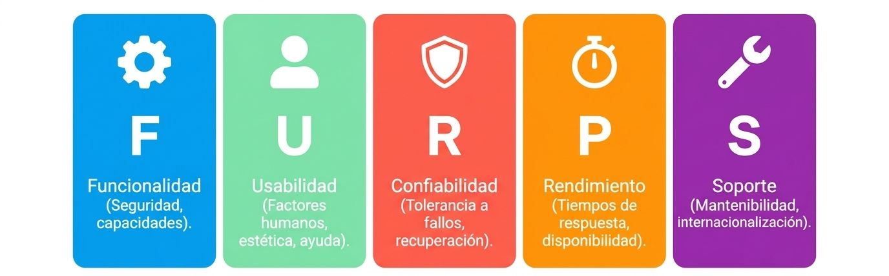
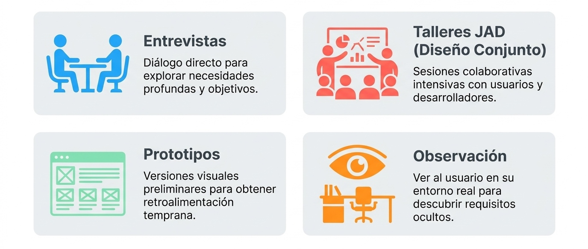
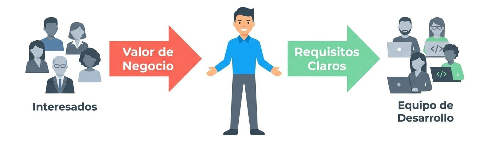
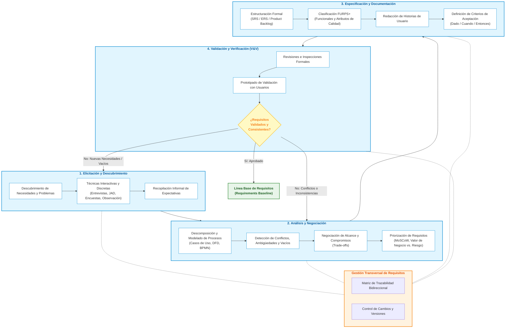

La **Ingeniería de Requisitos (IR)** es un proceso sistemático, estructurado e interdisciplinario que consiste en descubrir, analizar, documentar, priorizar, comunicar, verificar y gestionar las necesidades, restricciones y condiciones que debe cumplir un producto o sistema de software para responder a los objetivos estratégicos del negocio y de los interesados (*stakeholders*). 

Su propósito central es **traducir problemas organizacionales y objetivos de negocio en requisitos operativos concretos, medibles e inequívocos**, sirviendo como el puente fundamental entre el entorno del problema y el diseño de la solución técnica.



Dentro del ciclo de vida del desarrollo, actúa como el puente fundamental entre el problema del cliente y la solución técnica.



:::info[definición]
La **Elicitación** es el proceso de extraer o provocar información, datos o requisitos de una persona, sistema o entorno de manera fluida y estructurada. Es la primera fase del desarrollo de sistemas para identificar qué necesitan los usuarios y el negocio.

Tiene como objetivo convertir necesidades difusas en lenguaje natural a requerimientos técnicos claros.

**Técnicas habituales:** Entrevistas, cuestionarios, talleres de trabajo (workshops), observación directa, prototipado y análisis de documentación.
:::

### Requisitos Funcionales vs. No Funcionales

En este ámbito, las necesidades del sistema se clasifican principalmente en dos grandes categorías:



* **Requisitos Funcionales (RF):** Describen las capacidades, comportamientos, procesos y servicios específicos que el sistema debe ejecutar (el **qué** hace el producto o sistema). Se expresan tradicionalmente mediante casos de uso, historias de usuario o especificaciones funcionales. 

*Ejemplo:* El sistema debe permitir autorizar cobros con tarjeta de crédito.

* **Requisitos No Funcionales / Atributos de Calidad (NFR):** Especifican las propiedades, cualidades, condiciones y restricciones de operación del sistema (el **cómo** lo hace). Se organizan habitualmente bajo el modelo **FURPS+**:
  * **U**sability *(Usabilidad)*: Factores humanos, ergonomía de la interfaz, documentación y facilidad de aprendizaje.
  * **R**eliability *(Fiabilidad)*: Tolerancia a fallos, disponibilidad, capacidad de recuperación y previsibilidad.
  * **P**erformance *(Rendimiento)*: Tiempos de respuesta, capacidad de procesamiento concurrentes y uso de recursos.
  * **S**upportability *(Sostenibilidad/Soporte)*: Mantenibilidad, adaptabilidad, configurabilidad e internacionalización.
  * **Restricciones (+)**: Limitaciones de hardware/software, interfaces externas, normas legales, de seguridad y empaquetamiento.

  *Ejemplo:* El tiempo de respuesta del servidor no debe superar los 2 segundos ante 5,000 usuarios concurrentes.




### Historias de Usuario (*User Stories*)
* Son descripciones breves y sencillas de una funcionalidad deseada, redactadas desde la perspectiva del usuario final para capturar el valor de negocio que se busca entregar.
* En metodologías ágiles y marcos como Scrum, sustituyen las listas tradicionales de especificaciones extensas por un **Product Backlog** dinámico y vivo, sirviendo como un compromiso de diálogo continuo entre el equipo de desarrollo y el dueño del producto (*Product Owner*).

### Criterios de Aceptación (*Acceptance Criteria*)
* Son las condiciones, reglas o pruebas específicas que una historia de usuario o requisito debe cumplir para ser validado y considerado "terminado" (*Definition of Done*) por el cliente o el negocio.
* Guían el desarrollo guiado por pruebas de aceptación (ATDD / BDD) y garantizan que el software entregado satisfaga de forma verificable el comportamiento esperado.

### Reglas de Negocio (*Business Rules*)
* Son las políticas, fórmulas, procedimientos o restricciones organizacionales y legales que rigen el funcionamiento de la empresa.
* No son requisitos de software en sí mismas, pero **condicionan y restringen** directamente los requisitos del sistema. *Ejemplo:* Una norma corporativa que exige un 20% de descuento a empleados condiciona la lógica del requisito de cálculo de ventas.


### Priorización
* Es la actividad de evaluar y ordenar los requisitos o historias de usuario según su valor para el cliente, impacto en el negocio, urgencia o riesgo técnico.
* En ciclos de vida iterativos, permite al *Product Owner* seleccionar en cada iteración los elementos de mayor valor para construir incrementos funcionales tempranos. Se utilizan técnicas como la votación multicriterio, análisis costo-beneficio o dinámicas de grupo (*dot voting*).


### Ambigüedad y Consistencia
* **Ambigüedad:** Ocurre cuando un requisito no está claramente expresado y permite múltiples interpretaciones, siendo una de las principales fuentes de errores, desviaciones presupuestarias y retrabajos en los proyectos.

* **Consistencia:** Exige que los requisitos no entren en conflicto entre sí ni con las restricciones arquitectónicas o legales del proyecto.
* La IR utiliza herramientas como la **matriz de trazabilidad**, glosarios de términos y especificaciones claras para asegurar que los requisitos sean unívocos, medibles, testeables y coherentes de extremo a extremo.

## **Técnicas de recopilación**



En este ámbito específico —donde el objetivo central es capturar, analizar y validar las necesidades operativas de los usuarios e interesados— las **técnicas de recopilación y elicitación** se clasifican entre *métodos interactivos* (diálogo e interacción directa) y *métodos discretos* (observación no intrusiva). 

A continuación se desglosan en detalle las cuatro técnicas fundamentales:


### Entrevistas (*Interviews*)

La entrevista es un método interactivo basado en una conversación dirigida con un propósito específico, estructurada en un formato de preguntas y respuestas entre el analista de requisitos y los actores clave de la organización.

* **Propósito en la IR:** Permite explorar aspectos que difícilmente figuran en la documentación formal, tales como **opiniones, sentimientos, metas organizacionales, procedimientos informales e interacciones humano-computadora (HCI)**.
* **Pasos de Preparación:**
  1. *Estudiar antecedentes:* Familiarizarse con la jerga corporativa y el contexto operativo.
  2. *Establecer objetivos:* Definir de 4 a 6 áreas clave a investigar.
  3. *Seleccionar entrevistados:* Conformar una muestra representativa que incluya usuarios finales y directivos de todos los niveles afectados.
  4. *Preparar al entrevistado:* Notificar la agenda con anticipación y limitar la sesión a un máximo de **45 a 60 minutos** para evitar el sobrecalentamiento y la resistencia del usuario.
  5. *Estructurar el cuestionario:* Diseñar el flujo lógico de las preguntas.
* **Tipos de Preguntas:**
  * **Abiertas:** Permiten libertad de respuesta al usuario, descubriendo necesidades no contempladas y vocabulario del dominio.
  * **Cerradas (y bipolares):** Limitan las opciones a alternativas específicas o datos cuantitativos exactos.
  * **Sondeos (*Probes*):** Preguntas de seguimiento (como *"¿Por qué?"* o *"¿Puede darme un ejemplo?"*) para profundizar en las respuestas y evitar aceptar afirmaciones superficiales.
* **Estructuras Organizativas de la Entrevista:**
  * **Pirámide (inductiva):** Inicia con preguntas cerradas y específicas para luego abrir el diálogo hacia aspectos generales.
  * **Embudo (deductiva):** Comienza con preguntas amplias y abiertas para explorar sentimientos y se restringe progresivamente a datos cerrados.
  * **Diamante:** Inicia con preguntas cerradas, se expande a discusiones abiertas y concluye con compromisos y cierres específicos.
* **Exploración de Escenarios:** En IR es crítico interrogar no solo sobre el escenario ideal o sin fallas (*sunny-day scenario*), sino indagar explícitamente sobre las excepciones, fallas del sistema o clientes difíciles (*rainy-day scenarios*).



### Talleres JAD (*Joint Application Design*) 
**Diseño Conjunto de Aplicaciones**

Desarrollado por IBM, JAD es una técnica interactiva de trabajo en grupo diseñada para acelerar la elicitación de requisitos y el diseño de interfaces en un entorno colaborativo estructurado.

* **Propósito y Beneficios:** Sustituye la secuencia lenta de entrevistas individuales cara a cara. Permite un **ahorro de tiempo estimado del 15%**, acelera el desarrollo rápido, genera consenso entre grupos de usuarios con intereses contrapuestos y fomenta el diseño creativo mediante lluvias de ideas participativas.
* **Roles de los Participantes:**
  * **Patrocinador Ejecutivo:** Directivo de alto nivel que respalda el proyecto y simboliza el compromiso organizacional.
  * **Facilitador / Líder de Sesión:** Persona imparcial (frecuentemente un consultor externo) con habilidades de comunicación para guiar la discusión, negociar y alcanzar acuerdos sin imponer sesgos jerárquicos.
  * **Analistas de Sistemas:** Asumen un rol fundamentalmente pasivo de escucha activa, interviniendo para dar retroalimentación sobre la viabilidad técnica y los costos de las soluciones propuestas.
  * **Usuarios / Expertos del Negocio (8 a 12 participantes):** Representantes de diversos rangos capaces de articular sus necesidades de información.
  * **Escriba y Observadores:** Registran formalmente los acuerdos y aportan asesoría técnica puntual.
* **Formato y Entorno:** Se ejecuta en instalaciones **fuera del sitio de trabajo (*off-site*) durante 2 a 4 días continuos**, aislados de las interrupciones del trabajo diario. Examina de forma estructurada las actividades bajo las interrogantes *quién, qué, cómo, dónde y por qué*.


### Prototipos (*Prototyping*) y Modelado Interactivo

Consiste en construir un modelo funcional, operacional o visual en etapas tempranas del ciclo de vida del software (SDLC) para capturar las reacciones de los usuarios y refinar los requisitos preliminares bajo el principio de *"lo sabré cuando lo vea"*.

* **Los Cuatro Tipos de Prototipos:**
  1. **Prototipo de Parches (*Breadboarding*):** Sistema completamente funcional en todas sus características pero ineficiente en su lógica o almacenamiento interno.
  2. **Prototipo No Operacional:** Modelo a escala no funcional (ej. maquetas de pantallas/interfaz) para evaluar aspectos estéticos o ergonómicos.
  3. **Prototipo Primero de una Serie (Piloto):** Modelo a escala completa totalmente operativo que se instala en una ubicación o sucursal de prueba.
  4. **Prototipo de Características Selectas:** Modelo operacional que incluye únicamente un subconjunto de funciones esenciales. Es la base del desarrollo evolutivo e incremental (y del desarrollo rápido de aplicaciones - RAD).

* **Lineamientos Clave de Desarrollo:** Trabajar en módulos administrables, construir el modelo con rapidez, diseñar el código para admitir modificaciones iterativas y priorizar la usabilidad de la interfaz de usuario.

* **Rol del Usuario:** Experimentar directamente con el prototipo, proveer retroalimentación abierta y objetiva, y sugerir adiciones, supresiones o mejoras en los flujos.


### Observación (*Observation*) y Método STROBE

La observación es un método discreto y no intrusivo que consiste en presenciar directamente cómo los usuarios ejecutan sus tareas cotidianas e interactúan con la tecnología de la información.

* **Propósito en la IR:** Permite al analista contrastar la narrativa verbal obtenida en entrevistas contra la **realidad operativa**, identificando procedimientos no documentados, cuellos de botella y problemas de interacción humano-computadora (HCI).
* **Modalidades de Observación:**
  * **Guión del Analista (*Analyst's Script*):** Registro cronológico estructurado paso a paso que documenta a los actores, eventos de información, decisiones y herramientas utilizadas.
  * **Acompañamiento (*Job Shadowing*):** Observación directa en tiempo real del trabajo de un experto operativo.
  * **Método STROBE (*STRuctured OBservation of the Environment*):** Adaptado de la crítica cinematográfica (*mise-en-scène*), analiza de forma explícita **7 elementos físicos** del entorno de oficina para inferir cómo se procesa la información en la organización:
    1. *Ubicación de la oficina* (estatus y accesibilidad).
    2. *Colocación del escritorio* (comunicación vs. autoridad).
    3. *Equipo estacionario / Archivadores* (almacenamiento personal de datos).
    4. *Accesorios y dispositivos (Props)* (presencia de dispositivos móviles, PCs, tablas).
    5. *Fuentes externas de información* (revistas especializadas, sitios web).
    6. *Iluminación y color* (trabajo detallado vs. casual).
    7. *Vestimenta del tomador de decisiones* (autoridad o apego a normas).
* **Análisis de Discrepancias:** Las observaciones físicas de STROBE se comparan con las declaraciones verbales para **confirmar, invertir/negar, modificar, complementar o buscar pistas para profundizar** en los requisitos del sistema.


### Cuadro Comparativo de Técnicas de Elicitación

| Técnica | Naturaleza | Principal Ventaja en IR | Principal Desafío |
| :--- | :--- | :--- | :--- |
| **Entrevistas** | Interactiva | Profundiza en opiniones, objetivos, sentimientos y detalles informales. | Consume mucho tiempo y puede recopilar datos sesgados. |
| **Talleres JAD** | Interactiva | Resuelve desacuerdos rápidamente y logra consenso de requisitos en días. | Requiere disponibilidad a tiempo completo de 2 a 4 días de personal clave. |
| **Prototipos** | Interactiva | Clarifica requisitos ambiguos mediante interacción práctica temprana. | Riesgo de que el cliente confunda un prototipo incompleto con el sistema final. |
| **Observación / STROBE** | Discreta | Revela la realidad operativa directa y valida las afirmaciones verbales. | Puede alterar temporalmente el comportamiento del usuario observado. |


---

## **Importancia en el Ciclo de Vida**

La IR no es simplemente una etapa inicial de documentación; es el eje que atraviesa y condiciona todo el **Ciclo de Vida del Desarrollo de Software (SDLC)**:

#### A. Prevención del Fracaso de Proyectos y Reducción del Retrabajo
Estudios en proyectos reales revelan que más del **37% de los costos excesivos y problemas en el desarrollo** se originan en deficiencias de requisitos (especificaciones incompletas, ambiguas, contradictorias o falta de involucramiento del usuario). La falta de rigor al definir los requisitos provoca una desconexión entre lo que TI construye y lo que el usuario realmente necesita.

#### B. Reducción No Lineal del Costo de Corrección
Detectar y corregir un error de concepto o una ambigüedad durante la fase de análisis de requisitos es sumamente económico. Si ese mismo error no se detecta y se arrastra hasta las fases de desarrollo, pruebas o producción, el costo de corregirlo se incrementa exponencialmente debido a la necesidad de rediseñar la arquitectura, recodificar módulos y rehacer pruebas.

#### C. Moldeado de la Arquitectura del Software
Mientras que los requisitos funcionales determinan los módulos del software, **los requisitos no funcionales (atributos de calidad) son los que moldean las decisiones arquitectónicas de gran escala**. Un requisito de rendimiento o de tolerancia a fallos ante caídas de servicios condiciona directamente la elección de patrones de diseño, infraestructura, bases de datos y mecanismos de integración.

#### D. Base para la Verificación y Validación (V&V)
Los requisitos establecen los **criterios de aceptación** y las condiciones de éxito con las cuales el equipo de calidad y los clientes evalúan el producto. Permiten diseñar casos de prueba automatizados (unitarios, de integración, de sistema y de aceptación) para verificar que el software se esté construyendo correctamente y valide las necesidades operativas reales.

#### E. Guía para la Planificación y Estimación de Proyectos
La documentación y descomposición de requisitos en historias o casos de uso es el insumo clave para estructurar la **Estructura de Desglose del Trabajo (EDT/WBS)**, estimar costos, asignar recursos y trazar la matriz de trazabilidad para controlar los cambios de alcance (*scope creep*).


### La IR Predictivo vs. Adaptativo

El manejo de los requisitos varía sustancialmente según el enfoque del proyecto:

```
+-----------------------------------------------------------------------------------+
|                         CICLO PREDICTIVO (Cascada / SDLC)                         |
|  Requisitos exhaustivos y detallados al inicio -> Congelamiento -> Desarrollo      |
+-----------------------------------------------------------------------------------+
                                          VS
+-----------------------------------------------------------------------------------+
|                         CICLO ADAPTATIVO (Ágil / Scrum / UP)                      |
|  Requisitos evolutivos (Backlog) -> Exploración iterativa -> Entregas incrementales |
+-----------------------------------------------------------------------------------+
```

* **En Ciclos de Vida Predictivos (Cascada / SDLC):** Se intenta definir, documentar y congelar la totalidad de los requisitos al inicio del proyecto. Sin embargo, la práctica demuestra que los requisitos son intrínsecamente cambiantes e inestables debido a la evolución del mercado y a que los usuarios aclaran sus necesidades a medida que interactúan con el software.

* **En Ciclos de Vida Adaptativos / Ágiles (Scrum, Kanban, UP):** La IR se concibe como un **proceso continuo e iterativo**. Los requisitos no se congelan, sino que se gestionan en un **Product Backlog** estructurado en historias de usuario. A través de ciclos cortos de desarrollo y prototipos funcionales, el equipo obtiene retroalimentación rápida del cliente para refinar y adaptar los requisitos progresivamente, reduciendo la incertidumbre y maximizando la entrega de valor.

#### Proceso de desarrollo de requisitos




#### Explicación del Proceso

1. **Elicitación y Descubrimiento:**
   * **Objetivo:** Explorar el dominio del problema y extraer las necesidades reales del cliente y usuarios mediante métodos interactivos (entrevistas, talleres JAD, cuestionarios) y métodos discretos (revisión documental, análisis de artefactos).
   * **Entregable:** Lista inicial no estructurada de necesidades y requisitos de usuario.

2. **Análisis y Negociación:**
   * **Objetivo:** Filtrar y refinar la información obtenida. Se modela el sistema (UML, DFD, BPMN) para detectar ambigüedades, inconsistencias y brechas técnicas. Se resuelven conflictos de interés entre los *stakeholders* y se priorizan las funcionalidades a construir.
   * **Entregable:** Requisitos analizados, justificados y priorizados.

3. **Especificación y Documentación:**
   * **Objetivo:** Formalizar los requisitos en artefactos legibles y verificables tanto para el negocio como para el equipo técnico. Se desglosan en **Requisitos Funcionales** y **No Funcionales (FURPS+)**, o en **Historias de Usuario** acompañadas de sus respectivos **Criterios de Aceptación**.
   * **Entregable:** Documento de Especificación de Requisitos de Software (SRS/ERS) o *Product Backlog* refinado.

4. **Validación y Verificación (V&V):**
   * **Objetivo:** Garantizar que los requisitos especificados sean correctos, completos, consistentes y realistas (Verificación), y que realmente respondan a las necesidades del cliente (Validación).
   * **Ciclo de Retroalimentación:** Si se descubren vacíos o contradicciones, el flujo retrocede a la etapa de Análisis o Elicitación antes de congelar la versión.
   * **Entregable:** **Línea Base de Requisitos (*Requirements Baseline*)** aprobada.

5. **Gestión Transversal de Requisitos:**
   * **Objetivo:** Actividad continua durante todo el ciclo de vida para controlar los cambios de alcance (*scope creep*), gestionar las versiones y mantener la **matriz de trazabilidad bidireccional** entre requisitos, arquitectura, código y pruebas.


## **Análisis y negociación**

En el marco del **Proceso Fundamental de la Ingeniería de Requisitos**, la etapa de **Análisis y Negociación** constituye el filtro crítico donde las necesidades iniciales descubiertas o elicitadas de los interesados dejan de ser un listado informal de deseos y se transforman en una especificación estructurada, factible y consensuada.

Mientras que la *elicitación* se encarga de explorar y extraer los requisitos del cliente y de los usuarios, la fase de **Análisis y Negociación** asume la responsabilidad de procesar, descomponer, validar y mediar sobre esa información.


#### El Componente de Análisis: Descomposición y Diagnóstico

El análisis de requisitos busca comprender a fondo el problema de negocio y modelar el comportamiento esperado del sistema antes de construirlo. Sus objetivos principales abarcan:

* **Eliminación de ambigüedades e inconsistencias:** Identificar vacíos de información, términos imprecisos o afirmaciones contradictorias presentes en las solicitudes originales de los usuarios.
* **Descomposición e integración:** Dividir requisitos o procesos de alto nivel (como épicas o procesos de negocio complejos) en componentes más pequeños, atómicos y manejables, tales como historias de usuario, casos de uso o reglas de negocio.
* **Evaluación de viabilidad y análisis de alternativas:** Determinar la viabilidad técnica, operativa y financiera de las soluciones propuestas. En este paso se evalúan opciones como construir software a medida versus adquirir paquetes comerciales (COTS) o contratar servicios SaaS/ASP.
* **Modelado de sistemas y dominios:** Representar la lógica del negocio mediante diagramas de flujo de datos (DFD), diagramas de casos de uso, modelos de clases o flujos de trabajo (BPMN/UML) para verificar que las interacciones sean coherentes.


#### El Componente de Negociación: Resolución de Conflictos y Trade-Offs

Es habitual que los distintos interesados (*stakeholders*) tengan expectativas contrapuestas: la gerencia comercial suele exigir entregas rápidas con múltiples funcionalidades, mientras que el área financiera busca limitar el presupuesto y el equipo de desarrollo advierte sobre restricciones técnicas o de arquitectura.

La **Negociación de Requisitos** actúa como el mecanismo formal o participativo para equilibrar estas tensiones:

* **Gestión de Restricciones (Triángulo de Proyectos):** Si el alcance excede los límites acordados, la negociación permite pactar compromisos (*trade-offs*) entre las variables de ajuste: **tiempo, costo, alcance y calidad**.
* **Búsqueda de Acuerdos "Ganar-Ganar":** Aplicar un enfoque colaborativo orientado a resolver el problema raíz en lugar de imponer decisiones unilaterales que degraden el valor final del producto o generen resistencia en los usuarios.
* **Mecanismos de Consenso:** Utilización de dinámicas participativas como talleres facilitados (JAD / *Joint Application Design*), votación multicriterio, la técnica del grupo nominal o juegos de estimación y planificación (*Planning Poker*) para que clientes y desarrolladores acuerden qué construir y bajo qué criterios.


#### La Priorización de Requisitos

Un resultado directo del análisis y la negociación es la **priorización**. Dado que los recursos y los plazos siempre son finitos, no todos los requisitos identificados pueden o deben construirse al mismo tiempo.

Para definir qué construir primero, la Ingeniería de Requisitos clasifica los elementos bajo criterios clave:
1. **Riesgo técnico e incertidumbre:** Abordar temprano los aspectos arquitectónicos o de mayor complejidad para mitigar fallas futuras.
2. **Valor de negocio e impacto:** Priorizar las funcionalidades críticas que entregan el mayor beneficio al cliente (regla de Pareto o análisis del valor).
3. **Cobertura del sistema:** Asegurar que se construya una base mínima funcional (*ancho y superficial*) que valide los flujos principales de la solución.


#### Enfoques Predictivos vs. Adaptativos (Ágiles)

La forma en que se ejecuta el análisis y la negociación difiere según el ciclo de vida del proyecto:

* **En Ciclos Predictivos (Cascada / Tradicional):** El análisis y la negociación se concentran en una fase inicial exhaustiva para congelar y aprobar formalmente las especificaciones de requisitos antes de pasar al diseño y la codificación.
* **En Ciclos Adaptativos (Ágiles / Scrum):** Se reconoce que los requisitos son intrínsecamente cambiantes a medida que el cliente comprende mejor el sistema. El análisis y la negociación se convierten en un **proceso continuo e iterativo**. Eventos como el refinamiento del *Product Backlog* (*Backlog Refinement*) y las reuniones de planificación del incremento (*Sprint Planning*) funcionan como espacios permanentes para aclarar expectativas, renegociar prioridades e integrar cambios de alcance de forma colaborativa.

