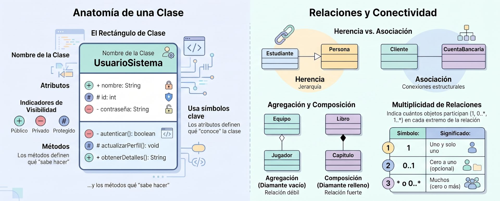
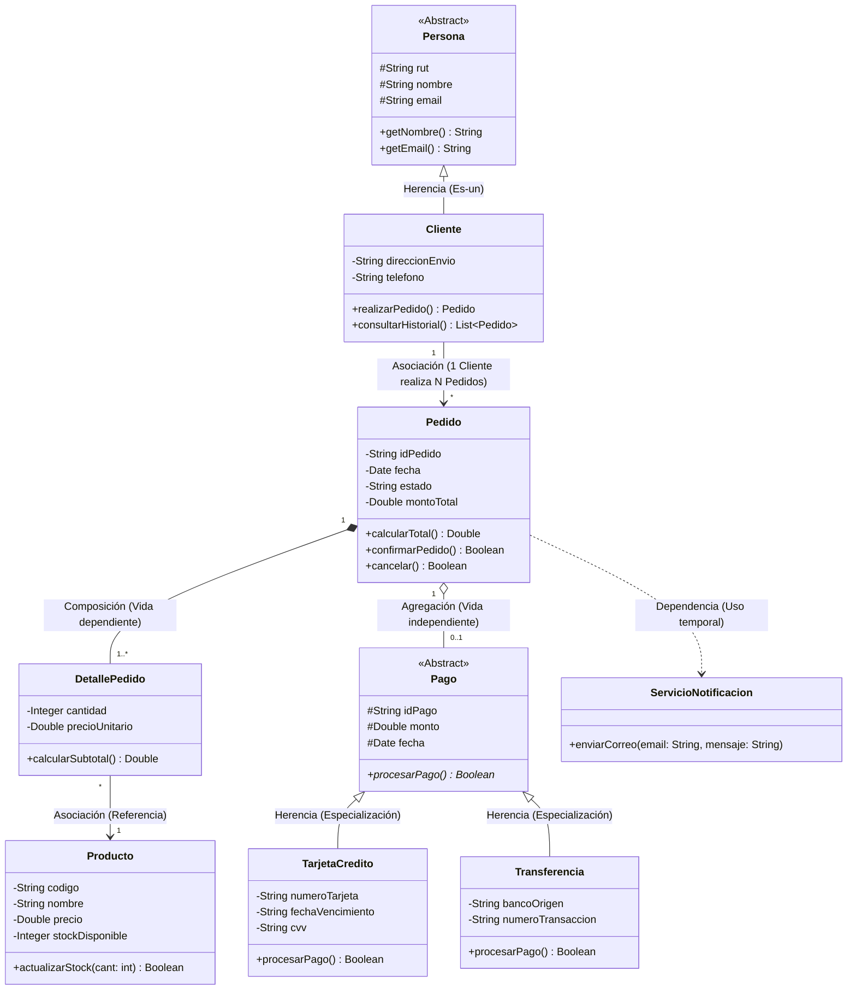
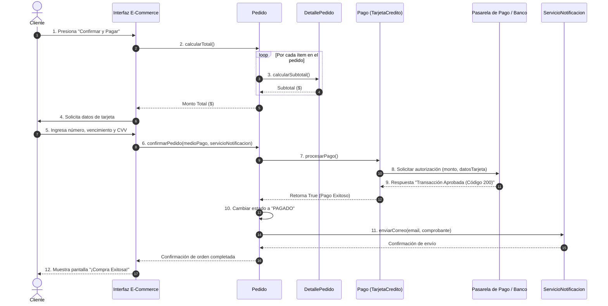

## **Diagrama de Clases**


Proporciona una referencia visual rápida y clara sobre los componentes fundamentales y las relaciones.


En el Lenguaje Unificado de Modelado (**UML**), el **diagrama de clases** es el diagrama estructural estático fundamental y más utilizado en el análisis y diseño orientado a objetos. Su objetivo principal es representar la estructura interna de un sistema mostrando sus **clases**, sus **atributos**, sus **métodos (u operaciones)** y las **relaciones estáticas** que existen entre ellas.

A diferencia de los diagramas de comportamiento (como los de secuencia o casos de uso), el diagrama de clases no muestra el procesamiento en el tiempo ni los eventos dinámicos, sino la **arquitectura o plano estático del software**.


### Representación de una Clase
En la notación gráfica de UML, una clase se dibuja como un **rectángulo dividido en tres secciones verticales**:

1. **Nombre de la clase (Sección superior):** Escrito en negrita y centrado, nombra el concepto o entidad. Si es una clase abstracta, el nombre suele escribirse en *cursiva*.
2. **Atributos (Sección media):** Representa los datos, propiedades o características que conocen y almacenan los objetos de esa clase.
3. **Métodos u Operaciones (Sección inferior):** Describe las acciones, funciones o comportamientos que la clase sabe ejecutar.

#### Visibilidad de Atributos y Métodos
Para garantizar la **encapsulación** o el ocultamiento de información, cada miembro puede llevar un símbolo de visibilidad al inicio:
* **`-` Privado (*Private*):** Accesible únicamente desde el interior de la propia clase.
* **`+` Público (*Public*):** Accesible desde cualquier otra clase u objeto del sistema.
* **`#` Protegido (*Protected*):** Accesible solo por la clase y sus subclases heredadas.
* **`~` Paquete (*Package*):** Accesible por las clases que pertenecen al mismo paquete de software.


### Principales Relaciones entre Clases
Las relaciones funcionan como el "pegamento" que vincula las clases en el modelo:

* **Asociación:** Conexión estructural simple que indica que los objetos de una clase interactúan o se comunican con los de otra. Incluye expresiones de **multiplicidad o cardinalidad** en los extremos (`1`, `0..1`, `1..*`, `*`) y flechas de **navegabilidad** que indican la dirección de la referencia.
* **Agregación (Rombo hueco):** Relación débil de "todo-parte" (*"tiene un"*), donde los componentes forman parte del todo pero poseen ciclos de vida independientes (si el todo se destruye, las partes continúan existiendo).
* **Composición (Rombo relleno):** Relación fuerte de "todo-parte" (*"siempre contiene"*), donde las partes dependen estrictamente de la existencia del todo (si la clase contenedor o padre se elimina, sus partes asociadas también se destruyen).
* **Generalización / Herencia (Triángulo hueco):** Relación *"es un"* que conecta una superclase (general) con sus subclases (especializadas). La subclase hereda automáticamente los atributos y métodos de la clase base.
* **Dependencia (Línea punteada con flecha):** Relación de uso temporal donde una clase utiliza o recibe como parámetro a otra clase dentro de la ejecución de sus métodos.
* **Realización / Implementación (Línea punteada con triángulo hueco):** Indica que una clase concreta implementa las operaciones definidas previamente en una **Interfaz**.


### Perspectivas y Evolución en el Ciclo de Vida

El diagrama de clases se utiliza en diferentes niveles de abstracción a lo largo del desarrollo:

1. **Perspectiva Conceptual (Modelo del Dominio):** Representa los conceptos, entidades y reglas reales del negocio sin comprometerse con detalles técnicos ni lenguajes de programación (se enfoca en comprender el dominio).
2. **Perspectiva de Diseño (Diagrama de Clases de Diseño - DCD):** Define las clases software de la solución técnica, especificando tipos de datos exactos, métodos de interfaz y navegabilidad.
3. **Perspectiva de Implementación:** Es la traducción directa del DCD hacia el código fuente ejecutable en lenguajes orientados a objetos como Java, C# o C++.


### Categorías de Clases
En el diseño de sistemas orientados a objetos, las clases suelen clasificarse en tres tipos principales según el patrón **MVC / Análisis**:
* **Clases de Entidad:** Almacenan y representan la información persistente del negocio (ej. *Cliente*, *Factura*, *Producto*).
* **Clases de Interfaz / Límite (*Boundary*):** Gestionan la interacción con los usuarios o con sistemas externos (pantallas, formularios Web, diálogos).
* **Clases de Control:** Coordinan la lógica de procesamiento, secuenciamiento de actividades y reglas de negocio entre la interfaz y las entidades.


---

## **Ejercicio Práctico**

#### Enunciado del Problema
Una empresa de comercio electrónico requiere modelar el módulo de procesamiento de ventas. Las reglas de negocio especifican lo siguiente:
1. Existen **Clientes** registrados en la plataforma. Cada cliente cuenta con RUT, nombre, correo electrónico, dirección de envío y teléfono.
2. Un cliente puede realizar múltiples **Pedidos**, pero cada pedido pertenece a un único cliente.
3. Todo pedido está compuesto por uno o más **Detalles de Pedido** (líneas de detalle). Si un pedido es eliminado del sistema, sus líneas de detalle asociadas deben destruirse automáticamente.
4. Cada línea de detalle hace referencia a un **Producto** específico y almacena la cantidad comprada y el precio al momento de la transacción.
5. El pedido se liquida mediante un **Pago**. El pago es una entidad abstracta que se concreta mediante **Tarjeta de Crédito** o **Transferencia Bancaria**. Si el pedido se cancela, la entidad de pago puede conservarse en la base de datos para auditoría financiera.
6. Al confirmar un pedido, la clase `Pedido` invoca temporalmente al `ServicioNotificacion` para enviar un comprobante por correo electrónico al cliente.


#### Desglose Metodológico de la Solución

##### 1. Identificación de Clases y Visibilidad
* **`Persona` (Clase Abstracta):** Agrupa atributos comunes (`rut`, `nombre`, `email`) marcados con visibilidad **Protegida (`#`)** para permitir el acceso directo desde clases derivadas.
* **`Cliente` (Subclase Concreta):** Hereda de `Persona`. Mantiene sus atributos propios (`direccionEnvio`, `telefono`) con visibilidad **Privada (`-`)** para garantizar la encapsulación, exponiendo métodos **Públicos (`+`)**.
* **`Pago` (Clase Abstracta):** Define la plantilla general para los medios de pago y declara el método abstracto `procesarPago()*` que cada medio de pago específico debe implementar.

##### 2. Justificación de las Relaciones UML

| Relación | Clases Involucradas | Símbolo UML | Explicación de Diseño |
| :--- | :--- | :--- | :--- |
| **Generalización (Herencia)** | `Cliente` \\(\rightarrow\\) `Persona`<br/>`TarjetaCredito` \\(\rightarrow\\) `Pago` | Flecha con triángulo hueco (\\(\triangle\\)) | Cumple con la regla **"Es un"**. Un cliente es una persona; una tarjeta de crédito es una forma de pago. |
| **Composición** | `Pedido` \\(\star\rightarrow\\) `DetallePedido` | Rombo relleno (\\(\blacklozenge\\)) | Relación fuerte de **"Todo-Parte"**. Las líneas de detalle no tienen sentido de existencia sin su pedido contenedor (comparten ciclo de vida). |
| **Agregación** | `Pedido` \\(\diamond\rightarrow\\) `Pago` | Rombo hueco (\\(\diamondsuit\\)) | Relación débil de **"Todo-Parte"**. El pago está vinculado al pedido, pero posee existencia e historial independiente (ej. registros contables/auditoría). |
| **Asociación Directa** | `Cliente` \\(\rightarrow\\) `Pedido`<br/>`DetallePedido` \\(\rightarrow\\) `Producto` | Flecha simple (\\(\rightarrow\\)) con multiplicidad | Define la estructura de navegación y cardinalidad (`1` a `*` o `1` a `1..*`). |
| **Dependencia** | `Pedido` \\(\dashrightarrow\\) `ServicioNotificacion` | Flecha punteada (\\(\dashrightarrow\\)) | Uso temporal **"Utiliza un"**. La clase `Pedido` recibe o invoca a `ServicioNotificacion` en la ejecución de su método `confirmarPedido()`, sin mantenerlo como atributo permanente. |

### Diagrama de Clases UML 
**(Sistema de Gestión de Pedidos)**




### Diagrama de Secuencia UML 
**(Proceso de Pago)**

El **diagrama de secuencia** muestra el aspecto dinámico del sistema, ilustrando cómo los objetos intercambian mensajes a lo largo de una línea de tiempo horizontal y vertical durante el flujo de checkout: **Diagrama de Secuencia** para el proceso de pago




#### Explicación Paso a Paso del Flujo Dinámico:
1. **Invocación del checkout (Pasos 1-3):** El `Cliente` dispara la orden desde la interfaz. La clase `Pedido` itera sobre cada `DetallePedido` para sumar los subtotales de los productos y calcular el monto total.
2. **Especialización y Autorización (Pasos 4-9):** La interfaz solicita los datos de pago y los envía al objeto `Pedido`. Este delega la transacción al medio concreto (`TarjetaCredito`), que se comunica con la pasarela externa o el banco para autorizar los fondos.
3. **Actualización de Estado y Notificación (Pasos 10-12):** Tras recibir la aprobación bancaria, `Pedido` cambia su estado interno a `"PAGADO"`, registra la transacción en el historial del cliente y utiliza la dependencia `ServicioNotificacion` para enviar el comprobante por correo electrónico antes de mostrar la pantalla final al usuario.

### Código en Python
Traducción del Diagrama de Clases UML a **código fuente ejecutable en Python 3**, aplicando principios de programación orientada a objetos (POO) como encapsulamiento, herencia, clases abstractas y polimorfismo.

<details>
<summary>🖥️ Código Python</summary>

```python showLineNumbers
from abc import ABC, abstractmethod
from datetime import datetime
from typing import List, Optional

# -------------------------------------------------------------------
# Clases Abstractas y Dominio Principal
# -------------------------------------------------------------------

class Persona(ABC):
    """Clase abstracta que define la estructura básica de una persona."""
    def __init__(self, rut: str, nombre: str, email: str):
        self._rut = rut             # Atributo protegido (#)
        self._nombre = nombre
        self._email = email

    @property
    def nombre(self) -> str:
        return self._nombre

    @property
    def email(self) -> str:
        return self._email

class Cliente(Persona):
    """Clase concreta que representa a un cliente registrado."""
    def __init__(self, rut: str, nombre: str, email: str, direccion_envio: str, telefono: str):
        super().__init__(rut, nombre, email)
        self.direccion_envio = direccion_envio  # Atributo público (+)
        self.telefono = telefono
        self._historial_pedidos: List['Pedido'] = []

    def agregar_pedido_al_historial(self, pedido: 'Pedido'):
        self._historial_pedidos.append(pedido)

    def consultar_historial() -> List['Pedido']:
        return self._historial_pedidos

class Producto:
    """Representa un bien disponible para la venta."""
    def __init__(self, codigo: str, nombre: str, precio: float, stock_disponible: int):
        self.codigo = codigo
        self.nombre = nombre
        self.precio = precio
        self.stock_disponible = stock_disponible

    def actualizar_stock(self, cantidad: int) -> bool:
        if self.stock_disponible >= cantidad:
            self.stock_disponible -= cantidad
            return True
        return False

class DetallePedido:
    """Línea de detalle del pedido (Composición de Pedido)."""
    def __init__(self, producto: Producto, cantidad: int):
        self.producto = producto
        self.cantidad = cantidad
        self.precio_unitario = producto.precio

    def calcular_subtotal() -> float:
        return self.cantidad * self.precio_unitario

# -------------------------------------------------------------------
# Jerarquía de Pagos (Especialización)
# -------------------------------------------------------------------

class Pago(ABC):
    """Clase abstracta para procesar transacciones financieras."""
    def __init__(self, id_pago: str, monto: float):
        self.id_pago = id_pago
        self.monto = monto
        self.fecha = datetime.now()

    @abstractmethod
    def procesar_pago(self) -> bool:
        """Método abstracto que deben implementar las subclases."""
        pass

class TarjetaCredito(Pago):
    def __init__(self, id_pago: str, monto: float, numero_tarjeta: str, fecha_vencimiento: str, cvv: str):
        super().__init__(id_pago, monto)
        self.numero_tarjeta = numero_tarjeta
        self.fecha_vencimiento = fecha_vencimiento
        self.cvv = cvv

    def procesar_pago(self) -> bool:
        # Simulación de autorización bancaria externa
        tarjeta_oculta = f"**** **** **** {self.numero_tarjeta[-4:]}"
        print(f"  [Pasarela de Pago] Validando tarjeta {tarjeta_oculta} por ${self.monto:,.2f}...")
        print("  [Pasarela de Pago] Transacción APROBADA exitosamente.")
        return True

class Transferencia(Pago):
    def __init__(self, id_pago: str, monto: float, banco_origen: str, numero_transaccion: str):
        super().__init__(id_pago, monto)
        self.banco_origen = banco_origen
        self.numero_transaccion = numero_transaccion

    def procesar_pago(self) -> bool:
        print(f"  [Banco {self.banco_origen}] Verificando abono N° {self.numero_transaccion} por ${self.monto:,.2f}...")
        print("  [Banco] Transferencia verificada y confirmada.")
        return True

# -------------------------------------------------------------------
# Servicios Auxiliares
# -------------------------------------------------------------------

class ServicioNotificacion:
    """Servicio externo/auxiliar utilizado por la clase Pedido (Dependencia)."""
    @staticmethod
    def enviar_correo(email: str, mensaje: str):
        print(f"  [ServicioNotificacion] Correo enviado a <{email}>:\n    \"{mensaje}\"")

# -------------------------------------------------------------------
# Clase Principal: Pedido
# -------------------------------------------------------------------

class Pedido:
    """Clase contenedora que coordina el proceso de compra."""
    def __init__(self, id_pedido: str, cliente: Cliente):
        self.id_pedido = id_pedido
        self.cliente = cliente
        self.fecha = datetime.now()
        self.estado = "PENDIENTE"
        self._detalles: List[DetallePedido] = []  # Composición (Vida dependiente)
        self.pago: Optional[Pago] = None          # Agregación (Vida independiente)

    def agregar_producto(self, producto: Producto, cantidad: int) -> bool:
        if producto.actualizar_stock(cantidad):
            detalle = DetallePedido(producto, cantidad)
            self._detalles.append(detalle)
            return True
        else:
            print(f"Error: Stock insuficiente para el producto '{producto.nombre}'.")
            return False

    def calcular_total() -> float:
        return sum(d.calcular_subtotal() for d in self._detalles)

    def confirmar_pedido(self, medio_pago: Pago, servicio_notificacion: ServicioNotificacion) -> bool:
        monto_total = self.calcular_total()

        if monto_total <= 0 or not self._detalles:
            print("Error: No se puede procesar un pedido sin artículos.")
            return False

        # Asignación de la Agregación (El pago se asocia pero existe de forma independiente)
        self.pago = medio_pago
        print(f"\n--- Iniciando procesamiento de pago para Pedido #{self.id_pedido} ---")
        
        exito_pago = self.pago.procesar_pago()

        if exito_pago:
            self.estado = "PAGADO"
            self.cliente.agregar_pedido_al_historial(self)
            
            # Uso de la Dependencia
            mensaje = f"Hola {self.cliente.nombre}, tu pedido #{self.id_pedido} ha sido confirmado por ${monto_total:,.2f}."
            servicio_notificacion.enviar_correo(self.cliente.email, mensaje)
            return True
        else:
            self.estado = "RECHAZADO"
            return False

# -------------------------------------------------------------------
# Script de Prueba / Demostración Ejecutable
# -------------------------------------------------------------------
if __name__ == "__main__":
    print("=======================================================")
    print(" DEMOSTRACIÓN DEL SISTEMA DE PEDIDOS (UML EN PYTHON)")
    print("=======================================================\n")

    # 1. Crear productos y cliente
    laptop = Producto("PROD-01", "Laptop HP Omen", 1200000.0, stock_disponible=5)
    mouse = Producto("PROD-02", "Mouse Inalámbrico Logitech", 25000.0, stock_disponible=10)

    cliente_1 = Cliente(
        rut="18.765.432-1",
        nombre="Constanza Morales",
        email="constanza.morales@example.com",
        direccion_envio="Av. Providencia 1234, Santiago",
        telefono="+56912345678"
    )

    # 2. Crear Pedido y agregar artículos
    pedido_1 = Pedido("PED-2026-001", cliente_1)
    pedido_1.agregar_producto(laptop, cantidad=1)
    pedido_1.agregar_producto(mouse, cantidad=2)

    print(f"Cliente: {cliente_1.nombre}")
    print(f"Monto Total Calculado: ${pedido_1.calcular_total():,.2f}")

    # 3. Pago mediante Tarjeta de Crédito y Notificación
    pago_tarjeta = TarjetaCredito(
        id_pago="PAG-9988",
        monto=pedido_1.calcular_total(),
        numero_tarjeta="4532112233445566",
        fecha_vencimiento="11/28",
        cvv="789"
    )
    notificador = ServicioNotificacion()

    # 4. Confirmar transacción
    resultado = pedido_1.confirmar_pedido(pago_tarjeta, notificador)
    print(f"\nEstado Final del Pedido: {pedido_1.estado}")
```
</details>