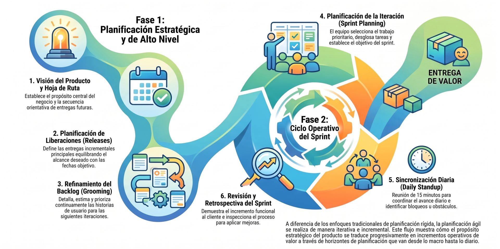

## **Planificación**

La **planificación ágil** es un proceso continuo, empírico e iterativo enfocado en adaptar el desarrollo a medida que se obtiene más información y retroalimentación del cliente. A diferencia de los enfoques predictivos tradicionales —donde se busca definir y "congelar" la totalidad del alcance al inicio del proyecto— la agilidad reconoce que los requisitos son emergentes e inestables. Por ello, en lugar de intentar eliminar el cambio, la planificación ágil lo incorpora deliberadamente en ciclos cortos para maximizar la entrega de valor.

### El Principio de la Planificación Gradual (*Rolling Wave*)

En la gestión ágil, **la planificación nunca desaparece; se ejecuta con diferentes niveles de granularidad en el tiempo**:
* **Fijos (Timeboxes):** El tiempo y el costo se mantienen fijos mediante iteraciones de duración constante (por ejemplo, de 1 a 4 semanas).
* **Ajuste del Alcance:** La variable de ajuste es el alcance, el cual se gestiona dinámicamente en una lista priorizada de trabajo pendiente (*Product Backlog*).
* **Planificación Justo a Tiempo (*Just-In-Time*):** Las actividades cercanas en el tiempo se planifican en detalle, mientras que los elementos futuros se mantienen a un nivel superior o agregado hasta que sea necesario abordarlos.

### Horizontes o Niveles de la Planificación Ágil

La planificación en entornos adaptativos se estructura en múltiples capas de abstracción (a menudo descritas como la "cebolla de la planificación"):

1. **Visión del Producto y Hoja de Ruta (*Product Roadmap*):** Establece el propósito a largo plazo y la secuencia estratégica anticipada de entregas en pinceladas amplias.

2. **Planificación de la Liberación (*Release Planning*):** Enfocada en un horizonte de mediano plazo (1 a 3 meses). El *Product Owner* y el equipo analizan las dependencias, la velocidad histórica y las prioridades de negocio para pronosticar qué conjunto de historias de usuario se liberarán en una fecha objetivo.

3. **Refinamiento de la Lista de Trabajo Pendiente (*Product Backlog Refinement / Grooming*):** Actividad continua (que suele consumir entre el 5% y 10% del tiempo de una iteración) donde el equipo descompone grandes funcionalidades (Épicas) en historias de usuario más pequeñas, aclara criterios de aceptación y actualiza estimaciones.

4. **Planificación del Sprint o Iteración (*Sprint Planning*):** Evento colaborativo al inicio de cada iteración (con un límite de tiempo o *timebox*). El *Product Owner* presenta las historias de mayor valor y el equipo evalúa su capacidad disponible para seleccionar y comprometerse con el *Sprint Backlog* que desarrollará.

5. **Sincronización Diaria (*Daily Standup / Daily Scrum*):** Reunión breve de 15 minutos donde el equipo evalúa el progreso diario, identifica impedimentos y replanifica de forma autónoma el trabajo para las siguientes 24 horas.

### Mecanismos, Herramientas y Métricas de Planificación

* **Historias de Usuario y Criterios de Aceptación:** Representan el trabajo desde la perspectiva del usuario final (*"Como [rol], quiero [funcionalidad], para [beneficio]"*). Cumplen con criterios de calidad como el modelo **INVEST** (Independientes, Negociables, Valiosas, Estimables, Pequeñas y Probables).

* **Estimación Relativa y *Planning Poker*:** Se evita la estimación prematura en horas absolutas. En su lugar, el equipo utiliza el juicio de expertos y el consenso para asignar **Puntos de Historia (*Story Points*)** o tallas de camiseta (*T-shirt sizes*) basándose en la complejidad, riesgo y esfuerzo relativo de la tarea.

* **Velocidad del Equipo (*Velocity*):** Es la cantidad de puntos de historia efectivamente completados y que cumplen con la Definición de Terminado (*Definition of Done*) en una iteración. Esta métrica histórica permite predecir la capacidad de entregas futuras con bases empíricas.

* **Gestión del Flujo y Límites WIP (*Work In Progress*):** En enfoques basados en flujo (como Kanban o Scrumban), la planificación se activa a demanda (sistema *pull*) al alcanzar un umbral mínimo en el tablero, limitando el trabajo en curso para reducir el tiempo de ciclo (*Cycle Time*) y evitar cuellos de botella.

* **Gráficos de Quemado y Trabajo Realizado (*Burndown & Burnup Charts*):** Herramientas visuales que muestran en tiempo real la cantidad de trabajo restante o completado a lo largo del tiempo, permitiendo detectar desviaciones de forma temprana.

### Cuadro Comparativo: Planificación Predictiva vs. Ágil

| Dimensión | Planificación Predictiva (Tradicional) | Planificación Ágil (Adaptativa) |
| :--- | :--- | :--- |
| **Enfoque principal** | Dirigido por el plan inicial; minimiza los cambios. | Dirigido por el valor; abraza el cambio como ventaja. |
| **Definición del Alcance** | Exhaustiva y detallada en etapas tempranas (*Upfront*). | Evolutiva; detallada justo a tiempo mediante el *Backlog*. |
| **Variables de Control** | Alcance fijo; Tiempo y Costo estimados. | Tiempo y Costo fijos (*Timebox*); Alcance variable. |
| **Métricas de Progreso** | Cumplimiento del cronograma Gantt y presupuesto. | Software o producto funcional y utilizable entregado. |
| **Gestión de Riesgo** | Análisis inicial y monitoreo de desviaciones. | Reducción de riesgo mediante experimentos e incrementos cortos. |

---
## **Como se aplica?**

Para aplicar la **planificación ágil** en la práctica, los equipos siguen un proceso continuo e iterativo que va desde la estrategia general del producto hasta la ejecución diaria del trabajo. A diferencia de los enfoques tradicionales, la planificación no se realiza en una sola fase inicial congelada, sino que se distribuye en **horizontes de tiempo dinámicos**.

Los pasos para aplicar la planificación ágil de forma estructurada:

### 1. Establecer la Visión del Producto y la Hoja de Ruta (*Roadmap*)
* **Definición del propósito:** Se inicia en la fase de concepto identificando la visión del negocio, los objetivos del proyecto y los beneficios esperados.

* **Creación del Product Backlog:** El *Product Owner* estructura un listado priorizado de necesidades y requerimientos expresados en **Historias de Usuario**. Este artefacto es un documento vivo que evoluciona a lo largo de todo el ciclo de vida.

* **Construcción de la Hoja de Ruta:** Muestra la secuencia anticipada de entregas en pinceladas amplias para alinear las expectativas de los interesados.

### 2. Planificación de Liberaciones o Entregas (*Release Planning*)
* **Horizonte de mediano plazo:** Aborda un marco temporal de 1 a 3 meses.

* **Determinación de la Capacidad/Velocidad:** Basándose en la velocidad histórica del equipo (puntos de historia o ítems completados por iteración) o en estimaciones iniciales, se evalúa cuánto trabajo es realista abordar.

* **Establecimiento de la Línea de Corte (*Cut Line*):** El *Product Owner* y el equipo definen las funcionalidades o historias que quedan por encima de la línea de corte para comprometer la liberación de un incremento utilizable en la fecha objetivo.

### 3. Refinamiento del Backlog (*Backlog Refinement / Grooming*)
* **Preparación Justo a Tiempo (*Just-In-Time*):** Es una actividad continua (o sesión dedicada a mitad de la iteración) donde el equipo analiza las historias del Product Backlog para la siguiente iteración.

* **Descomposición de Historias:** Las épicas grandes se dividen en historias de usuario más pequeñas, independientes y estimables (cumpliendo criterios de calidad como INVEST).

* **Estimación Relativa:** El equipo utiliza técnicas participativas como el ***Planning Poker*** o estimación de póker para asignar Puntos de Historia basados en el esfuerzo, complejidad y riesgo relativo.

### 4. Planificación de la Iteración o Sprint (*Sprint Planning*)
* **Delimitación de Tiempo (*Timebox*):** Evento colaborativo al inicio de cada iteración (con una duración máxima de 1 día para iteraciones de un mes, o de 2 a 4 horas para sprints de 2 semanas).

* **Parte 1 (El "Qué"):** El *Product Owner* presenta las historias de mayor prioridad. El equipo discute los detalles, realiza aclaraciones y acuerda el **Objetivo del Sprint (*Sprint Goal*)**.

* **Parte 2 (El "Cómo"):** El equipo de desarrollo desglosa las historias seleccionadas en tareas técnicas concretas, estima el tiempo necesario en horas y asume el compromiso del **Sprint Backlog**.

### 5. Sincronización Diaria y Gestión Visual del Flujo
* **Reunión Diaria de Pie (*Daily Standup*):** Sesión breve de máximo 15 minutos donde el equipo evalúa el progreso hacia el objetivo del Sprint respondiendo tres preguntas clave (qué completó, qué planea completar e impedimentos) o recorriendo el tablero de derecha a izquierda.
* **Gestión de Tableros y Límites WIP:** Mediante tableros visuales (Scrum o Kanban), el equipo limita la cantidad de Trabajo en Curso (*Work in Progress*) para evitar cuellos de botella, reducir el tiempo de ciclo (*Cycle Time*) y acelerar la entrega de valor.

### 6. Inspección, Demostración y Adaptación
* **Demostración y Revisión del Sprint (*Sprint Review*):** Al finalizar la iteración, el equipo demuestra el incremento funcional del producto (*software o entregable potencialmente desplegable*) ante los clientes e interesados para obtener retroalimentación real.

* **Retrospectiva del Sprint (*Sprint Retrospective*):** El equipo reflexiona sobre su proceso de trabajo, analiza problemas de comunicación o calidad y selecciona de 1 a 3 acciones concretas de mejora para implementarlas de inmediato en la siguiente iteración.
