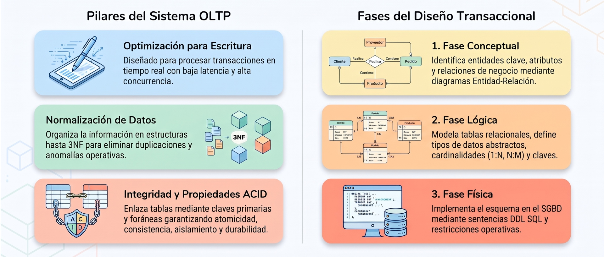
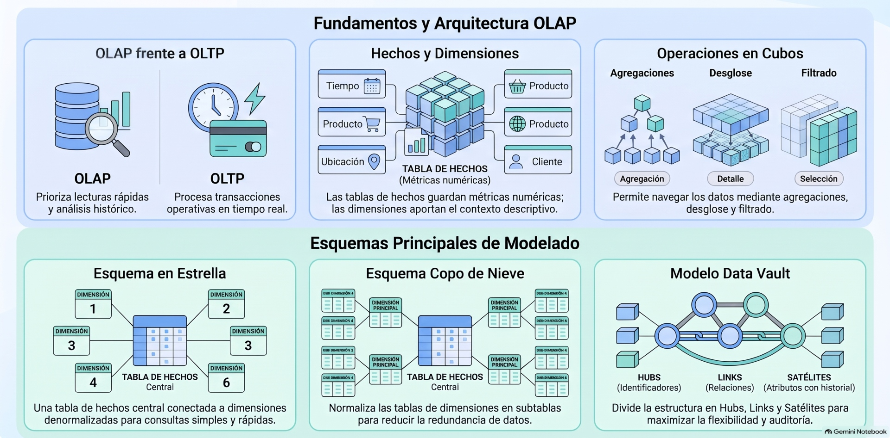

## **Modelamiento de datos**

El **modelamiento de datos (Data Modeling)** es una disciplina formal de la informática y la ingeniería de software encargada de **definir la estructura, relaciones, reglas semánticas y restricciones de integridad** de los datos que sustentan los procesos de una organización. Actúa como un plano arquitectónico que permite representar la realidad del negocio de manera estructurada e inequívoca, garantizando la consistencia, el almacenamiento eficiente y la precisión de la información.


### Las Tres Fases Clásicas

La teoría de bases de datos divide el proceso de modelamiento en tres etapas secuenciales de refinamiento:

1. **Fase Conceptual (Modelo Entidad–Relación - MER):**
   * **Objetivo:** Comprender y documentar la semántica del negocio y los requerimientos de los usuarios de forma independiente del software gestor (SGBD).
   * **Artefacto:** El **Diagrama Entidad–Relación (DER / ERD)**.
   * **Componentes:** Define las **entidades** (objetos del mundo real como Clientes o Productos), sus **atributos** (propiedades que las describen) y las **relaciones con sus cardinalidades** (1:1, 1:N, N:M).

2. **Fase Lógica (Modelo Relacional / Normalización):**
   * **Objetivo:** Traducir los conceptos abstractos a un esquema lógico estructurado (comúnmente relacional).
   * **Componentes:** Cada entidad se transforma en una **tabla**, los atributos en **columnas**, se definen **claves primarias (`PRIMARY KEY`)** para asegurar la unicidad y **claves foráneas (`FOREIGN KEY`)** para materializar relaciones.
   * **Normalización:** Se aplican las **formas normales (1NF, 2NF, 3NF)** para eliminar la redundancia de datos y prevenir anomalías de inserción, actualización y borrado.

3. **Fase Física (Implementación en el Motor de Base de Datos):**
   * **Objetivo:** Materializar las tablas en un motor de base de datos relacional concreto (como PostgreSQL o SQL Server).
   * **Componentes:** Ajuste fino de tipos de datos (`DECIMAL`, `VARCHAR`, `DATE`), almacenamiento en disco, estrategias de indexación y restricciones de integridad física mediante sentencias DDL (`CREATE TABLE`, `CHECK`, `DEFAULT`).


### Paradigmas
**Transaccional (OLTP) vs. Analítico (OLAP)**

El modelamiento se bifurca según el objetivo operativo del sistema:
* **Modelos Transaccionales (OLTP):** Orientados a soportar operaciones concurrentes de escritura (`INSERT`, `UPDATE`, `DELETE`) de alta frecuencia (como transacciones bancarias o carritos de compras). Se rigen por una **normalización rigurosa (3NF)** para que cada dato exista en un único lugar sin redundancias.
* **Modelos Dimensionales / Analíticos (OLAP):** Diseñados para sistemas de soporte de decisiones, *Business Intelligence* y *Data Warehousing*. Propuestos ampliamente por **Ralph Kimball**, recurren a la **desnormalización controlada** a través del **Esquema en Estrella (*Star Schema*)**. En este enfoque, los datos se dividen en:
  * **Tablas de Hechos (*Fact Tables*):** Almacenan métricas y medidas numéricas agregables del evento (ej. importe de venta, descuento).
  * **Tablas de Dimensiones (*Dimension Tables*):** Almacenan el contexto descriptivo desnormalizado (ej. atributos del cliente, producto o tiempo).


### Importancia Estratégica

* **Garantía de Integridad y Consistencia:** Mediante la imposición de claves primarias, claves foráneas y reglas de chequeo a nivel de motor, se previenen tuplas huérfanas o registros corruptos.
* **Eliminación de la Deuda Técnica Monolítica:** Evita el antipatrón de scripts de miles de líneas o dependencias no controladas.
* **Base para la Ingeniería de Analítica Moderna:** Permite construir arquitecturas modulares por capas (como Staging, Intermediate y Marts en herramientas como **dbt**) con un Grafo Acíclico Dirigido (DAG) claro y trazable.


***
## **Transaccional (OLTP)**



El **modelamiento transaccional (OLTP - Online Transaction Processing)** es la rama del diseño de bases de datos relacionales orientada a **soportar las operaciones cotidianas del negocio** (como registrar pedidos, procesar pagos bancarios o actualizar inventarios en tiempo real). Su arquitectura está diseñada para gestionar un **alto volumen de transacciones concurrentes de lectura y escritura (`INSERT`, `UPDATE`, `DELETE`) con latencias de respuesta mínimas**, garantizando que el sistema no sufra inconsistencias ante accesos simultáneos o fallos de infraestructura.

Es la base de los sistemas operacionales modernos. Su objetivo principal es estructurar datos mediante la normalización para eliminar la redundancia, garantizar la integridad referencial y permitir operaciones rápidas de escritura y lectura en tiempo real.

A diferencia de los entornos analíticos (OLAP o Data Warehousing), donde el objetivo es consultar y agregar millones de filas con lecturas masivas, el modelamiento OLTP busca que **cada dato atómico se almacene en un único lugar lógico**, evitando la redundancia y asegurando la integridad estricta del dato.


### Pilares Fundamentales

El modelamiento transaccional se apoya en tres fundamentos teóricos y estructurales:

#### A. Normalización Rigurosa (3NF / BCNF)
* Para evitar anomalías de inserción, actualización o borrado, los esquemas OLTP se descomponen mediante las **formas normales (1NF, 2NF, 3NF o BCNF)**.
* Esto da como resultado un esquema relacional con **múltiples tablas altamente especializadas** conectadas mediante claves primarias (`PRIMARY KEY`) y foráneas (`FOREIGN KEY`). Por ejemplo, en lugar de guardar el nombre y dirección del cliente en cada orden, estos atributos se aíslan en su propia tabla para que un cambio de domicilio solo requiera actualizar una única fila.

#### B. Propiedades ACID (Garantía Transaccional)
Toda modificación en un sistema OLTP se rige por el estándar **ACID**:
* **Atomicidad (Atomicity):** Una transacción es una unidad indivisible; se ejecutan todas sus sentencias con éxito (`COMMIT`) o ninguna surte efecto en la base de datos (`ROLLBACK`).
* **Consistencia (Consistency):** La transacción debe llevar la base de datos de un estado válido a otro, respetando todas las reglas de negocio y restricciones de integridad.
* **Aislamiento (Isolation):** Las transacciones simultáneas se aíslan entre sí mediante mecanismos de concurrencia y bloqueos (*locks* / MVCC), asegurando que los resultados sean equivalentes a una ejecución serializada.
* **Durabilidad (Durability):** Una vez confirmada la transacción (`COMMIT`), los cambios persisten de manera irreversible ante caídas del servidor o fallos eléctricos.

#### C. Integridad Declarativa Estructural
El motor de base de datos asume la responsabilidad de aplicar las reglas de consistencia mediante restricciones nativas:
* **Integridad de Entidad:** Garantizada por claves primarias no nulas.
* **Integridad Referencial:** Reglas de clave foránea con políticas de eliminación restringida (`ON DELETE RESTRICT` / `NO ACTION`) o en cascada (`ON DELETE CASCADE`).
* **Integridad de Dominio:** Restricciones de tipo de dato, valores no nulos (`NOT NULL`) y predicados de validación (`CHECK`).


### OLTP frente a OLAP

| Dimensión Técnica | Modelamiento Transaccional (OLTP) | Modelamiento Analítico (OLAP / Data Marts) |
| :--- | :--- | :--- |
| **Operación Predominante** | Escrituras y actualizaciones atómicas rápidas (`INSERT`, `UPDATE`, `DELETE`). | Lecturas complejas y agregaciones masivas (`SELECT`, `SUM`, `AVG`). |
| **Estrategia de Diseño** | **Normalización estricta** (generalmente 3NF). | **Desnormalización controlada** (Esquema en Estrella / *Star Schema*). |
| **Redundancia de Datos** | Mínima o nula (cada hecho se registra una sola vez). | Redundancia planificada en las tablas de dimensiones para acelerar lecturas. |
| **Topología de Consultas** | Múltiples uniones (*joins*) en cadena a través de tablas normalizadas. | Consultas directas de un solo salto desde la tabla de hechos a las dimensiones. |
| **Horizonte Temporal** | Datos operativos del presente y estado más reciente. | Datos históricos acumulados a lo largo del tiempo (series temporales, snapshots). |


### Caso práctico en Northwind
**Esquema Transaccional y Control de Integridad**

En la base de datos de ejemplo **Northwind**, el procesamiento transaccional típico involucra la interacción entre las tablas `Orders`, `Products` y la tabla intermedia de detalle `Order Details`. 

A continuación se presenta el diseño DDL del esquema transaccional en **PostgreSQL** y **SQL Server**, seguido por una **transacción transaccional ACID explícita** que realiza una venta y actualiza el inventario de forma segura:

#### A. Definición del Esquema Transaccional (DDL)

##### **Versión PostgreSQL**
```sql
-- 1. Tabla de Catálogo de Productos
CREATE TABLE products (
    product_id INT GENERATED ALWAYS AS IDENTITY PRIMARY KEY,
    product_name VARCHAR(40) NOT NULL,
    unit_price DECIMAL(10,2) NOT NULL DEFAULT 0.00,
    units_in_stock SMALLINT NOT NULL DEFAULT 0,
    CONSTRAINT chk_units_stock CHECK (units_in_stock >= 0)
);

-- 2. Tabla Maestra de Pedidos (Cabecera)
CREATE TABLE orders (
    order_id INT GENERATED ALWAYS AS IDENTITY PRIMARY KEY,
    customer_id VARCHAR(5) NOT NULL,
    order_date DATE NOT NULL DEFAULT CURRENT_DATE,
    freight DECIMAL(10,2) DEFAULT 0.00
);

-- 3. Tabla Intermedia de Transacción (Normalización N:M)
CREATE TABLE order_details (
    order_id INT NOT NULL,
    product_id INT NOT NULL,
    unit_price DECIMAL(10,2) NOT NULL,
    quantity SMALLINT NOT NULL CHECK (quantity > 0),
    discount REAL NOT NULL DEFAULT 0.0,
    CONSTRAINT pk_order_details PRIMARY KEY (order_id, product_id),
    CONSTRAINT fk_od_orders FOREIGN KEY (order_id) REFERENCES orders(order_id) ON DELETE CASCADE,
    CONSTRAINT fk_od_products FOREIGN KEY (product_id) REFERENCES products(product_id) ON DELETE RESTRICT
);
```

##### **Versión SQL Server (T-SQL)**
```sql
-- 1. Tabla de Catálogo de Productos
CREATE TABLE dbo.Products (
    ProductID INT IDENTITY(1,1) NOT NULL PRIMARY KEY CLUSTERED,
    ProductName NVARCHAR(40) NOT NULL,
    UnitPrice DECIMAL(10,2) NOT NULL CONSTRAINT DF_Products_UnitPrice DEFAULT 0.00,
    UnitsInStock SMALLINT NOT NULL CONSTRAINT DF_Products_UnitsInStock DEFAULT 0,
    CONSTRAINT CHK_UnitsInStock CHECK (UnitsInStock >= 0)
);

-- 2. Tabla Maestra de Pedidos (Cabecera)
CREATE TABLE dbo.Orders (
    OrderID INT IDENTITY(1,1) NOT NULL PRIMARY KEY CLUSTERED,
    CustomerID NCHAR(5) NOT NULL,
    OrderDate DATE NOT NULL CONSTRAINT DF_Orders_OrderDate DEFAULT CAST(GETDATE() AS DATE),
    Freight DECIMAL(10,2) CONSTRAINT DF_Orders_Freight DEFAULT 0.00
);

-- 3. Tabla Intermedia de Transacción (Normalización N:M)
CREATE TABLE dbo.[Order Details] (
    OrderID INT NOT NULL,
    ProductID INT NOT NULL,
    UnitPrice DECIMAL(10,2) NOT NULL,
    Quantity SMALLINT NOT NULL CHECK (Quantity > 0),
    Discount REAL NOT NULL CONSTRAINT DF_OrderDetails_Discount DEFAULT 0.0,
    CONSTRAINT PK_Order_Details PRIMARY KEY CLUSTERED (OrderID, ProductID),
    CONSTRAINT FK_OD_Orders FOREIGN KEY (OrderID) REFERENCES dbo.Orders(OrderID) ON DELETE CASCADE,
    CONSTRAINT FK_OD_Products FOREIGN KEY (ProductID) REFERENCES dbo.Products(ProductID) ON DELETE NO ACTION
);
```


#### B. Operación Transaccional ACID (Inserción de Pedido con Descuento de Stock)

El flujo simula la compra de 5 unidades del producto con ID 1 (*Chai*). Si el inventario disponible no alcanza para cubrir la venta, el bloque revierte la transacción para garantizar la **consistencia** y **atomicidad** del sistema:

##### **Versión PostgreSQL**
```sql
DO $$
DECLARE
    v_order_id INT;
    v_product_id INT := 1;
    v_quantity SMALLINT := 5;
    v_stock_actual SMALLINT;
    v_price DECIMAL(10,2);
BEGIN
    -- Verificamos inventario y precio bajo bloqueo de fila (FOR UPDATE)
    SELECT units_in_stock, unit_price 
    INTO v_stock_actual, v_price
    FROM products
    WHERE product_id = v_product_id
    FOR UPDATE;

    IF v_stock_actual < v_quantity THEN
        RAISE EXCEPTION 'Stock insuficiente para el producto ID % (Disponible: %, Solicitado: %)', 
            v_product_id, v_stock_actual, v_quantity;
    END IF;

    -- Paso 1: Insertar la cabecera del pedido
    INSERT INTO orders (customer_id, order_date, freight)
    VALUES ('ALFKI', CURRENT_DATE, 15.50)
    RETURNING order_id INTO v_order_id;

    -- Paso 2: Insertar la línea de detalle
    INSERT INTO order_details (order_id, product_id, unit_price, quantity, discount)
    VALUES (v_order_id, v_product_id, v_price, v_quantity, 0.0);

    -- Paso 3: Descontar el stock en la tabla de productos
    UPDATE products
    SET units_in_stock = units_in_stock - v_quantity
    WHERE product_id = v_product_id;

    RAISE NOTICE 'Transacción exitosa. Orden ID: % procesada correctamente.', v_order_id;
END $$;
```

##### **Versión SQL Server (T-SQL)**
```sql
BEGIN TRANSACTION;
BEGIN TRY
    DECLARE @OrderID INT;
    DECLARE @ProductID INT = 1;
    DECLARE @Quantity SMALLINT = 5;
    DECLARE @StockActual SMALLINT;
    DECLARE @Price DECIMAL(10,2);

    -- Verificamos inventario y bloqueamos la fila con UPDLOCK
    SELECT @StockActual = UnitsInStock, @Price = UnitPrice
    FROM dbo.Products WITH (UPDLOCK, ROWLOCK)
    WHERE ProductID = @ProductID;

    IF @StockActual < @Quantity
    BEGIN
        RAISERROR('Stock insuficiente para el producto solicitado.', 16, 1);
    END;

    -- Paso 1: Insertar la cabecera del pedido
    INSERT INTO dbo.Orders (CustomerID, OrderDate, Freight)
    VALUES ('ALFKI', CAST(GETDATE() AS DATE), 15.50);

    SET @OrderID = SCOPE_IDENTITY();

    -- Paso 2: Insertar el detalle
    INSERT INTO dbo.[Order Details] (OrderID, ProductID, UnitPrice, Quantity, Discount)
    VALUES (@OrderID, @ProductID, @Price, @Quantity, 0.0);

    -- Paso 3: Descontar el stock
    UPDATE dbo.Products
    SET UnitsInStock = UnitsInStock - @Quantity
    WHERE ProductID = @ProductID;

    -- Confirmación atómica
    COMMIT TRANSACTION;
    PRINT 'Transacción exitosa. Orden ID: ' + CAST(@OrderID AS VARCHAR(10));
END TRY
BEGIN CATCH
    -- Reversión en caso de error
    IF @@TRANCOUNT > 0
        ROLLBACK TRANSACTION;

    DECLARE @ErrorMessage NVARCHAR(4000) = ERROR_MESSAGE();
    RAISERROR(@ErrorMessage, 16, 1);
END CATCH;
```


### Resumen

El **modelamiento OLTP** es la base operativa de cualquier sistema empresarial:
* Prioriza la **velocidad de escritura individual** y la **integridad de los datos** mediante esquemas normalizados (3NF).
* Se fundamenta en el cumplimiento estricto de las garantías **ACID** para evitar pérdidas de datos o bloqueos inconsistentes ante accesos concurrentes.
* Opera como la fuente primaria de datos (*raw source*) que posteriormente alimenta los almacenes analíticos y lagos de datos mediante pipelines de integración (ETL / ELT).


***
## **Analítico (OLAP)**


El **modelamiento analítico** —asociado intrínsecamente al paradigma **OLAP (*Online Analytical Processing*)**— es una disciplina de diseño de bases de datos orientada a estructurar la información corporativa para facilitar la **toma de decisiones estratégicas, la inteligencia de negocios (*Business Intelligence - BI*) y el análisis multidimensional de grandes volúmenes de datos históricos**.

A diferencia del modelamiento transaccional (**OLTP**), cuya meta es registrar operaciones atómicas cotidianas con rapidez y bajo estricta normalización (3NF) para optimizar escrituras y evitar redundancias, el modelamiento OLAP está **optimizado para lecturas masivas, agregaciones numéricas complejas y consultas analíticas ad hoc**.


### Fundamentos
**De la Transacción al Modelo Dimensional**

El estándar dominante del modelamiento analítico es el **Modelado Dimensional**, propuesto formalmente por **Ralph Kimball** en 1996 a través de *The Data Warehouse Toolkit*. 

En la evolución de los almacenes de datos (*Data Warehouses*) existió un histórico debate metodológico entre dos pioneros:
*   **Bill Inmon:** Abogaba por un almacén de datos corporativo centralizado (*Enterprise Data Warehouse*) estructurado bajo el modelo relacional tradicional en **Tercera Forma Normal (3NF)**, desde el cual se desprendían posteriormente almacenes departamentales dependientes.
*   **Ralph Kimball:** Propuso construir el almacén de datos directamente a partir de **modelos dimensionales (data marts descentralizados pero conformados)**. Este enfoque prioriza el entendimiento humano y el rendimiento de las consultas analíticas mediante la **desnormalización controlada**.

El modelado dimensional estructura el universo de datos en dos clases fundamentales de tablas:

#### **A. Tablas de Hechos (*Fact Tables*)**
Se sitúan en el núcleo del esquema relacional y registran los **eventos, transacciones u observaciones numéricas** del negocio (ventas, pedidos, sesiones, niveles de inventario). Contienen dos categorías de columnas:
1.  **Claves Foráneas (*Foreign Keys* / *Surrogate Keys*):** Apuntan a las tablas de dimensiones que contextualizan el hecho.
2.  **Métricas o Medidas (*Measures*):** Atributos cuantitativos continuos (importes de dinero, cantidades, tiempos) que pueden someterse a agregaciones matemáticas (`SUM`, `AVG`, `MIN`, `MAX`).
*   **Granularidad (*Grain*):** Es el nivel atómico de detalle que representa una sola fila de la tabla de hechos (por ejemplo, una línea de artículo dentro de una factura o el consolidado mensual de ventas).

#### **B. Tablas de Dimensiones (*Dimension Tables*)**
Rodean a la tabla de hechos y contienen los atributos cualitativos y contextuales que responden a las interrogantes del analista: *¿Quién? ¿Qué? ¿Dónde? ¿Cuándo? ¿Por qué canal?*.
*   Almacenan categorías descriptivas (nombres de productos, jerarquías de clientes, regiones geográficas).
*   Se diseñan de forma **desnormalizada** para contener en una única tabla ancha jerarquías completas, minimizando la cantidad de enlaces (*joins*) requeridos en las consultas.
*   **Dimensión Fecha (*Dim_Date*):** Es una dimensión crítica conformada que materializa explícitamente el calendario gregoriano y fiscal (año, trimestre, mes, día de semana, festivos) para evitar cálculos de fecha en tiempo de ejecución.


### Tipologías de esquemas

Dependiendo del grado de normalización aplicado a las dimensiones, los esquemas analíticos se clasifican en:

```
        [ ESQUEMA EN ESTRELLA ]                      [ ESQUEMA COPO DE NIEVE ]
           ┌──────────────┐                             ┌──────────────┐
           │ Dim_Customer │                             │ Dim_Customer │
           └──────┬───────┘                             └──────┬───────┘
                  │                                            │
   ┌──────────┐   │   ┌──────────┐              ┌──────────┐   │   ┌──────────┐
   │ Dim_Date ├───┼───┤Dim_Product              │ Dim_Date ├───┼───┤Dim_Product
   └──────────┘   │   └──────────┘              └──────────┘   │   └────┬─────┘
                  │                                            │        │
             ┌────┴─────┐                                 ┌────┴─────┐  │  ┌──────────────┐
             │Fact_Sales│                                 │Fact_Sales│  └──┤ Dim_Category │
             └──────────┘                                 └──────────┘     └──────────────┘
```

1.  **Esquema en Estrella (*Star Schema*):** Cada dimensión se mantiene completamente desnormalizada en una sola tabla unida directamente a la tabla central de hechos mediante su clave. Ofrece la máxima simplicidad sintáctica y velocidad de lectura.

2.  **Esquema Copo de Nieve (*Snowflake Schema*):** Las dimensiones con jerarquías complejas se normalizan parcialmente en tablas secundarias contiguas (por ejemplo, separando la categoría o el país en una tabla satélite). Ahorra espacio físico y evita redundancias textuales, pero penaliza el tiempo de respuesta al requerir más acoplamientos relacionales (`JOIN`).


### El Hipercubo de Datos
**Las Operaciones Algebraicas OLAP**

Conceptualmente, el modelamiento dimensional proyecta los datos en un **cubo o hipercubo multidimensional (*Data Cube*)** donde las dimensiones forman los ejes ortogonales y las intersecciones albergan las métricas. 

Los analistas exploran este cubo mediante cinco operaciones formales:
*   **Slicing (Rebanado):** Filtra el cubo fijando una dimensión con un valor escalar constante (por ejemplo: `Dim_Date.Year = 1997`), reduciendo la dimensionalidad del resultado.
*   **Dicing (Seccionado):** Extrae un subcubo más pequeño aplicando filtros de rango o criterios múltiples sobre varias dimensiones simultáneas (por ejemplo: productos de la categoría *Beverages* vendidos en *Alemania* durante el *Q2*).
*   **Roll-up (Agregación Ascendente):** Resume y colapsa los datos ascendiendo a través de una jerarquía de atributos (de día a mes, o de ciudad a país), reduciendo la granularidad y aumentando la síntesis.
*   **Drill-down (Desglose Descendente):** Descompone métricas globales descendiendo en la jerarquía hacia un mayor nivel de detalle atómico (de año a trimestre, o de país a cliente específico).
*   **Pivot (Rotación):** Reorienta los ejes de visualización del cubo en el plano de la matriz para facilitar la lectura tabular (filas a columnas).


### Caso práctico en Northwind
**DDL del Esquema Dimensional en Estrella**

A continuación se define la estructura relacional analítica de un Data Mart de ventas (*Star Schema*) basado en **Northwind**. Se implementan **Claves Subrogadas (*Surrogate Keys*)** como identificadores enteros artificiales independientes del sistema operacional para optimizar índices y uniones:

#### **Versión PostgreSQL**
```sql
-- 1. Dimensión Desnormalizada de Productos (Consolida Producto y Categoría)
CREATE TABLE dim_products (
    sk_product INT GENERATED ALWAYS AS IDENTITY PRIMARY KEY,
    nk_product_id INT NOT NULL,
    product_name VARCHAR(40) NOT NULL,
    category_name VARCHAR(15) NOT NULL,
    unit_price DECIMAL(10,2) NOT NULL
);

-- 2. Dimensión Desnormalizada de Clientes (Consolida Demografía y Ubicación)
CREATE TABLE dim_customers (
    sk_customer INT GENERATED ALWAYS AS IDENTITY PRIMARY KEY,
    nk_customer_id VARCHAR(5) NOT NULL,
    company_name VARCHAR(40) NOT NULL,
    city VARCHAR(15) NOT NULL,
    country VARCHAR(15) NOT NULL
);

-- 3. Dimensión Conformada de Tiempo / Calendario
CREATE TABLE dim_date (
    sk_date INT PRIMARY KEY, -- Formato entero YYYYMMDD
    full_date DATE NOT NULL,
    calendar_year INT NOT NULL,
    calendar_quarter INT NOT NULL,
    calendar_month INT NOT NULL,
    month_name VARCHAR(15) NOT NULL
);

-- 4. Tabla de Hechos de Ventas (Granularidad: Línea de detalle de pedido)
CREATE TABLE fact_sales (
    sk_sales_line INT GENERATED ALWAYS AS IDENTITY PRIMARY KEY,
    nk_order_id INT NOT NULL,
    sk_date INT NOT NULL,
    sk_customer INT NOT NULL,
    sk_product INT NOT NULL,
    quantity SMALLINT NOT NULL,
    unit_price DECIMAL(10,2) NOT NULL,
    discount REAL NOT NULL,
    net_revenue DECIMAL(12,2) NOT NULL,
    CONSTRAINT fk_fs_date FOREIGN KEY (sk_date) REFERENCES dim_date(sk_date),
    CONSTRAINT fk_fs_customer FOREIGN KEY (sk_customer) REFERENCES dim_customers(sk_customer),
    CONSTRAINT fk_fs_product FOREIGN KEY (sk_product) REFERENCES dim_products(sk_product)
);
```

#### **Versión SQL Server (T-SQL)**
```sql
-- 1. Dimensión Desnormalizada de Productos
CREATE TABLE dbo.Dim_Products (
    SK_Product INT IDENTITY(1,1) NOT NULL PRIMARY KEY CLUSTERED,
    NK_ProductID INT NOT NULL,
    ProductName NVARCHAR(40) NOT NULL,
    CategoryName NVARCHAR(15) NOT NULL,
    UnitPrice DECIMAL(10,2) NOT NULL
);

-- 2. Dimensión Desnormalizada de Clientes
CREATE TABLE dbo.Dim_Customers (
    SK_Customer INT IDENTITY(1,1) NOT NULL PRIMARY KEY CLUSTERED,
    NK_CustomerID NCHAR(5) NOT NULL,
    CompanyName NVARCHAR(40) NOT NULL,
    City NVARCHAR(15) NOT NULL,
    Country NVARCHAR(15) NOT NULL
);

-- 3. Dimensión Conformada de Tiempo / Calendario
CREATE TABLE dbo.Dim_Date (
    SK_Date INT NOT NULL PRIMARY KEY CLUSTERED, -- Formato YYYYMMDD
    FullDate DATE NOT NULL,
    CalendarYear INT NOT NULL,
    CalendarQuarter INT NOT NULL,
    CalendarMonth INT NOT NULL,
    MonthName NVARCHAR(15) NOT NULL
);

-- 4. Tabla de Hechos de Ventas (Granularidad: Línea de detalle de pedido)
CREATE TABLE dbo.Fact_Sales (
    SK_SalesLine INT IDENTITY(1,1) NOT NULL PRIMARY KEY CLUSTERED,
    NK_OrderID INT NOT NULL,
    SK_Date INT NOT NULL,
    SK_Customer INT NOT NULL,
    SK_Product INT NOT NULL,
    Quantity SMALLINT NOT NULL,
    UnitPrice DECIMAL(10,2) NOT NULL,
    Discount REAL NOT NULL,
    NetRevenue DECIMAL(12,2) NOT NULL,
    CONSTRAINT FK_FS_Date FOREIGN KEY (SK_Date) REFERENCES dbo.Dim_Date(SK_Date),
    CONSTRAINT FK_FS_Customer FOREIGN KEY (SK_Customer) REFERENCES dbo.Dim_Customers(SK_Customer),
    CONSTRAINT FK_FS_Product FOREIGN KEY (SK_Product) REFERENCES dbo.Dim_Products(SK_Product)
);
```


### Consultas multidimensionales

El estándar ANSI SQL incorpora extensiones OLAP específicas para calcular simultáneamente múltiples niveles de agregación jerárquica. A continuación se resuelven requerimientos analíticos sobre el modelo dimensional de Northwind:

#### **Consulta 1: Roll-up Jerárquico Multidimensional con `ROLLUP`**
Calcula subtotales progresivos desde la granularidad fina de Categoría, pasando por País del Cliente, hasta el Gran Total global:

##### **Versión PostgreSQL**
```sql
SELECT 
    COALESCE(dc.country, '--- TOTAL GLOBAL ---') AS pais,
    COALESCE(dp.category_name, '--- TOTAL PAIS ---') AS categoria,
    SUM(f.net_revenue) AS facturacion_total,
    SUM(f.quantity) AS unidades_vendidas
FROM fact_sales f
INNER JOIN dim_customers dc ON f.sk_customer = dc.sk_customer
INNER JOIN dim_products dp ON f.sk_product = dp.sk_product
INNER JOIN dim_date dd ON f.sk_date = dd.sk_date
WHERE dd.calendar_year = 1997 -- Operación Slicing
GROUP BY ROLLUP (dc.country, dp.category_name)
ORDER BY dc.country NULLS LAST, dp.category_name NULLS LAST;
```

##### **Versión SQL Server (T-SQL)**
```sql
SELECT 
    ISNULL(dc.Country, '--- TOTAL GLOBAL ---') AS pais,
    ISNULL(dp.CategoryName, '--- TOTAL PAIS ---') AS categoria,
    SUM(f.NetRevenue) AS facturacion_total,
    SUM(f.Quantity) AS unidades_vendidas
FROM dbo.Fact_Sales f
INNER JOIN dbo.Dim_Customers dc ON f.SK_Customer = dc.SK_Customer
INNER JOIN dbo.Dim_Products dp ON f.SK_Product = dp.SK_Product
INNER JOIN dbo.Dim_Date dd ON f.SK_Date = dd.SK_Date
WHERE dd.CalendarYear = 1997 -- Operación Slicing
GROUP BY ROLLUP (dc.Country, dp.CategoryName)
ORDER BY 
    CASE WHEN dc.Country IS NULL THEN 1 ELSE 0 END, dc.Country,
    CASE WHEN dp.CategoryName IS NULL THEN 1 ELSE 0 END, dp.CategoryName;
```


#### **Consulta 2: Análisis de Tendencia Temporal con Funciones de Ventana (`OVER`, `LAG`)**
Calcula el crecimiento porcentual intermensual (*Month-over-Month - MoM*) de las ventas agregadas a nivel mensual sin alterar la estructura tabular:

##### **Versión PostgreSQL**
```sql
WITH ventas_mensuales AS (
    SELECT 
        dd.calendar_year,
        dd.calendar_month,
        dd.month_name,
        SUM(f.net_revenue) AS facturacion_mes
    FROM fact_sales f
    INNER JOIN dim_date dd ON f.sk_date = dd.sk_date
    WHERE dd.calendar_year = 1997
    GROUP BY dd.calendar_year, dd.calendar_month, dd.month_name
)
SELECT 
    calendar_year,
    month_name,
    facturacion_mes,
    -- Acceso a la tupla inmediatamente anterior en el eje temporal
    LAG(facturacion_mes, 1) OVER (ORDER BY calendar_month) AS facturacion_mes_anterior,
    ROUND(
        ((facturacion_mes - LAG(facturacion_mes, 1) OVER (ORDER BY calendar_month)) 
        / NULLIF(LAG(facturacion_mes, 1) OVER (ORDER BY calendar_month), 0) * 100)::numeric, 2
    ) AS crecimiento_pct_mom
FROM ventas_mensuales
ORDER BY calendar_month;
```

##### **Versión SQL Server (T-SQL)**
```sql
WITH VentasMensuales AS (
    SELECT 
        dd.CalendarYear,
        dd.CalendarMonth,
        dd.MonthName,
        SUM(f.NetRevenue) AS facturacion_mes
    FROM dbo.Fact_Sales f
    INNER JOIN dbo.Dim_Date dd ON f.SK_Date = dd.SK_Date
    WHERE dd.CalendarYear = 1997
    GROUP BY dd.CalendarYear, dd.CalendarMonth, dd.MonthName
)
SELECT 
    CalendarYear,
    MonthName,
    facturacion_mes,
    -- Acceso a la tupla anterior mediante LAG
    LAG(facturacion_mes, 1) OVER (ORDER BY CalendarMonth) AS facturacion_mes_anterior,
    ROUND(
        CAST((facturacion_mes - LAG(facturacion_mes, 1) OVER (ORDER BY CalendarMonth)) AS FLOAT) 
        / NULLIF(LAG(facturacion_mes, 1) OVER (ORDER BY CalendarMonth), 0) * 100, 2
    ) AS crecimiento_pct_mom
FROM VentasMensuales
ORDER BY CalendarMonth;
```


### Infraestructura Física
**Bases Orientadas a Filas (*Row-Store*) vs. Columnas (*Column-Store*)**

Para ejecutar consultas analíticas sobre miles de millones de registros, la arquitectura física del hardware y del motor de base de datos ha evolucionado significativamente:

*   **Row-Store (Orientadas a Filas - PostgreSQL / SQL Server tradicional):** Almacenan tuplas enteras de forma contigua en los bloques de disco. Son óptimas para operaciones transaccionales donde se recuperan o insertan todos los campos de un registro individual (`SELECT * FROM orders WHERE id = 10250`).
*   **Column-Store (Orientadas a Columnas - Snowflake, Amazon Redshift, Google BigQuery, DuckDB):** Almacenan cada columna contiguamente en disco de forma independiente. Como las consultas analíticas típicamente escanean pocas columnas (como `net_revenue` y `order_date`) a lo largo de millones de filas, los motores columnares leen únicamente los bloques necesarios, evitando la Entrada/Salida (I/O) superflua y permitiendo factores de compresión superiores al 80%.


### Resumen Comparativo

| Dimensión | Modelamiento Transaccional (OLTP) | Modelamiento Analítico (OLAP) |
| :--- | :--- | :--- |
| **Usuario Principal** | Clientes, cajeros, APIs transaccionales, ERP/CRM. | Analistas de datos, ejecutivos, herramientas de BI (Tableau, Power BI). |
| **Diseño Lógico** | Entidad–Relación en 3NF / BCNF. | Dimensional en Estrella (*Star Schema*) o Copo de Nieve. |
| **Operación Crítica** | `INSERT`, `UPDATE`, `DELETE` atómicos bajo garantías ACID. | `SELECT`, `GROUP BY`, `SUM`, `AVG`, `ROLLUP`, `CUBE`. |
| **Estructura Foco** | Normalizada, evita duplicidad de datos no primos. | Desnormalizada, centralizada en hechos y dimensiones. |
| **Almacenamiento Óptimo** | Row-Store (PostgreSQL, SQL Server OLTP, MySQL). | Column-Store / Data Lakehouses (BigQuery, Snowflake, Redshift, Delta Lake). |


***
## **Arquitectura Medallion**

La **Arquitectura Medallion (Medallion Architecture)** es un patrón de diseño conceptual y lógico originado en los entornos de **Data Lakehouse** (popularizado por tecnologías como Databricks y Delta Lake, e integrado en plataformas modernas de ingeniería de datos). Su propósito fundamental es estructurar el almacenamiento y procesamiento analítico en **tres capas concéntricas de refinamiento progresivo**: **Bronze (Bronce)**, **Silver (Plata)** y **Gold (Oro)**.

Este paradigma resuelve la histórica tensión entre los *Data Lakes* (que tendían a convertirse en "pantanos de datos" desordenados sin esquemas definidos) y los *Data Warehouses* tradicionales (rígidos y lentos de evolucionar), garantizando **calidad, reproducibilidad y gobernanza de datos** mediante transformaciones ACID incrementales.


### Las Tres Capas

```
   [ Fuentes Transaccionales / APIs / ERP ]
                      │
                      ▼ (Ingesta Batch / Streaming)
 ┌─────────────────────────────────────────────────────────────┐
 │ CAPA BRONZE (Raw / Landing Zone)                            │
 │ • Estado crudo, histórico inmutable y append-only.          │
 │ • Sin transformaciones de negocio; captura metadatos.       │
 └────────────────────────────┬────────────────────────────────┘
                              │
                              ▼ (Limpieza, Deduplicación y Conformado)
 ┌─────────────────────────────────────────────────────────────┐
 │ CAPA SILVER (Cleansed / Conformed / Enriched)               │
 │ • Datos limpios, tipados estrictos y validados.             │
 │ • Esquema relacional estructurado (3NF o normalizado).      │
 └────────────────────────────┬────────────────────────────────┘
                              │
                              ▼ (Modelado Dimensional / Agregaciones)
 ┌─────────────────────────────────────────────────────────────┐
 │ CAPA GOLD (Curated / Business-Level / Aggregated)           │
 │ • Modelado dimensional en estrella (Kimball: Facts & Dims). │
 │ • Máximo rendimiento para BI, Dashboards y Data Science.    │
 └─────────────────────────────────────────────────────────────┘
```

#### **A. Capa Bronze (Capa Cruda / Raw Data)**
* **Propósito:** Actuar como la zona de aterrizaje (*landing zone*) histórica de la organización.
* **Características:**
  * **Inmutabilidad y *Append-Only*:** Los registros se insertan tal y como provienen del sistema origen (Northwind OLTP), sin modificaciones de valores, ni siquiera para corregir errores.
  * **Auditoría y Metadatos:** Se añaden columnas técnicas obligatorias para la gobernanza (como fecha y hora de ingesta, usuario de carga o hash de auditoría).
  * **Estructura Flexible:** Puede almacenar datos en formatos tabulares directos o semiestructurados (como JSON).

#### **B. Capa Silver (Capa Limpia / Conformed & Enriched)**
* **Propósito:** Ofrecer una "única fuente de la verdad" (*Single Source of Truth*) limpia, estandarizada y normalizada para el consumo de analistas e ingenieros de datos.
* **Características:**
  * **Higiene de Datos:** Se aplican reglas de tipado estricto (*casting*), tratamiento de nulos (`COALESCE` / `ISNULL`), estandarización de formatos de fecha y limpieza de cadenas.
  * **Integridad y Deduplicación:** Se eliminan duplicados mediante funciones analíticas (`ROW_NUMBER()`) y se aplican filtros de validación de calidad.
  * **Modelado Relacional:** Se estructura comúnmente bajo un enfoque relacional normalizado (similar a la 3NF) o tablas consolidadas por entidad de negocio.

#### **C. Capa Gold (Capa Curada / Business-Level)**
* **Propósito:** Responder directamente a los casos de uso analítico, alimentar tableros de Business Intelligence (Power BI, Tableau) y servir como base para modelos de Machine Learning.
* **Características:**
  * **Modelado Dimensional (Star Schema):** Aplica la desnormalización controlada de Ralph Kimball (tablas de hechos numéricas rodeadas de dimensiones descriptivas).
  * **Pre-agregaciones:** Las métricas complejas (totales facturados, márgenes netos, tasas de descuento) ya se encuentran computadas y optimizadas para evitar cálculos costosos en tiempo de consulta.


### Equivalencia
**Arquitectura Medallion vs. Capas Modulares de dbt**

Existe una correlación directa entre la Arquitectura Medallion y las capas de modelado de **dbt (Data Build Tool)**:

| Capa Medallion | Capa dbt | Materialización Típica | Objetivo Analítico |
| :--- | :--- | :--- | :--- |
| **Bronze** | `sources` / Seeds crudos | Tablas físicas / External Tables | Ingesta cruda con metadatos de auditoría. |
| **Silver** | `staging` e `intermediate` | `view` o `ephemeral` | Limpieza, casting, cálculo de subtotales y joins intermedios. |
| **Gold** | `marts` | `table` o `incremental` | Hechos (`fct_`), Dimensiones (`dim_`) y tablas pre-agregadas. |


### Resumen de Gobierno

| Parámetro | Capa Bronze | Capa Silver | Capa Gold |
| :--- | :--- | :--- | :--- |
| **Formato de los Datos** | Crudo, texto o semiestructurado. | Tablas relacionales tipadas y normalizadas. | Tablas de Hechos y Dimensiones (Kimball) o agregados. |
| **Limpieza / Validación** | Ninguna (preserva el error del origen). | Deduplicación, tratamiento de nulos y control de rangos. | Métricas de negocio consolidadas y verificadas. |
| **Frecuencia de Escritura** | Append-only continuo o por lotes de alta frecuencia. | Procesamiento batch periódico con `MERGE` o `UPSERT`. | Cargas batch o incrementales para reporting de BI. |
| **Usuarios Destino** | Ingenieros de datos / Pipelines de ingesta. | Científicos de datos y Analytics Engineers. | Analistas de negocio, ejecutivos y herramientas de BI. |


