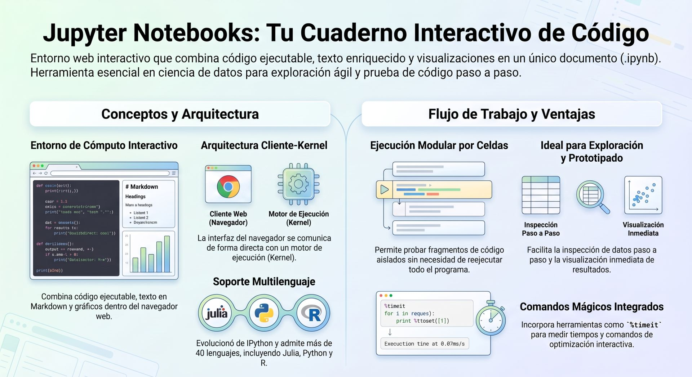
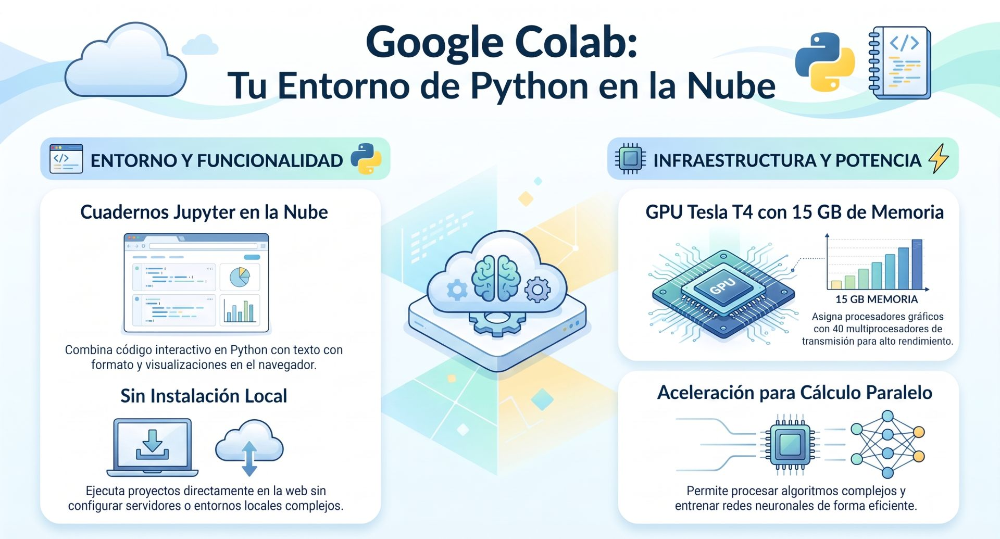
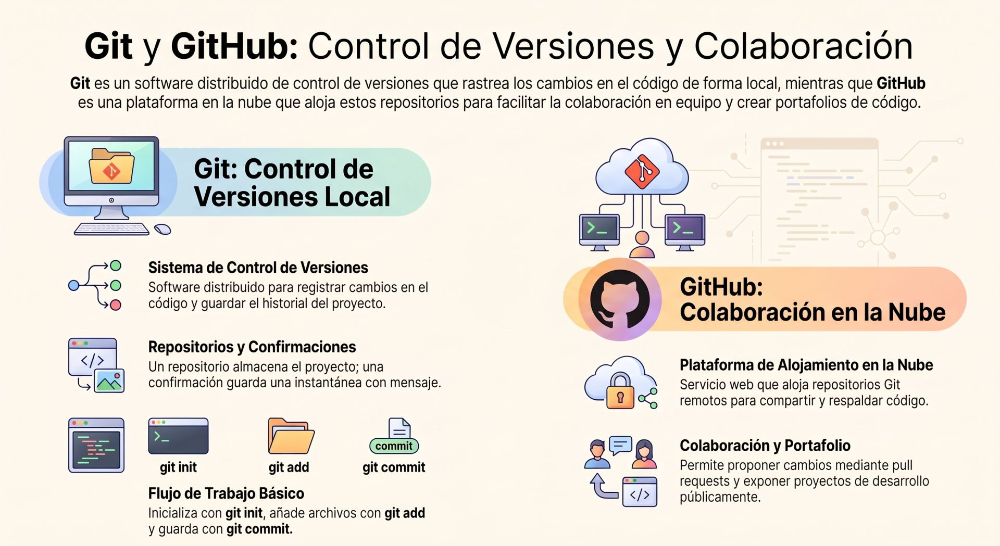
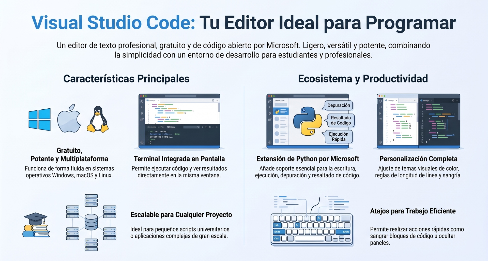

Para desarrollar programación se requiere utilizar herramientas de software para escribir el código, otras para evaluar el programa y su ejecución. En el caso de Python mostraremos los entornos más populares y mayormente utilizados. Comenzando por Google Colab, por su uso académico, hacia el más profesional Visual Studio Code.

## **Jupyter Notebooks**

:::info
https://jupyter.org/
:::

**Jupyter Notebook** es una aplicación web interactiva de código abierto que permite crear y compartir documentos dinámicos que combinan código ejecutable en Python, texto formateado (en Markdown o HTML), ecuaciones matemáticas (LaTeX) y visualizaciones de datos directamente en el navegador. 

El proyecto surgió originalmente en 2014 como una evolución y separación del entorno **IPython Notebook**. El nombre "Jupyter" hace referencia a los lenguajes principales para los que fue diseñado originalmente: **Ju**lia, **Py**thon y **R**, aunque en el caso de Python utiliza internamente el núcleo o *kernel* de IPython para procesar la ejecución.

### Principales características

1. **Estructura basada en celdas y ejecución modular:**
   * El código y el contenido se organizan en bloques individuales llamados **celdas** (de código o de texto/Markdown).
   * Cada celda de código se puede ejecutar de manera independiente, permitiendo probar pequeños fragmentos del programa sin necesidad de volver a correr todo el código desde el principio.

2. **Kernel interactivo y estado compartido:**
   * Todas las celdas de un mismo cuaderno comparten el mismo proceso activo de ejecución (*Python kernel*).
   * Las variables, funciones, datos importados o clases definidas en una celda previa permanecen disponibles en la memoria global para ser reutilizadas en celdas posteriores.

3. **Inspección paso a paso y prototipado rápido:**
   * Es una herramienta fundamental en ciencia de datos y computación científica porque facilita la exploración interactiva y la verificación inmediata de resultados.
   * Permite, por ejemplo, realizar la carga de datos masivos desde una base de datos en una celda inicial y experimentar de forma iterativa con la manipulación de esos datos en celdas posteriores sin tener que recargarlos en cada prueba.

4. **Integración con visualizaciones de datos e interfaces de Pandas:**
   * Muestra las salidas y resultados directamente debajo de la celda ejecutada.
   * Permite renderizar tablas formateadas de la librería **Pandas** (DataFrames) y gráficos estáticos e interactivos en línea con bibliotecas como **Matplotlib**, **Seaborn** o **Plotly**.

5. **Funcionalidades de desarrollo de IPython:**
   * Hereda capacidades avanzadas del shell de IPython, tales como:
     * **Autocompletado con la tecla TAB** para variables, objetos, métodos y rutas del sistema.
     * **Introspección de objetos** utilizando el signo `?` para consultar la documentación (*docstrings*) y firmas de funciones.
     * **Comandos mágicos** integrados (como `%timeit` para medir tiempos de ejecución de código, `%run` para ejecutar scripts o `%matplotlib inline` para integrar gráficos).

6. **Formato de documento enriquecido y portabilidad (`.ipynb`):**
   * Al guardar el cuaderno, genera un archivo con extensión `.ipynb` estructurado en formato JSON. Este archivo incluye tanto el código fuente como los textos explicativos, los gráficos generados y las salidas de ejecución previas, lo que facilita compartir investigaciones y reportes reproducibles.

7. **Diferenciación entre entorno de desarrollo y producción:**
   * Aunque es una herramienta óptima para la exploración, aprendizaje, prototipado y análisis visual, la literatura técnica aconseja no desplegar scripts de Jupyter directamente en entornos de producción intensivos de canalizaciones de datos (ETL), debido al consumo de memoria y procesamiento de su infraestructura interactiva.

---

## **Google Colab**

:::info
https://colab.research.google.com/
:::

Es el ambiente más simple para programar utilizando **Jupyter Notebooks**, con la cualidad de poder generar cuadernos (notebooks) para informes académicos.

**Google Colab** (Google Colaboratory) es un servicio alojado en la nube basado en **Jupyter Notebooks** que permite escribir, ejecutar y compartir código en Python directamente desde el navegador web, sin necesidad de realizar ninguna instalación o configuración local.

**Principales características destacadas:**
1. **Ejecución en la nube sin configuración (Zero Setup)**: No requiere instalar Python ni entornos virtuales en tu ordenador; el código se ejecuta sobre máquinas virtuales Linux efímeras alojadas en la infraestructura de Google.

2. **Acceso gratuito a GPU y TPU**: Permite seleccionar aceleradores de hardware como GPUs NVIDIA (por ejemplo, T4) o TPUs de forma gratuita, acelerando exponencialmente el procesamiento de algoritmos de Machine Learning y Deep Learning.

3. **Integración con Google Drive y colaboración en tiempo real**: Los cuadernos (`.ipynb`) se guardan directamente en tu cuenta de Drive y pueden compartirse, comentarse y coeditarse simultáneamente con otros usuarios, de manera similar a Google Docs.

4. **Librerías preinstaladas y consola shell**: Incluye preinstaladas las bibliotecas más populares de ciencia de datos e IA (Pandas, NumPy, TensorFlow, PyTorch, Scikit-Learn) y permite instalar paquetes adicionales o ejecutar comandos de consola Unix mediante el prefijo `!`.

5. **Asistencia con Inteligencia Artificial (Gemini)**: Incorpora herramientas avanzadas de IA generativa para autocompletado de código, sugerencias de refactorización, explicación de conceptos y depuración automática de errores directamente en las celdas del cuaderno.

***
## **GitHub**
:::info
https://github.com/
:::

**GitHub** es una plataforma basada en la nube que utiliza el sistema de control de versiones distribuido **Git** para alojar, gestionar y hacer seguimiento de proyectos de software. Funciona como el centro de colaboración más popular para desarrolladores a nivel mundial, organizando el código en **repositorios** ("repos") que guardan todo el historial de cambios, ramas de trabajo e incidencias.

---

### Principales características

#### 1. Control de versiones y respaldo continuo (Git Tracking)
* Permite registrar instantáneas (*commits*) del código a medida que evoluciona el proyecto.
* Si se comete un error o una actualización falla, es posible restaurar el programa a cualquier estado funcional previo.
* Sincroniza el código local con la nube ("push"), evitando pérdidas de trabajo y sirviendo como portafolio público o privado para desarrolladores.

#### 2. Colaboración y revisión de código (*Pull Requests*)
* Varios programadores pueden trabajar simultáneamente en diferentes características creando **ramas** (*branches*) separadas, sin sobreescribir el trabajo de los demás.
* Facilita la revisión de código mediante **Pull Requests**, donde el equipo discute, inspecciona y prueba los cambios antes de fusionarlos (*merge*) con la rama principal de producción.

#### 3. Integración con IDEs y entornos Python
* Entornos de desarrollo como **PyCharm** y **VS Code** se conectan directamente a GitHub ("Get from VCS" / "Clone").
* Permite clonar repositorios, crear ramas, realizar *commits* y subir cambios a la nube sin salir del editor de código.

#### 4. Automatización e Integración Continua (GitHub Actions y CI/CD)
* Mediante **GitHub Actions**, es posible configurar flujos de trabajo automatizados para ejecutar suites de pruebas unitarias (con `pytest` o `unittest`) cada vez que se sube un nuevo cambio.
* Detecta errores o fallos en las canalizaciones de datos y scripts de Python antes de que el código defectuoso llegue al entorno de producción.

#### 5. Hospedaje del ecosistema Open Source y distribución de paquetes
* Prácticamente todos los proyectos y librerías fundamentales del ecosistema Python (como el propio código fuente de **CPython**, **Pandas**, **NumPy**, **Django** o **Flask**) están alojados en GitHub.
* Permite instalar librerías o parches directamente desde repositorios de GitHub mediante `pip`, además de publicar paquetes en el registro oficial de **PyPI**.

#### 6. Interacción programática vía API REST
* La API de GitHub permite interactuar programáticamente desde scripts de Python usando módulos como `requests` para analizar repositorios populares, consultar métricas de desarrolladores o automatizar la recolección de datos.

***
## **Visual Studio Code**
:::info
https://code.visualstudio.com/
:::

**Visual Studio Code (VS Code)** es un editor de texto e IDE (Entorno de Desarrollo Integrado) ligero, gratuito, de código abierto y multiplataforma (compatible con Windows, macOS y Linux) desarrollado por Microsoft. Es uno de los entornos más populares tanto para principiantes como para desarrolladores profesionales gracias a su alto rendimiento, su diseño limpio y su extenso ecosistema de extensiones que permiten personalizarlo para cualquier lenguaje, especialmente **Python**.

### Principales características

#### 1. Extensión Oficial de Python e IntelliSense
* Al instalar la extensión oficial de Python para VS Code (desarrollada por Microsoft), el editor habilita autocompletado inteligente de código (**IntelliSense**), sugerencias de firmas de funciones, chequeo de tipos e introspección de objetos.
* Incluye **resaltado de sintaxis** que diferencia visualmente funciones, variables, cadenas de texto y palabras clave del lenguaje, ayudando a detectar errores de sintaxis al instante.

#### 2. Terminal Integrada e Intérprete Flexible
* Permite ejecutar scripts de Python (`python script.py`) directamente dentro de una ventana de terminal incrustada en el mismo editor, evitando la necesidad de cambiar a ventanas externas del sistema operativo.
* Detecta automáticamente todos los intérpretes y versiones de Python instalados en el sistema (así como entornos virtuales activos) y permite alternar entre ellos con un par de clics.

#### 3. Depuración Gráfica Interactiva (*Debugging*)
* Incluye un depurador gráfico completo que permite colocar puntos de interrupción (*breakpoints*) haciendo clic directamente en la línea de código deseada, avanzar paso a paso por la ejecución, inspeccionar el contenido de las variables y revisar la pila de llamadas (*call stack*).
* Permite personalizar perfiles de ejecución mediante el archivo de configuración `launch.json` o utilizar la consola de depuración (*Debug Console*) para probar expresiones sobre la marcha.

#### 4. Soporte Nativo para Jupyter Notebooks
* Ofrece una interfaz integrada para abrir, editar y ejecutar archivos `.ipynb` de **Jupyter Notebooks** directamente en el editor.
* Permite ejecutar celdas de código de forma independiente, visualizar tablas de datos (*DataFrames* de Pandas) y renderizar gráficos de bibliotecas como Matplotlib directamente debajo del bloque de código.

#### 5. Gestión de Entornos Virtuales y Calidad de Código (PEP 8)
* Facilita el trabajo con entornos virtuales (`venv`, `conda`, `poetry`), aislando las librerías instaladas por proyecto sin afectar el Python del sistema.
* Ofrece herramientas para el formato automático de código bajo las convenciones del estándar **PEP 8** (conversión automática de tabulaciones a 4 espacios y guías visuales para el límite de 79 caracteres por línea).

#### 6. Integración Nativa con Git y GitHub
* Cuenta con un panel lateral dedicado al control de versiones con **Git**, permitiendo revisar cambios, crear ramas (*branches*), hacer *commits* y gestionar repositorios remotos en **GitHub** de forma visual.

### Extensiones
Las extensiones claves para el desarrollo de programas en Python son entre otros:
- Jupyter (Microsoft)
- Pylance (Microsoft)
- Python (Microsoft)
- Python Debugger (Microsoft)
- PythonEnvironments (Microsoft)
- PostgreSQL (Microsoft)
- Latex (Mathematic Inc)
